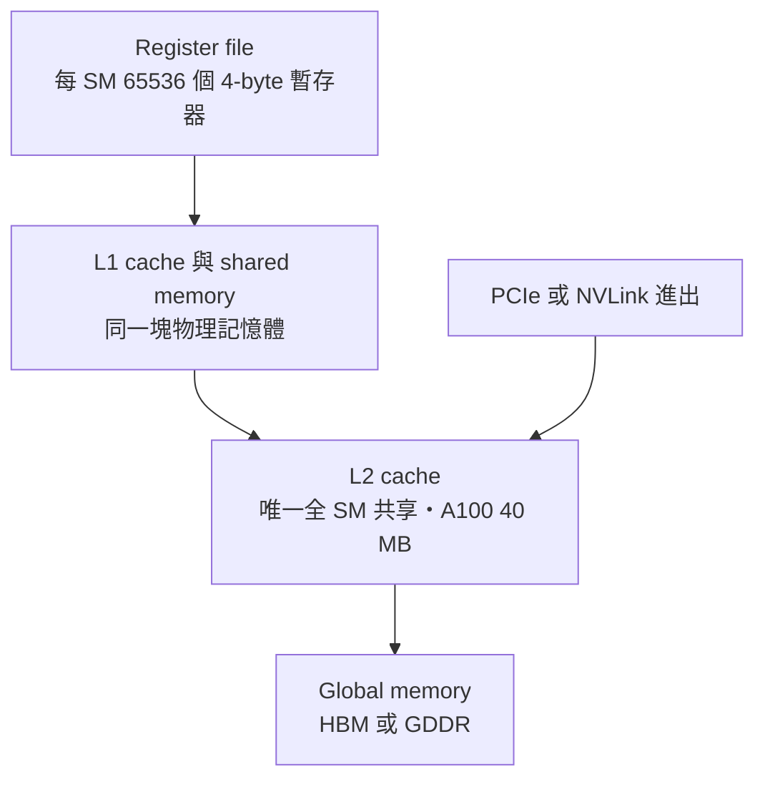
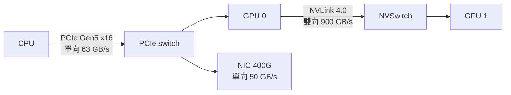
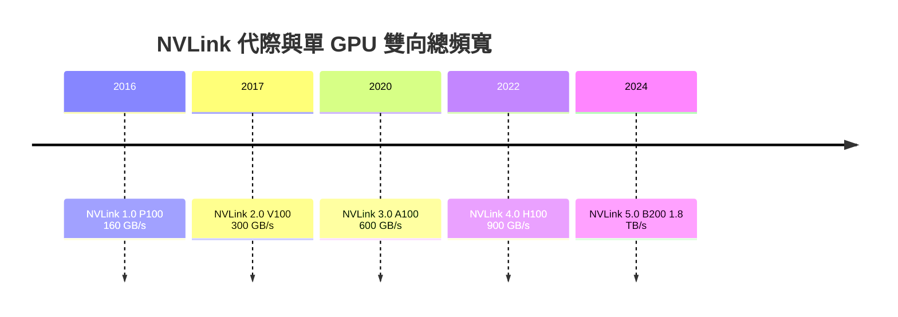
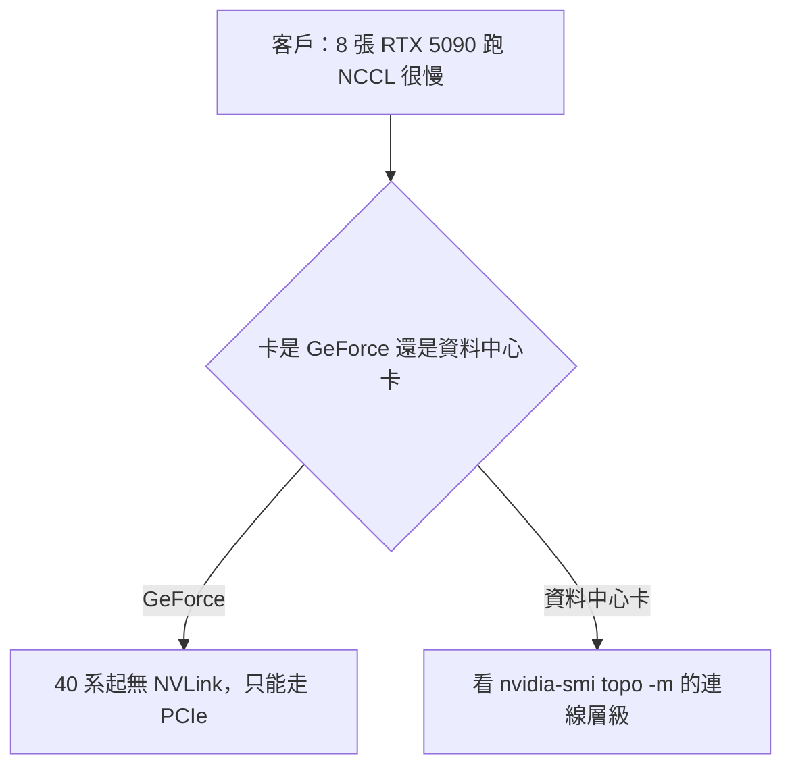

# 教學用視覺型錄（Mermaid 優先，GitHub 可渲染）

每份講義 1～3 張。先問「這張圖讓讀者看見什麼機制」，答不出來就不要畫。

## 安全語法（避免整張圖消失）

- 節點文字一律用 `["..."]` 包；文字內不要有 `(`、`)`、`/`、`#`、`"`；要換行用 `<br/>`。
- 只用 `flowchart LR`、`flowchart TD`、`sequenceDiagram`、`timeline`、`xychart-beta` 這幾種；`gantt` 與 `mindmap` 在部分渲染器不穩，不用。
- 一張圖節點 ≤ 12 個；超過就拆成兩張或改表格。
- 圖下一行用斜體寫「圖：…（來源 file:line）」。

## 型錄

### 1. 層級圖（誰包誰、由近到遠）

用途：記憶體層級、PCIe 拓撲、K8s 元件堆疊。



### 2. 資料路徑圖（資料怎麼走、每段頻寬）

用途：HGX 伺服器資料路徑、GPUDirect、PD 分離的 KV 傳輸。邊上標頻寬與口徑。



### 3. 代際時間線

用途：HBM、NVLink、PCIe 代際；每個節點帶一個關鍵數字。



### 4. 對比表（不要畫圖）

兩個以上方案、三個以上維度時，表格比圖清楚。欄位固定：維度、方案 A、方案 B、對客戶的意義。

### 5. 公式框

公式用 `text` 圍欄，變數逐一解釋，再代一組真實數字：

```text
PCIe 單向 GB/s = GT/s × 編碼效率 × lane 數 ÷ 8
Gen5 x16        = 32 × 0.985 × 16 ÷ 8 ≈ 63
```

### 6. 延遲階梯

用途：延遲金字塔、TTFT 拆解。用 `xychart-beta` 的長條，或直接用表格加量級欄。

### 7. 流程圖（情境 → 問診 → 結論）

用途：TAM 排障、客戶決策樹。菱形節點用 `{"..."}`。



## 嵌入 repo 既有圖片

可以用相對路徑嵌入上游文章的圖（如 `../../../01_hardware_architecture/nvidia/understand_gpu_architecture/img/GPUMemLevels.png`），圖下註明「圖片來源：<文章相對路徑>」。嵌入前用 `ls` 確認檔案存在。
