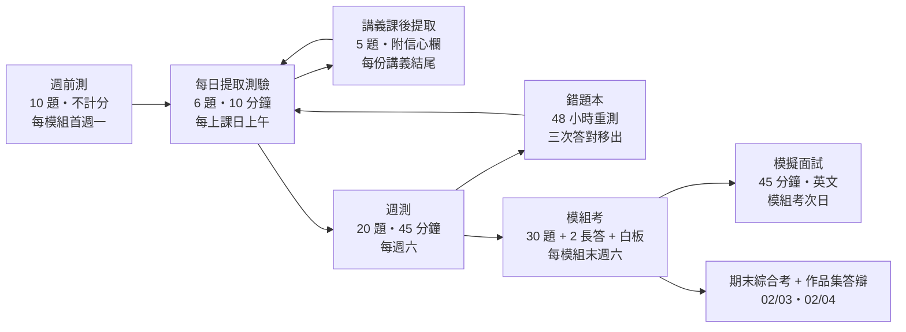

# 測驗規格：短期密集提取測驗的設計與組卷配方

> 本文件是 `retrieval-quiz-builder` 與 `course-handout-builder` 兩個 skill 出題時的依據，也是學習者自我施測的規則書。設計依據：《Make It Stick》（L1）的提取、間隔、交錯、生成、校準；《學生為什麼不喜歡上學？》（L2）的背景知識先於技能、具體先於抽象、記憶是思考的殘留物。

## 1. 測驗體系總覽



| 層級         | 目的（學習科學）                                 | 計分                   |
| ------------ | ------------------------------------------------ | ---------------------- |
| 週前測       | 生成效應：先嘗試再學，錯誤答案會變成學習的掛鉤   | 不計分，只記校準       |
| 每日提取測驗 | 提取練習 + 間隔：把昨天與更早的知識拉回來       | 完成率 + 校準，不計對錯 |
| 講義課後提取 | 當日鞏固，提供明日測驗的題源                     | 不計分                 |
| 週測         | 交錯：本週與前幾週混出，逼迫辨別「這題在考哪個」 | 正確率                 |
| 錯題本       | 校準：高信心錯題是最大的知識漏洞                 | 影響每日測驗的抽題     |
| 模組考       | 累積提取 + 口說輸出                              | 筆試 70% + 白板 30%    |
| 模擬面試     | 把知識轉成職缺語言，練習英文與故事結構           | 評分表                 |

## 2. 知識點（K 點）：所有測驗的最小單位

每份講義結尾列出 6～8 個「可測知識點」，編號格式 `WwwDdd-Kn`（例：`W01D02-K3`）。每個 K 點一行，包含：**可檢驗的陳述**、**來源 `file:line`**、**難度（1 事實 / 2 機制 / 3 應用 / 4 遷移）**、**適合的受眾口徑（CxO／工程師／TAM／Demo）**。

範例：

```text
W01D02-K3 | 難度 2 | HBM 以位寬換頻率：單堆疊 1024-bit、1.2～3.2 GHz；GDDR 相反，32-bit 介面、14～28 GHz | 01_hardware_architecture/performance/01_hbm_evolution.md:21-33 | 工程師、CxO（成本）
```

出題只能從 K 點清單與其來源文章取材。不在清單裡、來源查不到的事實不得入題。這條規則讓便宜模型也能安全出題：**只轉述，不創作事實**。

## 3. 題型（七種）與適用場合

| 代號 | 題型           | 寫法要求                                                                   | 適用層級         | 難度 |
| ---- | -------------- | -------------------------------------------------------------------------- | ---------------- | ---- |
| FR   | 自由回憶       | 「寫下你記得的 X 的三個要點」，不給選項，不給提示                           | 每日、週測       | 1～2 |
| SA   | 簡答           | 一到兩句話可答，答案唯一；問「為什麼」優於問「是什麼」                     | 全部             | 1～3 |
| CA   | 計算           | 給公式所需的數字，要求算出並寫單位與口徑；答案容許 ±5%                    | 每日、週測、模組考 | 2～3 |
| MT   | 配對／排序     | 代際、數字、產品配對，或層級由近到遠排序；項目 4～6 個                     | 每日、週測       | 1    |
| TJ   | 判斷並說理     | 一句常見說法，判斷對錯並一句話說為什麼；專門用來打常見誤區                   | 全部             | 2    |
| CX   | 客戶情境       | 150 字情境 + 客戶的一句話，要求給出 3～5 句回應；評「正確、受眾、結構」     | 週測、模組考、面試 | 3～4 |
| OR   | 口頭解釋       | 「用 60 秒對 [受眾] 解釋 X」，必須錄音；自評用 7.1 評分表                  | 每日最後一題、模組考 | 3   |

寫題禁忌（直接影響測驗效果）：

- **不出單純選擇題**。選擇題靠辨認即可答，提取量低；若要用選項，改成「以下哪個說法錯，為什麼」（TJ 變體）。
- **不在題幹洩漏答案**。「NVLink 5.0 的 1.8 TB/s 是雙向嗎？」洩漏了數字；改成「B200 單卡 NVLink 總頻寬是多少、是什麼口徑、怎麼算出來的？」
- **不出只能背誦年份的題**，除非年份本身是論點（如「NVLink 一年一代，紙本書跟不上」）。
- **每題只考一個 K 點**，但情境題可以同時用到多個。
- **口徑是題目的一部分**：涉及頻寬、顯存、算力的題，答案不寫口徑（單向／雙向、dense／sparsity、卡規格／可用值）就算半對。

## 4. 組卷配方

> **1 小時・Pre-sales 版（2026-11-11 起採用，優先於本節下文）**
>
> - **每日 6 題不變**，但第 6 題（OR）的受眾改為：一 客戶 CxO／採購、二 客戶工程師、三 自家業務（教業務怎麼講）、四 客戶反對意見（競品、價格）、五 面試官（英文）。
> - **週測 12 題、25 分鐘**：本週 6 題（FR 1、SA 1、CA 2、TJ 2）+ 前幾週 3 題（MT 1、SA 1、TJ 1）+ 遷移 1 題 + 客戶信 1 題（CX，100 字）+ 口說 1 題（OR，3 分鐘，對客戶工程師）。
> - **模組考 60 分鐘**：筆試 40 分鐘，20 題（本模組 14、前模組 6；FR 3、SA 7、CA 4、MT 2、TJ 3、CX 1）+ 1 題 200 字客戶情境長答；白板 20 分鐘（5 分鐘準備、10 分鐘講、5 分鐘自評）。
> - **模擬面試 30 分鐘**：自介 3 分鐘 → 技術 10 分鐘（3 題）→ Pre-sales 情境 12 分鐘（客戶需求訪談或 sizing 白板）→ 反問 2 分鐘 → 自評 3 分鐘。

### 4.1 每日提取測驗（6 題，10 分鐘）

| 題序 | 來源日                             | 題型建議 | 說明                                                          |
| ---- | ---------------------------------- | -------- | ------------------------------------------------------------- |
| 1～2 | D-1（昨天的講義）                   | FR、SA   | 第 1 題一定是自由回憶，先逼大腦自己拉                         |
| 3    | D-3                                | SA、CA   | 第一次間隔                                                    |
| 4    | D-7                                | MT、TJ   | 第二次間隔，優先挑上週答錯或低信心的 K 點                      |
| 5    | D-14 以上，或錯題本中「到期」的題    | 任意     | 若錯題本有到期題，優先出錯題本；否則抽前一模組                 |
| 6    | 本週任一 K 點                       | OR       | 受眾每天輪替：一 CxO、二 工程師、三 TAM 排障、四 Demo、五 面試官 |

模組首週的 D1 沒有 D-1，改做週前測（10 題涵蓋本週，不計分）。第 2 週起 D1 的第 1～2 題抽上週五的講義。

### 4.2 週測（20 題，45 分鐘，週六）

| 題數 | 來源                   | 題型                     |
| ---- | ---------------------- | ------------------------ |
| 10   | 本週五份講義各 2 題     | FR 2、SA 4、CA 2、TJ 2   |
| 6    | 前幾週（每週至少 1 題） | MT 2、SA 2、TJ 2         |
| 2    | 遷移應用               | 用本週知識解釋一個講義裡沒出現的新情境（如用 HBM 位寬邏輯解釋為什麼 NVLink 3.0 減信號對、加鏈路數） |
| 1    | 客戶信                 | CX：150 字回覆客戶 email |
| 1    | 口說                   | OR：3 分鐘工程師版       |

### 4.3 模組考（90 分鐘）

- 筆試 60 分鐘：30 題（本模組 20、前模組 10；題型比例 FR 4、SA 10、CA 6、MT 3、TJ 5、CX 2）+ 2 題長答（各 300 字，一題技術機制、一題客戶情境）。
- 白板 30 分鐘：從本模組 K 點中抽 1 題難度 3～4，先 10 分鐘準備、15 分鐘錄影講解（只能用白板或一張空白投影片）、5 分鐘自評。

### 4.4 模擬面試（45 分鐘，英文）

- 5 分鐘自我介紹（含「為什麼從現在的角色轉到這個職缺」）。
- 20 分鐘技術深度：從 `quizzes/interview_bank_*.md` 抽 4 題，面試官追問「為什麼」兩層。
- 15 分鐘職能情境：該職缺的典型情境（TMM 寫競品 FAQ、PMM 定位新品、Evangelist 10 分鐘 talk、TAM 處理升級）。
- 5 分鐘反問面試官。
- 自評或他評用 7.2 評分表。

### 4.5 間隔演算法（Leitner 盒）

```text
盒 1（每日）：新 K 點、答錯的 K 點
盒 2（3 天）：盒 1 中「答對且信心 ≥ 4」的 K 點
盒 3（7 天）：盒 2 中連續答對的 K 點
盒 4（21 天）：盒 3 中連續答對的 K 點；之後只在模組考與期末出現

降級規則：任何一次答錯 → 回盒 1；「答對但信心 ≤ 2」→ 停留原盒並加精緻化提問
```

每日測驗第 3～5 題就是從盒 2、盒 3、盒 4 到期的 K 點抽出。`retrieval-quiz-builder` 的 `scripts/build_schedule.py` 會依日期列出到期來源日與錯題本到期題。

## 5. 信心評分與校準

每題作答後、對答案前，填信心 1～5：

| 信心 | 意思                   |
| ---- | ---------------------- |
| 5    | 確定，可以教別人       |
| 4    | 相當確定               |
| 3    | 一半一半               |
| 2    | 大概猜的               |
| 1    | 完全不知道             |

對答案後，把每題歸入四格：

| 答對 × 高信心（4～5） | 答對 × 低信心（1～3）                      |
| --------------------- | ------------------------------------------ |
| 進下一盒             | 停留原盒，寫一句「為什麼對」（精緻化）     |
| **答錯 × 高信心**     | 答錯 × 低信心                              |
| **錯題本最高優先，48 小時內重測，並寫下「我當時為什麼覺得對」** | 錯題本，正常 48 小時重測 |

校準分數 = 1 − |平均信心/5 − 正確率|，每週算一次，寫進 [templates/weekly_review.md](templates/weekly_review.md)。校準持續高於 0.85 表示自我評估可信，可以放心把學習時間移到弱項。

## 6. 解答格式

每份測驗的解答放在同目錄 `answer_key.md`，每題：

```text
Q3 | K 點 W01D02-K3 | 題型 CA
參考答案：5 stacks × 1024 bits × 1.593 GHz × 2 (DDR) ÷ 8 = 2039 GB/s；口徑：A100-SXM4-80GB，HBM2e，廠商規格。
來源：01_hardware_architecture/performance/01_hbm_evolution.md:50-54
常見錯因：忘了 ×2（DDR）或忘了 ÷8（bit → byte）。
精緻化提問：為什麼 A100 選擇加一個堆疊（4 → 5）而不是把頻率再拉高？
```

## 7. 評分表

### 7.1 口說（OR）與白板講解

| 維度         | 3 分                                             | 1 分                                   |
| ------------ | ------------------------------------------------ | -------------------------------------- |
| 正確與口徑   | 無錯誤，數字帶口徑                               | 有一處概念錯或口徑混用                 |
| 受眾         | 用詞、深度、比喻符合指定受眾                     | 對 CxO 講 warp，對工程師講「很快很強」 |
| 結構         | 問題 → 機制 → 證據 → 下一步，時間控制在 ±10%     | 想到什麼說什麼，超時                   |
| 可信度       | 承認不確定處並說查證路徑                         | 不確定也硬講                           |

### 7.2 模擬面試

| 維度             | 權重 | 看什麼                                                                 |
| ---------------- | ---- | ---------------------------------------------------------------------- |
| 技術深度         | 35%  | 被追問兩層「為什麼」還能講到機制與數字                                 |
| 職能情境         | 30%  | 回答有該職缺的框架（PMM 用定位五要素、TAM 用現象→假設→診斷→溝通）     |
| 溝通與英文       | 20%  | 句子短、先結論、能切換受眾                                             |
| 故事與自我認知   | 15%  | 有 STAR 故事、能講自己的學習方法、能說「我不知道，但我會這樣查」        |

## 8. 檔案與命名

```text
00_study_plan/quizzes/
├── week01/
│   ├── README.md                 # 本週測驗清單與施測說明
│   ├── d01_pretest.md            # 週前測（模組首週）
│   ├── d02_quiz.md … d05_quiz.md # 每日提取測驗
│   ├── d06_weekly_quiz.md        # 週測
│   └── answer_key.md             # 全週解答（含 K 點、來源、錯因、精緻化提問）
├── week02/ …
├── module1_exam.md + module1_exam_key.md
├── interview_bank_module1.md … interview_bank_module4.md
└── error_log.md                  # 由 templates/error_log.md 複製，持續累積
```
