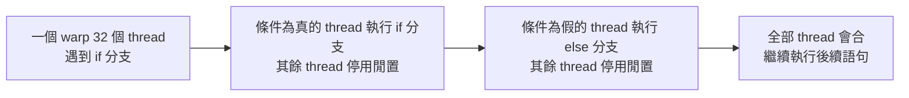
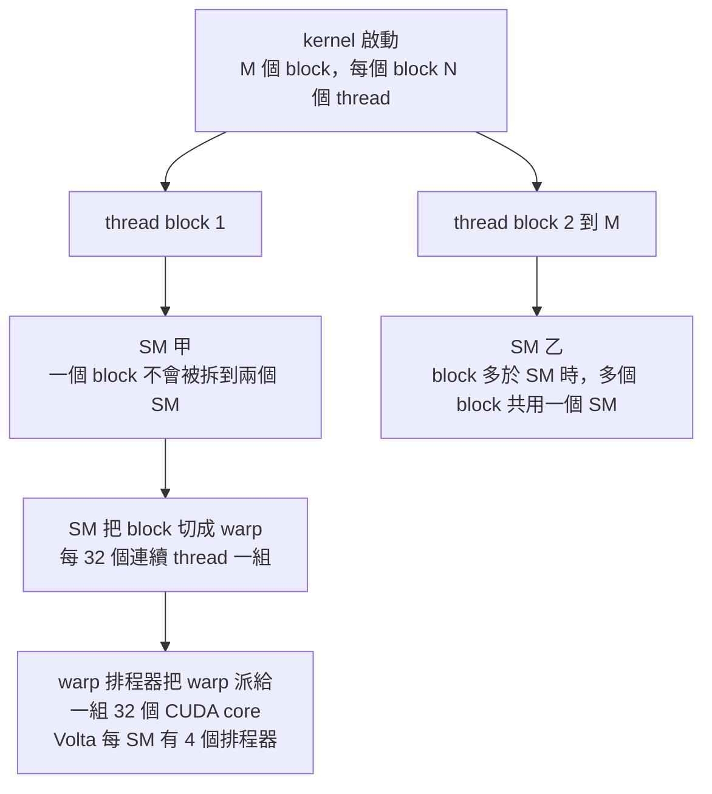

# W01D01｜GPU vs CPU：為什麼「5120 個核心」不等於 5120 個 CPU 核心

| 項目     | 內容                                                                                                                                                                                                 |
| -------- | ---------------------------------------------------------------------------------------------------------------------------------------------------------------------------------------------------- |
| 週／日   | 第 1 週・第 1 天（2026-11-16）                                                                                                                                                                         |
| 核心問題 | 為什麼 AI 需要 GPU？GPU 的「核心」、warp、SM 各對應到 CPU 的什麼？                                                                                                                                      |
| 預計時間 | 35 分鐘（1 小時版；讀法見表格下方） |
| 先修     | 無（本週第一天）                                                                                                                                                                                        |
| 來源文章 | [GPU 特性](../../../01_hardware_architecture/nvidia/understand_gpu_architecture/01_gpu_characteristics.md)、[A100 架構實例 §1](../../../01_hardware_architecture/nvidia/understand_gpu_architecture/07_a100_architecture.md)、[Device Query](../../../03_ai_cluster_ops/01_gpu_ops/01_device_query.md)（輔助） |
| 今日受眾 | 一 客戶 CxO／採購 |

> **35 分鐘讀法**：§0（3 分鐘）→ §1（3 分鐘）→ §2.1～2.3（10 分鐘；2.4～2.6 有空再讀）→ §3（5 分鐘）→ §5（7 分鐘）→ §7（7 分鐘）。本份是 70 分鐘版改寫前的範例，篇幅較長；從 W1D2 起的講義直接是 35 分鐘版。

## 0. 先想再讀（3 題，不要翻資料，各寫一兩句）

1. 為什麼同一個年代，GPU 的單精度峰值算力可以是伺服器 CPU 的好幾倍？晶片面積花到哪裡去了？
2. 一個 warp 是幾個 thread？為什麼偏偏是這個數？
3. 「GPU 的程式不能寫 if/else，因為所有核心只能做同一件事。」這句話對嗎？

## 1. 今天的情境

某製造業客戶的 IT 主管在會議上拿出兩張表。第一張是他們機房的 Intel Xeon Platinum 8280，單精度峰值 4.3 Tflop/s；第二張是業務送來的 Tesla V100 規格，單精度峰值 15.7 Tflop/s、CUDA cores 5120 個。

他說：「我算過了，V100 才快 3.6 倍左右。可是它有 5120 個核心，照核心數比，差距應該遠不只這樣。要嘛你們規格灌水，要嘛就是 GPU 的核心很爛。既然這樣，我多買幾台 CPU 伺服器不就好了？」

旁邊的資料科學家小聲說：「可是我們的模型在 GPU 上真的快很多啊……」

兩個人說的都有一部分對，但 IT 主管把「CUDA core」和「CPU core」當成同一種東西來比，結論就整個歪掉。今天要搞清楚的就是：GPU 的「核心」到底對應 CPU 的哪一層，以及 GPU 靠什麼機制把那 5120 個小單元餵飽。

## 2. 核心概念（具體 → 抽象）

### 2.1 晶體管花在哪裡：運算單元 vs 控制與快取

同年代的三顆晶片，單精度峰值：Xeon 8280 為 4.3 Tflop/s，Quadro RTX 5000 為 11.2 Tflop/s，V100 為 15.7 Tflop/s（`01_gpu_characteristics.md:99`）。下圖把晶體管分配抽象成色塊：綠色是運算、金色是指令處理、紫藍是快取。GPU 每一整排綠色小格只配一個金色控制格。


*圖片來源：`01_hardware_architecture/nvidia/understand_gpu_architecture/01_gpu_characteristics.md`（原圖取自 CUDA C++ Programming Guide v11.2）*

定義：GPU 把晶體管押在大量運算單元與高總記憶體頻寬；CPU 押在複雜指令處理、高時脈與較大的快取。代價是 GPU 只適合「可高度平行化」的工作負載（`01_gpu_characteristics.md:9-37`）。

### 2.2 CUDA core 不是 CPU core

V100 標 5120 個 CUDA cores，算法是 80 個 SM × 每 SM 64 個；A100 是 108 × 64 = 6912（`07_a100_architecture.md:11-15`）；Tesla T4 的 device query 輸出直接寫「2560（40 × 64）」（`01_device_query.md:52-55`）。

定義：一個 CUDA core 比較像 CPU 向量單元裡的一條 vector lane；真正對應 CPU core 的是 SM，對應 CPU 一條向量的是 warp（`01_gpu_characteristics.md:121`、`01_gpu_characteristics.md:129-135`）。這解開了情境裡的矛盾：該拿來和 CPU 核心數比的是 V100 的 80 個 SM，不是 5120。

### 2.3 Warp：32 個 thread 一組

一個有 256 個 thread 的 block，在執行時會被切成 256 ÷ 32 = 8 個 warp；每個 warp 由一組 32 個 CUDA cores 一起處理。對照 CPU：向量指令通常一次處理 8 或 16 個元素（`01_gpu_characteristics.md:121`）。

定義：warp 是 32 個「索引連續」的 thread，執行同一串指令、處理不同資料。為什麼是 32？因為 NVIDIA 硬體把 CUDA cores 固定分成 32 一組；記憶體端也配合：4-byte 運算元 × 32 = 128 bytes，正好是 GPU 的 cache line 大小（`01_gpu_characteristics.md:193-199`；`02_gpu_memory.md:28-30`）。和 2.2 相連：warp 之於 GPU，就像一條向量之於 CPU。

### 2.4 SIMT 與 warp divergence

同一個 warp 碰到 if/else：條件為真的 thread 先跑 if 分支，其他 thread 停用等待；接著換條件為假的 thread 跑 else 分支。結果正確，但兩條路是串行的。Volta 以前必須整段跑完才會合；V100 起可在中間點同步（`01_gpu_characteristics.md:151-171`）。



*圖：SIMT 下的分支是兩段串行，不是兩段平行（來源 `01_gpu_characteristics.md:147-153`）*

定義：SIMT 是放寬版的 SIMD。純 SIMD 一條指令以完全相同的方式作用於所有資料；SIMT 可以停用個別 thread，所以能處理分支，只是效率差（`01_gpu_characteristics.md:147-153`）。CPU 的遮罩向量指令也是同一個想法（`01_gpu_characteristics.md:173`）。

### 2.5 Kernel、block 與 SM

用 `fun<<<M, N>>>(x, y, z)` 啟動一個 kernel，就是要 M 個 block、每個 block N 個 thread（`01_gpu_characteristics.md:233`）。若 M = 1，不論卡上有 80 還是 108 個 SM，都只會有 1 個 SM 在工作。



*圖：軟體的 kernel、block 如何落到硬體的 SM 與 warp（來源 `01_gpu_characteristics.md:237-252`）*

定義：SM 是 CUDA cores 的硬體家，也擁有只供自己存取的暫存器、L1、shared memory；block 是分派到 SM 的最小單位。SM 數量依型號而異：V100 80、Quadro RTX 5000 48、A100 108（`01_gpu_characteristics.md:239`；`07_a100_architecture.md:9-13`）。

### 2.6 Compute capability：SM 的版本號

T4 的 device query 顯示 CUDA Capability 7.5（`01_device_query.md:53`）；A100 是 CC 8.0（`07_a100_architecture.md:3`）。主版本號代表核心架構：7 是 Volta、8 是 Ampere；Turing 是 7.5（`01_gpu_characteristics.md:261`），譯註補充 8.9 是 Ada、9.0 是 Hopper（`01_gpu_characteristics.md:265`）。和 2.5 相連：編譯時指定 `-arch=sm_80` 的程式不能在 CC 7.5 的卡上跑（`01_device_query.md:79`）。

## 3. 數字與口徑

| 項目 | 數值 | 單位 | 口徑（單向／雙向・dense／sparsity・卡規格／系統可用・廠商／實測・日期） | 來源 file:line |
| ---- | ---- | ---- | ---------------------------------------------------------------------- | -------------- |
| 單精度峰值：Xeon 8280／Quadro RTX 5000／V100 | 4.3／11.2／15.7 | Tflop/s | FP32 理論峰值（原文用「potentially」「might go as high as」），非實測；Cornell 教材的舉例年代，V100 所屬的 Longhorn 系統已退役 | 01_gpu_characteristics.md:99 |
| 單精度相對雙精度速度 | 約 2 | 倍 | 原文「often」，一般情況，非定律；各卡 FP64 比例待查：各型號官方 datasheet | 01_gpu_characteristics.md:55 |
| warp 大小 | 32 | threads | 所有 NVIDIA GPU 相同；硬體固定分組 | 01_gpu_characteristics.md:193-197；03_ai_cluster_ops/01_gpu_ops/01_device_query.md:83 |
| GPU cache line | 128 | bytes | 32 × 4-byte 運算元；以 V100 記憶體層級為例 | 02_gpu_memory.md:28-30 |
| CPU 向量寬度 | 8 或 16 | 元素 | 原文「typically」，依指令集而異 | 01_gpu_characteristics.md:121 |
| SM 數：V100／Quadro RTX 5000／A100／T4 | 80／48／108／40 | 個 | 卡規格；T4 為 device query 實機輸出 | 01_gpu_characteristics.md:239；07_a100_architecture.md:13；03_ai_cluster_ops/01_gpu_ops/01_device_query.md:54 |
| CUDA cores：V100／A100／T4 | 5120／6912／2560 | 個 | FP32 cores，= SM 數 × 64；A100 為 NVIDIA 資料表口徑（2020） | 07_a100_architecture.md:14-15；03_ai_cluster_ops/01_gpu_ops/01_device_query.md:55 |
| Volta 每 SM warp 排程器 | 4 | 個 | Volta 架構；其他架構待查：各代架構白皮書 | 01_gpu_characteristics.md:247 |
| Compute capability 主版本 | 7／7.5／8／8.9／9.0 | 版本號 | Volta／Turing／Ampere／Ada／Hopper；後兩者為譯註補充 | 01_gpu_characteristics.md:261-265 |

## 4. 常見誤區（3 條）

| 誤區 | 為什麼錯 | 正確說法 |
| ---- | -------- | -------- |
| 「V100 有 5120 個核心，等於 5120 個 CPU 核心」 | CUDA core 只是一條 vector lane，32 個一組才執行一條指令 | 和 CPU core 對應的是 SM：V100 是 80 個 SM（`01_gpu_characteristics.md:129-135`） |
| 「GPU 不能跑分支」或「GPU 分支沒有代價」 | SIMT 可停用個別 thread，所以能跑分支；但同一 warp 內兩路串行 | 分支可行但會讓部分 thread 閒置，應避免在 warp 內分歧（`01_gpu_characteristics.md:151-153,205`） |
| 「卡上有 108 個 SM，任何 kernel 都會用滿」 | block 不能跨 SM，用到的 SM 數最多等於 block 數 M | block 數要多於 SM 數，才可能把整張卡用滿（`01_gpu_characteristics.md:243`） |

## 5. Pre-sales 口徑

- **30 秒・客戶 CxO／採購版**：AI 的運算是同一個動作對海量資料重複做，GPU 就是為這種事情設計的：它把晶片面積幾乎都給了運算單元，控制邏輯很少。所以不能拿它的「核心數」去和 CPU 比；同年代的數字，一張 V100 的單精度峰值約是一顆 Xeon 8280 的 3.6 倍，而且只有能大量平行化的程式拿得到這個差距。對採購的意義是：先確認要跑的工作能不能平行化，能，就該買 GPU 伺服器；不能，多買 CPU 伺服器反而合理。
- **3 分鐘・客戶工程師版**：GPU 的執行模型是 SIMT。`fun<<<M, N>>>` 啟動 M 個 block，每個 block 只會落在一個 SM 上，SM 再把 block 切成 32 個連續 thread 的 warp，由一組 32 個 CUDA cores 執行；Volta 每個 SM 有 4 個 warp 排程器。所以 V100 的 5120 = 80 SM × 64，真正對應 CPU core 的是 SM。為什麼是 32：硬體分組是 32，cache line 也是 32 × 4 B = 128 B，一次正好餵滿一個 warp。邊界：warp 內若 if/else 分歧，兩路串行；M 小於 SM 數時整張卡用不滿。口徑：15.7 Tflop/s 是 FP32 理論峰值，不是實測。來源 `01_gpu_characteristics.md:191-252`。
- **配置建議**：今天的知識會影響兩件事。第一，**要不要上 GPU 伺服器**：看客戶的工作是不是大量重複的矩陣運算（模型訓練、推理），而不是分支很多的業務邏輯。混合需求時，可以建議業務系統留在 CPU 伺服器，模型放 GPU 伺服器。第二，**比較不同 GPU 時看什麼**：比 SM 數和對應精度的峰值算力，不要比 CUDA core 數（V100 80 個 SM、A100 108 個，`07_a100_architecture.md:13`）。另外，客戶如果要沿用舊卡或混用不同代的卡，要注意 compute capability：用 `-arch=sm_80` 編譯的程式不能在 CC 7.5 的卡上跑（`01_device_query.md:79`）。要再問客戶：「你們要跑的是模型訓練、推理，還是一般業務程式？現有程式是針對哪一代的卡編譯的？」
- **反對意見應對**：客戶說「V100 才快 3.6 倍，可是它有 5120 個核心，照核心數算應該更快，你們規格是不是灌水？」先認同：「您的算法沒錯，3.6 倍就是同年代 FP32 理論峰值的比值（`01_gpu_characteristics.md:99`）。」再補條件：「差別在於 5120 個 CUDA core 不是 5120 個 CPU 核心，它們比較像 80 個核心各自的 64 條運算通道；該拿來和 CPU 核心比的是 80 個 SM。而且峰值是理論值，程式能大量平行化才拿得到。」最後給可驗證的下一步：「我們拿您實際要跑的模型，在一台 GPU 伺服器上跑一次，和現有 CPU 伺服器比同一份工作的完成時間，用結果決定要買哪一種。」

## 6. 精緻化提問（寫下你的答案再往下）

1. 為什麼 warp 的大小、CUDA cores 的分組、cache line 的 128 bytes 都圍繞同一個數字 32？如果硬體改成 64 一組，哪些東西必須一起改？
2. 今天的 W01D01-K2（warp 為何是 32）和 W01D01-K4（block 不跨 SM）連起來，能不能解釋「一個 block 只有 16 個 thread」為什麼浪費？明天學到 register file 分 32 個 bank 時，再回來檢查這個答案。
3. 如果工作負載是大量互相依賴、分支很多的業務邏輯，而不是矩陣運算，第 1 節 IT 主管「多買 CPU 伺服器」的結論會怎麼變？

## 7. 課後提取測驗（閉卷，填信心 1～5）

| #   | 題型 | 題目 | 我的答案 | 信心 |
| --- | ---- | ---- | -------- | ---- |
| 1   | FR   | 寫下你記得的 GPU 與 CPU 在晶體管分配上的三個差異 |          |      |
| 2   | SA   | 為什麼 NVIDIA 把 thread 以 32 個一組打包成 warp？請給兩個理由 |          |      |
| 3   | CA   | A100 的 SM 數與 CUDA cores 總數各是多少、怎麼算？若以 `fun<<<64, 256>>>` 啟動 kernel，最多用到幾個 SM？每個 block 切成幾個 warp？ |          |      |
| 4   | TJ   | 「SIMT 和 SIMD 一樣，所以 GPU 程式裡的 if/else 兩個分支會同時平行執行。」判斷對錯並說理 |          |      |
| 5   | OR   | 用 60 秒對客戶的 CxO 或採購解釋：為什麼不能拿 GPU 的核心數去和 CPU 的核心數直接比 | （錄音檔名） |      |

## 8. 可測知識點（K 點）

```text
W01D01-K1 | 1 | GPU 的晶體管分配偏向大量運算單元與高總記憶體頻寬；CPU 偏向複雜指令處理、高時脈與大 cache | 01_hardware_architecture/nvidia/understand_gpu_architecture/01_gpu_characteristics.md:9-37 | CxO、工程師
W01D01-K2 | 2 | 一個 warp 是 32 個連續索引的 thread；原因是 NVIDIA 硬體把 CUDA cores 固定分成 32 一組，且 cache line 為 32 × 4 B = 128 B | 01_gpu_characteristics.md:191-200；02_gpu_memory.md:25-27 | 工程師
W01D01-K3 | 2 | SIMT 比 SIMD 多了「可停用個別 thread」，因此能處理分支；但 if/else 兩路會串行執行，非活動 thread 閒置（warp divergence） | 01_gpu_characteristics.md:145-160 | 工程師
W01D01-K4 | 2 | SM 是 CUDA cores 的硬體家；一個 thread block 不能跨 SM，block 多於 SM 時多個 block 共用一個 SM；Volta 每 SM 有 4 個 warp 排程器 | 01_gpu_characteristics.md:237-252 | 工程師
W01D01-K5 | 1 | SM 數量：V100 80、Quadro RTX 5000 48、A100 108 | 01_gpu_characteristics.md:239；07_a100_architecture.md:9-13 | 工程師
W01D01-K6 | 2 | CUDA cores 總數 = SM 數 × 每 SM cores：V100 80 × 64 = 5120；A100 108 × 64 = 6912 | 07_a100_architecture.md:11-14 | 工程師
W01D01-K7 | 3 | GPU 為「可高度平行化」的工作負載而生：圖中每一排運算單元只配一個控制單元；這是「為什麼不用多核 CPU 跑 AI」的答案核心 | 01_gpu_characteristics.md:33-37 | CxO
```

## 來源索引

| 檔案 | 用到的章節／行 | 關鍵內容 |
| ---- | -------------- | -------- |
| `01_hardware_architecture/nvidia/understand_gpu_architecture/01_gpu_characteristics.md` | 9-37、55、99、121-135、145-207、233-252、261-265 | GPU vs CPU 設計、峰值算力對比、術語對照表、SIMT、warp、kernel 與 SM、compute capability |
| `01_hardware_architecture/nvidia/understand_gpu_architecture/07_a100_architecture.md` | 3、9-15 | A100 CC 8.0、V100 對 A100 的 SM 數與 CUDA cores |
| `01_hardware_architecture/nvidia/understand_gpu_architecture/02_gpu_memory.md` | 28-30 | cache line = 32 × 4 B = 128 B |
| `03_ai_cluster_ops/01_gpu_ops/01_device_query.md` | 49-69、79-83 | T4 device query 輸出、SM 數與 warpSize 的意義 |

<details>
<summary>第 7 節參考答案</summary>

1. GPU 運算單元多、總記憶體頻寬高；CPU 指令處理更複雜、時脈更高、快取更多；GPU 每排運算單元只配一個控制單元，因此只適合可高度平行化的工作。來源 `01_gpu_characteristics.md:9-37`。常見錯因：只答「GPU 核心多」，漏掉控制與快取這一側。
2. 一，NVIDIA 硬體把 CUDA cores 固定分成 32 一組，切成同樣大小能簡化 SM 的排程；二，4-byte 運算元 × 32 = 128 B 正好是一條 cache line，一次餵滿一個 warp。來源 `01_gpu_characteristics.md:197-199`、`02_gpu_memory.md:28-30`。常見錯因：答「因為 32 是 2 的冪次」，這不是原文給的理由。
3. A100：108 SM × 64 = 6912 CUDA cores（FP32 cores，資料表口徑）；M = 64 小於 108，所以最多用到 64 個 SM；256 ÷ 32 = 8 個 warp。來源 `07_a100_architecture.md:13-15`、`01_gpu_characteristics.md:243-247`。常見錯因：以為 64 個 block 會被拆到 108 個 SM 上；block 不能跨 SM。
4. 錯。SIMT 比 SIMD 多了停用個別 thread 的能力，所以能處理分支；但同一 warp 內 if 與 else 是串行執行，非活動 thread 閒置。來源 `01_gpu_characteristics.md:147-153`。常見錯因：把「能處理分支」誤解成「分支免費」。
5. 評分看三點：有沒有避開 warp、SM 等詞；有沒有一個帶比較對象的量級（例如同年代 V100 單精度峰值約為 Xeon 8280 的 3.6 倍，理論峰值口徑）；有沒有落到決策（先看工作負載能否平行化）。來源 `01_gpu_characteristics.md:35-37,99`。自評用 `00_study_plan/02_assessment_spec.md` 第 7.1 節評分表。

</details>
