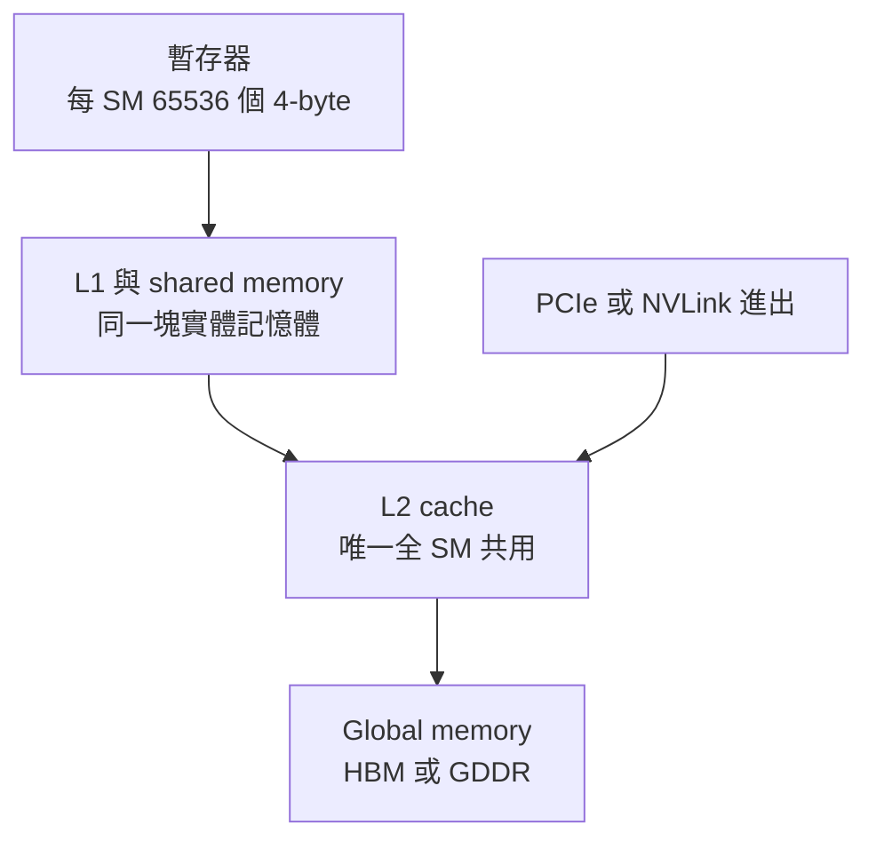

# W01D02｜GPU 記憶體與 HBM：為什麼顯存決定推理能跑多大

| 項目     | 內容                                                                                                                                                                                                 |
| -------- | ---------------------------------------------------------------------------------------------------------------------------------------------------------------------------------------------------- |
| 週／日   | 第 1 週・第 2 天（2026-11-17）                                                                                                                                                                         |
| 核心問題 | HBM 和 GDDR 差在哪？為什麼推理能跑多大，看的是顯存？                                                                                                                       |
| 預計時間 | 35 分鐘（含課後提取測驗）                                                                                                                                                                              |
| 先修     | W01D01-K2（warp 是 32 個 thread）                                                                                                                                                                       |
| 來源文章 | [GPU 記憶體](../../../01_hardware_architecture/nvidia/understand_gpu_architecture/02_gpu_memory.md)、[HBM 演進](../../../01_hardware_architecture/performance/01_hbm_evolution.md)、[顯存估算](../../../09_inference_system/memory_calc/memory_analysis.md)（只用權重公式一段） |
| 今日受眾 | 二 客戶工程師                                                                                                                                                                                           |

## 0. 先想再讀（3 題，不要翻資料，各寫一兩句）

1. 為什麼資料中心 GPU 用 HBM，遊戲卡用 GDDR？只是因為 HBM 比較快嗎？
2. 規格表寫 A100 顯存頻寬 2039 GB/s，你覺得實際程式能用到幾成？
3. 一個 70B 參數的模型用 FP16，光權重要多少 GB？一張 80 GB 的卡放得下嗎？

## 1. 今天的情境

韓國一家遊戲公司想做內部的 LLM 推理服務。IT 主管傳來一張比較表：RTX 5090 的 GDDR7 頻寬 1792 GB/s，A100 的 HBM2e 是 2039 GB/s，只差 14%。

他說：「頻寬差不多，價格差好幾倍。我們乾脆買一批 RTX 5090 的機器就好，你們為什麼一直推資料中心卡？」

他漏了東西。今天要弄清楚：頻寬數字怎麼來的，以及除了頻寬，客戶還該看什麼。

## 2. 核心概念（具體 → 抽象）

### 2.1 記憶體層級：越近越快、越小

V100 每個 SM 有 65536 個 4-byte 暫存器（`02_gpu_memory.md:13`）。往外依序是 L1／shared memory、全 SM 共用的 L2、HBM 或 GDDR 上的 global memory（`02_gpu_memory.md:36-75`）。PCIe 或 NVLink 進來的資料也先經過 L2（`02_gpu_memory.md:29-31`）。



*圖：由近到遠的 GPU 記憶體層級（來源 `02_gpu_memory.md:29-31,36-75`）*

定義：越近越快、越小；顯存最大、最慢，模型權重和 KV Cache 都住在這裡。

### 2.2 HBM 和 GDDR：兩條路線

A100 的 HBM2e 位寬 5120-bit、頻率 1593 MHz；RTX 5090 的 GDDR7 位寬 512-bit、頻率 14001 MHz（`01_hbm_evolution.md:76-77`）。一個靠路寬，一個靠車快。

定義：HBM 位寬優先，3D 堆疊加 Si interposer，約 3.5 pJ/bit；GDDR 頻率優先，平面排在 PCB 上，約 7 pJ/bit。消費卡用 GDDR 是為了成本（`01_hbm_evolution.md:21-34`）。

### 2.3 頻寬公式與代際

A100：5 × 1024 bits × 1.593 GHz × 2（DDR）÷ 8 = 2039 GB/s（`01_hbm_evolution.md:55`）。V100 到 A100 位寬 +25%、每 pin 資料率 +81%，相乘得 2.3 倍頻寬（`01_hbm_evolution.md:62-70`）。

定義：總頻寬 = 總位寬 × 每 pin 資料率 ÷ 8。規格表是理論峰值，A100 實測約到 71%（`01_hbm_evolution.md:79-80`）。

### 2.4 顯存容量決定「放不放得下」

權重記憶體 ≈ 參數量 × 每參數 bytes：FP16／BF16 為 2、INT8 為 1、INT4 為 0.5（`09_inference_system/memory_calc/memory_analysis.md:24-36`）。推理每一步都要讀一遍 KV Cache（`01_hbm_evolution.md:17`）。

定義：容量決定放不放得下，頻寬決定跑多快。

## 3. 數字與口徑

| 項目 | 數值 | 單位 | 口徑（單向／雙向・dense／sparsity・卡規格／系統可用・廠商／實測・日期） | 來源 file:line |
| ---- | ---- | ---- | ---------------------------------------------------------------------- | -------------- |
| 顯存總頻寬：V100／A100／H100／H200／B200 | 900／2039／3350／4800／8000 | GB/s | 理論峰值，各代代表 GPU 的實際配置 | 01_hbm_evolution.md:42-46 |
| 顯存容量：V100／A100／H100／H200／B200 | 32／80／80／141／192 | GB | 卡規格，文章所列版本；整機可用值待查：各機型 datasheet | 01_hbm_evolution.md:42-46 |
| RTX 5090 GDDR7 頻寬 | 1792 | GB/s | 理論峰值；容量待查：NVIDIA 產品頁 | 01_hbm_evolution.md:28 |
| A100 實測頻寬（1 GB 資料） | 約 1453／約 818 | GB/s | 實測：SM 讀寫 71%／copy engine 40%，repo 自帶 benchmark | 01_hbm_evolution.md:79-80 |
| 能耗 HBM／GDDR | 約 3.5／約 7 | pJ/bit | 文章概略值，非單一產品實測 | 01_hbm_evolution.md:29 |
| 每個參數的 bytes | 2／1／0.5 | bytes | FP16 或 BF16／INT8／INT4；量化的 metadata 未計入，實際略高 | memory_analysis.md:33-38 |

> 注意：同一張表的「每堆疊頻寬 × 堆疊數」不一定等於產品總頻寬（例如 V100 是 4 × 307 GB/s，但總頻寬寫 900 GB/s，`01_hbm_evolution.md:42`）。報價和簡報一律用產品規格表上的**總頻寬**；差異原因待查：各代官方 datasheet。

## 4. 常見誤區（3 條）

| 誤區 | 為什麼錯 | 正確說法 |
| ---- | -------- | -------- |
| 「RTX 5090 頻寬只比 A100 少 14%，推理就差不多」 | 窄位寬在讀 DRAM 時變瓶頸（`01_hbm_evolution.md:140`），容量也不同 | 同時看容量、頻寬和多卡互連 |
| 「算總頻寬時要再乘 2（DDR）」 | 每堆疊頻寬已經含 DDR，再乘一次會重複（`01_hbm_evolution.md:50`） | 用堆疊數 × 每堆疊頻寬，或總位寬 × 每 pin 資料率 ÷ 8 |
| 「規格表寫 2039 GB/s，程式就跑得到」 | 理論峰值；A100 實測約 71%（`01_hbm_evolution.md:79-80`） | 標明是理論值還是實測值 |

## 5. Pre-sales 口徑

- **30 秒・客戶 CxO／採購版**：推理服務能同時服務多少人、處理多長的文件，主要看顯存的容量和速度，不是算力。H200 對 H100，容量 141 對 80 GB（約 1.8 倍），速度 4.8 對 3.35 TB/s（約 1.4 倍）。同樣的服務可能少用幾張卡，所以差價要和省下的卡數一起算。
- **3 分鐘・客戶工程師版**：HBM 用位寬換頻率。A100：5 × 1024 × 1.593 GHz × 2 ÷ 8 = 2039 GB/s；RTX 5090 走 512-bit、14 GHz，理論 1792 GB/s。看起來接近，但 L2 沒命中要讀 DRAM 時，窄位寬馬上變瓶頸。LLM 推理每步都要讀 KV Cache，多半受頻寬限制。口徑：都是理論峰值，A100 實測約 71%。邊界：大矩陣乘這類高算術強度運算，頻寬不是瓶頸（`01_hbm_evolution.md:17`）。
- **配置建議**：先算放不放得下。70B 用 FP16 ≈ 140 GB：80 GB 的 A100、H100 單卡放不下；141 GB 的 H200 被權重塞滿、沒空間給 KV Cache，實務上要 2 張；192 GB 的 B200 單卡放得下還有餘裕。改 INT8 約 70 GB，80 GB 卡放得下但 KV 空間很少。要再問客戶：**哪個模型、什麼精度？同時幾人用、文件多長？** 後兩題決定 KV Cache 要留多少、要不要加卡。
- **反對意見應對**：客戶說「RTX 5090 頻寬跟 A100 差不多，便宜很多」。先認同：「理論頻寬只差 14%，您沒看錯。」再補條件：「差在容量和穩定的頻寬。模型放不下就要拆到很多張卡，效能和維運成本都會上去。」下一步：「拿您的模型和使用人數，兩種配置各算要幾張卡，用總成本比。」RTX 5090 的顯存容量 repo 沒寫，報價前查 NVIDIA 產品頁。

## 6. 精緻化提問（寫下你的答案再往下）

1. 為什麼 HBM 選擇「路很寬、車不快」，而不是像 GDDR 一樣拚頻率？和功耗有什麼關係？
2. 昨天的 W01D01-K2 說 warp 是 32 個 thread；今天的暫存器分 32 個 bank、cache line 是 32 × 4 B。這三個 32 怎麼連起來？
3. 如果客戶的工作是訓練，而不是推理，頻寬和容量哪一個比較關鍵？你會怎麼回答，還缺什麼資訊？

## 7. 課後提取測驗（閉卷，填信心 1～5）

| #   | 題型 | 題目 | 我的答案 | 信心 |
| --- | ---- | ---- | -------- | ---- |
| 1   | FR   | 寫出 GPU 記憶體由近到遠的四層，並指出哪一層是所有 SM 共用的 cache |          |      |
| 2   | SA   | HBM 和 GDDR 的設計路線各是什麼？為什麼消費卡用 GDDR？ |          |      |
| 3   | CA   | V100 的 HBM2 總位寬 4096-bit、每 pin 資料率 1.76 Gbps，用公式算出總頻寬，並說明這是什麼口徑 |          |      |
| 4   | TJ   | 「70B 模型用 FP16，一張 141 GB 的 H200 就夠了。」判斷對錯並說理 |          |      |
| 5   | OR   | 用 60 秒對客戶的工程師解釋：為什麼 RTX 5090 和 A100 理論頻寬接近，推理卻不能只看這個數字 | （錄音檔名） |      |

## 8. 可測知識點（K 點）

```text
W01D02-K1 | 1 | GPU 記憶體由近到遠：register file → L1／shared memory（同一塊物理記憶體）→ L2（唯一被所有 SM 共享的 cache）→ global memory（HBM 或 GDDR）；local、texture、constant 是 global 的特殊區域 | 02_gpu_memory.md:36-75 | 工程師
W01D02-K2 | 2 | L2 cache 位於資料經 PCIe／NVLink 進出 device 的路徑上，進來的資料先經 L2 再到 global memory | 02_gpu_memory.md:29-31,64 | 工程師
W01D02-K3 | 2 | HBM 位寬優先：單堆疊 1024-bit、1.2～3.2 GHz、3D 堆疊 + Si interposer、約 3.5 pJ/bit；GDDR 頻率優先：32-bit 介面、14～28 GHz、PCB 平面排布、約 7 pJ/bit；消費卡用 GDDR 是成本考量 | 01_hardware_architecture/performance/01_hbm_evolution.md:21-35 | CxO、工程師
W01D02-K4 | 1 | HBM 代際與代表 GPU：V100 HBM2 4 堆疊 900 GB/s；A100 HBM2e 5 堆疊 5120-bit 2039 GB/s；H100 HBM3 6 堆疊 3.35 TB/s；H200 HBM3e 8 堆疊 4.8 TB/s；B200 HBM3e 8 堆疊 8.0 TB/s | 01_hbm_evolution.md:38-47 | 工程師
W01D02-K5 | 3 | 總頻寬 = 堆疊數 × 每堆疊頻寬；A100：5 × 1024 bits × 1.593 GHz × 2（DDR）÷ 8 = 2039 GB/s | 01_hbm_evolution.md:50-56 | 工程師
W01D02-K6 | 2 | A100 對 V100：位寬 +25%（4 → 5 堆疊）、每 pin 數據率 +81%（1.76 → 3.19 Gbps/pin），相乘得 2.3× 頻寬；設計邏輯是「減少每鏈路信號線、增加鏈路數」，與 NVLink 3.0 一脈相承 | 01_hbm_evolution.md:58-70 | 工程師、CxO
W01D02-K7 | 1 | V100 每個 SM 有 65536 個 4-byte 暫存器；register file 分 32 個 bank 對應 warp 的 32 個 thread | 02_gpu_memory.md:9-11,48 | 工程師
W01D02-K8 | 2 | 權重記憶體 ≈ 參數量 × 每參數 bytes（FP16／BF16 2、INT8 1、INT4 0.5，未含量化 metadata）；70B FP16 ≈ 140 GB，80 GB 單卡放不下，141 GB 單卡被權重塞滿、沒有 KV Cache 空間 | 09_inference_system/memory_calc/memory_analysis.md:24-38；01_hbm_evolution.md:42-46 | 客戶工程師、CxO
```

## 來源索引

| 檔案 | 用到的章節／行 | 關鍵內容 |
| ---- | -------------- | -------- |
| `01_hardware_architecture/nvidia/understand_gpu_architecture/02_gpu_memory.md` | 9-31、36-75 | 記憶體層級、暫存器 32 bank、L2 位於資料進出路徑 |
| `01_hardware_architecture/performance/01_hbm_evolution.md` | 7-83、140 | HBM vs GDDR、代際表、頻寬公式、A100 實測、窄位寬瓶頸 |
| `09_inference_system/memory_calc/memory_analysis.md` | 24-38 | 權重記憶體 ≈ 參數量 × 每參數 bytes |

<details>
<summary>第 7 節參考答案</summary>

1. 暫存器 → L1／shared memory → L2 → global memory（HBM 或 GDDR）。L2 是唯一所有 SM 共用的 cache。K 點 W01D02-K1，來源 `02_gpu_memory.md:36-75`。常見錯因：把 shared memory 當成全卡共用。
2. HBM 位寬優先（1024-bit 起、3D 堆疊）；GDDR 頻率優先（32-bit 介面、14～28 GHz）。消費卡用 GDDR 是成本考量。K 點 W01D02-K3，來源 `01_hbm_evolution.md:21-34`。常見錯因：只答「HBM 比較快」。
3. 4096 × 1.76 ÷ 8 ≈ 901 GB/s，對應規格表的 900 GB/s；口徑是理論峰值。每 pin 資料率已含 DDR，不要再乘 2。K 點 W01D02-K5、K6，來源 `01_hbm_evolution.md:50,62-68`。常見錯因：多乘一次 2，算成約 1800 GB/s。
4. 錯。70 × 2 ≈ 140 GB，141 GB 只夠放權重，沒有空間給 KV Cache，實務上要 2 張，或改用較低精度。K 點 W01D02-K8，來源 `memory_analysis.md:24-38`、`01_hbm_evolution.md:45`。常見錯因：只比權重和容量，忘了 KV Cache。
5. 評分看三點：位寬 vs 頻率（5120-bit vs 512-bit）、容量與讀 DRAM 的瓶頸、標明理論峰值口徑。來源 `01_hbm_evolution.md:72-80,140`。自評用 `00_study_plan/02_assessment_spec.md` 第 7.1 節評分表。

</details>
