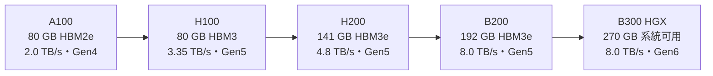
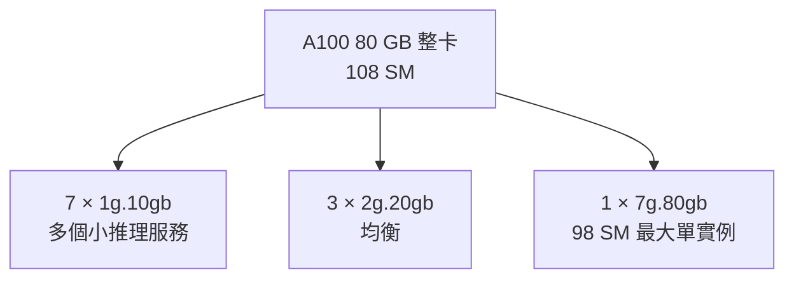

# W01D03｜GPU 代際與精度：A100 → H100 → B300，規格表上的哪個數字能拿去報價

| 項目     | 內容                                                                                                                                                                                                                                               |
| -------- | -------------------------------------------------------------------------------------------------------------------------------------------------------------------------------------------------------------------------------------------------- |
| 週／日   | 第 1 週・第 3 天（2026-11-18）                                                                                                                                                                                                                      |
| 核心問題 | 每一代資料中心 GPU 多了什麼？同一張卡為什麼會有好幾個「算力」和「顯存」數字？                                                                                                                                                                         |
| 預計時間 | 35 分鐘（含課後提取測驗）                                                                                                                                                                                                                           |
| 先修     | W01D01-K6（CUDA cores = SM × 每 SM cores）、W01D02-K4（HBM 代際）                                                                                                                                                                                    |
| 來源文章 | [A100 架構實例](../../../01_hardware_architecture/nvidia/understand_gpu_architecture/07_a100_architecture.md)、[PCIe & NVLink 頻寬速查表 §3](../../../01_hardware_architecture/performance/05_pcie_nvlink_speed_reference.md)、[GB300 NVL72 §1](../../../01_hardware_architecture/superchips/nvidia_gb300.md) |
| 今日受眾 | 三 自家業務（教業務怎麼講）                                                                                                                                                                                                                         |

## 0. 先想再讀（3 題，不要翻資料，各寫一兩句）

1. A100 推出時，NVIDIA 說訓練「不用改程式就能加速」。你猜它動了什麼手腳？
2. 同一張 A100，規格表上的 Tensor Core 算力為什麼會出現兩個差一倍的數字？
3. 「B300 每張 288 GB，8 張就有 2304 GB 可以放模型。」這句話對嗎？

## 1. 今天的情境

公司的韓國業務同事做了一份 HGX B300 八卡伺服器的提案。容量規劃頁寫著：「每卡 288 GB，共 2304 GB，可放下客戶的三個模型。」

客戶的工程師開機後跑 `nvidia-smi`，每張卡只看到約 270 GB。他寫信來問：「少了 18 GB × 8 = 144 GB，你們的規格是不是灌水？」

同事慌了，跑來問你。288 沒寫錯，270 也沒少給。今天要搞清楚：同一張卡的規格表上，哪個數字能拿去報價、哪個能拿去做容量規劃。

## 2. 核心概念（具體 → 抽象）

### 2.1 代際：每一代多了什麼

V100 到 A100：SM 80 → 108、L2 6 → 40 MB、顯存頻寬 900 → 2039 GB/s、PCIe Gen3 → Gen4，還新增了 MIG 和 2:4 稀疏（`07_a100_architecture.md:11-25`）。再往後，H100 換上 HBM3 和 PCIe Gen5，B300 走到 PCIe Gen6（`05_pcie_nvlink_speed_reference.md:52-56`）。



*圖：資料中心 GPU 顯存與 PCIe 代際（來源 `05_pcie_nvlink_speed_reference.md:52-56`）*

定義：每一代的主線是「顯存更大、更快，對外互連更寬」。看代際時，先看顯存，再看互連。

### 2.2 Tensor Core 精度：位元越少，吞吐越高

A100 的 FP32 是 19.5 TFLOPS。走 Tensor Core 時，TF32 是 8 倍（156）、FP16／BF16 是 16 倍（312）、INT8 是 32 倍、INT4 是 64 倍；FP64 反而只有 0.5 倍（`07_a100_architecture.md:63,77-86`）。

TF32 的做法是保留 FP32 的 8-bit 指數、尾數截成 10 bits，共 19 bits。數值範圍不變，所以訓練不必改程式（`07_a100_architecture.md:59-63`）。這就是第 0 節第 1 題的答案。

定義：精度越低，同一顆晶片能算的次數越多。挑精度，就是在「準確」和「快」之間取捨。

### 2.3 2:4 稀疏：規格表上那個「翻倍」的數字

每 4 個連續權重裡最多 2 個是 0，硬體跳過不算，有效吞吐翻倍（`07_a100_architecture.md:163-169`）。規格表常把這個翻倍後的數字寫在最前面。

定義：標「with sparsity」的算力要除以 2，才是一般模型的 dense 算力。

### 2.4 MIG：一張卡切成幾張小卡

A100-80GB 最多切 7 個 1g.10gb，每個約 14 個 SM、10 GB 顯存。各實例的 SM、顯存、L2 和頻寬都是專用的，互不搶（`07_a100_architecture.md:138-146`）。



*圖：A100 的 MIG 切法（來源 `07_a100_architecture.md:140-146`）*

定義：MIG 是給多租戶推理和隔離用的；訓練通常要整卡，不切（`07_a100_architecture.md:149`）。

### 2.5 卡規格 vs 系統可用

B300 的卡規格是 288 GB。裝進 HGX B300，每卡可用 270 GB；裝進 GB300 NVL72，每卡可用 279 GB。GB200 也有同樣的差距（192 對 186 GB）（`nvidia_gb300.md:33-37`、`05_pcie_nvlink_speed_reference.md:65`）。

定義：讀規格表、比代際，用卡規格；做容量規劃、算放不放得下，用系統可用值。

## 3. 數字與口徑

| 項目 | 數值 | 單位 | 口徑（單向／雙向・dense／sparsity・卡規格／系統可用・廠商／實測・日期） | 來源 file:line |
| ---- | ---- | ---- | ---------------------------------------------------------------------- | -------------- |
| SM 數量 V100／A100 | 80／108 | 個 | 卡規格，A100 資料表口徑（2020） | 07_a100_architecture.md:13 |
| L2 cache V100／A100 | 6／40 | MB | 卡規格 | 07_a100_architecture.md:18 |
| A100 FP32／TF32／FP16 | 19.5／156／312 | TFLOPS | A100-SXM4-80GB 資料表口徑，dense；帶 2:4 稀疏再翻倍 | 07_a100_architecture.md:63,77 |
| A100 精度倍數 TF32／FP16／INT8／INT4／FP64 | 8／16／32／64／0.5 | 倍（對 FP32） | dense，資料表折算 | 07_a100_architecture.md:79-86 |
| A100 MIG 最多實例 | 7 | 個 | 1g.10gb，每個約 14 SM、10 GB | 07_a100_architecture.md:138-142 |
| 顯存 H100／H200／B200 | 80／141／192 | GB | 卡規格 | 05_pcie_nvlink_speed_reference.md:53-55 |
| B300 顯存 | 288／270／279 | GB | 卡規格（官方部落格）／HGX B300 系統可用／GB300 NVL72 系統可用；後兩者為 preliminary | nvidia_gb300.md:33-37 |
| GB200 → GB300 FP4 算力（每 GPU） | 9 → 15 | PFLOPS | 廠商口徑；dense 或 sparsity 待查：NVIDIA Blackwell Ultra datasheet | nvidia_gb300.md:29 |
| GB200 → GB300 每 GPU 網路 | 400 → 800 | Gb/s | 網卡規格 CX-7 → CX-8，Gb/s 是 bit | nvidia_gb300.md:30 |
| H100 各精度 Tensor Core 算力 | — | TFLOPS | 待查：repo 未列；查 NVIDIA H100 datasheet，並確認 dense 或 sparsity | — |

## 4. 常見誤區（3 條）

| 誤區 | 為什麼錯 | 正確說法 |
| ---- | -------- | -------- |
| 「B300 每卡 288 GB，容量規劃就用 288」 | 288 是卡規格；HGX 系統每卡可用 270 GB（`nvidia_gb300.md:33-37`） | 規劃用 270（HGX）或 279（NVL72），並說明是 preliminary |
| 「規格表最大的那個 TFLOPS 就是實際算力」 | 常是 with sparsity 口徑，2:4 稀疏才翻倍（`07_a100_architecture.md:77`） | 先問是 dense 還是 sparsity，一般模型用 dense |
| 「MIG 切成 7 份，加起來還是整張卡」 | 最大的 7g.80gb 實例只有 98 SM，整卡是 108 SM（`07_a100_architecture.md:145-146`） | MIG 換來的是隔離，不是多出算力 |

## 5. Pre-sales 口徑

- **30 秒・客戶 CxO／採購版**：每一代新卡主要多了兩樣：記憶體更大、更快，以及能用更省的數字格式來算。B200 的記憶體是 A100 的 2.4 倍（192 對 80 GB）。比價時要確認對方報的是哪種口徑：最大的那個算力數字通常要打對折，記憶體也要看裝進整機後的可用量。
- **3 分鐘・客戶工程師版**：A100 的 Tensor Core 以 FP32 19.5 TFLOPS 為基準，TF32 156、FP16／BF16 312，都是 dense；開 2:4 稀疏再翻倍。TF32 是 19-bit，保留 FP32 的指數範圍，所以訓練程式不必改。顯存方面，B300 卡規格 288 GB，HGX B300 每卡可用 270 GB，屬 preliminary，正式值以出貨韌體為準。來源：`07_a100_architecture.md:57-86`、`nvidia_gb300.md:33-37`。
- **配置建議**：客戶要在 HGX B300 八卡上放幾個模型，容量就用 8 × 270 = 2160 GB 算，不是 2304 GB，而且要扣掉 KV Cache 的空間。如果客戶要同時跑很多個小推理服務，可以提 MIG 的切法，讓每個服務有專用的顯存和算力。要再問客戶：**每個模型多大、用什麼精度？是要一個大模型獨佔，還是很多小服務共用？**
- **反對意見應對**：客戶說「你們寫 288 GB，我只看到 270 GB，灌水」。先認同：「您看到的 270 是對的。」再補口徑：「288 是 GPU 本身的規格，裝進 HGX 系統後每卡可用 270 GB，NVIDIA 自己也是分兩欄列，GB200 一樣有這個差距。」下一步：「我們把容量規劃頁改成用 270 重算，連同 KV Cache 一起列給您確認。」

## 6. 精緻化提問（寫下你的答案再往下）

1. 為什麼 TF32 選擇保留 FP32 的 8-bit 指數、而犧牲尾數？反過來做會出什麼問題？
2. 昨天的 W01D02-K8 算過 70B FP16 ≈ 140 GB。今天學了系統可用值，用 HGX B300 跑同一個模型，一張卡放得下嗎？還剩多少給 KV Cache？
3. 如果客戶只跑訓練、不做多租戶，MIG 對他還有意義嗎？什麼情況下會改變答案？

## 7. 課後提取測驗（閉卷，填信心 1～5）

| #   | 題型 | 題目 | 我的答案 | 信心 |
| --- | ---- | ---- | -------- | ---- |
| 1   | FR   | 列出 A100 相對 V100 的四項主要升級，至少一項要帶數字 |          |      |
| 2   | SA   | TF32 是怎麼組成的？為什麼訓練不必改程式？ |          |      |
| 3   | CA   | A100 FP32 為 19.5 TFLOPS。算出 INT8 的 dense 與 with sparsity 算力，並標明口徑 |          |      |
| 4   | TJ   | 「HGX B300 八卡共有 2304 GB 可用顯存。」判斷對錯並說理 |          |      |
| 5   | OR   | 用 60 秒教自家業務同事：客戶問「為什麼我只看到 270 GB」時，該怎麼回答 | （錄音檔名） |      |

## 8. 可測知識點（K 點）

```text
W01D03-K1 | 1 | A100 對 V100：SM 108 vs 80、L2 40 MB vs 6 MB、80 GB HBM2e 2039 GB/s、NVLink 12 × 25 = 600 GB/s、PCIe Gen4、TSMC 7nm、新增 MIG 與 2:4 結構化稀疏 | 07_a100_architecture.md:9-27 | 工程師
W01D03-K2 | 2 | TF32 = FP32 的 8-bit 指數 + FP16 的 10-bit 尾數 = 19 bits；數值範圍同 FP32、尾數截斷；訓練不必改 code；Tensor Core 吞吐為 FP16 的一半（156 vs 312 TFLOPS） | 07_a100_architecture.md:57-63 | 工程師、TAM
W01D03-K3 | 2 | A100 精度矩陣（相對 FP32 19.5 TFLOPS）：TF32 8×、FP16/BF16 16×、INT8 32×、INT4 64×、FP64 0.5×；帶 2:4 稀疏時 Tensor Core 各精度再翻倍 | 07_a100_architecture.md:75-88 | 工程師、PMM
W01D03-K4 | 3 | MIG 把一張 A100 切成最多 7 個實例，每個有專屬 SM、顯存、L2 與頻寬（如 7 × 1g.10gb、3 × 2g.20gb、1 × 7g.80gb）；適用多租戶推理與 CI/CD 隔離，訓練通常不用 | 07_a100_architecture.md:136-150 | TAM、CxO
W01D03-K5 | 1 | 主流資料中心 GPU 規格：H100 80 GB HBM3 3.35 TB/s、PCIe Gen5、NVLink 4.0 900 GB/s；H200 141 GB HBM3e 4.8 TB/s；B200 192 GB HBM3e 8.0 TB/s、NVLink 5.0 1.8 TB/s；B300（HGX）270 GB 可用、PCIe Gen6 | 01_hardware_architecture/performance/05_pcie_nvlink_speed_reference.md:48-62 | 工程師、PMM
W01D03-K6 | 3 | B300 顯存有三個數：卡規格 288 GB（官方博客口徑）、HGX B300 系統可用 270 GB、GB300 NVL72 系統可用 279 GB；讀規格表用 288，做容量規劃用 270／279，不可混用 | 05_pcie_nvlink_speed_reference.md:66-68；01_hardware_architecture/superchips/nvidia_gb300.md:33-39 | TMM、TAM
W01D03-K7 | 1 | GB300 對 GB200：FP4 算力 15 vs 9 PFLOPS（+66%）、每 GPU 網路 800 vs 400 Gb/s（CX-8 vs CX-7）、CPU-GPU NVLink-C2C 同為 900 GB/s | nvidia_gb300.md:25-31 | PMM
W01D03-K8 | 1 | 消費級 GeForce RTX 不支援 NVLink（40 系起全面移除）；只有資料中心 GPU 提供 | 05_pcie_nvlink_speed_reference.md:64 | TAM、業務
```

## 來源索引

| 檔案 | 用到的章節／行 | 關鍵內容 |
| ---- | -------------- | -------- |
| `01_hardware_architecture/nvidia/understand_gpu_architecture/07_a100_architecture.md` | 9-27、57-86、136-169 | V100 對 A100 規格、TF32、精度矩陣、MIG、2:4 稀疏 |
| `01_hardware_architecture/performance/05_pcie_nvlink_speed_reference.md` | 46-65 | 主流 GPU 顯存與互連規格表、消費卡無 NVLink、B300 卡規格與系統可用 |
| `01_hardware_architecture/superchips/nvidia_gb300.md` | 25-37 | GB300 對 GB200、B300 顯存三個口徑 |

<details>
<summary>第 7 節參考答案</summary>

1. 任四項：SM 80 → 108；L2 6 → 40 MB；顯存 2039 GB/s（V100 為 900）；NVLink 300 → 600 GB/s；PCIe Gen3 → Gen4；新增 MIG、2:4 稀疏、TF32。K 點 W01D03-K1，來源 `07_a100_architecture.md:11-25`。常見錯因：只寫「更快」，沒有數字。
2. FP32 的 8-bit 指數 + FP16 的 10-bit 尾數 = 19 bits。數值範圍和 FP32 一樣，不會溢位；尾數截斷對訓練收斂影響不大，輸入維持 FP32 即可。K 點 W01D03-K2，來源 `07_a100_architecture.md:59-63`。常見錯因：說成「TF32 是 32-bit」。
3. INT8 = 19.5 × 32 = 624 TOPS（dense）；with sparsity 再翻倍為 1248 TOPS。口徑：A100-SXM4-80GB 資料表折算，dense 與 sparsity 要分開標。K 點 W01D03-K3，來源 `07_a100_architecture.md:77-84`。常見錯因：沒標口徑，或把 sparsity 數字當成一般模型的算力。
4. 錯。288 GB 是卡規格；HGX B300 每卡系統可用 270 GB，八卡是 2160 GB，而且屬 preliminary，還要扣掉 KV Cache。K 點 W01D03-K6，來源 `nvidia_gb300.md:33-37`。常見錯因：把卡規格直接乘張數。
5. 評分看三點：先認同客戶看到的數字、說清楚「卡規格 vs 系統可用」並舉 GB200 192 對 186 GB 的同樣差距、給出下一步（用 270 重算容量）。來源 `nvidia_gb300.md:33-37`。自評用 `00_study_plan/02_assessment_spec.md` 第 7.1 節評分表。

</details>
