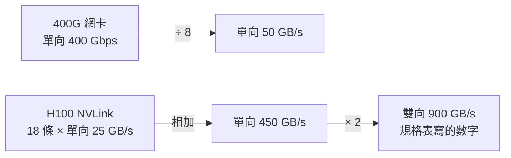

# W01D04｜規格表素養：Gbps 和 GB/s、單向和雙向，一個數字要問清楚四件事

| 項目     | 內容                                                                                                                                                                                         |
| -------- | -------------------------------------------------------------------------------------------------------------------------------------------------------------------------------------------- |
| 週／日   | 第 1 週・第 4 天（2026-11-19）                                                                                                                                                                |
| 核心問題 | 兩份報價的頻寬數字怎麼比？一個數字要先確認哪些口徑，才能拿來比？                                                                                                                                 |
| 預計時間 | 35 分鐘（含課後提取測驗）                                                                                                                                                                     |
| 先修     | W01D02-K5（HBM 頻寬公式）、W01D03-K3（精度矩陣與 2:4 稀疏）                                                                                                                                     |
| 來源文章 | [NVLink 技術入門 §2.2、§5](../../../01_hardware_architecture/nvlink/nvlink_intro.md)、[PCIe & NVLink 頻寬速查表 §1、§2、§6、§7](../../../01_hardware_architecture/performance/05_pcie_nvlink_speed_reference.md) |
| 今日受眾 | 四 客戶反對意見（競品、價格）                                                                                                                                                                  |

## 0. 先想再讀（3 題，不要翻資料，各寫一兩句）

1. 一張 400G 的網卡，每秒最多能送出多少 GB 的資料？
2. NVIDIA 說 B200 的 NVLink 是 1.8 TB/s。這是「送出去」的速度，還是「送加收」的速度？
3. 「PCIe 5.0 x16 是 128 GB/s。」另一份文件寫 126 GB/s。哪個錯了？

## 1. 今天的情境

韓國一家研究機構的採購同時收到兩份八卡伺服器報價。

競品報的是 PCIe 版 GPU，規格頁寫著「每卡配一張 400G 網卡，8 張共 3200G」。你們報的是 HGX H100，寫「NVLink 900 GB/s」。

採購打電話來：「人家 3200，你們 900，對方快了三倍多，還比較便宜。你們要怎麼解釋？」

他把網路的 Gbps 和 NVLink 的 GB/s 放在一起比，單位、方向、用途全都不同。今天要學會：拿到一個頻寬數字，先問清楚哪四件事。

## 2. 核心概念（具體 → 抽象）

### 2.1 Bit 還是 Byte：先除以 8

400G 網卡的意思是單向 400 Gbps。除以 8 是 50 GB/s（`nvlink_intro.md:187-189`）。網路廠商習慣用 Gbps，而且講的是單向；系統匯流排習慣用 GB/s，而且常講雙向總和（`nvlink_intro.md:190-192`）。

定義：看到小寫 b（bit）先除以 8，再確認是單向還是雙向。

### 2.2 NVLink 的數字怎麼來：鏈路數 × 單向 × 2

B200 有 18 條 NVLink，每條單向 50 GB/s：18 × 50 × 2 = 1.8 TB/s，是**雙向總和**（`nvlink_intro.md:195-201`）。H100 是 18 × 25 × 2 = 900 GB/s（`nvlink_intro.md:59`）。



*圖：把兩種數字換成同一口徑（來源 `nvlink_intro.md:187-201`、`nvlink_intro.md:59`）*

定義：NVLink 總雙向頻寬 = 單鏈路單向頻寬 × 2 × 鏈路數（`nvlink_intro.md:66`）。

### 2.3 PCIe 的數字怎麼來：還要扣編碼

PCIe Gen5 x16 單向 = 32 GT/s × 0.985 × 16 ÷ 8 ≈ 63 GB/s，雙向約 126 GB/s（`05_pcie_nvlink_speed_reference.md:17,120`）。0.985 是 Gen3～5 的 128b/130b 編碼效率；Gen6 起改用 PAM-4 + FLIT，效率約 0.945（`05_pcie_nvlink_speed_reference.md:9`）。

NVLink 文章寫 PCIe 5.0 x16 雙向 128 GB/s，是沒扣編碼的算法（`nvlink_intro.md:67`）。兩邊都沒錯，差在口徑。

定義：PCIe 單向頻寬 = GT/s × 編碼效率 × lane 數 ÷ 8。

### 2.4 算力也有口徑：dense 還是 sparsity

昨天學過，2:4 稀疏讓 Tensor Core 有效吞吐翻倍（`07_a100_architecture.md:77`）。規格表若寫「with sparsity」，一般模型要除以 2 才是 dense 算力。

定義：比算力前，先確認兩邊都是 dense，或都是 sparsity。

### 2.5 不同種類的頻寬不能直接比

HBM 頻寬是 GPU 和自己顯存之間的「近存頻寬」；PCIe、NVLink 是晶片和晶片之間的「片間頻寬」（`05_pcie_nvlink_speed_reference.md:46`）。H100 顯存 3.35 TB/s，NVLink 900 GB/s，比較兩者沒有意義。

定義：比頻寬前，先確認是同一段路。

## 3. 數字與口徑

| 項目 | 數值 | 單位 | 口徑（單向／雙向・dense／sparsity・卡規格／系統可用・廠商／實測・日期） | 來源 file:line |
| ---- | ---- | ---- | ---------------------------------------------------------------------- | -------------- |
| 400G 網卡 | 400／50 | Gbps／GB/s | 單向；網路視角 | nvlink_intro.md:187-189 |
| NVLink 4.0（H100） | 18 × 25 = 450／900 | GB/s | 單向／雙向總和，每 GPU | nvlink_intro.md:59 |
| NVLink 5.0（B200） | 18 × 50 = 900／1800 | GB/s | 單向／雙向總和，每 GPU | nvlink_intro.md:195-201 |
| NVLink 6.0（Rubin） | 3.6／3.0 | TB/s | 雙向；GTC 2025 宣傳口徑／NVIDIA 官網口徑，2026-11 核對 | 05_pcie_nvlink_speed_reference.md:38 |
| PCIe Gen5 x16 | 約 63／約 126 | GB/s | 單向／雙向；已扣 128b/130b 編碼 | 05_pcie_nvlink_speed_reference.md:17 |
| PCIe Gen5 x16 | 128 | GB/s | 雙向；未扣編碼 | nvlink_intro.md:67 |
| PCIe 編碼效率 Gen3～5／Gen6～7 | 約 0.985／約 0.945 | 比例 | 128b/130b／PAM-4 + FLIT | 05_pcie_nvlink_speed_reference.md:9 |
| NVLink 4.0 對 PCIe Gen5 x16 | 7.1 | 倍 | 兩邊都是 x16 雙向 | 05_pcie_nvlink_speed_reference.md:131 |

## 4. 常見誤區（3 條）

| 誤區 | 為什麼錯 | 正確說法 |
| ---- | -------- | -------- |
| 「400G 網卡比 NVLink 的 900 快一半」 | 400 是 Gbps 單向，換算只有 50 GB/s；900 是 GB/s 雙向（`nvlink_intro.md:187-192`） | 先換成同單位、同方向再比 |
| 「128 和 126 GB/s，一定有一個寫錯」 | 一個沒扣編碼、一個扣了 128b/130b（`nvlink_intro.md:67`、`05_pcie_nvlink_speed_reference.md:17`） | 引用時標明是否計入編碼效率 |
| 「8 張網卡加起來 3200G，就比 NVLink 快」 | 網卡是伺服器之間的路，NVLink 是伺服器內 GPU 之間的路，兩段不能互換（`nvlink_intro.md:219-227`） | 先確認比的是同一段資料路徑 |

## 5. Pre-sales 口徑

- **30 秒・客戶 CxO／採購版**：兩份報價的數字單位不同。網卡寫的 400G 是「位元」，換成和 NVLink 一樣的「位元組」要除以 8；而且網卡算一個方向，NVLink 算兩個方向。換成同一把尺，一張卡的 NVLink 大約是一張 400G 網卡的 9 倍。更重要的是，這兩條路負責的是不同的事，不能互相取代。
- **3 分鐘・客戶工程師版**：400G 網卡單向 400 Gbps = 50 GB/s，雙向 100 GB/s。H100 NVLink 4.0 是 18 條 × 單向 25 GB/s × 2 = 900 GB/s 雙向，單向 450 GB/s。所以同口徑下是 900 對 100，9 倍。對照 PCIe Gen5 x16，單向約 63 GB/s（32 × 0.985 × 16 ÷ 8），雙向約 126 GB/s；NVLink 4.0 是它的 7.1 倍。網卡走 scale-out，NVLink 走 scale-up。張量並行每層都要 all-reduce，走的是 NVLink 這段。來源：`nvlink_intro.md:183-201`、`05_pcie_nvlink_speed_reference.md:17,131`。
- **配置建議**：客戶如果要做張量並行，或模型大到一張卡放不下，選 SXM 加 NVLink 的機型（HGX），不選 PCIe 版。如果只是單卡推理、資料並行，PCIe 版可以省錢，但網卡數量和速率要依叢集規模另外算。要再問客戶：**模型會不會拆到多張卡上？要不要跨伺服器做訓練？**
- **反對意見應對**：客戶說「對方 3200，你們 900，人家快三倍還比較便宜」。先認同：「對方的網卡配置確實很完整，8 張 400G 在叢集裡是需要的。」再補口徑：「3200 是 Gbps 單向，換成 GB/s 是 400；我們的 900 是一張 GPU 的 NVLink 雙向。而且兩條路負責的事不同，網卡我們也一樣有配。」下一步：「把兩份報價換成同一口徑，做一張對照表給您，連同資料走的路徑一起標。」

## 6. 精緻化提問（寫下你的答案再往下）

1. 為什麼網路廠商習慣講單向 Gbps，系統匯流排廠商習慣講雙向 GB/s？各自對誰有利？
2. W01D02-K5 的 HBM 公式也有一個 ÷ 8 和一個 × 2。和今天 NVLink 公式的 ÷ 8、× 2，意思一樣嗎？
3. 如果 NVIDIA 官網把 NVLink 6.0 從 3.6 改成 3.0 TB/s，你已經交出去的簡報該怎麼處理？

## 7. 課後提取測驗（閉卷，填信心 1～5）

| #   | 題型 | 題目 | 我的答案 | 信心 |
| --- | ---- | ---- | -------- | ---- |
| 1   | FR   | 看到一個頻寬數字，要先確認哪四件事？ |          |      |
| 2   | SA   | 為什麼 PCIe 5.0 x16 雙向有人寫 126、有人寫 128 GB/s？ |          |      |
| 3   | CA   | 用公式算出 B200 的 NVLink 雙向總頻寬，並說明每個數字的意思 |          |      |
| 4   | TJ   | 「規格表寫 A100 INT8 是 1248 TOPS，所以我們的量化模型就能跑到這個速度。」判斷對錯並說理 |          |      |
| 5   | OR   | 客戶說「對方網卡 3200G，你們 NVLink 才 900」，用 60 秒回應 | （錄音檔名） |      |

## 8. 可測知識點（K 點）

```text
W01D04-K1 | 2 | 網路視角用 Gbps 且常指單向（400G NIC = 單向 400 Gbps = 50 GB/s）；系統總線視角用 GB/s 且常指雙向總和 | 01_hardware_architecture/nvlink/nvlink_intro.md:183-190 | 全部
W01D04-K2 | 3 | B200 標稱 1.8 TB/s 是單 GPU 雙向總頻寬 = 18 links × 50 GB/s 單向 × 2 | nvlink_intro.md:192-199 | 工程師、TMM
W01D04-K3 | 1 | NVLink 代際：1.0 P100 4 × 20 = 160 GB/s；2.0 V100 6 × 25 = 300；3.0 A100 12 × 25 = 600；4.0 H100 18 × 25 = 900；5.0 B200 18 × 50 = 1.8 TB/s；6.0 Rubin 3.6 TB/s（GTC 2025 口徑；官網 2026-11 為 3.0 TB/s） | 05_pcie_nvlink_speed_reference.md:25-42 | 工程師
W01D04-K4 | 3 | PCIe 單向頻寬 = GT/s × 編碼效率 × lane 數 ÷ 8；Gen3～5 用 128b/130b（≈0.985），Gen6／7 用 PAM-4 + FLIT（≈0.945）；Gen5 x16 單向 ≈ 63 GB/s、雙向 ≈ 126 GB/s | 05_pcie_nvlink_speed_reference.md:7-23,106-122 | 工程師、TAM
W01D04-K5 | 4 | 同一個 PCIe 5.0 x16 雙向，速查表寫 ~126 GB/s（計編碼效率）、NVLink 文寫 128 GB/s（未計）；差異來自口徑，不是誰錯，引用時要標明 | 05_pcie_nvlink_speed_reference.md:17；nvlink_intro.md:66 | TMM
W01D04-K6 | 2 | 規格表上的 Tensor Core 算力常標「with sparsity」（2:4 結構化稀疏），dense 口徑要除以 2 | 07_a100_architecture.md:75-77,161-173 | TMM、PMM
W01D04-K7 | 2 | HBM 頻寬是「近存頻寬」（near-memory），PCIe／NVLink 是「片間頻寬」，兩者量級不同、不可直接比較 | 05_pcie_nvlink_speed_reference.md:46 | 工程師
W01D04-K8 | 3 | 任何數字標來源與日期；同一規格可能有宣傳口徑與官網口徑之差（NVLink 6.0 3.6 vs 3.0 TB/s、NVL72 域 260 vs 216 TB/s） | 05_pcie_nvlink_speed_reference.md:40-42 | TMM、PMM
```

## 來源索引

| 檔案 | 用到的章節／行 | 關鍵內容 |
| ---- | -------------- | -------- |
| `01_hardware_architecture/nvlink/nvlink_intro.md` | 52-67、183-201、217-228 | NVLink 代際表與公式、bit vs byte、單向 vs 雙向、何時需要 NVLink |
| `01_hardware_architecture/performance/05_pcie_nvlink_speed_reference.md` | 7-38、46、106-133 | PCIe 公式與編碼效率、NVLink 雙口徑、近存 vs 片間、NVLink 對 PCIe 倍數 |
| `01_hardware_architecture/nvidia/understand_gpu_architecture/07_a100_architecture.md` | 75-86、161-169 | 精度矩陣、2:4 稀疏翻倍 |

<details>
<summary>第 7 節參考答案</summary>

1. 四件事：bit 還是 byte（Gbps 或 GB/s）；單向還是雙向；dense 還是 sparsity（算力）；卡規格還是系統可用、廠商還是實測、哪一天的口徑。K 點 W01D04-K1、K6、K8，來源 `nvlink_intro.md:183-192`、`05_pcie_nvlink_speed_reference.md:38`。常見錯因：只記得 bit 和 byte。
2. 126 扣了 128b/130b 編碼效率（32 × 0.985 × 16 ÷ 8 × 2）；128 沒扣（32 × 16 ÷ 8 × 2）。兩邊都對，差在口徑。K 點 W01D04-K4、K5，來源 `05_pcie_nvlink_speed_reference.md:17`、`nvlink_intro.md:67`。常見錯因：直接判定其中一個寫錯。
3. 18 條鏈路 × 每條單向 50 GB/s × 2（雙向）= 1800 GB/s = 1.8 TB/s；這是單一 GPU 的雙向總頻寬。K 點 W01D04-K2，來源 `nvlink_intro.md:195-201`。常見錯因：漏掉 × 2，算成 900 GB/s。
4. 錯。1248 TOPS 是 with sparsity 口徑（19.5 × 32 × 2），只有權重符合 2:4 稀疏才拿得到；一般量化模型看 dense 的 624 TOPS，而且這是理論峰值。K 點 W01D04-K6，來源 `07_a100_architecture.md:77-84,163-169`。常見錯因：把規格表最大的數字當成實際速度。
5. 評分看三點：先認同對方網卡配置合理；換成同口徑（3200 Gbps = 400 GB/s 單向，對 NVLink 4.0 單向 450、雙向 900 GB/s）並說明兩段路用途不同；給出下一步（同口徑對照表）。來源 `nvlink_intro.md:183-201,217-228`。自評用 `00_study_plan/02_assessment_spec.md` 第 7.1 節評分表。

</details>
