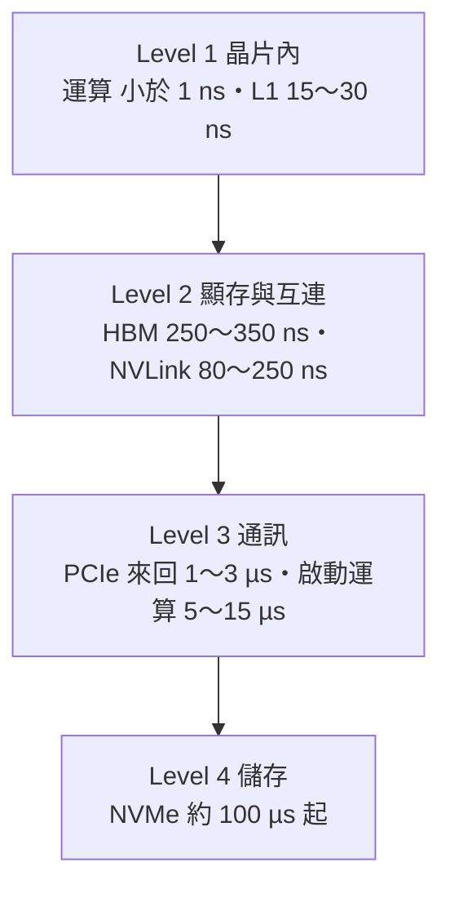
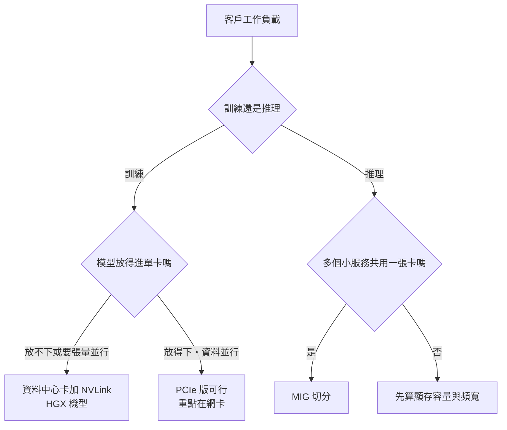

# W01D05｜情境整合：訓練還是推理、要不要 NVLink、消費卡能不能用

| 項目     | 內容                                                                                                                                                                                                                                                                       |
| -------- | -------------------------------------------------------------------------------------------------------------------------------------------------------------------------------------------------------------------------------------------------------------------------- |
| 週／日   | 第 1 週・第 5 天（2026-11-20）                                                                                                                                                                                                                                              |
| 核心問題 | 拿到一個客戶需求，怎麼從工作負載倒推出卡型、互連和切分方式？                                                                                                                                                                                                                   |
| 預計時間 | 35 分鐘（含課後提取測驗）                                                                                                                                                                                                                                                   |
| 先修     | W01D02-K8（權重記憶體估算）、W01D03-K4（MIG）、W01D04-K1（Gbps 與 GB/s）                                                                                                                                                                                                       |
| 來源文章 | [AI 基礎設施延遲金字塔 §1～§4](../../../01_hardware_architecture/performance/ai_latency_pyramid.md)、[NVLink 技術入門 §5.3](../../../01_hardware_architecture/nvlink/nvlink_intro.md)、[KV Cache 第 1 講課綱（重點難點表）](../../../10_ai_related_course/kv_cache_course/01-kv-cache-basics/syllabus.md) |
| 今日受眾 | 五 面試官（英文）                                                                                                                                                                                                                                                           |

## 0. 先想再讀（3 題，不要翻資料，各寫一兩句）

1. GPU 讀自己的顯存，和透過 PCIe 跟 CPU 來回一趟，你猜差幾倍？
2. 推理服務變慢時，你會先懷疑算力不夠，還是顯存頻寬不夠？為什麼？
3. 「八張 RTX 5090 用 NVLink 串起來，就能當小型訓練叢集。」這句話對嗎？

## 1. 今天的情境

首爾一家 AI 新創寄來一封需求信，裡面有兩件事：

1. 想用八張 RTX 5090 微調一個 70B 模型，打算「用 NVLink 把八張卡串起來做張量並行」。
2. 另外想在一張 A100 上同時跑七個客戶的小模型推理服務，「但不希望客戶之間互相拖慢」。

老闆要你拿這封信當面試考題。你得先答得出來：第一件有硬傷，第二件有現成解法。

## 2. 核心概念（具體 → 抽象）

### 2.1 延遲量級：每往外一層，慢一到兩個數量級

GPU 算一次乘加不到 1 ns；讀 L1 要 15～30 ns；讀 HBM 要 250～350 ns；經 NVLink 到隔壁 GPU 要 80～250 ns；經 PCIe 跟 CPU 來回一趟要 1～3 µs；CPU 叫 GPU 開始一段運算要 5～15 µs（`ai_latency_pyramid.md:118-126`）。

速記：1 ns ≈ 1 公尺。讀 HBM 是繞社區半圈，跟 CPU 來回一趟是跑步去鄰村（`ai_latency_pyramid.md:17,34,42`）。



*圖：延遲金字塔四層（來源 `ai_latency_pyramid.md:19-55,118-130`）*

定義：每跨一層，延遲增加約 1～2 個數量級；設計的目標是讓資料留在前兩層（`ai_latency_pyramid.md:156-157`）。

### 2.2 傳輸時間 = 延遲 + 大小 ÷ 頻寬

經 PCIe Gen5 x16（單向約 63 GB/s）搬 1 KB：約 2 µs，延遲說了算；搬 1 GB：約 16 ms，頻寬說了算。

定義：小資料看延遲，大資料看頻寬（`ai_latency_pyramid.md:138-140`）。

### 2.3 訓練和推理，瓶頸不一樣

推理的 decode 在典型小 batch、長上下文下受顯存頻寬限制，batch 很大才可能轉成受算力限制（`10_ai_related_course/kv_cache_course/01-kv-cache-basics/syllabus.md:51`）。訓練大模型做張量並行，每層都要 all-reduce，對卡間頻寬和延遲很敏感（`nvlink_intro.md:222-224`）。

定義：推理先問「放得下、讀得快嗎」，訓練先問「卡和卡之間夠快嗎」。

### 2.4 什麼時候一定要 NVLink

一定要：模型超過單卡顯存、張量並行、MoE 的 all-to-all。可以不用：單卡推理、資料並行（瓶頸在伺服器之間的網路）、小模型 LoRA 微調（`nvlink_intro.md:221-228`）。

GeForce RTX 從 40 系起全面拿掉 NVLink，RTX 5090 只有 32 GB GDDR7（`05_pcie_nvlink_speed_reference.md:57,61`）。

定義：情境第 1 件事的硬傷：RTX 5090 沒有 NVLink，八張卡之間只能走 PCIe。

### 2.5 多租戶推理用 MIG

一張 A100-80GB 可切成 7 個 1g.10gb，各有專用的 SM、顯存、L2 和頻寬，服務之間不互搶（`07_a100_architecture.md:138-149`）。這是情境第 2 件事的解法。



*圖：從工作負載倒推配置（來源 `nvlink_intro.md:217-228`、`07_a100_architecture.md:149`）*

## 3. 數字與口徑

| 項目 | 數值 | 單位 | 口徑（單向／雙向・dense／sparsity・卡規格／系統可用・廠商／實測・日期） | 來源 file:line |
| ---- | ---- | ---- | ---------------------------------------------------------------------- | -------------- |
| 運算／L1／HBM | 小於 1／15～30／250～350 | ns | 典型熱路徑估算，H100／A100 環境 | ai_latency_pyramid.md:120-122 |
| NVLink GPU 對 GPU | 80～250 | ns | 估算；直連 80～120，經 NVSwitch 150～250 | ai_latency_pyramid.md:82-83 |
| PCIe 來回／啟動一段 GPU 運算 | 1～3／5～15 | µs | 估算，含驅動與 CPU 互動 | ai_latency_pyramid.md:124-126 |
| 跨機對機內通訊延遲 | 10～100 | 倍 | 估算，IB NDR 網路對 NVLink | ai_latency_pyramid.md:101 |
| RTX 5090 顯存 | 32 | GB | 卡規格，GDDR7，1.79 TB/s，無 NVLink | 05_pcie_nvlink_speed_reference.md:57 |
| L40S 顯存 | 48 | GB | 卡規格，GDDR6，864 GB/s，無 NVLink | 05_pcie_nvlink_speed_reference.md:58 |
| A100-80GB MIG 最小實例 | 10 | GB | 1g.10gb，最多 7 個，每個約 14 SM | 07_a100_architecture.md:142 |
| PCIe Gen5 x16 | 約 63 | GB/s | 單向，已扣編碼 | 05_pcie_nvlink_speed_reference.md:17 |

## 4. 常見誤區（3 條）

| 誤區 | 為什麼錯 | 正確說法 |
| ---- | -------- | -------- |
| 「推理慢，就換算力更高的卡」 | 典型小 batch 的 decode 受顯存頻寬限制（`10_ai_related_course/kv_cache_course/01-kv-cache-basics/syllabus.md:51`） | 先看顯存容量和頻寬，再看算力 |
| 「八張 RTX 5090 用 NVLink 串起來做張量並行」 | GeForce 40 系起沒有 NVLink（`05_pcie_nvlink_speed_reference.md:61`） | 張量並行要資料中心卡加 NVLink |
| 「HBM 頻寬那麼大，讀顯存一定很快」 | 頻寬大不代表延遲低；HBM3 讀取仍要 250～350 ns（`ai_latency_pyramid.md:80`） | 頻寬和延遲是兩件事，小資料看延遲 |

## 5. Pre-sales 口徑

- **30 秒・客戶 CxO／採購版**：您的兩個需求適合不同配置。微調 70B 需要卡和卡之間的高速專線，遊戲卡沒有，八張串起來會慢在溝通上。多客戶共用推理，可以把一張資料中心卡切成七份，各自獨立，不用買七張卡。
- **3 分鐘・客戶工程師版**：70B 用 BF16，權重約 140 GB，RTX 5090 每張 32 GB，一定要拆到多張卡。張量並行每層都要 all-reduce，NVLink 單跳 80～120 ns；RTX 5090 只能走 PCIe，來回 1～3 µs，大資料受限於單向約 63 GB/s。推理那邊，A100-80GB 開 MIG 切 7 個 1g.10gb，資源各自專用。邊界：只做 LoRA 或資料並行，PCIe 版可行。來源：`nvlink_intro.md:217-228`、`ai_latency_pyramid.md:118-126`、`07_a100_architecture.md:138-149`。
- **配置建議**：微調 70B：提 HGX 機型（SXM 加 NVLink），不提 RTX 5090 組合；若預算有限，改提 LoRA 方案。七個推理服務：一張 A100 或 H100 開 MIG，前提是每個模型放得進 10 GB。要再問客戶：**是全參數微調還是 LoRA？七個推理模型各多大、尖峰時多少人用？**
- **反對意見應對**：客戶說「RTX 5090 便宜很多，網路上很多人用它訓練」。先認同：「單卡做小模型或 LoRA，RTX 5090 確實很划算。」再補條件：「70B 要拆到八張卡上做張量並行，這時卡和卡之間的溝通變成瓶頸，而 RTX 5090 沒有 NVLink。」下一步：「我們可以用您的模型，在兩種配置上各跑一次短時間的訓練，比每小時能處理的資料量。」

## 6. 精緻化提問（寫下你的答案再往下）

1. 為什麼資料並行的瓶頸在伺服器之間的網路，而不是伺服器內部？
2. W01D02-K8 說 70B FP16 約 140 GB；W01D03-K6 說 HGX B300 每卡可用 270 GB。如果客戶改用 HGX B300，今天情境第 1 件事的答案會怎麼變？
3. 如果七個推理服務裡有一個是 30 GB 的模型，MIG 的切法要怎麼調？

## 7. 課後提取測驗（閉卷，填信心 1～5）

| #   | 題型 | 題目 | 我的答案 | 信心 |
| --- | ---- | ---- | -------- | ---- |
| 1   | FR   | 寫出延遲金字塔前三層各一個例子和它的延遲量級 |          |      |
| 2   | SA   | 列出三個一定要用 NVLink 的場景，和三個可以不用的場景 |          |      |
| 3   | CA   | 用 PCIe Gen5 x16（單向約 63 GB/s、來回延遲 2 µs）搬 1 GB 和 1 KB，各要多久？各自由什麼決定？ |          |      |
| 4   | TJ   | 「推理服務很慢，所以應該換 TFLOPS 更高的卡。」判斷對錯並說理 |          |      |
| 5   | OR   | Answer the interviewer in English (60 s): "A customer wants to fine-tune a 70B model on eight RTX 5090s with tensor parallelism. What do you tell them?" | （錄音檔名） |      |

## 8. 可測知識點（K 點）

```text
W01D05-K1 | 1 | 延遲量級：Math < 1 ns；SRAM／L1 15～30 ns；DRAM／HBM 250～350 ns；GPU-GPU NVLink 80～250 ns；Host-Device PCIe 1～3 µs；kernel launch 5～15 µs | 01_hardware_architecture/performance/ai_latency_pyramid.md:116-130 | 工程師
W01D05-K2 | 3 | 傳輸時間 = Latency + Size ÷ Bandwidth；小資料看延遲、大資料看頻寬 | ai_latency_pyramid.md:134-139 | 工程師、TAM
W01D05-K3 | 4 | 推理 decode 在典型小 batch、長上下文下受記憶體頻寬限制，因此 HBM 容量與頻寬（如 H200 141 GB／4.8 TB/s）常比 TFLOPS 更決定推理能跑多大；大 batch 可能轉為 compute-bound | 10_ai_related_course/kv_cache_course/01-kv-cache-basics/syllabus.md:52-53；05_pcie_nvlink_speed_reference.md:48-62 | CxO、PMM
W01D05-K4 | 3 | NVLink 必要場景：張量並行（每層 all-reduce）、MoE all-to-all、超過單卡顯存的模型；非必要：單卡推理、資料並行（瓶頸在節點間網路）、小模型 LoRA | nvlink_intro.md:217-229 | TAM、業務
W01D05-K5 | 3 | MIG 用於多租戶推理可避免多個服務競爭同一 GPU；一張 A100-80GB 可切 7 × 1g.10gb | 07_a100_architecture.md:136-150 | TAM
W01D05-K6 | 2 | 消費卡與工作站卡的限制：RTX 5090 為 32 GB GDDR7、1.79 TB/s，L40S 為 48 GB GDDR6、864 GB/s，兩者都沒有 NVLink，多卡之間只能走 PCIe | 05_pcie_nvlink_speed_reference.md:57-61 | 業務、TAM
W01D05-K7 | 2 | 跨機通訊（網路）比機內通訊（NVLink）延遲大 10～100 倍；每跨一層延遲金字塔，延遲增加約 1～2 個數量級 | ai_latency_pyramid.md:101,156 | 工程師、CxO
```

## 來源索引

| 檔案 | 用到的章節／行 | 關鍵內容 |
| ---- | -------------- | -------- |
| `01_hardware_architecture/performance/ai_latency_pyramid.md` | 13-55、76-101、116-140、156-157 | 延遲四層、1 ns ≈ 1 公尺、速查表、傳輸時間公式 |
| `01_hardware_architecture/nvlink/nvlink_intro.md` | 217-228 | 何時必須用 NVLink |
| `10_ai_related_course/kv_cache_course/01-kv-cache-basics/syllabus.md` | 51 | decode 在小 batch 下頻寬受限 |
| `01_hardware_architecture/performance/05_pcie_nvlink_speed_reference.md` | 17、57-61 | PCIe Gen5 x16 單向、消費卡規格、無 NVLink |
| `01_hardware_architecture/nvidia/understand_gpu_architecture/07_a100_architecture.md` | 138-149 | MIG 切法與適用場景 |

<details>
<summary>第 7 節參考答案</summary>

1. Level 1：運算小於 1 ns、L1 15～30 ns；Level 2：HBM 250～350 ns、NVLink 80～250 ns；Level 3：PCIe 來回 1～3 µs、啟動一段 GPU 運算 5～15 µs、跨機 AllReduce 200 µs～5 ms。K 點 W01D05-K1，來源 `ai_latency_pyramid.md:118-129`。常見錯因：單位寫錯（ns 和 µs 混用）。
2. 一定要：模型超過單卡顯存、張量並行、MoE all-to-all。可以不用：單卡推理、資料並行、小模型 LoRA。K 點 W01D05-K4，來源 `nvlink_intro.md:221-228`。常見錯因：把資料並行也當成一定要 NVLink。
3. 1 GB：2 µs + 1 ÷ 63 秒 ≈ 16 ms，由頻寬決定。1 KB：2 µs + 約 0.016 µs ≈ 2 µs，由延遲決定。K 點 W01D05-K2，來源 `ai_latency_pyramid.md:138-140`、`05_pcie_nvlink_speed_reference.md:17`。常見錯因：忘了換算單位，把 GB 和 KB 的差距算錯三個數量級。
4. 不一定對。典型小 batch、長上下文的 decode 受顯存頻寬限制，換算力高、頻寬沒變的卡幫助有限；要先看顯存容量和頻寬。大 batch 時才可能是算力瓶頸。K 點 W01D05-K3，來源 `10_ai_related_course/kv_cache_course/01-kv-cache-basics/syllabus.md:51`。常見錯因：只看 TFLOPS。
5. 評分看四點（面試官版結構）：先給結論（不建議，RTX 5090 沒有 NVLink）；給機制（張量並行每層 all-reduce，只能走 PCIe）；主動說一個邊界或不確定的點（例如「LoRA 或資料並行的話可行；實際慢多少我會用客戶的模型實測」）；最後提出替代方案（HGX 或 LoRA）。來源 `nvlink_intro.md:217-228`、`05_pcie_nvlink_speed_reference.md:61`。自評用 `00_study_plan/02_assessment_spec.md` 第 7.1 節評分表。

</details>
