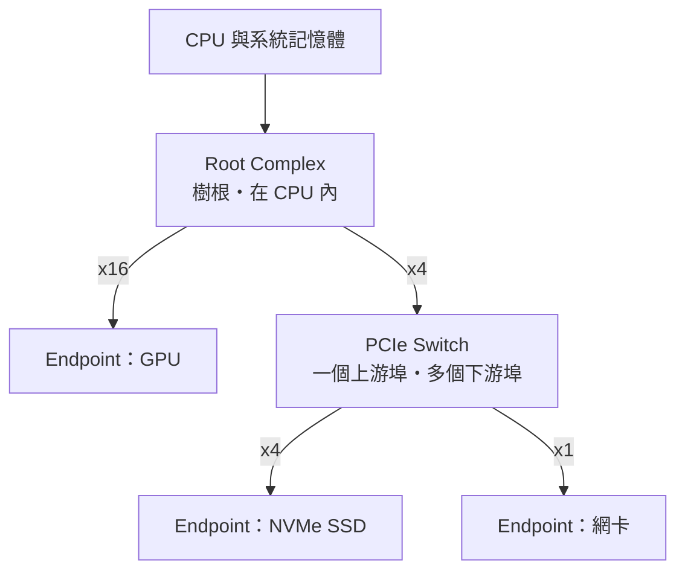

# W02D01｜PCIe 基礎：一條 x16 插槽，為什麼跑出一半的速度

| 項目     | 內容                                                                                                                                                                                       |
| -------- | ------------------------------------------------------------------------------------------------------------------------------------------------------------------------------------------ |
| 週／日   | 第 2 週・第 1 天（2026-11-23）                                                                                                                                                              |
| 核心問題 | PCIe 的頻寬由哪幾個因素決定？為什麼同一張卡，插在不同伺服器上速度會不一樣？                                                                                                                    |
| 預計時間 | 35 分鐘（含課後提取測驗）                                                                                                                                                                   |
| 先修     | W01D04-K4（PCIe 頻寬公式）、W01D05-K2（傳輸時間 = 延遲 + 大小 ÷ 頻寬）                                                                                                                        |
| 來源文章 | [PCIe 匯流排技術大全 §1、§3、§6](../../../01_hardware_architecture/pcie/01_pcie_comprehensive_guide.md)、[nvidia-smi 指南 §4.4](../../../03_ai_cluster_ops/01_gpu_ops/03_nvidia_smi_guide.md)（只用 PCIe 鏈路一段） |
| 今日受眾 | 一 客戶 CxO／採購                                                                                                                                                                            |

## 0. 先想再讀（3 題，不要翻資料，各寫一兩句）

1. 「x16」的 16 指的是什麼？為什麼 PCIe 天生就分單向和雙向？
2. 每升一代 PCIe，頻寬大概變成幾倍？Gen5 x16 單向大約多少？
3. 「我的伺服器插槽是 x16，所以卡一定跑在 x16。」這句話對嗎？

## 1. 今天的情境

韓國一家製造業客戶買了四張新的 PCIe 版資料中心 GPU，自己裝進兩年前買的伺服器。跑完資料搬移測試，CPU 到 GPU 只有預期的一半。

工程師跑 `nvidia-smi -q -d PCIE`，有一張卡顯示目前寬度 x8，另外三張顯示 Gen4。

客戶的 IT 總監打電話來：「你們賣的卡是不是有問題？我們要退貨。」

卡很可能沒問題。今天要搞清楚：PCIe 的速度由哪幾個因素決定，以及開機時卡和插槽是怎麼「談」出速度的。

## 2. 核心概念（具體 → 抽象）

### 2.1 Lane：x16 就是 16 條雙向車道

一個「x16」連結由 16 條 lane 組成。每條 lane 有兩對差分線，一對送（TX）、一對收（RX），所以送和收可以同時進行（`01_pcie_comprehensive_guide.md:122-123`）。這就是 PCIe 天生分「單向」和「雙向」的原因。

定義：連結（Link）由 1～32 條 lane 組成，寬度寫成 x1、x4、x8、x16；頻寬和 lane 數成正比。

### 2.2 代際與編碼：每一代翻倍，但要扣開銷

Gen3 x16 約 15.75 GB/s，Gen4 約 31.51，Gen5 約 63.02，Gen6 約 121（`01_pcie_comprehensive_guide.md:35-38`）。每 3～4 年一代，頻寬翻倍（`01_pcie_comprehensive_guide.md:29`）。

這些數字已經扣掉編碼開銷：Gen1／2 的 8b/10b 吃掉 20%；Gen3～5 的 128b/130b 只吃約 1.5%；Gen6 起改用 PAM-4 加 FLIT 和 FEC，開銷約 5～6%（`01_pcie_comprehensive_guide.md:45-47`）。

定義：單向頻寬 = GT/s × 編碼效率 × lane 數 ÷ 8（`01_pcie_comprehensive_guide.md:43`）。

### 2.3 樹狀拓撲：Root Complex、Switch、Endpoint

GPU、NVMe SSD、網卡都是末端的 Endpoint。它們要嘛直接接到 CPU 裡的 Root Complex，要嘛先接到 PCIe Switch，再由 Switch 往上接（`01_pcie_comprehensive_guide.md:125-130`）。



*圖：典型的 PCIe 樹狀拓撲（來源 `01_pcie_comprehensive_guide.md:125-171`）*

定義：PCIe 是點對點的樹，Switch 負責扇出和轉發，像網路交換機（`01_pcie_comprehensive_guide.md:127`）。

### 2.4 鏈路訓練：開機時「談」出寬度和速率

開機時，卡和插槽會跑一套訓練流程（LTSSM）：先偵測對方、送訓練序列，再協商連結寬度；出錯或要換速率時進入 Recovery 重新訓練（`01_pcie_comprehensive_guide.md:291-297`）。PCIe 向後相容，新一代的卡插在舊平台上也能用（`01_pcie_comprehensive_guide.md:15`）。

所以卡不一定跑在最高規格。nvidia-smi 指南的建議是：確認目前寬度等於最大寬度；如果 Gen4 卡跑在 Gen3，或 x16 掉到 x8，去查 BIOS 設定、PCIe 擴展器和 Riser 卡（`03_nvidia_smi_guide.md:174-177`）。

定義：實際頻寬由兩端「談」出來的寬度和代際決定，不是由卡的規格決定。

## 3. 數字與口徑

| 項目 | 數值 | 單位 | 口徑（單向／雙向・dense／sparsity・卡規格／系統可用・廠商／實測・日期） | 來源 file:line |
| ---- | ---- | ---- | ---------------------------------------------------------------------- | -------------- |
| Gen3／Gen4／Gen5 x16 | 15.75／31.51／63.02 | GB/s | 單向，已扣 128b/130b 編碼，理論值 | 01_pcie_comprehensive_guide.md:35-37 |
| Gen6／Gen7 x16 | 121.0／242.0 | GB/s | 單向，已扣 FEC 與協議開銷，理論值 | 01_pcie_comprehensive_guide.md:38-39 |
| Gen5 x1 | 3.938 | GB/s | 單向，每 lane | 01_pcie_comprehensive_guide.md:37 |
| 8b/10b 開銷 | 20 | % | Gen1／2 | 01_pcie_comprehensive_guide.md:282 |
| 128b/130b 開銷 | 約 1.5 | % | Gen3～5 | 01_pcie_comprehensive_guide.md:283 |
| PAM-4 + FLIT + FEC 開銷 | 約 5～6 | % | Gen6 起 | 01_pcie_comprehensive_guide.md:47 |
| 連結寬度 | 1～32 | lane | x1、x2、x4、x8、x16、x32 | 01_pcie_comprehensive_guide.md:122 |

## 4. 常見誤區（3 條）

| 誤區 | 為什麼錯 | 正確說法 |
| ---- | -------- | -------- |
| 「插槽是 x16，卡就一定跑 x16」 | 寬度是開機時協商出來的，Riser、BIOS 都可能讓它掉到 x8（`03_nvidia_smi_guide.md:177`） | 用 `nvidia-smi -q -d PCIE` 看目前寬度和代際 |
| 「Gen5 的卡插哪台都是 Gen5 速度」 | 向後相容只保證能用，速度由兩端協商（`01_pcie_comprehensive_guide.md:15,295-297`） | 報價前確認伺服器平台支援哪一代 |
| 「Gen6 只是 GT/s 翻倍，編碼不變」 | Gen6 改用 PAM-4 + FLIT + FEC，開銷從約 1.5% 變成約 5～6%（`01_pcie_comprehensive_guide.md:45-47`） | 換代時編碼和開銷也一起看 |

## 5. Pre-sales 口徑

- **30 秒・客戶 CxO／採購版**：卡本身沒有問題。GPU 和主機之間的連線速度，取決於「卡」和「插槽」兩邊都能跑到多快；舊伺服器的插槽比新卡慢一代，速度就只剩一半。我們今天派人協助檢查設定，不需要退貨。下一批採購時，建議卡和伺服器一起規劃，才不會花了新卡的錢、只拿到一半效果。
- **3 分鐘・客戶工程師版**：PCIe 頻寬 = GT/s × 編碼效率 × lane 數 ÷ 8。Gen5 x16 單向約 63 GB/s；同一張卡如果協商成 Gen4，只剩約 31.5；x16 掉成 x8，又再減半。開機時 LTSSM 會協商寬度，出錯會進 Recovery 重新訓練，所以要看實際值：`nvidia-smi -q -d PCIE`，確認 Current Link Width 等於 Max。掉速常見原因是 BIOS 設定、擴展器和 Riser 卡。來源：`01_pcie_comprehensive_guide.md:35-47,291-297`、`03_nvidia_smi_guide.md:174-177`。
- **配置建議**：GPU 報價要連同伺服器平台一起看。Gen5 的卡配 Gen5 平台、x16 直連插槽；如果要用 Riser 或擴展器，先確認它支援的代際和寬度。要再問客戶：**要沿用舊伺服器還是新購？伺服器平台支援哪一代 PCIe？每張卡接的是直連插槽還是 Riser？**
- **反對意見應對**：客戶說「你們的卡速度只有一半，我們要退貨」。先認同：「實測只有一半，您的觀察是對的，這確實會影響效能。」再補條件：「速度由卡和插槽兩邊協商，舊平台只到 Gen4，有一張還掉到 x8。」下一步：「我們先一起跑 `nvidia-smi -q -d PCIE`，把每張卡的寬度和代際列出來；調整 BIOS 和 Riser 後再測一次，數字對了再談後續。」

## 6. 精緻化提問（寫下你的答案再往下）

1. 為什麼 PCIe 從 Gen3 開始改用 128b/130b，而不是繼續用 8b/10b？對客戶的實際頻寬差多少？
2. W01D04-K5 說 PCIe 5.0 x16 雙向有 126 和 128 GB/s 兩個數。今天的編碼開銷，怎麼解釋這個差？
3. 如果客戶的伺服器要同時接 8 張 GPU 和 8 張網卡，CPU 的 PCIe lane 夠不夠？還缺什麼資訊才能回答？

## 7. 課後提取測驗（閉卷，填信心 1～5）

| #   | 題型 | 題目 | 我的答案 | 信心 |
| --- | ---- | ---- | -------- | ---- |
| 1   | FR   | 畫出（或寫出）PCIe 樹狀拓撲的三種角色，各舉一個例子 |          |      |
| 2   | SA   | 為什麼一張插在 x16 插槽的卡，可能只跑在 x8？要用什麼命令確認？ |          |      |
| 3   | CA   | 用公式算出 Gen4 x8 的單向頻寬，並和 Gen5 x16 比較差幾倍 |          |      |
| 4   | TJ   | 「Gen6 的頻寬是 Gen5 的兩倍，因為編碼方式完全一樣、只有速率翻倍。」判斷對錯並說理 |          |      |
| 5   | OR   | 用 60 秒對客戶 IT 總監解釋：為什麼新卡在舊伺服器上只跑出一半速度，以及下一步 | （錄音檔名） |      |

## 8. 可測知識點（K 點）

```text
W02D01-K1 | 1 | PCIe 連結（Link）由 1～32 條 lane 組成（x1、x2、x4、x8、x16、x32）；每條 lane 有 TX、RX 兩對差分線，全雙工，所以頻寬分單向與雙向 | 01_hardware_architecture/pcie/01_pcie_comprehensive_guide.md:122-123 | 工程師
W02D01-K2 | 1 | PCIe x16 單向理論頻寬：Gen3 15.75、Gen4 31.51、Gen5 63.02、Gen6 121.0、Gen7 242.0 GB/s；約每 3～4 年一代、頻寬翻倍 | 01_pcie_comprehensive_guide.md:29-39 | 工程師、CxO
W02D01-K3 | 2 | 編碼開銷：Gen1／2 用 8b/10b 損失 20%；Gen3～5 用 128b/130b 約 1.5%；Gen6 起 PAM-4 + FLIT + FEC 約 5～6% | 01_pcie_comprehensive_guide.md:43-47,282-284 | 工程師
W02D01-K4 | 2 | PCIe 是點對點樹狀拓撲：Root Complex 是樹根、整合在 CPU 內；Switch 有一個上游埠與多個下游埠，負責扇出與轉發；Endpoint 是末端裝置（GPU、NVMe、網卡） | 01_pcie_comprehensive_guide.md:125-130 | 工程師、TAM
W02D01-K5 | 2 | 開機時 LTSSM 依序 Detect → Polling → Configuration（協商寬度）→ L0；出錯或換速率時進 Recovery 重新訓練，所以實際寬度與代際可能低於卡規格 | 01_pcie_comprehensive_guide.md:291-298 | 工程師、TAM
W02D01-K6 | 3 | 確認 PCIe 實際狀態用 `nvidia-smi -q -d PCIE`，Current Link Width 應等於 Max；Gen4 卡跑在 Gen3 或 x16 掉到 x8 時，查 BIOS、PCIe 擴展器與 Riser 卡 | 03_ai_cluster_ops/01_gpu_ops/03_nvidia_smi_guide.md:174-177 | TAM、工程師
W02D01-K7 | 3 | 同一張 Gen5 x16 卡：協商成 Gen4 x16 單向約 31.5 GB/s（減半），再掉到 x8 約 15.8 GB/s（剩四分之一）；報價時卡與伺服器平台要一起規劃 | 01_pcie_comprehensive_guide.md:15,36-37,295 | CxO、業務
```

## 來源索引

| 檔案 | 用到的章節／行 | 關鍵內容 |
| ---- | -------------- | -------- |
| `01_hardware_architecture/pcie/01_pcie_comprehensive_guide.md` | 15、29-47、122-171、282-298 | 向後相容、代際表、編碼開銷、lane 與全雙工、樹狀拓撲、LTSSM |
| `03_ai_cluster_ops/01_gpu_ops/03_nvidia_smi_guide.md` | 174-177 | 檢查 PCIe 實際寬度與代際、掉速原因 |

<details>
<summary>第 7 節參考答案</summary>

1. Root Complex（樹根，在 CPU 內）；Switch（一個上游埠、多個下游埠，扇出與轉發）；Endpoint（末端裝置，例如 GPU、NVMe SSD、網卡）。K 點 W02D01-K4，來源 `01_pcie_comprehensive_guide.md:125-130`。常見錯因：把 Switch 和 Root Complex 混為一談。
2. 寬度是開機時 LTSSM 在 Configuration 階段協商出來的，BIOS 設定、PCIe 擴展器、Riser 卡都可能讓它掉到 x8。用 `nvidia-smi -q -d PCIE` 確認 Current Link Width 是否等於 Max。K 點 W02D01-K5、K6，來源 `01_pcie_comprehensive_guide.md:295`、`03_nvidia_smi_guide.md:174-177`。常見錯因：以為插槽寬度就是實際寬度。
3. Gen4 x8 = 16 × 0.985 × 8 ÷ 8 ≈ 15.8 GB/s（單向）。Gen5 x16 約 63 GB/s，差約 4 倍（代際一半 × lane 一半）。K 點 W02D01-K2、K7，來源 `01_pcie_comprehensive_guide.md:36-37,43`。常見錯因：忘了乘編碼效率，或忘了 ÷ 8。
4. 錯。Gen6 的速率確實翻倍（32 → 64 GT/s），但編碼從 128b/130b 改成 PAM-4 + FLIT + FEC，開銷從約 1.5% 變成約 5～6%，所以 x16 單向是 121 GB/s，不是 126。K 點 W02D01-K3，來源 `01_pcie_comprehensive_guide.md:37-38,45-47`。常見錯因：只看 GT/s。
5. 評分看三點（CxO 版）：先說卡沒問題、不必退貨；用「卡和插槽兩邊協商」解釋一半速度，不出現 LTSSM、lane 等術語；給出下一步（派人檢查、下次卡和伺服器一起規劃）。來源 `01_pcie_comprehensive_guide.md:15,291-297`。自評用 `00_study_plan/02_assessment_spec.md` 第 7.1 節評分表。

</details>
