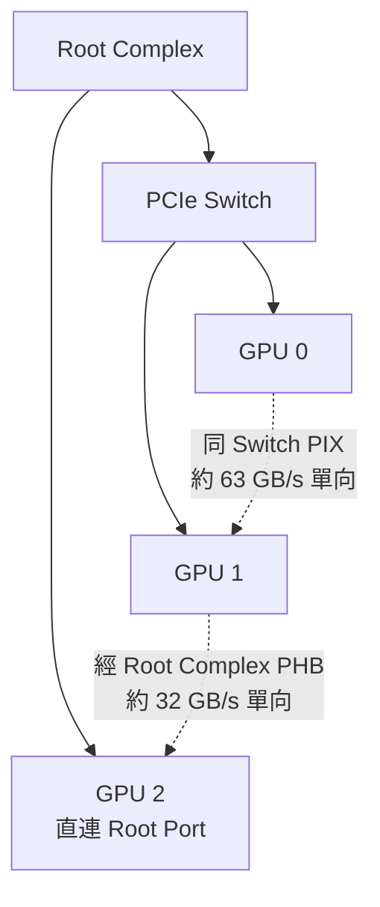

# W02D02｜PCIe 拓撲與 NUMA：多一層 Switch，是加了延遲還是加了頻寬

| 項目     | 內容                                                                                                                                                                                                                                                                                           |
| -------- | ---------------------------------------------------------------------------------------------------------------------------------------------------------------------------------------------------------------------------------------------------------------------------------------------- |
| 週／日   | 第 2 週・第 2 天（2026-11-24）                                                                                                                                                                                                                                                                  |
| 核心問題 | GPU 前面接的是 Bridge、Switch 還是直連 CPU，會怎麼改變延遲、頻寬和 GPU 之間的直接傳輸？雙路 CPU 又多了什麼代價？                                                                                                                                                                                      |
| 預計時間 | 35 分鐘（含課後提取測驗）                                                                                                                                                                                                                                                                       |
| 先修     | W02D01-K4（PCIe 樹狀拓撲三角色）、W01D05-K1（延遲量級）                                                                                                                                                                                                                                           |
| 來源文章 | [PCIe 拓撲層次](../../../01_hardware_architecture/pcie/06_pcie_topology_hierarchy.md)、[PCIe Switch 識別與驗證](../../../01_hardware_architecture/pcie/07_pcie_switch_vs_bridge.md)、[PCIe 根匯流排段與 NUMA](../../../01_hardware_architecture/performance/04_pcie_domain_numa.md)、[頻寬速查表 §5](../../../01_hardware_architecture/performance/05_pcie_nvlink_speed_reference.md) |
| 今日受眾 | 二 客戶工程師                                                                                                                                                                                                                                                                                   |

## 0. 先想再讀（3 題，不要翻資料，各寫一兩句）

1. 在 GPU 和 CPU 之間多加一顆 PCIe Switch，你覺得是好事還是壞事？
2. 兩張 GPU 要直接互傳資料（不經過 CPU 記憶體），經過同一顆 Switch 和經過 CPU 兩條路，頻寬會差多少？
3. 「雙路伺服器的兩顆 CPU 是一體的，GPU 插哪一邊都一樣。」這句話對嗎？

## 1. 今天的情境

韓國一家電信公司要買八卡 PCIe 版 GPU 伺服器做推理，比較兩家的設計：

- **A 家**：每顆 CPU 下面接一顆 PCIe Switch，每顆 Switch 掛 4 張 GPU 加 1 張網卡。
- **B 家**：八張 GPU 全部直接插在 CPU 的 Root Port 上，沒有 Switch。

客戶的系統工程師在會議上說：「Switch 就是多一層延遲，還要四張卡搶一條上行，直連一定比較好。」A 家是你們的方案。

他說的兩件事都對，但只說了一半。今天要搞清楚 Switch 的代價和好處，以及雙路 CPU 下「插在哪裡」為什麼重要。

## 2. 核心概念（具體 → 抽象）

### 2.1 四層模型：從 CPU 到卡

一台實測機的 GPU 路徑是「Root Complex → Bridge → GPU」；NVMe 陣列則可能是「Root Port → Switch → 多個 NVMe」（`06_pcie_topology_hierarchy.md:9-16`）。Root Port、Bridge、Switch 的 class code 都是 0x060400，要看下游掛幾個裝置才分得出來（`06_pcie_topology_hierarchy.md:18-26`）。

定義：Root Complex 在 CPU 內，往下是 Root Port，再往下可以接 Bridge 或 Switch，最末端是 GPU、NVMe、網卡這些 Endpoint。

### 2.2 Bridge 和 Switch：一對一轉發 vs 一對多扇出

Bridge 一進一出、透明轉發，每跳延遲數十 ns。Switch 一進 N 出，每個埠約 100～200 ns，還支援 ACS（控制裝置之間的直接傳輸）和多播（`07_pcie_switch_vs_bridge.md:15-22`）。

GPU 獨佔一個 Bridge 時，CPU 到 GPU 實測 56.3 GB/s，約 Gen5 x16 的 89%；接在 Switch 下的多個裝置則共用同一條上行（`07_pcie_switch_vs_bridge.md:137-146`）。

定義：Switch 的代價是每層多約 100～200 ns，以及下游裝置共用上行頻寬。

### 2.3 Switch 的好處：GPU 之間的直接傳輸

兩張 GPU 在同一顆 Switch 下（nvidia-smi 顯示 PIX），直接互傳約 63 GB/s；如果要經過 Root Complex 繞一圈（PHB），約 32 GB/s，頻寬減半（`05_pcie_nvlink_speed_reference.md:89-90`）。



*圖：GPU 之間直接傳輸的兩條路（來源 `05_pcie_nvlink_speed_reference.md:89-90`）*

定義：Switch 讓掛在它下面的 GPU 互傳不必經過 CPU；代價和好處要看客戶的流量是「CPU 到 GPU」多，還是「GPU 到 GPU」多。

### 2.4 雙路 CPU 與 NUMA：插在哪一顆 CPU 下面

雙路伺服器的兩顆 CPU 之間用 UPI 連接。GPU 讀對面 CPU 下的 NVMe，要走「對面的 Root Complex → UPI → 本地的 Root Complex」；NUMA distance 21 對本地 10，延遲約 2 倍（`04_pcie_domain_numa.md:109-115`）。但 NVMe 本身就要 10～100 µs，多出的約 100 ns 影響很小。nvidia-smi 拓撲裡，跨 NUMA 的 SYS 最慢（`03_nvidia_smi_guide.md:162-167`）。

定義：裝置掛在哪顆 CPU 下面，決定資料要不要多走一段跨 CPU 的路。

## 3. 數字與口徑

| 項目 | 數值 | 單位 | 口徑（單向／雙向・dense／sparsity・卡規格／系統可用・廠商／實測・日期） | 來源 file:line |
| ---- | ---- | ---- | ---------------------------------------------------------------------- | -------------- |
| Bridge 每跳延遲 | 數十 | ns | 量級估算 | 07_pcie_switch_vs_bridge.md:20 |
| Switch 每層延遲 | 約 100～200 | ns | 量級估算，內部 crossbar 轉發 | 07_pcie_switch_vs_bridge.md:20,133 |
| GPU 獨佔 Bridge 的 H2D | 56.3 | GB/s | 實測，RTX 5090、Gen5 x16，約理論 89%；實測時間約 2025 年 | 07_pcie_switch_vs_bridge.md:146 |
| GPU 對 GPU，同 Switch（PIX） | 約 63 | GB/s | 單向，Gen5 x16 理論值 | 05_pcie_nvlink_speed_reference.md:89 |
| GPU 對 GPU，經 Root Complex（PHB） | 約 32 | GB/s | 單向，Gen5 x16 ÷ 2，理論值 | 05_pcie_nvlink_speed_reference.md:90 |
| PIX／NODE（Gen4 平台） | 約 32／約 28 | GB/s | nvidia-smi 指南所列典型值，Gen4 | 03_nvidia_smi_guide.md:165-166 |
| NUMA distance 本地／跨 socket | 10／21 | 相對值 | 跨 socket 延遲約 2 倍；實測平台雙路 Sapphire Rapids | 04_pcie_domain_numa.md:115 |

## 4. 常見誤區（3 條）

| 誤區 | 為什麼錯 | 正確說法 |
| ---- | -------- | -------- |
| 「有 Switch 一定比直連差」 | Switch 多約 100～200 ns，但同 Switch 的 GPU 互傳約 63 GB/s，經 Root Complex 只剩約 32（`05_pcie_nvlink_speed_reference.md:89-90`） | 看流量是 CPU↔GPU 多還是 GPU↔GPU 多 |
| 「`pci0000:97` 代表 GPU 在 domain 97」 | `0000` 才是 domain，97 是 bus 號段（`04_pcie_domain_numa.md:9`） | 它是 domain 0 裡以 bus 0x97 為根的一段 |
| 「跨 NUMA 延遲變 2 倍，NVMe 就慢 2 倍」 | NVMe I/O 本身 10～100 µs，多出來的約 100 ns 影響很小（`04_pcie_domain_numa.md:115`） | 跨 NUMA 對小延遲的操作影響大，對 NVMe 影響小 |

## 5. Pre-sales 口徑

- **30 秒・客戶 CxO／採購版**：兩家設計各有取捨。A 家多放一顆交換晶片，同組四張 GPU 直接互傳的速度是繞經 CPU 的兩倍；代價是多一點延遲，四張卡也要共用一條通往 CPU 的路。哪種划算，看您的模型會不會拆到多張卡上。
- **3 分鐘・客戶工程師版**：您說的兩點都對：Switch 每層多約 100～200 ns，下游裝置共用上行。但同一顆 Switch 下的 GPU 做 P2P 是 PIX，Gen5 x16 約 63 GB/s 單向；直連方案的 GPU 互傳要經 Root Complex（PHB），約 32 GB/s，減半。另外八張卡跨兩顆 CPU 時，跨 socket 走 UPI，nvidia-smi 會顯示 SYS，NUMA distance 21 對 10。建議跑 `nvidia-smi topo -m` 看兩家機器的實際標識。來源：`07_pcie_switch_vs_bridge.md:15-22,137-146`、`05_pcie_nvlink_speed_reference.md:89-90`、`04_pcie_domain_numa.md:109-115`。
- **配置建議**：如果客戶的模型要拆到 2～4 張卡（張量並行或 pipeline），而又沒有 NVLink，A 家的 Switch 設計讓同組 GPU 互傳快一倍，選 A；如果每張卡各跑一個獨立模型、主要流量是 CPU 到 GPU，B 家直連延遲較低。不論哪家，網卡和它服務的 GPU 要掛在同一顆 CPU、最好同一顆 Switch 下。要再問客戶：**一個模型會拆到幾張卡？資料主要從網路進來還是從本機 NVMe 讀？**
- **反對意見應對**：客戶說「Switch 就是多一層延遲，直連一定比較好」。先認同：「多一層確實多約 100～200 ns，四張卡也確實共用上行。」再補條件：「但您的模型如果要拆到多張卡，卡和卡之間的互傳，同一顆 Switch 下約 63 GB/s，直連方案要繞經 CPU，只剩約 32。」下一步：「兩家各借一台，用您的模型跑 `nvidia-smi topo -m` 和一次多卡推理，比實際的每秒處理量。」

## 6. 精緻化提問（寫下你的答案再往下）

1. 為什麼經過 Root Complex 的 GPU 互傳，頻寬會減半？資料在那裡多走了什麼路？
2. W02D01-K4 說 Switch 負責扇出與轉發。今天看到 Switch 的延遲約 100～200 ns，再對照 W01D05-K1 的延遲量級，這個代價大概落在金字塔的哪一層？
3. 如果客戶的 GPU 之間有 NVLink，今天 A、B 兩家的比較結論還成立嗎？哪一段會改變？

## 7. 課後提取測驗（閉卷，填信心 1～5）

| #   | 題型 | 題目 | 我的答案 | 信心 |
| --- | ---- | ---- | -------- | ---- |
| 1   | FR   | 寫出 PCIe 從 CPU 到 Endpoint 的四層，並說明 Bridge 和 Switch 的差別 |          |      |
| 2   | SA   | nvidia-smi 拓撲的 PIX、NODE、SYS 各代表什麼路徑？哪個最慢？ |          |      |
| 3   | CA   | 兩張 GPU 在 Gen5 平台上互傳 8 GB 資料，同一顆 Switch 下和經 Root Complex，各約要多久？ |          |      |
| 4   | TJ   | 「GPU 讀另一顆 CPU 下面的 NVMe，延遲變 2 倍，所以讀檔速度會慢一半。」判斷對錯並說理 |          |      |
| 5   | OR   | 用 60 秒對客戶的系統工程師回應：「Switch 就是多一層延遲，直連一定比較好。」 | （錄音檔名） |      |

## 8. 可測知識點（K 點）

```text
W02D02-K1 | 1 | PCIe 四層：Root Complex（在 CPU 內）→ Root Port → Bridge 或 Switch → Endpoint；Root Port、Bridge、Switch 的 class code 都是 0x060400，要看下游掛幾個裝置區分 | 01_hardware_architecture/pcie/06_pcie_topology_hierarchy.md:9-26 | 工程師
W02D02-K2 | 2 | Bridge 一上一下、透明轉發、每跳數十 ns；Switch 一上 N 下、每埠約 100～200 ns，支援 ACS 與多播；sysfs 下游 1 個裝置是 Bridge、≥ 2 個是 Switch | 01_hardware_architecture/pcie/07_pcie_switch_vs_bridge.md:15-22 | 工程師
W02D02-K3 | 3 | Switch 下多個裝置共用上行頻寬；GPU 獨佔 Bridge 時 H2D 實測 56.3 GB/s，約 Gen5 x16 理論值的 89% | 07_pcie_switch_vs_bridge.md:137-146 | 工程師、TAM
W02D02-K4 | 2 | GPU 之間的 PCIe P2P：同一顆 Switch（PIX）Gen5 x16 單向約 63 GB/s；經 Root Complex（PHB）約 32 GB/s，頻寬減半 | 01_hardware_architecture/performance/05_pcie_nvlink_speed_reference.md:89-90 | 工程師、TAM
W02D02-K5 | 2 | nvidia-smi 拓撲標識：NV12 為 12 條 NVLink 直連約 600 GB/s 雙向；PIX 同一 PCIe switch（Gen4 約 32 GB/s）；NODE 同 NUMA 經 host bridge（約 28 GB/s）；SYS 跨 NUMA 經 QPI／UPI，最慢 | 03_ai_cluster_ops/01_gpu_ops/03_nvidia_smi_guide.md:162-167 | TAM、工程師
W02D02-K6 | 2 | 跨 socket 經 UPI：NUMA distance 21 對本地 10，延遲約 2 倍；NVMe I/O 本身 10～100 µs，多出的約 100 ns 影響很小 | 01_hardware_architecture/performance/04_pcie_domain_numa.md:109-115 | 工程師
W02D02-K7 | 3 | Linux 裝置名 `0000:98:00.0` 中 0000 是 domain、98 是 bus；Sapphire Rapids 每個 socket 有多個 RC stack，`pci0000:97` 是 domain 0 內以 bus 0x97 為根的段，不是 domain 97 | 04_pcie_domain_numa.md:9-16 | 工程師
W02D02-K8 | 3 | 同一個 host bridge 下的 P2P 通常暢通；跨 host bridge 的 P2P 依賴韌體 ACPI DMAR 表支援，雲環境可能受限 | 04_pcie_domain_numa.md:133-135 | TAM
```

## 來源索引

| 檔案 | 用到的章節／行 | 關鍵內容 |
| ---- | -------------- | -------- |
| `01_hardware_architecture/pcie/06_pcie_topology_hierarchy.md` | 9-26、98-119 | 四層模型、class code、實測機拓撲、跨 socket 經 UPI |
| `01_hardware_architecture/pcie/07_pcie_switch_vs_bridge.md` | 7-24、124-146 | Bridge vs Switch 對照、延遲、頻寬共享、H2D 實測 |
| `01_hardware_architecture/performance/04_pcie_domain_numa.md` | 7-16、95-135 | domain 與 bus 號段、跨 NUMA 路徑、跨 host bridge 的 P2P |
| `01_hardware_architecture/performance/05_pcie_nvlink_speed_reference.md` | 89-90 | PIX 與 PHB 的 P2P 頻寬 |
| `03_ai_cluster_ops/01_gpu_ops/03_nvidia_smi_guide.md` | 160-167 | nvidia-smi 拓撲標識 |

<details>
<summary>第 7 節參考答案</summary>

1. Root Complex → Root Port → Bridge 或 Switch → Endpoint。Bridge 一上一下、透明轉發、每跳數十 ns；Switch 一上 N 下、每埠約 100～200 ns、下游共用上行，支援 ACS 與多播。K 點 W02D02-K1、K2，來源 `06_pcie_topology_hierarchy.md:9-26`、`07_pcie_switch_vs_bridge.md:15-22`。常見錯因：以為 Bridge 和 Switch 的 class code 不同。
2. PIX：同一顆 PCIe Switch；NODE：同一個 NUMA，經 host bridge；SYS：跨 NUMA，經 QPI／UPI，最慢。K 點 W02D02-K5，來源 `03_nvidia_smi_guide.md:162-167`。常見錯因：把 NODE 和 SYS 搞反。
3. 同 Switch：8 ÷ 63 ≈ 0.13 秒；經 Root Complex：8 ÷ 32 ≈ 0.25 秒，約兩倍時間。兩者都是理論單向頻寬，實測會更低。K 點 W02D02-K4、W01D05-K2，來源 `05_pcie_nvlink_speed_reference.md:89-90`。常見錯因：用雙向頻寬算。
4. 錯。跨 socket 的延遲約 2 倍，但只多約 100 ns；NVMe I/O 本身 10～100 µs，影響很小，不等於讀檔速度減半。K 點 W02D02-K6，來源 `04_pcie_domain_numa.md:115`。常見錯因：把延遲倍數當成吞吐倍數。
5. 評分看三點（工程師版）：先認同延遲和共用上行兩點；補上 PIX 約 63 對 PHB 約 32 GB/s 的數字與口徑；給出可驗證的下一步（`nvidia-smi topo -m` 加多卡推理實測）。來源 `07_pcie_switch_vs_bridge.md:15-22`、`05_pcie_nvlink_speed_reference.md:89-90`。自評用 `00_study_plan/02_assessment_spec.md` 第 7.1 節評分表。

</details>
