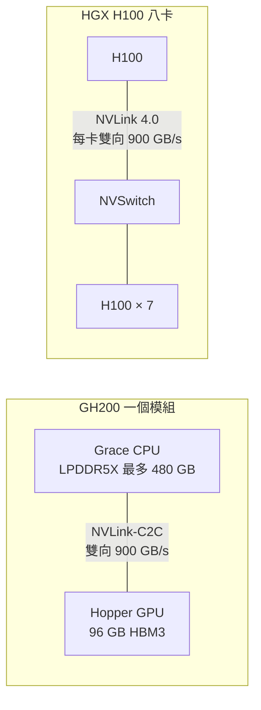

# W02D03｜NVLink、NVSwitch 與 NVLink-C2C：同樣寫 900 GB/s，連的是不同的東西

| 項目     | 內容                                                                                                                                                                              |
| -------- | --------------------------------------------------------------------------------------------------------------------------------------------------------------------------------- |
| 週／日   | 第 2 週・第 3 天（2026-11-25）                                                                                                                                                     |
| 核心問題 | NVLink 為什麼比 PCIe 快？NVSwitch 和 SHARP 多做了什麼？NVLink-C2C 又是連誰和誰？                                                                                                    |
| 預計時間 | 35 分鐘（含課後提取測驗）                                                                                                                                                          |
| 先修     | W01D04-K2（NVLink 雙向總頻寬公式）、W02D02-K4（PCIe P2P 經 Root Complex 減半）                                                                                                       |
| 來源文章 | [NVLink 技術入門 §1、§3、§4](../../../01_hardware_architecture/nvlink/nvlink_intro.md)、[NVLink-C2C 技術詳解](../../../01_hardware_architecture/superchips/nvlink_c2c.md)（§2、§3.1、§4.1、§5） |
| 今日受眾 | 三 自家業務（教業務怎麼講）                                                                                                                                                         |

## 0. 先想再讀（3 題，不要翻資料，各寫一兩句）

1. NVLink 每一代都想塞進更多條鏈路。你猜它是靠什麼辦到的？
2. 八張 GPU 要兩兩都能全速互傳，用點對點直連和用一顆交換晶片，差在哪？
3. 「GH200 的 NVLink 是 900 GB/s，HGX H100 也是 900 GB/s，所以兩者的 GPU 互傳一樣快。」這句話對嗎？

## 1. 今天的情境

公司的業務同事在給韓國一家搜尋引擎公司的提案裡寫：「GH200 有 900 GB/s 的 NVLink，GPU 之間互傳和 HGX H100 一樣快，而且還多了 CPU 記憶體。」

客戶的架構師回信：「GH200 一個模組只有一顆 GPU，你說的 GPU 之間是指哪兩顆？」

兩邊的 900 GB/s 都是真的，但一個是 CPU 連 GPU，一個是 GPU 連 GPU。今天要分清楚 NVLink、NVSwitch、NVLink-C2C 各自連誰、多做了什麼。

## 2. 核心概念（具體 → 抽象）

### 2.1 NVLink：每條鏈路用更少的線

V100 每條 NVLink 用 8 對差分訊號線，A100 減到 4 對，H100 再減到 2 對；鏈路數因此從 6 增加到 12、再到 18（`nvlink_intro.md:79-84`）。單條鏈路單向都是 25 GB/s，總頻寬靠鏈路數往上加。到 B200，每條鏈路速率翻倍成 50 GB/s（`nvlink_intro.md:85-86`）。

定義：NVLink 用「減少每條鏈路的線、增加鏈路數」換頻寬，和 W01D02-K6 的 HBM 設計邏輯一樣。

### 2.2 記憶體語義：直接讀寫隔壁 GPU 的顯存

PCIe 搬資料靠 DMA；NVLink 讓 GPU 用 Load／Store 指令直接讀寫遠端顯存，所有 HBM 編在同一個位址空間（`nvlink_intro.md:31,108-111`）。協議也比 PCIe 精簡，有效載荷效率 94% 以上（`nvlink_intro.md:96-98`）。

定義：NVLink 讓多張 GPU 像共用一大塊顯存。

### 2.3 NVSwitch：從點對點到交換網路

點對點直連在 4～8 卡還行，卡一多就太複雜。NVSwitch 像網路交換機，讓任兩張 GPU 直連、同時滿速（`nvlink_intro.md:128-137`）。

一顆 Gen3 NVSwitch（DGX H100）有 64 個埠，每埠雙向 50 GB/s，聚合 3.2 TB/s；Gen4（GB200 NVL72）72 埠 × 100 GB/s = 7.2 TB/s（`nvlink_intro.md:144-156`）。

定義：NVSwitch 聚合頻寬 = 埠數 × 每埠雙向頻寬。

### 2.4 SHARP：在交換晶片裡做加總

傳統 All-Reduce 要資料在 GPU 間來回好幾趟、在 GPU 上加總。Gen3 NVSwitch 起內建運算單元，資料流經時直接加總、只回傳結果；網路流量減半，集合通訊效能提升 2～3 倍（`nvlink_intro.md:162-166`）。

定義：SHARP 把「加總」這件事從 GPU 搬到交換晶片裡做。

### 2.5 NVLink-C2C：CPU 和 GPU 之間的那條線

GH200 把一顆 Grace CPU 和一顆 Hopper GPU 封裝在一起，中間用 NVLink-C2C 連接：雙向 900 GB/s（每方向 450），約 PCIe Gen5 x16 的 7 倍（`nvlink_c2c.md:60,161`）。GPU 因此能直接讀 CPU 的 LPDDR5X，把不常用的 KV Cache 放到 CPU 記憶體（`nvlink_c2c.md:225-227`）。



*圖：兩個 900 GB/s 連的是不同的東西（來源 `nvlink_c2c.md:161-162`、`nvlink_intro.md:59,136`）*

定義：NVLink 管 GPU 對 GPU；NVLink-C2C 管封裝內 CPU 對 GPU（`nvlink_c2c.md:270`）。

## 3. 數字與口徑

| 項目 | 數值 | 單位 | 口徑（單向／雙向・dense／sparsity・卡規格／系統可用・廠商／實測・日期） | 來源 file:line |
| ---- | ---- | ---- | ---------------------------------------------------------------------- | -------------- |
| 每條 NVLink 的差分線對 V100／A100／H100 | 8／4／2 | 對 | 物理規格 | nvlink_intro.md:80-84 |
| 每 GPU 鏈路數 V100／A100／H100 | 6／12／18 | 條 | 物理規格；每條單向 25 GB/s | nvlink_intro.md:57-59 |
| NVLink 有效載荷效率 | 94 以上 | % | 文章口徑，非單一產品實測 | nvlink_intro.md:98 |
| NVSwitch Gen3／Gen4 聚合 | 3.2／7.2 | TB/s | 每顆晶片，埠數 × 每埠雙向 | nvlink_intro.md:155-156 |
| SHARP 集合通訊提升 | 2～3 | 倍 | 文章口徑，未附測試條件；待查：NVIDIA 官方 benchmark | nvlink_intro.md:166 |
| NVLink-C2C（GH200） | 900／450 | GB/s | 雙向／每方向；NVIDIA 官方技術部落格 | nvlink_c2c.md:68 |
| NVLink-C2C 對 PCIe Gen5 x16 | 約 7 | 倍 | 官方部落格口徑 | nvlink_c2c.md:60 |
| GH200 記憶體 | 96 HBM3／最多 480 LPDDR5X | GB | 實配上限；512 GB 是 CPU 上限口徑；依 SKU 而異 | nvlink_c2c.md:162 |

## 4. 常見誤區（3 條）

| 誤區 | 為什麼錯 | 正確說法 |
| ---- | -------- | -------- |
| 「GH200 和 HGX H100 都是 900 GB/s，GPU 互傳一樣快」 | GH200 的 900 是 CPU 對 GPU 的 NVLink-C2C；HGX 的 900 是每張 GPU 的 NVLink（`nvlink_c2c.md:270-278`） | 先問這個頻寬連的是哪兩顆晶片 |
| 「NVLink 每一代都靠提高單線速度變快」 | 2.0～4.0 單鏈路單向都是 25 GB/s，靠減少線對、增加鏈路數（`nvlink_intro.md:158`） | 總頻寬 = 鏈路數 × 每鏈路頻寬，兩個都會變 |
| 「NVSwitch 只是轉接，不會改變通訊效率」 | Gen3 起的 SHARP 在交換晶片內加總，流量減半（`nvlink_intro.md:162-166`） | NVSwitch 也做運算，能減少 All-Reduce 的資料搬移 |

## 5. Pre-sales 口徑

- **30 秒・客戶 CxO／採購版**：同樣寫 900 GB/s，連的東西不同。GH200 是把 CPU 和 GPU 綁在一起，讓 GPU 能借用大量的 CPU 記憶體，適合需要放很多資料的推理。HGX 是八張 GPU 用交換晶片互連，適合要把一個大模型拆到多張卡上的訓練和推理。先看您的模型要不要拆卡，再選架構。
- **3 分鐘・客戶工程師版**：GH200 的 NVLink-C2C 是 CPU 對 GPU，雙向 900 GB/s（每方向 450），約 PCIe Gen5 x16 的 7 倍，GPU 可直接存取最多 480 GB 的 LPDDR5X，適合 KV Cache offloading。HGX H100 的 NVLink 4.0 是每張 GPU 18 條 × 25 GB/s 單向 × 2 = 900 GB/s，經 Gen3 NVSwitch 全互連，而且 NVSwitch 內建 SHARP，All-Reduce 時在交換晶片裡加總。來源：`nvlink_c2c.md:60-68,161-162,225-227`、`nvlink_intro.md:144-166`。
- **配置建議**：客戶的模型放得進單張 GPU、但上下文很長、KV Cache 很大：考慮 GH200 這類 CPU 加 GPU 的 Superchip。模型要拆到 2～8 張卡做張量並行：選 HGX 加 NVSwitch。要再問客戶：**模型多大、要不要拆卡？最長的上下文多長、同時多少人？**
- **反對意見應對**：客戶說「GH200 一個模組只有一顆 GPU，你說的 GPU 互傳是哪兩顆？」先認同：「您說得對，那句是我們寫錯了。」再補口徑：「GH200 的 900 GB/s 是 CPU 對 GPU 的 NVLink-C2C；GPU 對 GPU 的 900 GB/s 是 HGX H100 的 NVLink。」下一步：「我們改一版提案，把兩種架構各自的連線畫成一張圖，再依您的模型大小建議用哪一種。」

## 6. 精緻化提問（寫下你的答案再往下）

1. 為什麼 NVLink 選擇「減少每條鏈路的線、增加鏈路數」，而不是一直提高單條線的速度？和晶片引腳數有什麼關係？
2. W02D02-K4 說 PCIe P2P 經 Root Complex 會減半。今天的 NVSwitch 和昨天的 PCIe Switch，在 GPU 互傳上的角色有什麼相同和不同？
3. 如果客戶的 KV Cache 大到 HBM 放不下，GH200 的 C2C 和一般伺服器的 PCIe，搬回 GPU 的速度差多少倍？

## 7. 課後提取測驗（閉卷，填信心 1～5）

| #   | 題型 | 題目 | 我的答案 | 信心 |
| --- | ---- | ---- | -------- | ---- |
| 1   | FR   | NVLink、NVSwitch、NVLink-C2C 各連的是哪兩種晶片？各寫一個代表產品 |          |      |
| 2   | SA   | SHARP 在 All-Reduce 時做了什麼？好處是什麼？ |          |      |
| 3   | CA   | 用公式算出 Gen4 NVSwitch 的聚合頻寬，並說明每個數字的意思 |          |      |
| 4   | TJ   | 「NVLink 2.0 到 4.0 越來越快，是因為每條鏈路的速度一直在提高。」判斷對錯並說理 |          |      |
| 5   | OR   | 用 60 秒教業務同事：客戶問「GH200 和 HGX H100 都是 900 GB/s，差在哪」時怎麼回答 | （錄音檔名） |      |

## 8. 可測知識點（K 點）

```text
W02D03-K1 | 2 | NVLink 物理層用「減少每鏈路線對、增加鏈路數」換頻寬：每鏈路差分線對 V100 8、A100 4、H100 2，鏈路數 6 → 12 → 18；2.0～4.0 單鏈路單向都是 25 GB/s，B200 升到 50 GB/s | 01_hardware_architecture/nvlink/nvlink_intro.md:79-86 | 工程師
W02D03-K2 | 2 | NVLink 支援 Load／Store 記憶體語義與原生原子操作，NVLink 域內所有 GPU 的 HBM 編在統一位址空間；協議以 Flit 為單位，有效載荷效率 94% 以上 | nvlink_intro.md:31,96-111 | 工程師
W02D03-K3 | 2 | NVSwitch 把點對點 Mesh 升級為交換式 Fabric：任兩顆 GPU 直連、非阻塞全速；聚合頻寬 = 埠數 × 每埠雙向頻寬，Gen3（DGX H100）64 × 50 = 3.2 TB/s，Gen4（GB200 NVL72）72 × 100 = 7.2 TB/s | nvlink_intro.md:128-156 | 工程師、TMM
W02D03-K4 | 3 | SHARP（Gen3 NVSwitch 起）在交換晶片內用 ALU 完成 All-Reduce 的歸約，只回傳結果；網路流量減半，集合通訊效能提升 2～3 倍（文章口徑） | nvlink_intro.md:160-166 | 工程師、PMM
W02D03-K5 | 1 | NVLink-C2C 是封裝級 CPU 對 GPU 互連：GH200 中雙向 900 GB/s（每方向 450），約 PCIe Gen5 x16 的 7 倍，鏈路能耗 1.3 pJ/bit | 01_hardware_architecture/superchips/nvlink_c2c.md:60-69 | 工程師、CxO
W02D03-K6 | 3 | GH200 = 1 Grace CPU + 1 Hopper GPU：96 GB HBM3 + 最多 480 GB LPDDR5X（512 GB 為 CPU 上限口徑）；GPU 經 C2C 直接存取 CPU 記憶體，可做 KV Cache offloading | nvlink_c2c.md:157-162,223-227 | CxO、PMM
W02D03-K7 | 3 | 同樣寫 900 GB/s：GH200 是 CPU 對 GPU 的 NVLink-C2C，HGX H100 是每張 GPU 的 NVLink 4.0（GPU 對 GPU）；引用時先說清連的是哪兩顆晶片 | nvlink_c2c.md:268-281 | 業務、TMM
W02D03-K8 | 1 | GB200 NVL72 用 9 個 NVSwitch Tray（每個 2 顆 Gen4 NVSwitch）連接 72 顆 GPU，機架內用 5000 多根銅纜背板而非光模組 | nvlink_intro.md:170-175 | PMM、CxO
```

## 來源索引

| 檔案 | 用到的章節／行 | 關鍵內容 |
| ---- | -------------- | -------- |
| `01_hardware_architecture/nvlink/nvlink_intro.md` | 31、57-59、79-111、128-175 | 物理層線對與鏈路數、記憶體語義、Flit、NVSwitch 代際與聚合頻寬、SHARP、NVL72 銅纜 |
| `01_hardware_architecture/superchips/nvlink_c2c.md` | 56-75、155-162、223-227、249-281 | C2C 指標、GH200 規格、KV Cache offloading、NVLink 與 C2C 對比 |

<details>
<summary>第 7 節參考答案</summary>

1. NVLink：GPU 對 GPU（HGX H100 每卡 900 GB/s）；NVSwitch：交換晶片，讓多張 GPU 全互連（DGX H100、GB200 NVL72）；NVLink-C2C：封裝內 CPU 對 GPU（GH200）。K 點 W02D03-K3、K5、K7，來源 `nvlink_c2c.md:270-278`、`nvlink_intro.md:136`。常見錯因：把 NVSwitch 也當成一種連線。
2. 資料流經 NVSwitch 時，交換晶片內的運算單元直接做加總，只把結果回傳給 GPU。好處：網路流量減半、集合通訊提升 2～3 倍（文章口徑），也省下 GPU 的算力和顯存頻寬。K 點 W02D03-K4，來源 `nvlink_intro.md:162-166`。常見錯因：說成「SHARP 是更快的線」。
3. 72 埠 × 每埠雙向 100 GB/s（NVLink 5.0 每鏈路單向 50 × 2）= 7200 GB/s = 7.2 TB/s，是單顆晶片的聚合頻寬。K 點 W02D03-K3，來源 `nvlink_intro.md:153-156`。常見錯因：用單向 50 算成 3.6 TB/s。
4. 錯。2.0～4.0 單鏈路單向都是 25 GB/s，變快是因為每條鏈路的線對從 8 減到 4 再到 2，鏈路數從 6 增到 12 再到 18。到 5.0 單鏈路才翻倍成 50 GB/s。K 點 W02D03-K1，來源 `nvlink_intro.md:79-86,158`。常見錯因：只記得「越來越快」。
5. 評分看三點（教業務版）：給業務一句能直接講的話（「先問連的是哪兩顆晶片」）；分清 C2C 是 CPU 對 GPU、NVLink 是 GPU 對 GPU；教業務怎麼把話題帶回客戶需求（模型要不要拆卡、KV Cache 多大）。來源 `nvlink_c2c.md:268-281`。自評用 `00_study_plan/02_assessment_spec.md` 第 7.1 節評分表。

</details>
