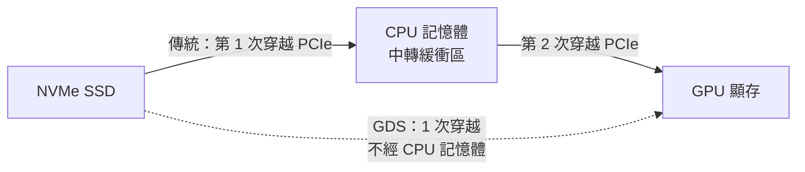

# W02D04｜GPUDirect 與 DMA：資料不繞經 CPU 記憶體，省下的到底是什麼

| 項目     | 內容                                                                                                                                                                                                                                                         |
| -------- | ------------------------------------------------------------------------------------------------------------------------------------------------------------------------------------------------------------------------------------------------------------ |
| 週／日   | 第 2 週・第 4 天（2026-11-26）                                                                                                                                                                                                                                |
| 核心問題 | GPUDirect P2P、RDMA、Storage 各讓哪兩個裝置直接傳資料？它們省下的是頻寬、延遲還是 CPU？什麼條件下會失效？                                                                                                                                                         |
| 預計時間 | 35 分鐘（含課後提取測驗）                                                                                                                                                                                                                                     |
| 先修     | W02D02-K4（P2P 經 Root Complex 減半）、W02D02-K5（nvidia-smi 拓撲標識）                                                                                                                                                                                         |
| 來源文章 | [GPUDirect RDMA 與 Storage](../../../01_hardware_architecture/gpudirect/01_gpudirect_technology.md)、[GPUDirect P2P](../../../01_hardware_architecture/gpudirect/02_gpudirect_p2p.md)、[DMA engine](../../../01_hardware_architecture/dma/01_dma_engine.md)、[頻寬速查表 §5](../../../01_hardware_architecture/performance/05_pcie_nvlink_speed_reference.md) |
| 今日受眾 | 四 客戶反對意見（競品、價格）                                                                                                                                                                                                                                  |

## 0. 先想再讀（3 題，不要翻資料，各寫一兩句）

1. 「DMA」是什麼意思？誰下指令、誰真正搬資料？
2. 資料從 NVMe 讀進 GPU，傳統做法要經過哪些地方？
3. 「開了 GPUDirect Storage，讀資料一定快兩倍。」這句話對嗎？

## 1. 今天的情境

韓國一家自駕車公司在做訓練叢集 POC。競品簡報寫：「支援 GPUDirect Storage，資料載入快兩倍。」你們也支援 GDS。

客戶的資料平台主管寄來 POC 結果：開了 GDS，本機 NVMe 讀到 GPU 和不開幾乎一樣，都約 7 GB/s。

他回信：「你們的 GDS 是不是沒作用？對手說能快兩倍。」

速度沒變，GDS 卻可能正在起作用。今天要搞清楚 GPUDirect 各省下什麼、何時會退回傳統路徑。

## 2. 核心概念（具體 → 抽象）

### 2.1 DMA：CPU 下單，搬運硬體去搬

CPU 把來源、目的地、長度寫成一張「單子」（descriptor）交給 DMA engine，硬體在背景搬，搬完通知 CPU（`01_dma_engine.md:11`）。GPU 的 copy engine 就是一種 DMA engine（`01_dma_engine.md:15`）。「零複製」是去掉 CPU 記憶體裡的中轉緩衝區，DMA 仍在（`01_dma_engine.md:130`）。

定義：DMA 把控制留給 CPU、搬運交給專門硬體，價值在於搬運和計算同時進行（`01_dma_engine.md:13`）。

### 2.2 GPUDirect P2P：GPU 對 GPU，兩跳變一跳

沒有 P2P 時，資料先寫到 CPU 記憶體再讀回，共兩跳；有 P2P 一跳直達（`02_gpudirect_p2p.md:98-104`）。A100 實測：經 NVLink 的 P2P 單向 239.28 GB/s，經 CPU 中轉只有 11.76 GB/s（`01_dma_engine.md:117-118`）。

定義：P2P 讓兩張 GPU 直接互傳；NVLink 最快，同一顆 PCIe Switch 次之，跨 NUMA 不支援（`02_gpudirect_p2p.md:261-266`）。

### 2.3 GPUDirect RDMA：網卡直接讀寫 GPU 顯存

傳統跨機傳輸要「GPU 顯存 → CPU 記憶體 → 網卡」；GPUDirect RDMA 讓網卡透過 PCIe BAR 直接讀寫 GPU 顯存，CPU 只管建立連線（`01_gpudirect_technology.md:21-25,35-44,64`）。只經 PCIe Switch 最好，跨 CPU socket 可能嚴重受限；IOMMU 要關閉或設成 passthrough（`01_gpudirect_technology.md:39-41`）。

定義：RDMA 讓跨機的 GPU 資料不在 CPU 記憶體落地；網卡和 GPU 越近越好。

### 2.4 GPUDirect Storage：NVMe 直接寫進 GPU

傳統讀檔三步：NVMe 寫進 page cache → CPU 複製到使用者緩衝區 → DMA 到 GPU，PCIe 走兩趟（`01_gpudirect_technology.md:122-132`）。GDS 讓 NVMe 直接 DMA 進 GPU 顯存（`01_gpudirect_technology.md:160-162`）。



*圖：讀檔到 GPU 的兩條路（來源 `01_gpudirect_technology.md:122-132,160-162`、`05_pcie_nvlink_speed_reference.md:94-96`）*

Gen4 x4 NVMe：buffered 約 3.5 GB/s，O_DIRECT 約 7，GDS 也約 7（`05_pcie_nvlink_speed_reference.md:94-96`）。NVMe 的 x4 介面是瓶頸時，GDS 省下的是一次 PCIe 穿越和 CPU 的工作，頻寬未必變高。前提是 ACS bypass、`iommu=pt`、O_DIRECT 開檔，任一不符就退回傳統路徑（`01_gpudirect_technology.md:166-168`）。

定義：官方說的「峰值頻寬至少兩倍」是路徑判斷，不是通用的加速倍數（`01_gpudirect_technology.md:174`）。

## 3. 數字與口徑

| 項目 | 數值 | 單位 | 口徑（單向／雙向・dense／sparsity・卡規格／系統可用・廠商／實測・日期） | 來源 file:line |
| ---- | ---- | ---- | ---------------------------------------------------------------------- | -------------- |
| A100 NVLink P2P | 239.28 | GB/s | 實測，simpleP2P，64 MB，單向 | 01_dma_engine.md:117 |
| A100 經 CPU 中轉 | 11.76 | GB/s | 實測，128 MB 往返的每方向等效速率 | 01_dma_engine.md:118 |
| 兩台 H100 節點 GPUDirect RDMA | 約 23 | GB/s | 實測，跨節點驗證，受網路與拓撲影響 | 01_dma_engine.md:120 |
| NVMe → GPU 傳統 buffered | 約 3.5 | GB/s | Gen4 x4 NVMe，2 次 PCIe 穿越 + CPU 複製 | 05_pcie_nvlink_speed_reference.md:94 |
| NVMe → GPU 傳統 O_DIRECT | 約 7 | GB/s | Gen4 x4 NVMe，2 次 PCIe 穿越，無 CPU 複製 | 05_pcie_nvlink_speed_reference.md:95 |
| NVMe → GPU 經 GDS | 約 7／約 14 | GB/s | Gen4 x4／Gen5 x4 NVMe，1 次 PCIe 穿越，同 Switch 最優 | 05_pcie_nvlink_speed_reference.md:96-97 |
| A100 copy engine 對 SM 複製 | 約 818／約 1453 | GB/s | 實測 HBM 內複製，約峰值 40%／71%，不可當 HBM 峰值 | 01_dma_engine.md:119 |

## 4. 常見誤區（3 條）

| 誤區 | 為什麼錯 | 正確說法 |
| ---- | -------- | -------- |
| 「開了 GDS 就一定快兩倍」 | 「至少兩倍」是路徑判斷；NVMe 是瓶頸時，GDS 和 O_DIRECT 都約 7 GB/s（`01_gpudirect_technology.md:174`、`05_pcie_nvlink_speed_reference.md:95-96`） | GDS 省下 CPU 工作與一次 PCIe 穿越，頻寬看瓶頸 |
| 「零複製就是沒有 DMA」 | 零複製是去掉 CPU 中轉緩衝區，DMA 仍在搬（`01_dma_engine.md:130`） | 零複製 = 少一次中轉，不是不搬 |
| 「有 GPUDirect 功能，插上就會生效」 | ACS、IOMMU、O_DIRECT 任一不符就退回；跨 socket 的 P2P 不支援（`01_gpudirect_technology.md:166-168`、`02_gpudirect_p2p.md:266`） | 檢查拓撲與設定，確認實際路徑 |

## 5. Pre-sales 口徑

- **30 秒・客戶 CxO／採購版**：這類「直通」技術讓資料不必先停在主機記憶體，省下主機處理器的工作和一段傳輸。硬碟夠快時速度會提升；硬碟本身是瓶頸時速度不一定變，但處理器會空出來。「快兩倍」要看資料從哪來、硬碟多快，我們用您的資料實測。
- **3 分鐘・客戶工程師版**：傳統讀檔是 NVMe → page cache → 使用者緩衝區 → GPU，PCIe 走兩趟，還有一次 CPU 複製。GDS 讓 NVMe 直接 DMA 進 GPU，只走一趟。Gen4 x4 NVMe 的數字：buffered 約 3.5、O_DIRECT 約 7、GDS 約 7 GB/s，所以 POC 和 O_DIRECT 比看不出差別是合理的，差在 CPU 使用率。也要確認 GDS 真的生效：ACS bypass、`iommu=pt`、O_DIRECT 任一不符就退回相容模式；NVMe 和 GPU 最好同一顆 Switch。來源：`01_gpudirect_technology.md:122-132,166-174`、`05_pcie_nvlink_speed_reference.md:94-96`。
- **配置建議**：要靠 GDS 加速資料載入，讓 NVMe 和 GPU 掛在同一顆 PCIe Switch、同一個 socket 下；跨機 RDMA 時網卡和 GPU 也盡量同 Switch。要再問客戶：**訓練資料放在本機 NVMe 還是遠端儲存？現在的瓶頸是讀資料，還是 CPU 前處理？**
- **反對意見應對**：客戶說「開了 GDS 沒變快，對手說能快兩倍」。先認同：「您量到的 7 GB/s 是準的，這顆 NVMe 的介面上限就在這裡。」再補條件：「GDS 省下的是一次 PCIe 傳輸和 CPU 複製；硬碟本身是瓶頸時，兩種方式頻寬都約 7 GB/s。對手說的兩倍，是相對 buffered 的 3.5 GB/s 這種路徑。」下一步：「我們用 `nvidia-smi topo -m` 確認拓撲、檢查 GDS 是否生效、量 CPU 使用率；要更高頻寬，再評估 Gen5 或多顆 NVMe。」

## 6. 精緻化提問（寫下你的答案再往下）

1. 為什麼 GDS 要求 IOMMU 設成 passthrough、ACS 關閉轉發限制？它們分別擋住了什麼？
2. W02D02-K4 說同 Switch 的 P2P 約 63 GB/s、經 Root Complex 約 32。今天的 GDS「同 Switch 最優」，是同一個道理嗎？
3. 如果客戶把資料從本機 NVMe 改放到遠端儲存，今天學的哪一種 GPUDirect 會變成主角？

## 7. 課後提取測驗（閉卷，填信心 1～5）

| #   | 題型 | 題目 | 我的答案 | 信心 |
| --- | ---- | ---- | -------- | ---- |
| 1   | FR   | GPUDirect P2P、RDMA、Storage 各讓哪兩個裝置直接傳資料？各省下了哪一段？ |          |      |
| 2   | SA   | GDS 要生效需要哪三個前提條件？不滿足會怎樣？ |          |      |
| 3   | CA   | 用 Gen4 x4 NVMe 讀 70 GB 的資料進 GPU，傳統 buffered 和 GDS 各約要多久？ |          |      |
| 4   | TJ   | 「零複製就是完全不用 DMA。」判斷對錯並說理 |          |      |
| 5   | OR   | 客戶說「開了 GDS 沒變快，對手說能快兩倍」，用 60 秒回應 | （錄音檔名） |      |

## 8. 可測知識點（K 點）

```text
W02D04-K1 | 2 | DMA 是委託：CPU／驅動把來源、目的、長度寫成 descriptor 交給 DMA engine 搬運，控制面在 CPU、資料面在 engine；GPU 的 copy engine 是 DMA engine 的一種；零複製是去掉 CPU 中轉緩衝區，DMA 仍在 | 01_hardware_architecture/dma/01_dma_engine.md:11-15,130 | 工程師
W02D04-K2 | 2 | GPUDirect P2P 把 GPU 間傳輸從兩跳（D2H + H2D 經系統記憶體）縮成一跳；A100 實測 NVLink P2P 單向 239.28 GB/s，經 CPU 中轉約 11.76 GB/s | 01_hardware_architecture/gpudirect/02_gpudirect_p2p.md:98-104；01_dma_engine.md:117-118 | 工程師、CxO
W02D04-K3 | 2 | P2P 路徑優劣：NV# 最佳、PIX 次之、PXB 良好、PHB 一般、NODE 受限、SYS（跨 NUMA）不支援 GPUDirect P2P | 02_gpudirect_p2p.md:260-266 | TAM、工程師
W02D04-K4 | 2 | GPUDirect RDMA 讓網卡透過 PCIe BAR 直接讀寫 GPU 顯存，資料不經 CPU 記憶體；路徑只經 PCIe Switch 最佳，跨 CPU socket 可能嚴重受限；IOMMU 須關閉或 1:1 passthrough | 01_hardware_architecture/gpudirect/01_gpudirect_technology.md:13,35-44 | 工程師、TAM
W02D04-K5 | 2 | 傳統讀檔到 GPU 三步：NVMe → page cache → 使用者緩衝區（CPU 複製）→ H2D；PCIe 走兩趟。GDS 讓 NVMe 的 DMA 直接寫入 GPU 顯存，只走一趟 | 01_gpudirect_technology.md:122-132,160-162 | 工程師
W02D04-K6 | 3 | GDS 前提：ACS bypass、`iommu=pt`、O_DIRECT 開檔；任一不符，libcufile 自動退回系統記憶體中轉的相容模式 | 01_gpudirect_technology.md:166-168 | TAM
W02D04-K7 | 4 | Gen4 x4 NVMe 讀進 GPU：buffered 約 3.5、O_DIRECT 約 7、GDS 約 7 GB/s；NVMe 本身是瓶頸時 GDS 頻寬不一定提升，收益在少一次 PCIe 穿越與 CPU 卸載；「至少兩倍」是路徑判斷而非通用倍數 | 01_hardware_architecture/performance/05_pcie_nvlink_speed_reference.md:94-96；01_gpudirect_technology.md:174 | CxO、TAM
W02D04-K8 | 3 | copy engine 適合大塊、可與計算重疊的複製；A100 HBM 內複製實測 copy engine 約 818 GB/s（峰值 40%）、SM 複製約 1453 GB/s（71%），copy engine 數字不能當 HBM 峰值 | 01_dma_engine.md:60,119-122 | 工程師
```

## 來源索引

| 檔案 | 用到的章節／行 | 關鍵內容 |
| ---- | -------------- | -------- |
| `01_hardware_architecture/dma/01_dma_engine.md` | 11-15、60、117-122、130 | DMA 的委託模型、copy engine、P2P 與 RDMA 實測、零複製的意思 |
| `01_hardware_architecture/gpudirect/02_gpudirect_p2p.md` | 98-104、260-266 | P2P 一跳與兩跳、拓撲路徑分級 |
| `01_hardware_architecture/gpudirect/01_gpudirect_technology.md` | 13、21-44、64、122-132、160-174 | RDMA 機制與前提、傳統讀檔三步、GDS 路徑、回退條件、兩倍口徑 |
| `01_hardware_architecture/performance/05_pcie_nvlink_speed_reference.md` | 94-97 | NVMe 到 GPU 各路徑的頻寬 |

<details>
<summary>第 7 節參考答案</summary>

1. P2P：GPU 對 GPU，省下經 CPU 記憶體的中轉（兩跳變一跳）；RDMA：網卡對 GPU 顯存，省下 GPU 和網卡之間經 CPU 記憶體的那段；Storage（GDS）：NVMe 對 GPU 顯存，省下 page cache 和使用者緩衝區的中轉與 CPU 複製。K 點 W02D04-K2、K4、K5，來源 `02_gpudirect_p2p.md:98-104`、`01_gpudirect_technology.md:13,122-132`。常見錯因：把三者都說成「GPU 互傳」。
2. ACS bypass、`iommu=pt`、O_DIRECT 開檔。任一不滿足，libcufile 自動退回經系統記憶體中轉的相容模式，功能仍可用但沒有直通的好處。K 點 W02D04-K6，來源 `01_gpudirect_technology.md:166-168`。常見錯因：以為不滿足就會報錯。
3. buffered：70 ÷ 3.5 = 20 秒；GDS：70 ÷ 7 = 10 秒。注意 O_DIRECT 也約 10 秒，GDS 相對 O_DIRECT 的差別在 CPU 使用率和 PCIe 穿越次數。都是 Gen4 x4 NVMe 的典型值。K 點 W02D04-K7，來源 `05_pcie_nvlink_speed_reference.md:94-96`。常見錯因：拿 GDS 和 O_DIRECT 比，卻以為會快兩倍。
4. 錯。零複製通常指去掉 CPU 記憶體裡的中轉緩衝區，資料仍由 DMA engine 搬運。K 點 W02D04-K1，來源 `01_dma_engine.md:130`。常見錯因：把「零複製」字面理解成沒有搬運。
5. 評分看三點：先認同客戶量到的 7 GB/s 準確；說明 NVMe x4 是瓶頸、GDS 省下的是 CPU 和一次 PCIe 穿越，以及對手的兩倍是相對 buffered；給出下一步（檢查拓撲與 GDS 是否生效、量 CPU 使用率、評估 Gen5 或多顆 NVMe）。來源 `01_gpudirect_technology.md:166-174`、`05_pcie_nvlink_speed_reference.md:94-96`。自評用 `00_study_plan/02_assessment_spec.md` 第 7.1 節評分表。

</details>
