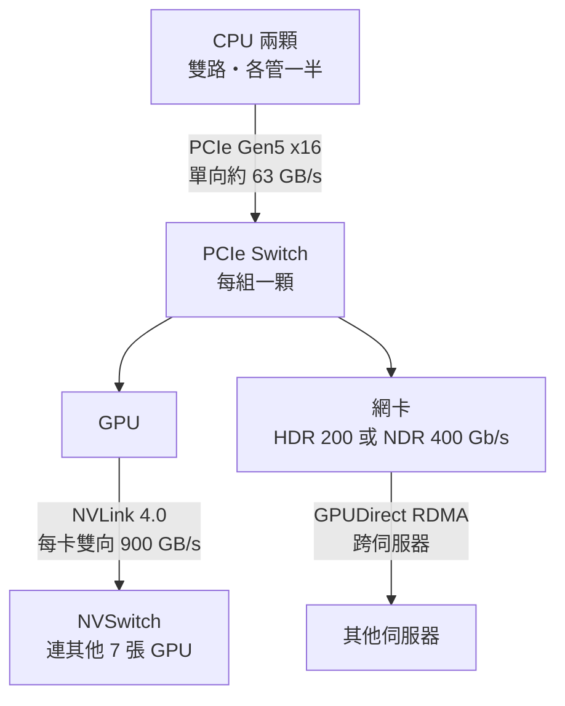

# W02D05｜整合：走一遍 HGX 八卡伺服器的資料路徑，為什麼還要 8 張網卡

| 項目     | 內容                                                                                                                                                                                                                                                                                                         |
| -------- | ------------------------------------------------------------------------------------------------------------------------------------------------------------------------------------------------------------------------------------------------------------------------------------------------------------ |
| 週／日   | 第 2 週・第 5 天（2026-11-27）                                                                                                                                                                                                                                                                                |
| 核心問題 | 八卡伺服器裡，資料在 CPU、PCIe Switch、GPU、NVSwitch、網卡之間怎麼走？每一段的頻寬是多少？瓶頸在哪一段？                                                                                                                                                                                                          |
| 預計時間 | 35 分鐘（含課後提取測驗）                                                                                                                                                                                                                                                                                     |
| 先修     | W02D02-K5（nvidia-smi 拓撲標識）、W02D03-K7（兩種 900 GB/s）、W02D04-K4（GPUDirect RDMA）                                                                                                                                                                                                                      |
| 來源文章 | [單 GPU 拓撲分析](../../../01_hardware_architecture/performance/02_single_gpu_topology_analysis.md)、[GPUDirect RDMA 跨節點驗證](../../../01_hardware_architecture/gpudirect/04_gpudirect_rdma_verification.md)、[CXL 全景](../../../01_hardware_architecture/pcie/08_cxl_interconnect_overview.md)（§一、§五）、[IB 網路理論](../../../03_ai_cluster_ops/02_infiniband/01_ib_network_theory.md)（只用 PCIe 瓶頸一段） |
| 今日受眾 | 五 面試官（英文）                                                                                                                                                                                                                                                                                             |

## 0. 先想再讀（3 題，不要翻資料，各寫一兩句）

1. 八張 GPU 之間已經有 NVLink，為什麼 HGX 伺服器還要配好幾張網卡？
2. 網卡和 GPU 掛在哪裡，會影響跨伺服器傳輸嗎？
3. 「nvidia-smi 顯示 GPU 的 PCIe 是 Gen1，所以插槽壞了。」這句話對嗎？

## 1. 今天的情境

你在面一家外商伺服器廠的 Solutions Engineer。面試官在白板上畫了一台八卡 H100 伺服器，問：

「客戶採購說：GPU 之間已經有 900 GB/s 的 NVLink，你們還報 8 張網卡，不是重複花錢嗎？你怎麼回答？順便畫出這台機器的資料路徑。」

這題把整週串起來，也是週日作業 2（HGX 資料路徑圖）的骨架。

## 2. 核心概念（具體 → 抽象）

### 2.1 一台八卡伺服器的資料路徑

一台實測的八卡 H100 伺服器：2 顆 Xeon 8468、8 張 ConnectX-7 網卡，GPU0 和 NIC0 在同一顆 PCIe Switch 下（PIX）（`04_gpudirect_rdma_verification.md:9-20`）。



*圖：八卡伺服器內一組 GPU 與網卡的路徑（來源 `04_gpudirect_rdma_verification.md:12-20`、`05_pcie_nvlink_speed_reference.md:89-93`、`nvlink_intro.md:59`）*

定義：伺服器內 GPU 對 GPU 走 NVLink（scale-up），伺服器之間走網卡（scale-out），CPU 與 GPU 之間走 PCIe。

### 2.2 為什麼是 8 張網卡

NVLink 只連伺服器內的 GPU；跨伺服器的資料一定要經網卡（`nvlink_intro.md:234`）。GPUDirect RDMA 在網卡和 GPU 之間只經 PCIe Switch 時最好（`01_gpudirect_technology.md:39`），所以每張 GPU 配一張同 Switch 的網卡。

一條 PCIe Gen5 x16 約 64 GB/s，剛好撐得住一個 NDR 400 Gb/s（50 GB/s）埠；Gen4 x16 撐不住 NDR（`01_ib_network_theory.md:1694-1696`）。實測兩台 H100 之間：單埠 HDR 196 Gb/s（24.5 GB/s），NCCL all-reduce 等效單向約 23 GB/s（`04_gpudirect_rdma_verification.md:121-126`）。

定義：網卡數跟著 GPU 走，讓每張 GPU 有不經 CPU 的跨機通道。

### 2.3 拓撲要實際看，不要只看規格

`nvidia-smi topo -m` 的 PIX、PXB、PHB 是橋接層級，NODE、SYS 才編碼 NUMA（`02_single_gpu_topology_analysis.md:106-116`）。GPU 閒置時 PCIe 降到 Gen1 省電，負載下才回 Gen5（`02_single_gpu_topology_analysis.md:12`）。容器常遮住 NUMA 效應：兩節點 H2D 都約 52.6 GB/s，裸機預期差約 2.1 倍（`02_single_gpu_topology_analysis.md:162-167`）。

定義：在負載下、在裸機上看實際拓撲。

### 2.4 CXL 一瞥：PCIe 之上的記憶體語義

PCIe 不具一致性，裝置不能快取系統記憶體，只能整塊搬（`08_cxl_interconnect_overview.md:16`）。CXL 沿用 PCIe 實體層，多了 CXL.cache 和 CXL.mem，分 Type 1／2／3 裝置（`08_cxl_interconnect_overview.md:50`）。CXL 記憶體閒置延遲約 DDR 的兩倍，主流用法是當「冷的一層」擴容量，甜蜜點在機架內，不取代乙太網（`08_cxl_interconnect_overview.md:159-161`）。

定義：CXL 解決的是「記憶體擴容與池化」，不是 GPU 互連。

## 3. 數字與口徑

| 項目 | 數值 | 單位 | 口徑（單向／雙向・dense／sparsity・卡規格／系統可用・廠商／實測・日期） | 來源 file:line |
| ---- | ---- | ---- | ---------------------------------------------------------------------- | -------------- |
| 實測八卡 H100 的網卡 | 8 × 200 | Gb/s | ConnectX-7，HDR 每埠；GPU0 與 NIC0 同 Switch | 04_gpudirect_rdma_verification.md:16-18 |
| 單埠 HDR ib_write_bw | 196／24.5 | Gb/s／GB/s | 實測，主機記憶體，單向 | 04_gpudirect_rdma_verification.md:123 |
| 兩節點 NCCL all-reduce | 45.8／約 23 | GB/s | 實測 Bus BW／等效單向，GPU 記憶體經 RDMA | 04_gpudirect_rdma_verification.md:124-126 |
| PCIe 撐得住的網卡 | Gen5 x16 撐 1 埠 NDR 400 | — | Gen5 x16 約 64 GB/s 對 NDR 50 GB/s；Gen4 x16 撐不住 NDR | 01_ib_network_theory.md:1694-1696 |
| 容器內 H2D，跨 NUMA／本地 | 52.60／52.63 | GB/s | 實測，RTX 5090；容器限制 membind，裸機預期差約 2.1 倍 | 02_single_gpu_topology_analysis.md:162-167 |
| CPU 到 CXL Type 3 記憶體 | 約 170 | ns | 論文估算，Intel 平台為主 | 08_cxl_interconnect_overview.md:86 |
| CXL 對 DDR | 8／約 2 | 倍 | 每引腳頻寬／閒置延遲 | 08_cxl_interconnect_overview.md:159 |

## 4. 常見誤區（3 條）

| 誤區 | 為什麼錯 | 正確說法 |
| ---- | -------- | -------- |
| 「有 NVLink 就不需要那麼多網卡」 | NVLink 只連伺服器內；跨伺服器一定走網卡（`nvlink_intro.md:234`） | 網卡管 scale-out，數量跟 GPU 數與叢集規模走 |
| 「nvidia-smi 顯示 Gen1，插槽壞了」 | 閒置時鏈路降到 Gen1 省電，負載下才回到 Gen5（`02_single_gpu_topology_analysis.md:12`） | 在負載下再看一次 |
| 「CXL 會取代 NVLink 或乙太網」 | CXL 甜蜜點在機架內的記憶體擴容與池化（`08_cxl_interconnect_overview.md:159-161`） | CXL 管記憶體，NVLink 管 GPU，網路管跨機 |

## 5. Pre-sales 口徑

- **30 秒・客戶 CxO／採購版**：伺服器裡有兩種路：機器內八張 GPU 之間是內部專線，機器和機器之間靠網卡。幾台伺服器串成叢集訓練時，每張 GPU 都需要自己的對外出口，否則會擠在少數出口排隊，貴的 GPU 就在等資料。所以網卡數量跟 GPU 走，不是重複花錢。
- **3 分鐘・客戶工程師版**：NVLink 4.0 每卡雙向 900 GB/s，只在機內。跨機靠 GPUDirect RDMA，網卡和 GPU 在同一顆 PCIe Switch 下（PIX）最好，所以 1 GPU 配 1 NIC。一條 Gen5 x16 約 64 GB/s，剛好撐一個 NDR 400 埠，Gen4 撐不住。實測兩台 H100 用 HDR：單埠 196 Gb/s，NCCL 等效單向約 23 GB/s。驗收用 `nvidia-smi topo -m` 確認 GPU 和 NIC 是 PIX。來源：`04_gpudirect_rdma_verification.md:12-20,121-126`、`01_ib_network_theory.md:1694-1696`。
- **配置建議**：單機推理、不跨機：網卡可少配，重點在儲存與前端網路。多機訓練或 PD 分離推理：每 GPU 一張網卡、同 Switch，配 NDR 400 時平台須是 Gen5。要再問客戶：**會不會跨機訓練？叢集要幾台？已有的交換器是 HDR、NDR 還是乙太網？**
- **反對意見應對**：客戶說「GPU 之間已經有 900 GB/s，8 張網卡是重複花錢」。先認同：「單機使用的話，您說得對，網卡可以少配。」再補條件：「NVLink 只在機內；多台一起訓練時，每張 GPU 都要自己的跨機出口，網卡少了，GPU 就排隊等資料。」下一步：「先確認您第一年會不會擴到多台；不會的話我們給單機配置，需要時再加卡。」

## 6. 精緻化提問（寫下你的答案再往下）

1. 為什麼網卡要和 GPU 掛在同一顆 PCIe Switch 下，而不是直接接在 CPU 上？用 W02D02-K4 和 W02D04-K4 解釋。
2. 實測的 NCCL 等效單向約 23 GB/s，和這台機器 NVLink 每卡雙向 900 GB/s 比，差幾十倍？這對「把一個模型拆到兩台機器」意味著什麼？
3. 如果客戶問「CXL 能不能幫 GPU 加顯存」，用今天學的，你會怎麼回答？哪裡你還不確定？

## 7. 課後提取測驗（閉卷，填信心 1～5）

| #   | 題型 | 題目 | 我的答案 | 信心 |
| --- | ---- | ---- | -------- | ---- |
| 1   | FR   | 畫出（或寫出）八卡伺服器裡 CPU、PCIe Switch、GPU、NVSwitch、網卡的連接，並在每一段標頻寬與口徑 |          |      |
| 2   | SA   | 為什麼八卡伺服器通常配 8 張網卡，而且要和 GPU 同一顆 PCIe Switch？ |          |      |
| 3   | CA   | 一個 NDR 400 Gb/s 的網卡需要多少 GB/s 的 PCIe 頻寬？Gen4 x16 和 Gen5 x16 哪個撐得住？ |          |      |
| 4   | TJ   | 「在容器裡測 H2D，跨 NUMA 和本地幾乎一樣，所以 NUMA 不重要。」判斷對錯並說理 |          |      |
| 5   | OR   | Answer the interviewer in English (60 s): "The customer says eight NICs are redundant because the GPUs already have 900 GB/s NVLink. How do you respond?" | （錄音檔名） |      |

## 8. 可測知識點（K 點）

```text
W02D05-K1 | 2 | 八卡伺服器三種路：GPU 對 GPU 走 NVLink（機內 scale-up，NVLink 4.0 每卡雙向 900 GB/s）；伺服器之間走網卡（scale-out）；CPU 與 GPU 之間走 PCIe（Gen5 x16 單向約 63 GB/s） | 01_hardware_architecture/nvlink/nvlink_intro.md:59,234；01_hardware_architecture/performance/05_pcie_nvlink_speed_reference.md:93 | 工程師、CxO
W02D05-K2 | 3 | 實測八卡 H100：2 × Xeon 8468、8 × ConnectX-7（HDR 200 Gb/s），GPU0 與 NIC0 同一顆 PCIe Switch（PIX）；1 GPU 配 1 NIC 讓每張 GPU 有不經 CPU 的跨機通道 | 01_hardware_architecture/gpudirect/04_gpudirect_rdma_verification.md:9-20 | TAM、業務
W02D05-K3 | 3 | PCIe Gen5 x16 約 64 GB/s 可撐 1 埠 NDR 400 Gb/s（50 GB/s）；Gen4 x16 約 32 GB/s 撐不住 NDR，只夠單埠 HDR；ConnectX-7 是 PCIe 5.0 裝置 | 03_ai_cluster_ops/02_infiniband/01_ib_network_theory.md:1694-1696 | 工程師、TAM
W02D05-K4 | 2 | 兩台 H100 跨節點實測：單埠 HDR ib_write_bw 196 Gb/s（24.5 GB/s）；NCCL all-reduce Bus BW 45.8 GB/s，等效單向約 23 GB/s | 04_gpudirect_rdma_verification.md:121-126 | 工程師
W02D05-K5 | 2 | nvidia-smi topo 的 PIX、PXB、PHB 是橋接層級分類，與 NUMA 無關；只有 NODE、SYS 編碼 NUMA／socket 資訊 | 01_hardware_architecture/performance/02_single_gpu_topology_analysis.md:106-116 | TAM
W02D05-K6 | 2 | GPU 閒置時 PCIe 鏈路降到 Gen1 省電，負載下才恢復 Gen5；看到 Gen1 先在負載下複查 | 02_single_gpu_topology_analysis.md:12 | TAM
W02D05-K7 | 3 | 容器常遮住 NUMA 效應：實測跨 NUMA 與本地 H2D 都約 52.6 GB/s，因容器限制 membind；裸機預期差約 2.1 倍 | 02_single_gpu_topology_analysis.md:162-167 | TAM、工程師
W02D05-K8 | 3 | CXL 沿用 PCIe 實體層，加上 CXL.cache 與 CXL.mem（Type 1／2／3 裝置）；每引腳頻寬約 DDR 的 8 倍、閒置延遲約 2 倍，主流用法是冷記憶體層擴容量，甜蜜點在機架內、不取代乙太網 | 01_hardware_architecture/pcie/08_cxl_interconnect_overview.md:50,159-161 | 工程師、PMM
```

## 來源索引

| 檔案 | 用到的章節／行 | 關鍵內容 |
| ---- | -------------- | -------- |
| `01_hardware_architecture/gpudirect/04_gpudirect_rdma_verification.md` | 9-20、121-126 | 八卡 H100 實測配置、GPU 與 NIC 同 Switch、跨節點頻寬 |
| `03_ai_cluster_ops/02_infiniband/01_ib_network_theory.md` | 1694-1696 | PCIe 代際能撐多快的網卡 |
| `01_hardware_architecture/performance/02_single_gpu_topology_analysis.md` | 12、106-116、162-167 | 閒置降速、topo 標識、容器遮住 NUMA |
| `01_hardware_architecture/pcie/08_cxl_interconnect_overview.md` | 16、50、86、159-161 | PCIe 非一致性、CXL 三協議與裝置類型、延遲、部署邊界 |
| `01_hardware_architecture/nvlink/nvlink_intro.md` | 59、234 | NVLink 4.0 頻寬、scale-up 與 scale-out 分工 |
| `01_hardware_architecture/gpudirect/01_gpudirect_technology.md` | 39 | RDMA 路徑只經 PCIe Switch 最好 |
| `01_hardware_architecture/performance/05_pcie_nvlink_speed_reference.md` | 89-93 | PCIe 與 NVLink 各段頻寬 |

<details>
<summary>第 7 節參考答案</summary>

1. CPU（兩顆）→ PCIe Gen5 x16（單向約 63 GB/s）→ PCIe Switch → GPU 與網卡（同 Switch，PIX）；GPU → NVLink 4.0（每卡雙向 900 GB/s）→ NVSwitch → 其他 7 張 GPU；網卡（HDR 200 或 NDR 400 Gb/s，單向）→ 其他伺服器。每段要標單向或雙向。K 點 W02D05-K1、K2，來源 `04_gpudirect_rdma_verification.md:12-20`、`05_pcie_nvlink_speed_reference.md:89-93`。常見錯因：把網卡畫在 NVSwitch 後面。
2. NVLink 只在機內，跨機必須走網卡；GPUDirect RDMA 在網卡與 GPU 只經 PCIe Switch 時最好，所以每張 GPU 配一張同 Switch 的網卡，避免多張 GPU 擠同一個出口、也避免繞經 CPU。K 點 W02D05-K2，來源 `01_gpudirect_technology.md:39`、`nvlink_intro.md:234`。常見錯因：只答「為了更快」。
3. 400 ÷ 8 = 50 GB/s（單向）。Gen4 x16 約 32 GB/s 撐不住；Gen5 x16 約 64 GB/s 撐得住一埠。K 點 W02D05-K3，來源 `01_ib_network_theory.md:1694-1696`。常見錯因：忘了除以 8，以為 400 GB/s。
4. 錯。容器限制了 membind，記憶體配置不受 CPU 綁定影響，所以量不出差異；裸機預期跨 NUMA 約差 2.1 倍。K 點 W02D05-K7，來源 `02_single_gpu_topology_analysis.md:162-167`。常見錯因：相信測試數字、沒問測試環境。
5. 評分看四點（面試官版）：先給結論（單機不需要，多機需要）；機制（NVLink 只在機內，跨機靠 GPUDirect RDMA，1 GPU 1 NIC 同 Switch）；主動講邊界或不確定處（例如「實際要幾張，看叢集規模與交換器速率，我會先問」）；停下來等追問。來源 `04_gpudirect_rdma_verification.md:12-20`、`nvlink_intro.md:234`。自評用 `00_study_plan/02_assessment_spec.md` 第 7.1 節評分表。

</details>
