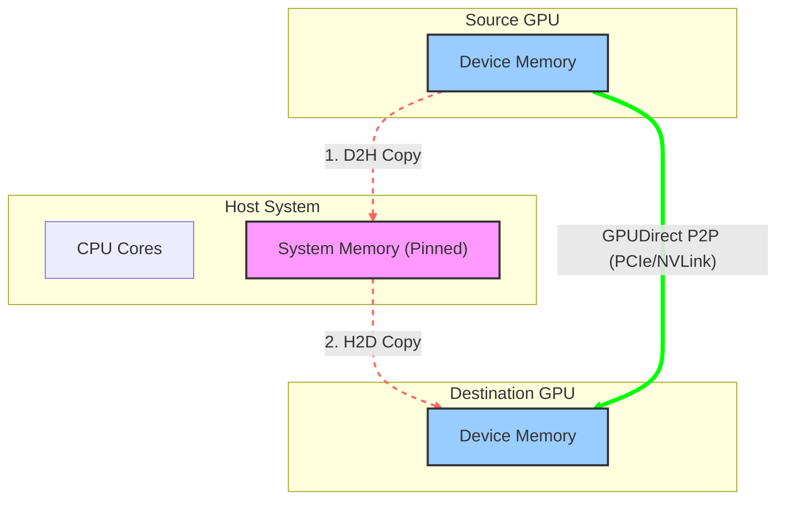

# NVIDIA GPUDirect P2P 技術詳解：節點內 GPU 高速互聯

## 1. 引言

在單機多卡（Single Node Multi-GPU）的深度學習訓練和高效能運算場景中，GPU 之間頻繁的資料交換是不可避免的。傳統的 GPU 間通訊（P2P, Peer-to-Peer）如果透過 CPU 系統記憶體中轉，會帶來顯著的延遲和頻寬瓶頸。

**GPUDirect P2P (Peer-to-Peer)** 技術允許同一節點內的 GPU 直接訪問彼此的顯存，無需將資料複製到 CPU 主機記憶體。這是構建高效多卡平行計算的基礎，也是 GPUDirect 家族中最基礎且應用最廣泛的技術之一。

---

## 2. 技術原理

GPUDirect P2P 的核心在於繞過 CPU 和系統記憶體，利用 PCIe 匯流排的 **Peer-to-Peer TLP (Transaction Layer Packet) 轉發**機制或 **NVLink 高速互連**協議，在 GPU 之間建立直接的 DMA (Direct Memory Access) 通路。

### 2.1 資料路徑與延遲模型

先對比傳統的資料回彈（Bounce Buffer）路徑與 GPUDirect P2P 的直接傳輸路徑，差異集中在延遲與頻寬利用率上。



- **傳統路徑 (Bounce Buffer)**：

  1. **D2H (Device-to-Host)**：源 GPU 透過 DMA 將資料寫入 CPU 系統記憶體（通常是 Pinned Memory）。
  2. **H2D (Host-to-Device)**：目標 GPU 透過 DMA 從系統記憶體讀取資料。

  - **瓶頸**：資料在 PCIe 匯流排上往返兩次，增加了延遲；且受限於系統記憶體頻寬和 CPU 記憶體控制器效率。

- **GPUDirect P2P 路徑**：

  1. **D2D (Device-to-Device)**：源 GPU 的 DMA 引擎直接向目標 GPU 的實體地址發起寫操作。

  - **優勢**：資料僅經過 PCIe Switch 或 NVLink 互連，無需經過 Root Complex (在同一 Switch 下) 或 CPU 記憶體，實現了真正的零複製 (Zero-Copy)。

### 2.2 關鍵技術支撐

GPUDirect P2P 的實現依賴於軟硬體的緊密協同，包括軟體層的**統一虛擬定址** (UVA) 以及硬體層的 PCIe/NVLink 互連機制。

#### 2.2.1 統一虛擬定址 (UVA) 與頁表對映

CUDA 4.0 引入的 **UVA** (Unified Virtual Addressing) 是 P2P 的軟體基礎。

- **單一地址空間**：UVA 將 CPU 記憶體和所有 GPU 的顯存對映到同一個 64 位虛擬地址空間。
- **MMU 協同**：當開啟 P2P (`cudaDeviceEnablePeerAccess`) 后，CUDA 驅動程式會修改 GPU 的頁表 (Page Table)。它將目標 GPU (Peer GPU) 的實體地址範圍對映到當前 GPU (Current GPU) 的虛擬地址空間中。
- **直接定址**：因此，CUDA Kernel 可以直接解引用一個指向 Peer GPU 顯存的指標。GPU MMU 會自動將該虛擬地址翻譯為目標 GPU 的物理地址，併發起透過 PCIe/NVLink 的訪問請求。

#### 2.2.2 PCIe P2P 機制與 BAR 空間

對於基於 PCIe 的 P2P，其底層依賴於 PCIe 規範中的 **Base Address Register (BAR)** 機制。

- **BAR 映射**：每個 GPU 在啟動時都會將其顯存的一部分（通常是几百 MB 到全部顯存，取決於 Resizable BAR 設定）映射到 PCIe 匯流排實體地址空間。
- **TLP 路由**：當源 GPU 發起對目標 GPU BAR 地址的寫操作時，PCIe Switch 會根據地址路由 TLP 包。
  - **同一 Switch 下**：Switch 直接將 TLP 轉發給目標 GPU，不經過 CPU Root Complex。
  - **跨 Switch/Root Port**：TLP 可能需要經過 Root Complex，此時如果 **ACS (Access Control Services)** 開啟，會阻斷 P2P 轉發並將 TLP 重定向到 Root Complex，導致頻寬減半。需關閉 ACS 或配置 ACS 直通策略。

#### 2.2.3 NVLink 高速互連

NVLink 是 NVIDIA 專有的互連協議，專為多 GPU 通訊最佳化。

- **高頻寬與低延遲**：相比 PCIe，NVLink 提供了更高的頻寬（例如 H100 上的 NVLink 4.0 雙向頻寬達 900 GB/s）和更低的協議開銷。
- **記憶體語義**：NVLink 原生支持 Load/Store 記憶體語義，使得 GPU 間訪問更接近於訪問本地顯存。
- **拓撲結構**：透過 NVSwitch，可以構建全互聯 (All-to-All) 的 GPU 網路，使得任意兩個 GPU 之間的 P2P 性能一致，消除了 PCIe 樹狀拓撲帶來的 NUMA 效應。

---

## 3. 核心優勢與效能對比

GPUDirect P2P 把 GPU 間傳輸從“兩跳經系統記憶體”縮短為“一跳直達”。收益落在三個維度：頻寬、延遲、CPU 占用。

### 3.1 效能對比表

| 指標           | 傳統路徑 (Without P2P)                 | GPUDirect P2P                               |
| :------------- | :------------------------------------- | :------------------------------------------ |
| **資料路徑**   | GPU A -> System Memory -> GPU B        | GPU A -> GPU B (Direct)                     |
| **傳輸跳數**   | 2 跳 (Device-to-Host + Host-to-Device) | 1 跳 (Device-to-Device)                     |
| **CPU 參與度** | 高 (需管理系統記憶體緩衝區)              | 低 (僅建立連線，不參與資料搬運)             |
| **延遲**       | 高 (PCIe 往返 + 系統記憶體開銷)          | 低 (直接透過 PCIe Switch 或 NVLink)         |
| **頻寬瓶頸**   | 受限於 PCIe 頻寬及系統記憶體頻寬         | 受限於 PCIe 或 NVLink (NVLink 可達 900GB/s) |

### 3.2 收益從哪來

#### 3.2.1 頻寬

PCIe 路徑受限於匯流排頻寬（例如 PCIe Gen5 x16 雙向約為 128 GB/s）；NVLink 把互聯頻寬提到另一個量級。

**NVLink 優勢**：在 NVIDIA H100 GPU 上，NVLink 4.0 提供高達 **900 GB/s** 的雙向聚合頻寬，是 PCIe Gen5 的約 7 倍。這對於參數量巨大的大模型訓練（如 Transformer 架構）至關重要，因為 `AllReduce` 等集合通訊操作是頻寬敏感型的。

#### 3.2.2 延遲

透過消除 **Bounce Buffer**（系統記憶體中轉），P2P 顯著降低了端到端延遲。

- **物理路徑縮短**：在同一 PCIe Switch（PIX）下，資料不再需要經過 Root Complex 和 CPU 記憶體控制器，減少了物理鏈路長度。
- **協議開銷降低**：省去了 CPU 端的記憶體分配、鎖頁（Pinning）以及兩次 DMA 描述符的建立過程。對於小包通訊（Latency-sensitive），這種延遲最佳化尤為明顯。

#### 3.2.3 CPU 解除安裝

在傳統模式下，CPU 需要花費大量週期來管理 DMA 緩衝區和設定描述符。開啟 P2P 后：

- **控制流與資料流分離**：CPU 僅需負責發射指令（Launch Kernels/MemcpyAsync），繁重的資料搬運工作完全由 GPU 的 Copy Engine (DMA) 或 SM (透過 NVLink Load/Store) 完成。
- **重疊執行**：CPU 可以立即返回執行其他邏輯，從而更容易實現計算與通訊的重疊 (Compute-Communication Overlap)。

#### 3.2.4 程式設計模型的簡化與統一

P2P 支持 **Direct Memory Access (DMA)**，這意味著開發者可以將所有 GPU 的顯存視為一個統一的地址空間。

- **零程式碼遷移**：對於使用 Unified Memory (`cudaMallocManaged`) 的應用，驅動程式會自動利用 P2P 路徑加速頁遷移，無需修改任何程式碼。
- **核心級訪問**：CUDA Kernel 可以直接讀寫 Peer GPU 顯存，這使得編寫自定義的細粒度通訊演算法（如環形 AllReduce）變得非常直觀。

---

## 4. 開發者指南：API 與程式碼示例

使用 GPUDirect P2P 主要涉及 CUDA Runtime API。開發者通常需要關注三個核心步驟：**查詢拓撲**、**啟用訪問**、**執行傳輸**。

### 4.1 啟用 P2P 訪問 (P2P Initialization)

P2P 訪問並非預設開啟。必須顯式檢查硬體支援並在每一對 GPU 之間建立連線。

> **注意**：`cudaDeviceEnablePeerAccess` 是一個昂貴的操作（可能涉及 TLB 重新整理和頁表修改），通常只需在應用程式啟動時執行一次。

```cpp
#include <stdio.h>
#include <cuda_runtime.h>

// 簡易錯誤檢查宏
#define CHECK(call) \
{ \
    const cudaError_t error = call; \
    if (error != cudaSuccess) { \
        printf("Error: %s:%d, ", __FILE__, __LINE__); \
        printf("code:%d, reason: %s\n", error, cudaGetErrorString(error)); \
        exit(1); \
    } \
}

int main() {
    int gpuid0 = 0;
    int gpuid1 = 1;
    int can_access_peer_0_1, can_access_peer_1_0;

    // 1. 雙向檢查硬體支援
    CHECK(cudaDeviceCanAccessPeer(&can_access_peer_0_1, gpuid0, gpuid1));
    CHECK(cudaDeviceCanAccessPeer(&can_access_peer_1_0, gpuid1, gpuid0));

    if (can_access_peer_0_1 && can_access_peer_1_0) {
        printf("P2P Access supported between GPU %d and GPU %d.\n", gpuid0, gpuid1);

        // 2. 雙向啟用 P2P 訪問
        // 注意：必須切換到源裝置來授權對目標裝置的訪問

        // GPU 0 可以訪問 GPU 1
        CHECK(cudaSetDevice(gpuid0));
        CHECK(cudaDeviceEnablePeerAccess(gpuid1, 0));

        // GPU 1 可以訪問 GPU 0
        CHECK(cudaSetDevice(gpuid1));
        CHECK(cudaDeviceEnablePeerAccess(gpuid0, 0));

        printf("Bidirectional P2P Access enabled.\n");
    } else {
        printf("P2P Access NOT supported.\n");
    }

    return 0;
}
```

### 4.2 P2P 資料複製 (Async Copy)

推薦使用 **非同步複製 (`cudaMemcpyPeerAsync`)** 替代同步複製，以充分利用 Copy Engine 並實現計算與通訊的重疊。

```cpp
// 分配顯存
void *d_src, *d_dst;
cudaSetDevice(gpuid0);
cudaMalloc(&d_src, size);
cudaSetDevice(gpuid1);
cudaMalloc(&d_dst, size);

// 建立流
cudaStream_t stream;
cudaSetDevice(gpuid0);
cudaStreamCreate(&stream);

// P2P 非同步複製：從 GPU 0 (src) 到 GPU 1 (dst)
// 此時 CPU 不會被阻塞，可以繼續處理其他任務
cudaMemcpyPeerAsync(d_dst, gpuid1, d_src, gpuid0, size, stream);

// 同步流（等待傳輸完成）
cudaStreamSynchronize(stream);
```

### 4.3 P2P 直接定址 (Direct Access Kernel)

在 Kernel 中直接讀寫遠端 GPU 記憶體是最靈活的方式。利用 `__restrict__` 關鍵字可以幫助編譯器最佳化載入指令。

```cpp
// Kernel: 執行在 GPU 0 上，讀取 GPU 1 的資料
__global__ void p2p_add_kernel(float* __restrict__ local_data,
                               const float* __restrict__ remote_data,
                               int N) {
    int idx = blockIdx.x * blockDim.x + threadIdx.x;
    if (idx < N) {
        // 直接讀取遠端 GPU (remote_data) 的資料
        // 這一行程式碼會觸發透過 NVLink/PCIe 的遠端 Read 事務
        local_data[idx] += remote_data[idx];
    }
}

// Host 端呼叫
void launch_p2p_kernel(float* d_ptr0, float* d_ptr1, int N, cudaStream_t stream) {
    // 假設已開啟 P2P 訪問
    cudaSetDevice(gpuid0);

    // d_ptr1 是 GPU 1 上的指標
    // 得益於 UVA，GPU 0 的 Kernel 可以直接使用該指標
    int threads = 256;
    int blocks = (N + threads - 1) / threads;

    p2p_add_kernel<<<blocks, threads, 0, stream>>>(d_ptr0, d_ptr1, N);
}
```

---

## 5. 效能考量與注意事項

在實際部署 GPUDirect P2P 時，為了獲得理論峰值頻寬並避免潛在的效能陷阱，需要重點關注硬體拓撲、PCIe 配置及程式設計模型限制。

### 5.1 硬體拓撲與 NUMA 親和性

硬體連線方式直接決定了 P2P 的性能上限。

- **拓撲檢測**：使用 `nvidia-smi topo -m` 檢視矩陣。
  - **最佳路徑 (`NV#`)**：透過 NVLink 連線，提供最高頻寬（如 H100 上單向 450GB/s）和最低延遲。
  - **次優路徑 (`PIX`)**：透過同一 PCIe Switch 連線。支持全速 PCIe P2P，但受限於 PCIe 代數（Gen4/Gen5）頻寬。
  - **良好路徑 (`PXB`)**：穿越多個 PCIe Bridge/Switch，但不經過 PCIe Host Bridge。支持 GPUDirect P2P，延遲低。
  - **一般路徑 (`PHB`)**：經由 CPU Root Complex（同 CPU Socket，不同 Root Port）。P2P 支援視平台而定，延遲中等，頻寬受 RC 共享限制。
  - **受限路徑 (`NODE`)**：同 Socket 內跨 PCIe Host Bridge（同 NUMA Node，不同 PHB）。P2P 支援視平台而定，需核心 allowlist。
  - **不可用路徑 (`SYS`)**：跨 NUMA Node / CPU Socket，資料經過 CPU 間互連匯流排（UPI/IF）。不支持 GPUDirect P2P，延遲高、頻寬受限。
- **NUMA 親和性**：務必將控制 GPU 的 CPU 執行緒繫結到與該 GPU 最近的 NUMA 節點，以減少控制路徑的延遲。

### 5.2 PCIe ACS (Access Control Services) 瓶頸

在純 PCIe 環境中，ACS 是影響 P2P 效能的常見隱形殺手。

- **問題現象**：如果 PCIe Switch 開啟了 ACS 轉發隔離（通常為了虛擬化安全），P2P TLP 可能會被禁止直接轉發，被迫路由到 Root Complex 再折回（P2P over Root Complex）。
- **效能影響**：這會導致有效頻寬減半，並大幅增加延遲。
- **解決方案**：在裸機（Bare Metal）高效能運算環境中，應在 BIOS 或作業系統層面禁用 PCIe Switch 下行端口的 ACS 轉發限制。

### 5.3 原子操作 (Atomic Operations) 的非對稱性

PCIe 和 NVLink 對原子操作的支援存在本質差異：

- **NVLink**：原生支持所有 CUDA 原子操作（如 `atomicAdd`, `atomicCAS`），硬體一致性保證了遠端原子操作的高效能。
- **PCIe**：GPUDirect P2P over PCIe 對原子操作支援有限。通常不支援遠端原子操作，或者效能極低（因為需要鎖定匯流排或回退到 Host 處理）。
- **建議**：在使用 PCIe P2P 時，避免對遠端記憶體執行頻繁的原子操作；應先將資料拉取到本地（Register/Shared Memory）計算後再寫回。

### 5.4 系統級最佳化

- **IOMMU 開銷**：雖然 P2P 繞過了 CPU 資料複製，但 IOMMU 的地址翻譯（IOTLB Miss）仍可能引入開銷。在可信叢集環境中，通常建議開啟 PCIe Passthrough 或使用 `iommu=pt` (Passthrough) 模式。
- **Unified Memory**：使用 `cudaMallocManaged` 分配的統一記憶體也會利用 P2P 機制。當 `cudaDeviceEnablePeerAccess` 激活時，Driver 會優先使用 P2P 鏈路處理缺頁（Page Fault）和預取。

---

## 6. 總結

GPUDirect P2P 的價值可以歸結為一條：GPU 間的資料不再落在系統記憶體。要拿到這條路徑的效能，三件事要同時成立：`cudaDeviceCanAccessPeer` 返回 1、拓撲在 PIX/PXB/NV# 級別、ACS 與 IOMMU 沒有把流量重定向回 Root Complex。任何一件不滿足，都會退回 CPU 中轉或共享頻寬的路徑。

節點內的這條路徑在跨節點場景由 [GPUDirect RDMA](./01_gpudirect_technology.md#2-gpudirect-rdma-技術) 延續：NIC 直接讀寫遠端 GPU 顯存，CPU 中轉同樣被移出資料路徑。

---

## 7. 參考資料

- **CUDA C++ Programming Guide**: [Peer Device Memory Access](https://docs.nvidia.com/cuda/cuda-c-programming-guide/index.html#peer-device-memory-access)  
  官方程式設計指南，詳細解釋了 UVA、P2P 定址和記憶體一致性模型。
- **官方 Sample**: [simpleP2P](https://github.com/NVIDIA/cuda-samples/tree/master/cpp/0_Introduction/simpleP2P)  
  可編譯執行的 P2P 頻寬驗證程式，輸出 `cudaDeviceCanAccessPeer` 結果與雙向頻寬，本文 API 流程的官方對照實現。
- **CUDA Runtime API Reference**: [Peer Device Memory Access](https://docs.nvidia.com/cuda/cuda-runtime-api/group__CUDART__PEER.html)  
  API 文件，包含 `cudaDeviceEnablePeerAccess` 和 `cudaMemcpyPeer` 的詳細參數說明。
- **NVIDIA Developer Blog**: [Peer-to-Peer & Unified Virtual Addressing](https://developer.nvidia.com/blog/cuda-pro-tip-always-set-current-device-avoid-multithreading-bugs/)  
  雖然是一篇關於設定裝置最佳實踐的部落格，但其中深入探討了 UVA 和 P2P 上下文的重要性。
- **NVIDIA GPUDirect Overview**: [GPUDirect Technology](https://developer.nvidia.com/gpudirect)  
  GPUDirect 技術家族的總覽頁面。
- [GPU 間資料傳輸方法實測](../../02_gpu_programming/04_profiling/09_gpu_transfer_methods.md)：P2P 249 GB/s vs CPU 中轉 12 GB/s A100 實測對比
- [GPU 間資料傳輸 Benchmark](../../02_gpu_programming/04_profiling/code/09_gpu_transfer_methods.cu)：可編譯執行的 P2P 頻寬驗證程式碼
- [Multi-GPU CUDA 程式設計](../../02_gpu_programming/02_cuda/15_multi_gpu_programming.md)：P2P/NCCL/拓撲感知的完整程式設計指南
