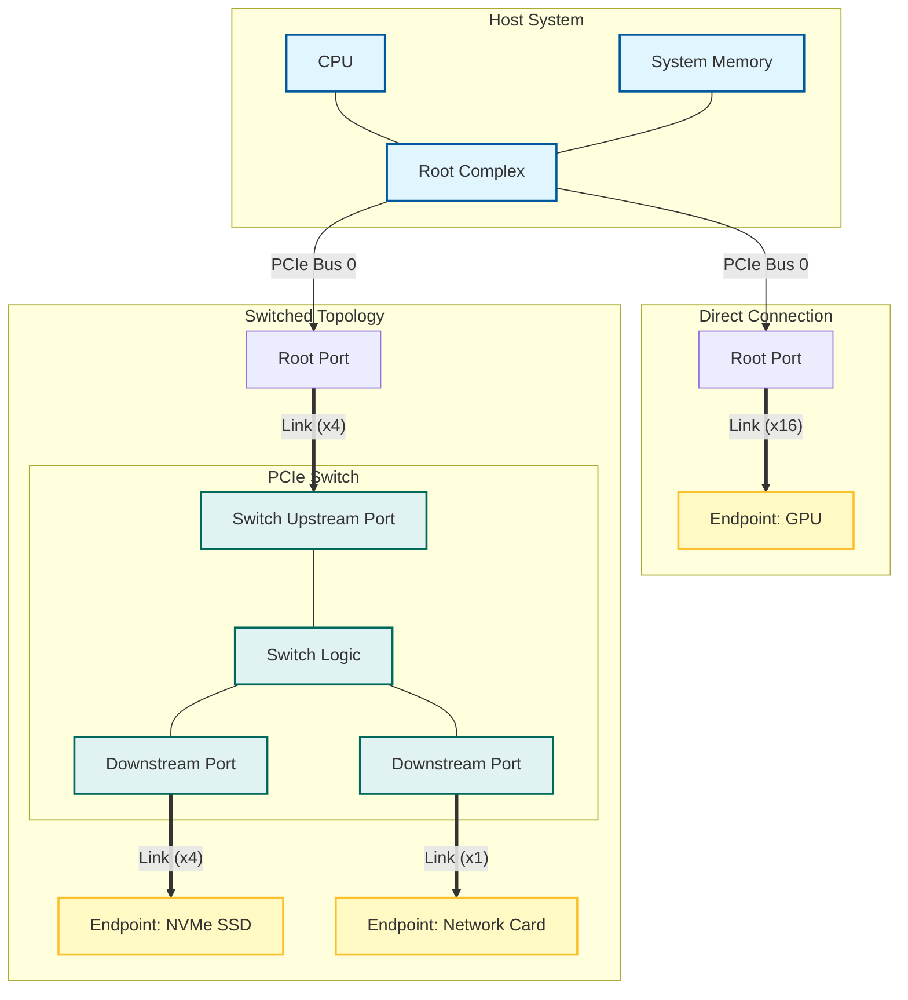

# PCIe 匯流排技術大全

> 本文基於 [Felix 的 PCIe 掃盲系列博文](http://blog.chinaaet.com/justlxy/p/5100053251) 及維基百科內容整理而成，旨在為讀者提供一份從 PCI 到 PCIe 的全面技術指南。

---

## 1. 前言：PCIe 簡介

本章將簡要介紹 PCIe 的起源、核心優勢以及從 Gen1 到 Gen7 的技術演進路線，幫助讀者建立對 PCIe 技術的宏觀認識。

### 1.1 什麼是 PCIe

**PCI Express (Peripheral Component Interconnect Express)**，簡稱 **PCIe** 或 **PCI-E**，是繼 ISA 和 PCI 匯流排之後的第三代 I/O 匯流排標準（3GIO）。它由 Intel 在 2001 年的 IDF 上提出，並由 PCI-SIG 組織釋出。

目前 PCIe 已經發展到 Gen5、Gen6 甚至更高版本，但其核心架構依然保持向後相容。

### 1.2 PCIe 的核心優勢

PCIe 的主要優勢在於：

- **高速率**：提供極高的資料傳輸頻寬。
- **點對點傳輸**：取代了 PCI 的共享匯流排架構。
- **序列傳輸**：抗干擾能力強，傳輸距離遠，訊號完整性更好。
- **低功耗**：支援先進的電源管理。
- **軟體相容性**：在軟體層面上完全相容 PCI/PCI-X 裝置。

### 1.3 PCIe 版本演進與效能對比

PCIe 規範由 PCI-SIG 組織維護，大約每 3-4 年更新一代，頻寬通常翻倍。以下是各版本的關鍵參數對比：

| 版本    | 发布年份 | 傳輸速率 (GT/s) | 編碼方式      | x1 頻寬 (GB/s) | x16 頻寬 (GB/s) | 備註                        |
| :------ | :------- | :-------------- | :------------ | :------------- | :-------------- | :-------------------------- |
| **1.0** | 2003     | 2.5             | 8b/10b        | 0.25           | 4.0             | 初始版本                    |
| **2.0** | 2007     | 5.0             | 8b/10b        | 0.50           | 8.0             | 速率翻倍                    |
| **3.0** | 2010     | 8.0             | 128b/130b     | 0.985          | 15.75           | 編碼效率提升至 98.5%        |
| **4.0** | 2017     | 16.0            | 128b/130b     | 1.969          | 31.51           | 保持 128b/130b 編碼         |
| **5.0** | 2019     | 32.0            | 128b/130b     | 3.938          | 63.02           | 面向高效能運算和 AI         |
| **6.0** | 2022     | 64.0            | PAM-4 (1b/1b) | 7.56           | 121.0           | 引入 PAM-4 調製和 FLIT 模式（規範 2022 年 1 月定稿） |
| **7.0** | 2025     | 128.0           | PAM-4         | 15.13          | 242.0           | 正式发布，頻寬再次翻倍      |

> **注**：
>
> 1. **GT/s (Giga Transfers per second)**：表示每秒傳輸的次數。每 lane 頻寬 (GB/s) = 傳輸速率 (GT/s) × 編碼效率 ÷ 8；x16 總頻寬再 × 16。
> 2. **編碼/開銷**：
>    - Gen1/Gen2 使用 8b/10b 編碼，效率為 80%。
>    - Gen3-Gen5 使用 128b/130b 編碼，效率約為 98.5%（128/130）；表中 1.969/31.51 等已按此折算。
>    - Gen6+ 改用 PAM-4 調製 + FLIT (Flow Control Unit) + FEC：開銷源變為 FEC 與協議開銷（約 5-6%），不再是 128b/130b 編碼——表中 7.56/15.13 為扣除後口徑。

---

## 2. PCI 匯流排回顧

在深入 PCIe 之前，了解 PCI 匯流排的基礎對於理解 PCIe 的演進至關重要。

### 2.1 基本概念

**PCI (Peripheral Component Interconnect)** 是一種區域性並行匯流排標準。

- **結構**：樹型結構，獨立於 CPU 匯流排。
- **主從裝置**：PCI 匯流排上只允許有一個主裝置（Initiator）擁有匯流排控制權，其他為從裝置（Target）。
- **仲裁**：透過仲裁器（Arbiter）管理匯流排使用權，使用 `REQ#` 和 `GNT#` 訊號。

### 2.2 典型的 PCI 匯流排週期

PCI 匯流排是**地址和資料複用**的（AD 訊號線）。所有訊號與時鐘同步。
一個典型的資料讀取週期包括：

1. **Arbitration**：主裝置申請並獲得匯流排使用權。
2. **Address Phase**：`FRAME#` 拉低，主裝置傳送地址和命令。
3. **Data Phase**：`IRDY#`（主裝置就緒）和 `TRDY#`（從裝置就緒）同時有效時，傳輸資料。
4. **Turn-around**：匯流排控制權交接時的三態週期。
5. **Termination**：傳輸結束，訊號恢復空閒。

### 2.3 Reflected-Wave Signaling (反射波訊號)

PCI 匯流排（33MHz）利用**反射波訊號**技術來降低功耗。

- **原理**：傳送端的驅動能力較弱（只能驅動一半電平），依靠訊號在傳輸線末端的反射波與入射波疊加，達到邏輯電平要求。
- **限制**：要求匯流排長度和負載嚴格受限。隨著頻率提高（如 66MHz），反射機制成為瓶頸，限制了匯流排上可掛載的裝置數量（66MHz 下通常只能掛載 1-2 個插槽）。

### 2.4 三種傳輸模式

1. **Programmed I/O (PIO)**：CPU 直接參與資料搬運，效率低，占用 CPU 資源。
2. **DMA (Direct Memory Access)**：由 DMA 控制器完成記憶體與外設間的資料傳輸，無需 CPU 干預，效率高。
3. **Peer-to-Peer**：兩個 PCI 裝置之間直接通訊（一個作為主裝置，一個作為從裝置），無需透過記憶體中轉。

### 2.5 中斷與錯誤處理

- **中斷訊號**：PCI 使用 `INTA#`, `INTB#`, `INTC#`, `INTD#` 四根邊帶訊號（Sideband Signals）進行中斷請求。這些訊號是電平觸發的，且可以共享（線與）。
- **中斷路由**：系統中通常透過中斷路由表（Interrupt Routing Table）將 PCI 插槽的中斷對映到中斷控制器的 IRQ 引腳。

### 2.6 地址空間分配

PCI 支援三種地址空間：

1. **Memory Space**：記憶體地址空間（32位或64位）。
2. **I/O Space**：I/O 地址空間（x86 下限制為 64KB，已逐漸廢棄）。
3. **Configuration Space**：配置空間。每個功能（Function）有 256 位元組的配置空間。
   - 訪問方式：x86 透過 `0xCF8` (地址端口) 和 `0xCFC` (資料埠) 間接訪問。

### 2.7 66MHz 瓶頸與 PCI-X

為了提高頻寬，PCI 升級到了 66MHz/64-bit。但由於反射波訊號機制和非暫存器輸入（Non-registered Input）的時序限制，66MHz 已接近並行 PCI 匯流排的物理極限。

**PCI-X (PCI eXtended)**：

- **Registered Input**：引入暫存器輸入，放寬時序要求，頻率提升至 133MHz。
- **Split Transaction (分割事務)**：解決從裝置響應慢導致的等待問題。當從裝置無法立即響應時，會通知主裝置釋放匯流排，待資料準備好後再重新申請匯流排，從而顯著提高匯流排利用率。
- **DDR/QDR**：在 PCI-X 2.0 中引入雙倍/四倍資料速率。
- 儘管效能提升，但並行匯流排的串擾、佈線難度和引腳數量問題依然存在，最終被序列的 PCIe 取代。

---

## 3. PCIe 匯流排基礎

本章將重點介紹 PCIe 的核心架構設計，包括其分層體系結構、點對點拓撲結構以及在軟體層面如何保持與傳統 PCI 的兼容性。

### 3.1 基本概念

PCIe 采用**高速序列點對點**連線。

- **Link & Lane**：兩個裝置之間的連線稱為 Link。Link 由 1 到 32 個 Lane 組成（x1, x2, x4, x8, x16, x32）。
- **差分訊號**：每個 Lane 包含兩對差分線（一對傳送 TX，一對接收 RX），實現全雙工通訊。
- **嵌入式時鐘**：接收端從資料流中恢復時鐘（8b/10b 或 128b/130b 編碼），無需獨立時鐘線。
- **拓撲結構**：
  - **Root Complex (RC)**：PCIe 樹狀結構的根節點，集成在 CPU 或北橋中。它負責 CPU/記憶體子系統與 PCIe 裝置之間的事務生成與轉換。
  - **Switch (交換機)**：具有一個上游埠 (Upstream Port) 和多個下游埠 (Downstream Port)。它提供了扇出能力，並在內部支援點對點的資料包轉發（類似於網路交換機）。
  - **Endpoint (EP)**：拓撲結構的末端裝置（如 NVMe SSD、顯示卡）。
    - **Legacy Endpoint**：支持 IO 事務，相容舊式 PCI 操作。
    - **Native Endpoint**：僅支援 Memory 映射，透過 MSI/MSI-X 中斷，效能更優。

為了更直觀地理解，下圖展示了一個典型的 PCIe 樹狀拓撲結構：

### 3.2 軟體相容性

PCIe 在硬體物理層上與 PCI 完全不同，但在**軟體層**上保持兼容。

- PCIe 保留了 PCI 的配置空間定義（Header Type 0/1）。
- 作業系統依然可以透過列舉 PCI 匯流排的方式發現和配置 PCIe 裝置，無需修改驅動模型。
- PCIe 擴展了配置空間至 4KB（前 256 位元組與 PCI 兼容）。

### 3.3 體系結構概覽

PCIe 採用分層結構：

1. **應用層 (Software/Application Layer)**：處理使用者請求。
2. **事務層 (Transaction Layer)**：生成和解析 TLP (Transaction Layer Packet)，負責 QoS、流控、排序。
3. **資料鏈路層 (Data Link Layer)**：生成和解析 DLLP，負責資料完整性（CRC）、ACK/NAK 重傳機制。
4. **物理層 (Physical Layer)**：負責鏈路訓練、編解碼（8b/10b）、串行化/解串、差分驅動。

---

## 4. PCIe 事務層 (Transaction Layer)

事務層是 PCIe 體系結構的核心，負責 TLP 包的構建與處理。

### 4.1 通訊機制 (Request & Completion)

PCIe 通訊基於**請求（Request）**和**完成（Completion）**模型。所有事務均由 Requester 发起，Completer 響應（如果需要）。

- **Requester**：發起請求的裝置（如 RC 讀取 EP 資料）。
- **Completer**：響應請求的裝置（如 EP 返回資料給 RC）。

### 4.2 TLP 類型與 Posted/Non-Posted

根據是否需要對方返回響應，PCIe 事務分為兩類：

1. **Non-Posted Transaction (非派發事務)**：
   - Requester 傳送請求後，**必須**等待 Completer 返回 Completion 包。
   - 典型類型：**Memory Read**, **I/O Read/Write**, **Configuration Read/Write**。
   - 目的：確保資料已正確讀取或寫入（對於 I/O 和 Config 寫入，需要確認完成以保證時序）。

2. **Posted Transaction (派發事務)**：
   - Requester 傳送請求後，**不需要**等待 Completion 包，類似於“发射后不管”。
   - 典型類型：**Memory Write**, **Message**。
   - 優勢：極大提高了匯流排效率，避免了寫操作的等待延遲。

### 4.3 TLP 包結構

一個 TLP 包主要由 Header、Data Payload 和 ECRC 組成：

- **Header (包頭)**：長度為 3 DW (12位元組) 或 4 DW (16位元組)。
  - **Fmt (Format)**：指定 TLP 長度（3DW/4DW）及是否包含資料。
  - **Type**：指定事務類型（Memory, I/O, Cfg, Msg）。
  - **Length**：資料載荷長度（以 DW 為單位，最大 1024 DW 即 4KB）。
  - **Requester ID**：由 Bus Number (8b) + Device Number (5b) + Function Number (3b) 組成，用於路由響應。
  - **Address**：64-bit 或 32-bit 地址。
- **Data Payload (資料載荷)**：僅在 Write 請求或 Read 完成包中存在，最大 4KB。
- **ECRC (End-to-End CRC)**：可選的 32-bit 校驗，確保資料在穿越 Switch 時的端到端完整性。

### 4.4 QoS 與流量控制 (Flow Control)

PCIe 採用基於**信用 (Credit)** 的流控機制，而非簡單的忙/閒狀態。

- **Traffic Class (TC)**：TLP Header 中的 3-bit 字段，定義 8 個優先順序（TC0-TC7）。
- **Virtual Channel (VC)**：物理緩衝區，TC 映射到 VC。不同 VC 獨立仲裁，防止低優先順序阻塞高優先順序流量。
- **Flow Control Credits**：
  - 接收端定期向傳送端廣播當前可用的緩衝區空間（Credits）。
  - Credit 分為 3 類：**Posted (P)**, **Non-Posted (NP)**, **Completion (Cpl)**。
  - 每類又分為 **Header (H)** 和 **Data (D)** 兩種信用。
  - 傳送端只有在擁有足夠 Credit 時才傳送 TLP，從根本上消除了接收端緩衝區溢位導致的丟包。

---

## 5. PCIe 資料鏈路層 (Data Link Layer)

資料鏈路層位於事務層和物理層之間，負責鏈路管理和資料完整性。

### 5.1 主要功能

1. **TLP 組包與拆包**：為上層 TLP 增加 Sequence Number (2 Bytes) 和 LCRC (4 Bytes)。
2. **資料完整性校驗**：透過 LCRC 確保 TLP 在鏈路傳輸中未出錯。
3. **重傳機制 (ACK/NAK)**：保證資料可靠傳輸。

### 5.2 DLLP (Data Link Layer Packet)

資料鏈路層會產生僅在相鄰裝置間傳輸的資料鏈路層包 (DLLP)，不包含資料載荷，長度固定（通常 6 位元組）。常見類型：

- **ACK/NAK DLLP**：用於確認 TLP 接收狀態。
- **InitFC1/InitFC2/UpdateFC**：用於流量控制信用的初始化和更新。
- **PM (Power Management)**：電源管理相關互動。

### 5.3 ACK/NAK 重傳協議

- **Transmitter**：发送 TLP 后，將其副本儲存在 **Replay Buffer** 中。
- **Receiver**：收到 TLP 後校驗 LCRC 和 Sequence Number。
  - **校驗透過**：返回 **ACK**，发送端清除 Replay Buffer 中對應的 TLP。
  - **校驗失敗**：返回 **NAK**，发送端重发 Replay Buffer 中的所有 TLP。
- 這種機制確保了即使物理層偶發誤碼，上層軟體也無需干預，看到的是一條無錯鏈路。

---

## 6. PCIe 物理層 (Physical Layer)

物理層負責邏輯與電氣訊號的轉換，是 PCIe 協議棧的最底層。

### 6.1 邏輯子層與電氣子層

- **邏輯子層 (Logical Sub-block)**：
  - **Byte Striping**：將資料流分發到多個 Lane 上（x1, x4, x16...）。
  - **Scrambling (擾碼)**：透過異或操作打散資料規律，降低 EMI（電磁干擾）。
  - **Encoding (編碼)**：
    - **8b/10b** (Gen1/2)：每 8-bit 資料編碼為 10-bit 符號，引入 20% 開銷。
    - **128b/130b** (Gen3/4/5)：每 128-bit 資料增加 2-bit 同步頭，開銷降至 ~1.5%。
    - **PAM-4/1b/1b** (Gen6+)：采用 4 電平脈衝調製和 FLIT 編碼。
- **電氣子層 (Electrical Sub-block)**：
  - **SerDes**：負責並行資料與高頻序列訊號的轉換。
  - **Differential Driver/Receiver**：驅動差分對，實現低壓差分訊號傳輸。

### 6.2 鏈路訓練與狀態機 (LTSSM)

PCIe 鏈路的初始化和管理由 **LTSSM (Link Training and Status State Machine)** 控制。主要狀態包括：

1. **Detect**：檢測接收端是否連線了裝置（透過檢測終端電阻）。
2. **Polling**：傳送訓練序列（TS1/TS2），確立 Bit Lock 和 Symbol Lock。
3. **Configuration**：協商鏈路寬度（Link Width）和通道編號（Lane Numbering），處理 Lane Reversal。
4. **L0**：**正常工作狀態**，傳輸資料。
5. **Recovery**：當鏈路出錯或需要改變速率（Speed Change）時進入此狀態，重新訓練。
6. **L1/L2**：低功耗狀態，暫停資料傳輸以省電。

---

## 7. 實例分析：Memory Read 操作

為了更好地理解上述概念，我們看一個 **Endpoint 向 System Memory 讀取資料** 的過程（Non-Posted）：

1. **Requester (Endpoint)**：
   - 事務層構建 **MRd (Memory Read)** TLP，包含目標地址、Requester ID、Tag 等。
   - 資料鏈路層增加 Sequence Number 和 LCRC，暫存入 Replay Buffer。
   - 物理層進行編碼、串行化，透過 Link 傳送給 Switch/Root Complex。

2. **Switch/Root Complex**：
   - 接收並校驗 TLP（物理層 -> 資料鏈路層）。
   - 若無誤，返回 ACK DLLP（Endpoint 收到後釋放 Replay Buffer）。
   - 路由邏輯將 TLP 轉發至目標（System Memory 控制器）。

3. **Completer (System Memory)**：
   - 讀取記憶體資料。
   - 構建 **CplD (Completion with Data)** TLP，包含請求的資料、Completer ID，並複製請求中的 Requester ID 和 Tag 以便匹配。

4. **返回路徑**：
   - CplD TLP 經過反向路徑路由回 Endpoint。
   - Endpoint 的事務層接收 CplD，利用 Tag 匹配原始請求，完成讀取操作。

---

> **總結**：PCIe 透過分層架構、序列差分傳輸、流控和重傳機制，完美解決了並行 PCI 匯流排的速度瓶頸和可靠性問題，成為現代計算機系統的基石。
