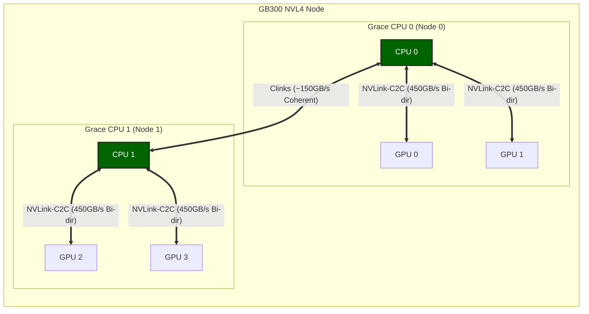

# NVIDIA GB300 NVL72 架構解析與效能測試報告

本文基於 `nvbandwidth` 實測資料、NVIDIA 官方技術文件及 Grace Blackwell 架構規範，整理了 **NVIDIA GB300 NVL72** 計算平台的物理拓撲與互連效能參數。

---

## 1. 系統規格

**NVIDIA GB300 NVL72** 是基於 Grace Blackwell 架構的機架級計算系統（規格於 2026-11 對照 NVIDIA 官方頁與 DGX SuperPOD GB300 RA 複核；preliminary 規格可能隨韌體/驅動更新）：**72 顆 Blackwell Ultra GPU (B300)** 經 NVLink 5 / NVSwitch 連成單一 NVLink 域；**36 顆 Grace CPU** 則各自透過 NVLink-C2C 連線本地的 GPU 與對端 CPU（詳見 §2.2/§2.3）[1,4]。

### 1.1 Blackwell GPU 架構特性

Blackwell 架構 GPU 采用**雙晶片 (Dual-Die) 封裝設計**，集成 2080 億電晶體，采用定制的 TSMC 4NP 工藝製造。兩個計算核心 (Die) 之間透過頻寬高達 **10 TB/s** 的片間互連 (NV-HBI) 連線，確保了在單一 GPU 封裝內實現無縫的統一記憶體訪問和計算排程 [5,10]。這與 CPU-GPU 間的 900 GB/s NVLink-C2C 共同構成了多層級的高速互連體系。

根據 NVIDIA 官方技術部落格 [10] 披露的 Blackwell Ultra (B300) 核心架構細節：

- **統一計算域**: 最多包含 160 個流多處理器（SM 數量隨 SKU 而異） (SMs)，提供 640 個第五代 Tensor Cores。
- **Tensor Memory (TMEM)**: 每個 SM 配備 256 KB 的 TMEM，用於中間結果的 warp 級同步儲存，減少片外顯存訪問。
- **NVFP4 精度**: 引入全新的 4-bit 浮點格式，透過兩級縮放（block-level + tensor-level）實現接近 FP8 的精度，同時將顯存佔用降低約 1.8 倍。

### 1.2 核心參數對比 (GB300 vs GB200)

該系統配備 **GB300 (Blackwell Ultra)** 元件，相較於 GB200 (Blackwell) 具有以下規格差異 [3]：

| 特性                  | GB200 (Blackwell)   | **GB300 (Blackwell Ultra)** | 差異說明   |
| :-------------------- | :------------------ | :-------------------------- | :--------- |
| **GPU 型號**          | B200                | **B300**                    | Ultra 版本 |
| **顯存容量 (每 GPU)** | 192 GB HBM3e        | **279 GB HBM3e** (NVL72)    | 增加 ~45%  |
| **FP4 算力 (每 GPU)** | 9 PFLOPS            | **15 PFLOPS**               | 增加 66%   |
| **網路頻寬 (每 GPU)** | 400 Gb/s (CX-7)     | **800 Gb/s (CX-8)**         | 增加 100%  |
| **CPU-GPU 互連**      | 900 GB/s NVLink-C2C | **900 GB/s NVLink-C2C**     | 規格一致   |

> **顯存口徑說明**：B300 的**卡規格**是 **288 GB HBM3e**（NVIDIA Blackwell Ultra 官方博客：「288 GB of HBM3e per GPU」）。上表寫的 279 GB 是**系統形態下的單卡可用值**，不是裸卡規格。
>
> NVIDIA 的 [MIG 產品頁](https://www.nvidia.com/en-us/technologies/multi-instance-gpu/)把兩種形態的可用顯存分檔列出：**GB300 NVL72 為 `1x 279 GB`，HGX B300 為 `1x 270 GB`**。該頁尾註標明這些屬於 `Preliminary specifications`（初步規格，可能變動），且 NVL72 形態比裸卡少約 6–9 GB 是慣例——GB200 同樣出現 186 GB vs 192 GB 的差額。
>
> **讀規格表時用 288，做容量規劃時用 279 或 270**，兩者不要混。

---

## 2. 物理拓撲架構

根據 NVIDIA 官方发布的 **GB200 NVL4** 架構資料（GB300 NVL4 為其升級版），該系統在一個計算節點內整合了 **2 顆 Grace CPU** 和 **4 顆 Blackwell GPU** [4]。其核心互連邏輯如下：

### 2.1 統一超級晶片架構

GB300 NVL4 將兩組 Grace Blackwell Superchip 透過高速互連技術整合在同一主機板上，形成一個統一的 NUMA 系統。

### 2.2 CPU-GPU 互連：NVLink-C2C

- **連線方式**: 每顆 Grace CPU 透過兩條獨立的 **NVLink-C2C (Chip-to-Chip)** 鏈路分別連線兩顆 Blackwell GPU。
- **互連頻寬**: 單條鏈路提供 **450 GB/s** 的雙向頻寬。一個 Superchip 內（1 CPU + 2 GPU）的 CPU↔GPU 總頻寬為 **900 GB/s**。
- **特性**: NVLink-C2C 提供了 CPU 與 GPU 之間的超低延遲、高頻寬通道，支援統一記憶體訪問。

### 2.3 CPU-CPU 互連：Clinks

- **連線方式**: 兩顆 Grace CPU 之間透過 **Clinks**（而非 NVLink-C2C）互連 [_DGX SPOD GB300 RA, Figure 5_](https://docs.nvidia.com/pdf/dgx-spod-gb300-ra.pdf)。
- **互連頻寬**: 約 **150 GB/s**。
- **特性**: 支持跨 CPU 的快取一致性 (Cache Coherency)，使兩顆 CPU 的 LPDDR5X 記憶體空間呈現為統一的 NUMA 記憶體池。

### 2.4 完整拓撲圖

基於 NVL4 架構的 4 GPU 系統連線拓撲如下：

- **CPU-CPU 互連**: 兩顆 Grace CPU (綠色節點) 之間透過 **Clinks** 連線（~150 GB/s），支持跨 CPU 的快取一致性。
- **CPU-GPU 互連**: 每個 Grace CPU 透過兩條獨立的 **NVLink-C2C** 鏈路分別連線兩顆 Blackwell GPU。單條鏈路提供 **450 GB/s** 的雙向頻寬（單向理論值為 225 GB/s；900/450 為官方聚合口徑 900 ÷ 2 的推算），一個 Superchip 內 CPU↔GPU 總頻寬為 900 GB/s [4,9]。
- **系統總頻寬分析**:
  - **CPU <-> GPU 實測頻寬**: 4 × 210 GB/s (單向)，接近 225 GB/s 的理論極限，表明鏈路利用率極高。
  - **CPU <-> CPU 頻寬**: ~150 GB/s (Clinks)，為跨 NUMA 節點的記憶體訪問提供通道。

### 2.5 CPU 內部架構：Scalable Coherency Fabric (SCF)

除了外部的 C2C 互連，Grace CPU 內部採用了 **NVIDIA Scalable Coherency Fabric (SCF)** 網狀架構 [6]。

- **核心與快取規格**:
  - **核心**: 72 個 ARM Neoverse V2 核心（架構詳情見 2.6 節）。
  - **快取**: 每個核心擁有 **64 KB L1 Cache** 和 **1 MB L2 Cache**；所有核心共享 **114 MB L3 Cache** (LLC) [7]。
- **功能**: SCF 提供超過 **3.2 TB/s** 的片內對分頻寬，負責在核心、快取、NVLink-C2C 接口、記憶體和系統 I/O 之間進行高速資料路由。
- **作用**: 它確保了從 CPU 核心到 NVLink-C2C 介面的資料流不會成為內部瓶頸，從而能夠跑滿外部 900 GB/s 的物理鏈路。

### 2.6 Grace CPU 核心架構

根據 NVIDIA 官方白皮書 [8]，Grace CPU 采用了 **Arm Neoverse V2** 核心，這是 Arm 專為資料中心設計的高效能核心，基於 Armv9.0-A 架構。

- **指令集架構 (ISA)**:
  - 支持 **Armv9.0-A**，向下兼容 Armv8.0 至 Armv8.5 的所有二進位制檔案（如 Ampere Altra 和 AWS Graviton2/3）。
  - **SIMD 矢量化**: 實現了 **4x128-bit** 的 SIMD 矢量指令集配置，支持 **SVE2 (Scalable Vector Extension 2)** 和 **NEON**。
    - **SVE2**: 相比 NEON 支援更多資料類型（如 FP16）、更強大的指令（如 gather/scatter）以及變長向量支援，特別最佳化了機器學習、基因組學和密碼學等 HPC 負載。
- **原子操作 (Atomic Operations)**:
  - 支持 **LSE (Large System Extension)**，提供低開銷的原子指令（如 `CAS`, `LD<OP>`, `ST<OP>`, `SWP`）。
  - **性能提升**: 相比傳統的 load/store exclusive 序列，LSE 原子指令在 CPU 間通訊、鎖和互斥量操作上的吞吐量可提升一個數量級，這對於 NVLink-C2C 連線的雙 CPU 高頻協同至關重要。
- **記憶體子系統**:
  - 采用 **LPDDR5X** 記憶體，支持 **Error Correction Code (ECC)**，在提供高頻寬的同時大幅降低了功耗（相比 DDR5 頻寬提升 53%，每 GB 功耗降低 87%）。
  - 這種設計平衡了頻寬、能效和成本，特別適合大規模 AI 和 HPC 工作負載。

### 2.7 CPU-GPU 互連細節與資料流

雖然 GB300 屬於 Blackwell 架構，但其 CPU 部分（Grace CPU）與前代 GH200 (Grace Hopper) 架構保持一致。參考 ACM 關於 GH200 架構的分析研究 [7]，我們可以深入理解 CPU 與 GPU 之間 NVLink-C2C 的互連機制，該機制在 GB300 中同樣適用。其內部資料流路徑如下：

_圖 1: NVIDIA GH200 架構中 Grace CPU 與 H100 GPU 透過 NVLink C2C 的互連示意圖（來源：ACM [7]）_

- **Grace CPU 側資料流**:
  - 資料從 **CPU Cores (L1/L2)** 匯聚至 **L3 LLC (114 MB)**。
  - 透過 **Scalable Coherency Fabric (SCF)** 網狀互連架構，連線至 **Memory Controllers** (訪問 LPDDR5X) 和 **NVLink I/O** 接口。
  - 這種設計確保了 CPU 核心、記憶體和 GPU 鏈路之間的高頻寬低延遲通訊。

- **GPU 側資料流 (以 GH200 為例推演)**:
  - GPU 的 **SMs (Streaming Multiprocessors)** 透過 **XBar (Crossbar)** 和 **L2 Cache** 進行資料交換。
  - **Hub** 單元負責協調內部流量，連線至 **NVLink I/O**。
  - 顯存控制器直接連線 **HBM3e** 高頻寬記憶體。
  - _注：GB300 (Blackwell Ultra) 的 GPU 內部架構可能在 SMs 和 XBar 上有進一步最佳化，但整體透過 Hub 連線 NVLink-C2C 的邏輯保持不變。_

- **NVLink-C2C 鏈路特性**:
  - 物理鏈路由 10 條 C2C 鏈路組成，每條鏈路 9 資料訊號 × 40 Gbps，單向聚合理論頻寬約 225 GB/s（雙向 450 GB/s），與前文實測資料吻合（鏈路構成據 arXiv 2408.11556；「18 × 25 GB/s」是 H100 NVLink 4.0 的數字，不適用於 C2C）。
  - 該鏈路支援 **硬體級快取一致性**，允許 GPU 直接以高頻寬訪問 CPU 的 LPDDR5X 記憶體，實際上將 CPU 記憶體作為 GPU 的"擴展顯存"使用，這對於處理超過 GPU 顯存容量的大模型推理至關重要。

---

## 3. 頻寬效能實測資料

使用 `nvbandwidth` 工具對系統進行的頻寬測試結果如下。

### 3.1 Host to Device (H2D) 測試資料

| 測試專案                 | 單鏈路實測頻寬 (GB/s) | 併發總頻寬 (4 GPUs) (GB/s) |
| :----------------------- | :-------------------- | :------------------------- |
| **Host -> Device (H2D)** | **~210.7**            | **~842.7**                 |
| **Device -> Host (D2H)** | **~193.2**            | **~772.8**                 |
| **Bidirectional (雙向)** | **~167.1**            | **~668.5**                 |

### 3.2 資料分析

1. **獨立頻寬通道**:
   - 測試資料顯示，所有 4 張 GPU 在併發測試中均達到了 **~210 GB/s** 的單卡頻寬。
   - 該結果驗證了 CPU 與每顆 GPU 之間存在獨立的物理傳輸通道，各通道頻寬互不共享。
2. **傳輸效率**:
   - 單向物理理論頻寬極限約為 225 GB/s (450 GB/s 雙向 / 2)。
   - 實測值 210 GB/s 約為理論極限的 **93%**。
3. **與 PCIe Gen5 對比**:
   - GB300 (NVLink-C2C): 單卡 ~210 GB/s
   - PCIe Gen5 x16: 單卡 ~56 GB/s

---

## 4. 技術參數釋疑

官方文件中提到的 **900 GB/s** 頻寬指標指的是 **單個 Superchip (1 CPU + 2 GPU)** 內部的總互連頻寬容量：

- CPU 連線 GPU 0: 450 GB/s (雙向)
- CPU 連線 GPU 1: 450 GB/s (雙向)
- **合計**: **900 GB/s**

在實際應用中，CPU 記憶體 (LPDDR5X) 可透過上述鏈路被兩顆 GPU 同時訪問。

---

## 5. 參考資料

1. **NVIDIA GB300 NVL72 產品頁面**
   - [https://www.nvidia.com/en-us/data-center/gb300-nvl72/](https://www.nvidia.com/en-us/data-center/gb300-nvl72/)
2. **NVLink-C2C 互連技術說明**
   - [https://www.nvidia.com/en-us/data-center/nvlink-c2c/](https://www.nvidia.com/en-us/data-center/nvlink-c2c/)
3. **Azure ND GB300 v6 虛擬機器規格**
   - [https://learn.microsoft.com/en-us/azure/virtual-machines/sizes/gpu-accelerated/nd-gb300-v6-series](https://learn.microsoft.com/en-us/azure/virtual-machines/sizes/gpu-accelerated/nd-gb300-v6-series)
4. **Grace Blackwell 架構分析 (Developer Blog)**
   - [https://developer.nvidia.com/blog/nvidia-gb200-nvl72-delivers-trillion-parameter-llm-training-and-real-time-inference/](https://developer.nvidia.com/blog/nvidia-gb200-nvl72-delivers-trillion-parameter-llm-training-and-real-time-inference/)
5. **NVIDIA Blackwell Architecture Overview**
   - [https://www.nvidia.com/en-us/data-center/technologies/blackwell-architecture/](https://www.nvidia.com/en-us/data-center/technologies/blackwell-architecture/)
6. **NVIDIA Grace CPU Architecture In-Depth**
   - [https://developer.nvidia.com/blog/nvidia-grace-cpu-superchip-architecture-in-depth/](https://developer.nvidia.com/blog/nvidia-grace-cpu-superchip-architecture-in-depth/)
7. **Towards Memory Disaggregation via NVLink C2C: Benchmarking CPU-Requested GPU Memory Access**
   - [https://dl.acm.org/doi/full/10.1145/3723851.3723853](https://dl.acm.org/doi/full/10.1145/3723851.3723853)
8. **NVIDIA Grace CPU Superchip Whitepaper**
   - [https://resources.nvidia.com/en-us-grace-cpu/nvidia-grace-cpu-superchip](https://resources.nvidia.com/en-us-grace-cpu/nvidia-grace-cpu-superchip)
9. **NVIDIA GB300 NVL72: GPU Architecture & Performance Analysis**
   - [https://verda.com/blog/gb300-nvl72-architecture](https://verda.com/blog/gb300-nvl72-architecture)
10. **Inside NVIDIA Blackwell Ultra: The Chip Powering the AI Factory Era**
    - [https://developer.nvidia.com/blog/inside-nvidia-blackwell-ultra-the-chip-powering-the-ai-factory-era/](https://developer.nvidia.com/blog/inside-nvidia-blackwell-ultra-the-chip-powering-the-ai-factory-era/)
