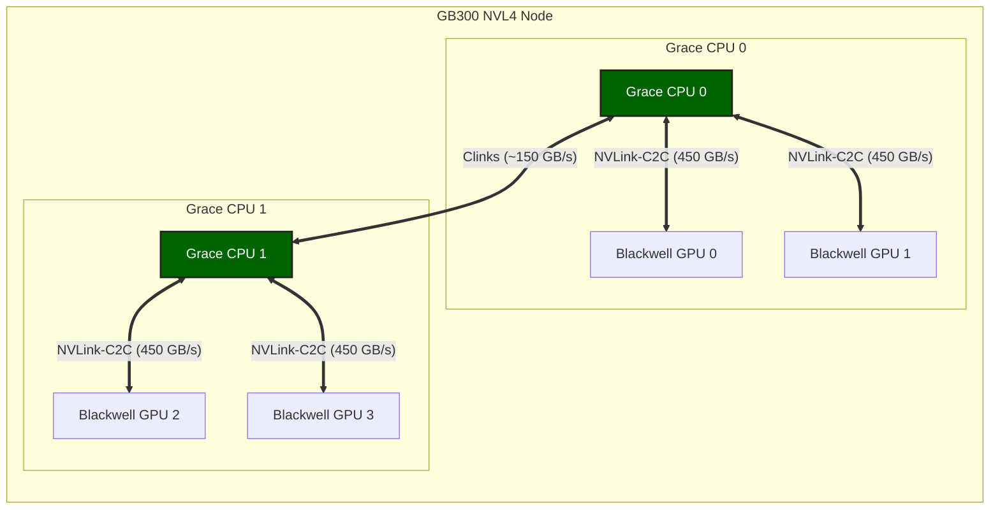

# NVLink-C2C 技術詳解：構建 AI Superchip 的關鍵互連技術

隨著 AI 與高效能運算（HPC）的迅速发展，計算系統的瓶頸逐漸從算力轉移到資料移動（Data Movement）。GPU 的計算能力在過去十年中增長了數十倍，但 CPU 與 GPU 之間的資料交換仍主要依賴 PCIe，匯流排頻寬與延遲逐漸成為系統效能的限制因素。

為了解決這一問題，NVIDIA 提出了 NVLink-C2C（Chip-to-Chip）互連技術，用於在 CPU 與 GPU、CPU 與 CPU、以及多晶片系統中實現高頻寬、低延遲的一致性互連。該技術已經成為 NVIDIA Grace Hopper、Grace Blackwell 等 AI Superchip 架構的核心基礎設施。

本文將系統介紹 NVLink-C2C 的技術背景、體系結構、核心參數以及在 GB300 等最新架構中的應用。文中關鍵資料均引用自 NVIDIA 官網頁面、官方技術部落格與官方釋出材料。

## 1. 背景與技術演進

本節從傳統 CPU 與 GPU 互連的頻寬瓶頸出發，回顧 NVLink 技術從 GPU 間互連到晶片級互連的演進歷程。

### 1.1 AI 時代的互連瓶頸

在傳統伺服器架構中，CPU 與 GPU 的連線通常依賴於 PCIe 匯流排，這種架構在面對大規模 AI 負載時逐漸顯露出侷限性。

```text
// 傳統 CPU 與 GPU 透過 PCIe 互連示意圖
CPU <--- PCIe ---> GPU
```

PCIe 的特點是：

- **匯流排屬性**：通用 I/O 匯流排。
- **擴展目標**：面向裝置擴展。
- **時延特徵**：延遲較高。
- **頻寬特徵**：頻寬有限。

即使在 PCIe Gen5 x16 配置下，CPU 與 GPU 互連頻寬仍顯著低於現代 GPU 的本地記憶體頻寬與計算吞吐能力。NVIDIA 官方技術部落格也將 NVLink-C2C 的 900 GB/s（雙向）描述為相對 x16 PCIe Gen5 的約 7 倍頻寬 [2]。這意味著在許多 AI/HPC 負載中，CPU 與 GPU 互連會成為系統瓶頸。為了突破這一限制，NVIDIA 逐步发展出 NVLink 互連技術。

### 1.2 NVLink 技術演進

NVLink 是 NVIDIA 為 GPU 設計的高頻寬互連技術，旨在解決傳統互連方式的頻寬限制問題。其演進大致經歷了三個階段：

| 技術           | 作用              | 說明                                                |
| :------------- | :---------------- | :-------------------------------------------------- |
| **NVLink**     | GPU ↔ GPU 互連    | 用於 GPU 間的高速互連，支援顯存池化                 |
| **NVSwitch**   | GPU 叢集互連      | 構建大規模 GPU 網路（如 NVL72），實現全互連         |
| **NVLink-C2C** | Chip-to-Chip 互連 | 封裝級互連，連線異構晶片（CPU 與 GPU、GPU 與 ASIC） |

NVLink 最初用於 GPU ↔ GPU，例如：

```text
// NVLink 早期的 GPU 互連示意圖
GPU --- NVLink --- GPU
```

隨後 NVIDIA 推出了 NVSwitch，用於構建大規模 GPU 網路。而 NVLink-C2C 則進一步將 NVLink 技術擴展到**晶片級互連**（die-to-die interconnect），即在單一封裝內或近封裝距離下連線不同的處理器裸片（如 CPU die 與 GPU die），實現比傳統板級互連更高的頻寬與更低延遲。

---

## 2. NVLink-C2C 技術詳解

本節從技術概述、核心指標、架構協議與統一記憶體四個方面，深入解析 NVLink-C2C 的設計與實現。

### 2.1 技術概述

NVLink-C2C（Chip-to-Chip）是一種封裝級高速互連技術，用於連線同一系統中的多個處理器晶片，例如 CPU 與 GPU、CPU 與 CPU 或 GPU 與 ASIC。它的核心目標是在多個處理器之間實現高頻寬、低延遲和記憶體一致性。

與傳統 PCIe 不同，NVLink-C2C 是**計算互連**（compute interconnect）。根據 NVIDIA 官方技術部落格，NVLink-C2C 在 Grace Hopper 中提供 900 GB/s（雙向）頻寬，約為 x16 PCIe Gen5 的 7 倍頻寬 [2]。

### 2.2 核心技術指標

根據 NVIDIA 官方技術部落格、官網技術頁面與官方釋出材料，NVLink-C2C 的關鍵指標如下：

| 指標                               | 參數                                     | 說明                                                     |
| :--------------------------------- | :--------------------------------------- | :------------------------------------------------------- |
| **雙向頻寬**                       | **900 GB/s**                             | 官方技術部落格披露 GH200 中為 900 GB/s（450 GB/s/方向）[2] |
| **能效（鏈路）**                   | **1.3 pJ/bit**                           | 官方技術部落格披露 NVLink-C2C 鏈路能耗指標 [2]             |
| **能效/面積效率（最新官網口徑）**  | **6x / 3.5x**                            | 相比 NVIDIA 芯片上的 PCIe Gen6 PHY [1]                   |
| **能效/面積效率（2022 釋出口徑）** | **25x / 90x**                            | 相比 NVIDIA 芯片上的 PCIe Gen5（來自官方釋出材料）[5]    |
| **物理層**                         | **40 Gbps/pin**                          | 官方釋出材料披露單端訊號速率 [5]                         |
| **協議支援**                       | **AMBA CHI / CXL**                       | 官方產品頁明確支援 Arm AMBA CHI 或 CXL [1]               |
| **封裝與整合形態**                 | **PCB / MCM / Interposer / Wafer-level** | 官方頁面明確支援多種整合方式 [1, 5]                      |

### 2.3 核心架構與協議

NVLink-C2C 的核心思想是透過高速 SerDes 實現 die-to-die coherent interconnect：物理層之上承載完整的快取一致性協議棧。

#### 2.3.1 物理互連架構

典型系統架構如下（以 Grace Hopper 為例）：

```text
// NVLink-C2C 連線 Grace CPU 與 Hopper GPU 的架構示意圖
             NVLink-C2C (900 GB/s)
      ┌─────────────────────────────┐
      │                             │
      ▼                             ▼

+-------------+               +-------------+
|  Grace CPU  |===============|  Hopper GPU |
| (72 Cores)  |               |  (H100/H200)|
|             |               |             |
|   LPDDR5X   |               |    HBM3     |
|   Memory    |               |   Memory    |
+-------------+               +-------------+

        Unified Memory Address Space
```

該架構具有幾個關鍵特性：

1. **高頻寬**：900 GB/s 的頻寬消除了 CPU 和 GPU 之間的資料傳輸瓶頸。
2. **低延遲**：晶片級互連大幅降低了通訊延遲。
3. **硬件一致性**：支援硬體級 Cache Coherency。
4. **統一地址空間**：允許 CPU 和 GPU 直接訪問對方記憶體。

#### 2.3.2 協議層：AMBA CHI 與 CXL

NVLink-C2C 支持 Arm 的 **AMBA CHI (Coherent Hub Interface)** 協議，並支援 **CXL** 互操作能力 [1, 5]。這意味著：

- Grace CPU（基於 Arm Neoverse V2）可以直接透過 NVLink-C2C 與 GPU 進行快取一致性通訊。
- GPU 可以直接讀取 CPU 的 L3 Cache 或 LPDDR5X 記憶體，而無需經過傳統的 PCIe Root Complex。

此外，官方釋出材料還強調 NVLink-C2C 面向低延遲、高頻寬與高能效場景進行了專門最佳化 [5]。

### 2.4 統一記憶體架構

NVLink-C2C 的一個關鍵能力是記憶體一致性（Memory Coherency），即 CPU 與 GPU 共享統一地址空間。

```text
// 統一地址空間架構示意圖
          Unified Address Space

          ┌───────────────────┐
          │   System Memory   │
          └───────────────────┘
                 ▲
                 │
     ┌───────────┴───────────┐
     │                       │

+-------------+       +-------------+
|  Grace CPU  |       |  Hopper GPU |
|   LPDDR5X   |       |    HBM3     |
|   Memory    |       |   Memory    |
+-------------+       +-------------+
        │                   │
        └──── NVLink-C2C ───┘
```

在該架構中，CPU 記憶體、GPU HBM 和系統頁表都處於統一地址空間。這意味著：

- **零複製 (Zero-Copy)**：GPU 可以直接訪問 CPU 記憶體，不需要顯式資料複製（如 `cudaMemcpy`）。
- **原子操作 (Atomics)**：支援系統級原子操作，GPU kernel 可以直接更新 CPU 資料，CPU 也可以直接更新 GPU 資料。
- **大記憶體支援**：GPU 可以利用 CPU 的大容量 LPDDR5X 記憶體（Grace Hopper 單 Superchip 的 CPU 側上限為 512 GB LPDDR5X，GH200 實配 SKU 最高 480 GB）來存放超大模型參數或 KV Cache，突破 HBM 容量限制 [2]。

---

## 3. NVLink-C2C 在 AI Superchip 中的應用

NVLink-C2C 是 NVIDIA 構建 "Superchip" 的基石，已在 Grace Hopper、GB200、GB300 等產品中落地 [1, 3, 4]。

### 3.1 Grace Hopper Superchip (GH200)

GH200 將一顆 Grace CPU 和一顆 Hopper GPU 封裝在一起 [2]。不同產品 SKU 與系統配置下的 LPDDR5X 容量存在差異，需結合具體平台規格解讀 [2, 6]。


- **互連頻寬**：900 GB/s（雙向，450 GB/s/方向）[2]。
- **記憶體容量**：96 GB HBM3 + 最多 512 GB LPDDR5X（CPU 上限口徑，GH200 實配最高 480 GB），單 Superchip 可定址記憶體最多 608 GB [2]。
- **應用場景**：推薦系統、大模型推理、圖計算。

### 3.2 Grace Blackwell Superchip (GB200/GB300)

在最新的 Blackwell 架構中，NVLink-C2C 的應用進一步擴大。以 **GB300 NVL72** 為例，其基礎構建模組為計算 tray（2 顆 Grace CPU + 4 顆 Blackwell Ultra GPU，官方 RA 文件口徑；「NVL4」是沿用 GB200 時代的稱呼）——文中記作 GB300 NVL4 Node。官方給出的整機規格為 72 顆 Blackwell Ultra GPU 與 36 顆 Grace CPU；在 NVL72 域內提供 130 TB/s 的 NVLink 頻寬 [3]。Blackwell 官方技術頁也明確指出 Grace CPU 與 Blackwell GPU 之間存在 900 GB/s 的高速鏈路 [4]。

GB300 NVL4 Node 的拓撲示意如下：



- **拓撲結構**：以 GB300 NVL4 為基本單元，兩顆 Grace CPU 透過 NVLink-C2C 互連，每顆 CPU 分別連線兩顆 Blackwell GPU [3, 4]。
- **鏈路能力**：
  - **CPU 與 GPU**：官方口徑為 CPU↔GPU 聚合 900 GB/s（450 GB/s/方向為聚合值 ÷2 的推算口徑），每顆 CPU 總計 900 GB/s [4]。
  - **CPU 與 CPU**：兩顆 Grace CPU 之間透過 **Clinks** 互連（約 150 GB/s，Hot Chips 2025 教程與 GB300 RA Figure 5 口徑），支持跨 CPU 快取一致性——注意這條不是 900 GB/s 的 NVLink-C2C（後者只連 CPU↔GPU）。
- **整機規模**：在 NVL72 規模下，官方 NVLink 域頻寬為 130 TB/s [3]。
- **實測資料**：透過 `nvbandwidth` 測試，單卡 H2D 頻寬實測約 **210 GB/s**，達到理論極限 225 GB/s 的 **93%**，遠超 PCIe Gen5 x16 的 56 GB/s。詳細測試報告參見 [GB300 架構解析與效能測試](./nvidia_gb300.md)。

### 3.3 Quad GH200 實測補充（Alps）

來自 ETH Zurich 與 CSCS 的 GH200 實測研究進一步補充了工程側細節：研究物件為 Quad GH200 節點（4 個 GH200 全互連），強調該類緊耦合異構系統中的“資料放置”是效能關鍵變數 [6]。

- **鏈路實現**：論文給出 NVLink-C2C 的實現口徑為每資料訊號 40 Gbps，GH200 中 CPU 與 GPU 各集成 10 條鏈路，合計 450 GB/s/方向 [6]。
- **節點配置**：該研究平台的每個 GH200 配置為 96 GB HBM3 + 128 GB LPDDR5（論文註明早期階段可用 LPDDR5 容量為 120 GB）[6]。
- **效能結論**：當訪問路徑跨越 C2C 與 NVLink 多級互連時，實際吞吐通常顯著低於區域性訪問上限；本地性與記憶體放置策略會直接影響頻寬與延遲表現 [6]。
- **應用啟示**：在 LLM 推理與集合通訊場景中，“同 Superchip 本地性”常比“僅區分 DDR/HBM 類型”更關鍵，需優先規劃資料佈局 [6]。

---

## 4. AI 系統價值與生態

NVLink-C2C 對 AI 基礎設施的意義主要體現在超大模型支援、程式設計模型簡化與開放生態三個方面。

### 4.1 超大模型支援與 KV Cache 解除安裝

傳統 GPU 記憶體有限（如 H100 80 GB），但 LLM 推理（尤其是長 Context）需要巨大的顯存。透過 NVLink-C2C，GPU 可以直接訪問 CPU 的 LPDDR5X 記憶體；官方將這一能力稱為 Extended GPU Memory，並強調可用於顯存超分配場景 [2]。

- **KV Cache Offloading**：將不常用的 KV Cache 存放在 CPU 記憶體中，GPU 需要時可透過 NVLink-C2C 高頻寬鏈路快速讀取 [2, 4]。
- **參數解除安裝**：在訓練或推理超大模型時，可以將部分參數層解除安裝到 CPU 記憶體。

### 4.2 減少資料複製與程式設計簡化

傳統架構中，從 CPU 記憶體到 GPU 記憶體的資料傳輸需要使用 `cudaMemcpy`，且頻寬受限於 PCIe。
而 NVLink-C2C 允許：

- **隱式資料移動**：在 ATS 與硬體一致性支援下，CPU 與 GPU 可共享地址翻譯與一致性語義，減少顯式遷移負擔 [2]。
- **細粒度訪問**：GPU 可以高效地訪問 CPU 記憶體中的零散資料結構（如 Graph 節點），而無需打包傳輸。

同時，來自 Quad GH200 的實測結果也表明：雖然統一地址空間顯著降低了程式設計複雜度，但效能仍然強依賴資料區域性性與頁放置策略；“可訪問”並不等同於“高效能訪問” [6]。

### 4.3 開放生態：NVLink Fusion

NVIDIA 正在透過 **NVLink Fusion** 計劃開放 NVLink-C2C 技術，官方產品頁明確說明該能力可用於半定製系統設計 [1]。

- **Chiplet 集成**：支援將 NVIDIA 處理器與定製矽片進行高頻寬一致性互連 [1, 5]。
- **混合計算**：客戶可以將自己的專用加速器與 NVIDIA 的 GPU 或 CPU 透過 NVLink-C2C 封裝在一起，構建定製化的 AI Superchip。

---

## 5. 技術對比

本節從兩個維度對 NVLink-C2C 進行橫向比較：一是與 PCIe、CXL 等通用互連的差異，二是與同屬 NVLink 體系的 GPU 間互連的區別。

### 5.1 與 PCIe / CXL 的對比

NVLink-C2C 常被拿來與 PCIe 和 CXL 比較，它們在設計目標和效能指標上有著顯著差異。

| 特性                       | PCIe Gen5 x16               | CXL                    | NVLink-C2C                                                                    |
| :------------------------- | :-------------------------- | :--------------------- | :---------------------------------------------------------------------------- |
| **主要用途**               | 通用裝置互連（NIC、SSD 等） | 記憶體擴展與一致性互連   | 高性能 CPU 與 GPU / Chiplet 互連                                              |
| **頻寬口徑（官方已披露）** | 常見為 x16 形態             | 行業標準一致性互連協議 | GH200 中 900 GB/s（雙向）[2]                                                  |
| **能效/面積效率口徑**      | 基准                        | 基准                   | 相比 PCIe Gen6 PHY：6x / 3.5x [1]；2022 釋出口徑相對 PCIe Gen5：25x / 90x [5] |
| **一致性與原子操作**       | 需額外機制                  | 支援一致性語義         | 官方明確支援硬體一致性與原子操作 [2]                                          |
| **互操作協議**             | PCIe 協議族                 | CXL 協議族             | 支持 AMBA CHI 或 CXL [1]                                                      |
| **物理整合形態**           | 板級為主                    | 板級/機架級擴展        | 支持 PCB、MCM、矽中介層、晶圓級連線 [1]                                       |

NVLink-C2C 的優勢在於高頻寬、低延遲與高能效，適合封裝內或近封裝互連；PCIe/CXL 更適合板級與系統級擴展。三者並非互斥，而是分層協同 [1, 2, 5]。

### 5.2 NVLink 與 NVLink-C2C 對比

NVLink 與 NVLink-C2C 同屬 NVIDIA 高速互連體系，但二者服務的系統層級不同：NVLink 主要解決 GPU 與 GPU 規模化互連，NVLink-C2C 主要解決封裝內或近封裝的 CPU 與 GPU / Chiplet 一致性互連。

| 維度             | NVLink                                                    | NVLink-C2C                                     |
| :--------------- | :-------------------------------------------------------- | :--------------------------------------------- |
| **典型連線物件** | GPU ↔ GPU（含 NVSwitch 規模化互連）[4, 7]                 | CPU 與 GPU、CPU 與 CPU、GPU 與 ASIC [1, 2]     |
| **系統層級**     | 板級/機架內 scale-up 主干 [4, 7]                          | 封裝級或近封裝 chip-to-chip 互連 [1, 5]        |
| **核心目標**     | 提升多 GPU 間頻寬與集體通訊效率 [4, 7]                    | 提供高頻寬、低延遲、快取一致性訪問 [1, 2]      |
| **一致性語義**   | 以 GPU 互連與記憶體訪問擴展為主 [2, 7]                      | 明確強調硬體一致性、原子操作與 ATS 協同 [2, 6] |
| **頻寬口徑示例** | Hopper NVLink 4.0 體系常見 900 GB/s（GPU 側總口徑）[2, 7] | GH200 CPU 與 GPU 互連 900 GB/s（雙向）[2, 6]   |
| **工程關注點**   | 拓撲擴展、NVSwitch 域內通訊與並行效率 [4, 7]              | 資料放置、本地性、跨 C2C 訪問路徑代價 [6]      |

從架構演進看，NVLink 歷代版本持續提升每代 GPU 的互連總頻寬；而 NVLink-C2C 將“頻寬 + 一致性”下沉到 Superchip 內部，二者在 AI 基礎設施中通常協同出現：前者負責 GPU 域擴展，後者負責異構晶片緊耦合 [2, 4, 7]。

---

## 6. 總結

NVLink-C2C 是 NVIDIA 面向 AI 時代的晶片級高速互連技術。它的三個實際作用：

1. **擴展 GPU 可用記憶體**：CPU 與 GPU 共享統一記憶體架構，GPU 以 900 GB/s（CPU↔GPU 雙向聚合）直接訪問 LPDDR5X，把 CPU 記憶體當作大容量擴展顯存。
2. **支撐 Superchip 形態**：Grace Hopper/GB200/GB300 這類超級晶片都以 C2C 作為 CPU 與 GPU 間的互連基礎。
3. **提供 Die-to-Die 互連標準**：為定製化矽片整合提供了高效能的一致性互連參考。

需要注意的邊界：C2C 的 900 GB/s 只存在於 CPU↔GPU 方向；多 CPU 之間是 ~150 GB/s 的 Clinks，跨 Superchip 則回到 NVLink 域與常規網路。把這些頻寬差異納入資料放置決策，才是用好 Superchip 的關鍵。

---

## 7. 參考資料

[1] NVIDIA, "NVLink-C2C," _NVIDIA Data Center_, n.d. [Online]. Available: https://www.nvidia.com/en-us/data-center/nvlink-c2c/

[2] NVIDIA, "NVIDIA Grace Hopper Superchip Architecture In-Depth," _NVIDIA Developer Blog_, 2022. [Online]. Available: https://developer.nvidia.com/blog/nvidia-grace-hopper-superchip-architecture-in-depth/

[3] NVIDIA, "NVIDIA GB300 NVL72," _NVIDIA Data Center_, 2025. [Online]. Available: https://www.nvidia.com/en-us/data-center/gb300-nvl72/

[4] NVIDIA, "NVIDIA Blackwell Architecture," _NVIDIA Data Center Technologies_, 2024. [Online]. Available: https://www.nvidia.com/en-us/data-center/technologies/blackwell-architecture/

[5] NVIDIA, "NVIDIA Opens NVLink for Custom Silicon Integration," _NVIDIA Newsroom_, 2022. [Online]. Available: https://nvidianews.nvidia.com/news/nvidia-opens-nvlink-for-custom-silicon-integration

[6] M. Khalilov, M. Chrapek, G. Chukkapalli, T. Schulthess, and T. Hoefler, "Understanding Data Movement in Tightly Coupled Heterogeneous Systems: A Case Study with the Grace Hopper Superchip," _arXiv_, 2024. [Online]. Available: https://arxiv.org/html/2408.11556v2

[7] Wikipedia contributors, "NVLink," _Wikipedia_, n.d. [Online]. Available: https://en.wikipedia.org/wiki/NVLink
