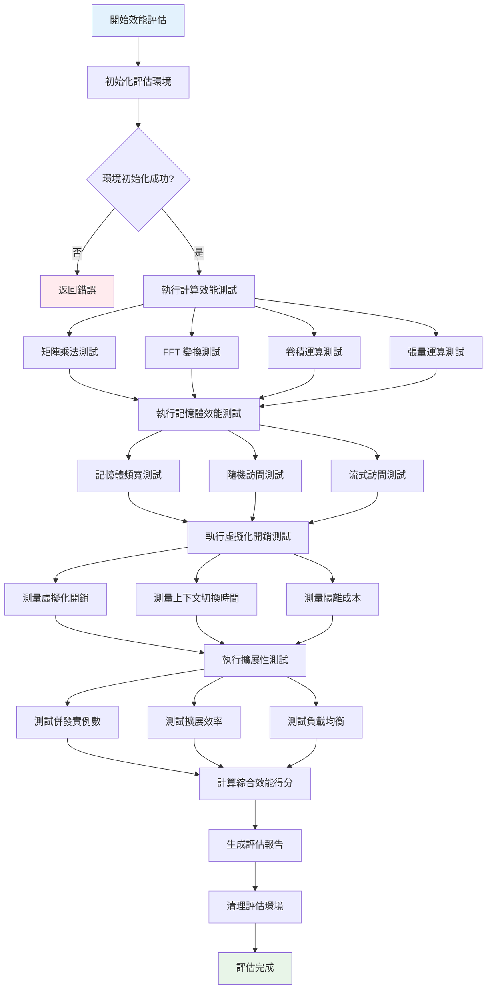
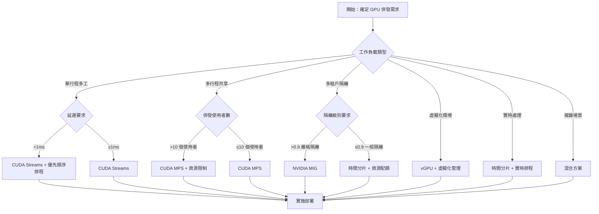

# GPU 虛擬化與資源管理技術深度解析 - 第一部分：基礎理論篇

## 概述

《**GPU 虛擬化與資源管理技術深度解析**》是一套完整的 GPU 資源管理技術體系文件，旨在為 AI 時代的 GPU 資源高效利用提供全面的理論指導和實踐方案。隨著大語言模型、深度學習等 AI 應用的爆發式增長，GPU 資源已成為現代計算基礎設施的核心瓶頸。本系列文件系統性地解決了 GPU 資源利用率低、多租戶隔離困難、成本高昂等關鍵問題。

本系列采用"理論 → 技術 → 實踐 → 應用"的遞進式架構，涵蓋 GPU 虛擬化與資源管理的完整技術棧：

**第一部分：基礎理論篇** - 構建技術認知框架

- 深入分析 AI 時代 GPU 資源需求激增的技術背景
- 系統梳理傳統 GPU 使用模式的六大核心局限性
- 建立 GPU 虛擬化、切分、遠端呼叫三大核心技術體系
- 提供科學的技術選型決策框架和 ROI 評估模型

**第二部分：虛擬化技術篇** - 掌握核心實現機制

- 硬體級虛擬化：NVIDIA MIG、AMD SR-IOV、GPU Passthrough 深度解析
- 核心態虛擬化：虛擬 GPU 管理器、資源排程器、上下文管理器設計
- 使用者態虛擬化：HAMi 專案架構、CUDA API 攔截、效能最佳化機制
- 提供完整的技術對比分析和選擇指南

**第三部分：資源管理與最佳化篇** - 實現高效資源排程

- GPU 切分技術：HAMi 與 MIG 集成、動態切片、混合排程策略
- CUDA 流和 MPS：併發執行最佳化、多行程服務、效能調優
- 核心算法：顯存管理、計算排程、效能隔離、監控分析
- 針對 AI 大模型訓練場景的專項最佳化策略

**第四部分：實踐應用篇** - 落地生產環境

- 完整的部署指南：環境準備、配置最佳化、容器生態整合
- 運維最佳實踐：監控體系、故障排查、自動化恢復
- 云平台集成：公有云、私有云、混合云 GPU 管理策略
- 效能評估與基準測試：指標體系、測試工具、最佳化策略

本系列重點解決 GPU 資源管理的三大核心挑戰：

1. **資源利用率提升**：透過虛擬化和切分技術提升 GPU 利用率——業界經驗量級估計可從傳統的 20-30% 提升至 70-90%（無統一公開實測，實際提升取決於負載與切分方案）
2. **多租戶安全隔離**：實現硬體級、核心級、使用者級的多層次隔離機制，確保企業級安全要求
3. **成本效益最佳化**：透過資源池化和智慧排程，顯著降低 GPU TCO（總擁有成本）

本系列的目標讀者與應用場景：

- **AI 工程師**：掌握 GPU 資源最佳化技術，提升模型訓練和推理效率
- **系統架構師**：設計高效的 GPU 叢集架構，支撐大規模 AI 應用
- **運維工程師**：實現 GPU 資源的自動化管理和監控
- **技術決策者**：基於科學的評估框架進行 GPU 技術選型

**第一部分：基礎理論篇：**

本篇作為整個系列的理論基礎，將從 GPU 計算資源需求的時代背景出發，系統分析傳統 GPU 使用模式的技術侷限性，建立 GPU 虛擬化、切分和遠端呼叫的核心技術體系，並提供科學的技術選型決策框架。透過本篇的學習，讀者將建立完整的 GPU 資源管理技術認知框架，為後續深入學習技術實現和實踐應用奠定堅實基礎。

## 目錄

- [GPU 虛擬化與資源管理技術深度解析 - 第一部分：基礎理論篇](#gpu-虛擬化與資源管理技術深度解析---第一部分基礎理論篇)
  - [概述](#概述)
  - [目錄](#目錄)
  - [1. 術語表](#1-術語表)
  - [2. 引言](#2-引言)
    - [2.1 GPU 計算資源需求的快速增長背景](#21-gpu-計算資源需求的快速增長背景)
      - [2.1.1 關鍵驅動因素](#211-關鍵驅動因素)
      - [2.1.2 最新 GPU 架構對虛擬化技術的影響](#212-最新-gpu-架構對虛擬化技術的影響)
      - [2.1.3 技術趨勢對虛擬化的推動作用](#213-技術趨勢對虛擬化的推動作用)
    - [2.2 傳統 GPU 使用模式的局限性](#22-傳統-gpu-使用模式的局限性)
      - [2.2.1 資源利用率低下](#221-資源利用率低下)
      - [2.2.2 資源分配不靈活](#222-資源分配不靈活)
      - [2.2.3 多租戶隔離困難](#223-多租戶隔離困難)
      - [2.2.4 擴展性受限](#224-擴展性受限)
      - [2.2.5 遠端訪問與網路依賴問題](#225-遠端訪問與網路依賴問題)
      - [2.2.6 技術棧整合與標準化缺失](#226-技術棧整合與標準化缺失)
    - [2.3 GPU 管理核心技術概覽](#23-gpu-管理核心技術概覽)
      - [2.3.1 GPU 虛擬化技術](#231-gpu-虛擬化技術)
      - [2.3.2 GPU 切分技術](#232-gpu-切分技術)
      - [2.3.3 GPU 遠端呼叫技術](#233-gpu-遠端呼叫技術)
      - [2.3.4 技術整合與協同](#234-技術整合與協同)
    - [2.4 本文研究範圍](#24-本文研究範圍)
      - [2.4.1 核心技術領域](#241-核心技術領域)
      - [2.4.2 實現層面分析](#242-實現層面分析)
      - [2.4.3 應用場景覆蓋](#243-應用場景覆蓋)
      - [2.4.4 技術邊界和限制](#244-技術邊界和限制)
      - [2.4.5 目標讀者群體](#245-目標讀者群體)
    - [2.5 核心概念解析](#25-核心概念解析)
      - [2.5.1 GPU 切分技術](#251-gpu-切分技術)
      - [2.5.2 時間片排程機制](#252-時間片排程機制)
      - [2.5.3 顯存超分技術](#253-顯存超分技術)
      - [2.5.4 側通道攻擊防護](#254-側通道攻擊防護)
      - [2.5.5 CUDA MPS 多行程服務技術](#255-cuda-mps-多行程服務技術)
      - [2.5.6 GPU 資源池化技術](#256-gpu-資源池化技術)
      - [2.5.7 容器化 GPU 管理](#257-容器化-gpu-管理)
  - [3. 技術選型決策框架](#3-技術選型決策框架)
    - [3.1 技術選型評估維度](#31-技術選型評估維度)
      - [3.1.1 效能指標評估](#311-效能指標評估)
      - [3.1.2 成本效益分析](#312-成本效益分析)
      - [3.1.3 技術成熟度評估](#313-技術成熟度評估)
      - [3.1.4 生態相容性分析](#314-生態相容性分析)
    - [3.2 應用場景分類與匹配](#32-應用場景分類與匹配)
      - [3.2.1 雲端計算環境需求分析](#321-雲端計算環境需求分析)
      - [3.2.2 邊緣計算場景特徵](#322-邊緣計算場景特徵)
      - [3.2.3 高效能運算叢集要求](#323-高效能運算叢集要求)
      - [3.2.4 AI 訓練與推理場景](#324-ai-訓練與推理場景)
      - [3.2.5 GPU 併發機制技術對比](#325-gpu-併發機制技術對比)
    - [3.3 ROI 計算模型](#33-roi-計算模型)
      - [3.3.1 成本構成分析](#331-成本構成分析)
      - [3.3.2 收益量化方法](#332-收益量化方法)
      - [3.3.3 投資回報評估](#333-投資回報評估)
  - [第一部分總結](#第一部分總結)

---

## 1. 術語表

| **術語**      | **全稱**                                        | **定義**                                                 |
| ------------- | ----------------------------------------------- | -------------------------------------------------------- |
| GPU           | Graphics Processing Unit                        | 圖形處理單元，專門用於平行計算的處理器                   |
| MIG           | Multi-Instance GPU                              | NVIDIA 的多實例 GPU 技術，支援硬體級 GPU 切分 [1]        |
| HAMi          | Heterogeneous AI Computing Virtualization Middleware | 異構 AI 計算虛擬化中介軟體，開源 GPU 資源管理方案 [10]     |
| CUDA          | Compute Unified Device Architecture             | NVIDIA 的平行計算平台和程式設計模型 [4,5]                    |
| API           | Application Programming Interface               | 應用程式程式設計介面                                         |
| cgroup        | Control Groups                                  | Linux 核心功能，用於限制和隔離行程組的資源使用           |
| ioctl         | Input/Output Control                            | 裝置輸入輸出控制系統呼叫                                 |
| mmap          | Memory Map                                      | 記憶體對映系統呼叫                                         |
| QoS           | Quality of Service                              | 服務品質，用於保證網路或系統效能                         |
| SLA           | Service Level Agreement                         | 服務級別協議                                             |
| ROI           | Return on Investment                            | 投資回報率                                               |
| NPU           | Neural Processing Unit                          | 神經網路處理單元                                         |
| DPU           | Data Processing Unit                            | 資料處理單元                                             |
| FPGA          | Field-Programmable Gate Array                   | 現場可程式設計門陣列                                         |
| vGPU          | Virtual GPU                                     | 虛擬 GPU，基於虛擬化建立的 GPU 實例                      |
| SR-IOV        | Single Root I/O Virtualization                  | 單根 I/O 虛擬化，硬體級虛擬化技術 [6]                    |
| IOMMU         | Input-Output Memory Management Unit             | 輸入輸出記憶體管理單元，用於裝置虛擬化 [7]                 |
| PCIe          | Peripheral Component Interconnect Express       | 高速序列計算機擴展匯流排標準                               |
| NUMA          | Non-Uniform Memory Access                       | 非統一記憶體訪問架構                                       |
| UVM           | Unified Virtual Memory                          | 統一虛擬記憶體，CUDA 的記憶體管理技術                        |
| COW           | Copy-on-Write                                   | 寫時複製，記憶體管理最佳化技術                               |
| LRU           | Least Recently Used                             | 最近最少使用，快取替換演算法                               |
| OOM           | Out of Memory                                   | 記憶體不足錯誤                                             |
| ZSTD          | Zstandard                                       | 高效的無損資料壓縮演算法                                   |
| LZ4           | LZ4                                             | 快速無損資料壓縮演算法                                     |
| RDMA          | Remote Direct Memory Access                     | 遠端直接記憶體訪問技術                                     |
| InfiniBand    | InfiniBand                                      | 高效能運算和資料中心互聯技術                             |
| NVLink        | NVIDIA NVLink                                   | NVIDIA 的高速 GPU 互聯技術                               |
| NVSwitch      | NVIDIA NVSwitch                                 | NVIDIA 的 GPU 交換晶片                                   |
| NCCL          | NVIDIA Collective Communication Library         | NVIDIA 集合通訊庫 [8]                                    |
| cuDNN         | CUDA Deep Neural Network Library                | CUDA 深度神經網路庫 [8]                                  |
| TensorRT      | TensorRT                                        | NVIDIA 的深度學習推理最佳化庫 [8]                          |
| Triton        | Triton Inference Server                         | NVIDIA 的推理伺服器                                      |
| DRA           | Dynamic Resource Allocation                     | Kubernetes 動態資源分配技術，支援精細化 GPU 資源管理 [9] |
| CDI           | Container Device Interface                      | 容器裝置介面規範，實現容器與裝置的無縫對接 [9]           |
| Device Plugin | Kubernetes Device Plugin                        | Kubernetes 裝置外掛框架，用於硬體裝置管理 [11]           |
| MPS           | Multi-Process Service                           | NVIDIA 多行程服務，支援多行程共享 GPU 資源 [12]          |
| Docker        | Docker                                          | 容器化平台                                               |
| Kubernetes    | Kubernetes                                      | 容器編排平台                                             |
| Prometheus    | Prometheus                                      | 開源監控和告警系統 [13]                                  |
| Grafana       | Grafana                                         | 開源資料視覺化平台 [14]                                  |
| ROCm          | Radeon Open Compute                             | AMD 的開源 GPU 計算平台 [2]                              |
| HIP           | Heterogeneous-Compute Interface for Portability | AMD 的異構計算介面                                       |
| HBM           | High Bandwidth Memory                           | 高頻寬記憶體                                               |
| GDDR          | Graphics Double Data Rate                       | 圖形雙倍資料速率記憶體                                     |
| ECC           | Error-Correcting Code                           | 錯誤糾正碼記憶體                                           |
| DMA           | Direct Memory Access                            | 直接記憶體訪問                                             |
| IOVA          | I/O Virtual Address                             | I/O 虛擬地址                                             |
| SMMU          | System Memory Management Unit                   | 系統記憶體管理單元                                         |
| ATS           | Address Translation Services                    | 地址轉換服務                                             |
| PASID         | Process Address Space Identifier                | 行程地址空間識別符號                                       |

---

## 2. 引言

隨著人工智慧、深度學習、科學計算等領域的快速發展，GPU 計算資源需求呈現指數級增長態勢 [9,10]。GPU 已從傳統的圖形渲染專用處理器演進為現代計算基礎設施的核心元件，在大規模機器學習訓練和推理任務中發揮關鍵作用 [11]。然而，傳統 GPU 使用模式在資源利用效率、多租戶隔離、彈性擴展等方面存在顯著侷限性 [12,16]。GPU 虛擬化技術作為解決資源利用率問題的關鍵方案，近年來在學術界和工業界都得到了廣泛關注和深入研究 [4]。

本文系統性地分析 GPU 管理技術的發展背景、傳統使用模式的技術瓶頸、GPU 虛擬化技術的核心價值和發展趨勢，並明確研究範圍和核心概念，為深入理解後續技術內容構建理論基礎。

### 2.1 GPU 計算資源需求的快速增長背景

近年來，AI 應用的複雜度和規模呈現持續增長趨勢，特別是大語言模型（LLM）的快速发展，對 GPU 計算能力提出了前所未有的技術挑戰。從 GPT-3 的 1750 億參數規模發展至 GPT-4 的 [1.8 萬億參數體量](https://explodingtopics.com/blog/gpt-parameters)，模型參數規模的指數級增長直接驅動了 GPU 計算資源需求的急劇擴張。

#### 2.1.1 關鍵驅動因素

- **模型規模增長**：從 BERT 的 3.4 億參數發展到當前的萬億級參數
- **應用場景擴展**：從研究機構擴展到金融、醫療、自動駕駛、製造業等各行各業
- **計算密集度提升**：大模型訓練需要數千張 GPU 協同工作，實時推理服務對效能要求極高

#### 2.1.2 最新 GPU 架構對虛擬化技術的影響

隨著 GPU 架構的快速演進，最新一代 GPU 在虛擬化支援方面帶來了顯著的技術突破，為 GPU 資源管理提供了新的可能性：

**NVIDIA H100 架構創新：**

- **增強的 MIG 支持**：H100 提供[多版本配置](https://www.nvidia.com/en-us/data-center/h100)：
  - SXM5 版本：80GB HBM3 顯存，支持第二代 MIG 技術
  - NVL 版本：188GB HBM3 顯存，透過 NVLink 橋接
  - 單卡最多[劃分 7 個實例，支援動態配置無需 GPU 重置](https://docs.nvidia.com/launchpad/ai/h100-mig/latest/h100-mig-gpu.html)
  - 每個實例提供前代 3 倍計算資源及近 2 倍記憶體頻寬
- **MIG 效能最佳化**：新的 Streaming Multiprocessor（SM）架構減少了上下文切換開銷，MIG 實例相對於物理 GPU 具有接近原生的效能表現
- **安全隔離增強**：硬體級的 Confidential Computing 支持，為多租戶環境提供了更強的安全保障
- **NVLink 4.0 支持**：900GB/s 的互連頻寬為分散式 GPU 虛擬化提供了高速通訊基礎

**AMD MI300 系列突破：**

- **MI300X 顯存架構**：192GB HBM3 [顯存配置](https://www.amd.com/en/products/accelerators/instinct/mi300x.html)
  - 8,192 位記憶體匯流排介面
  - 5.2Gbps 資料速率，提供 **5.325TB/s** 峰值頻寬
  - [**第三代 Infinity Fabric 互連技術**](https://www.amd.com/en/technologies/infinity-architecture)
    - 晶片間互連頻寬提升至 **896GB/s**
    - 支援自適應路由和錯誤糾正機制
    - 延遲降低至納秒級
- **統一記憶體架構**：MI300X 集成了 HBM3 記憶體，為虛擬化環境下的記憶體管理提供了新的最佳化空間
- **CDNA 3 架構優勢**：原生支援虛擬化工作負載，在多租戶場景下效能表現更加穩定
- **ROCm 6.0 生態**：完善的開源軟體棧為 GPU 虛擬化提供了更多技術選擇

**Intel 資料中心 GPU 進展：**

- **Xe-HPC 架構**：Intel Ponte Vecchio 在設計之初就考慮了虛擬化需求，提供了硬體級的資源隔離機制
- **oneAPI 統一程式設計模型**：為跨廠商 GPU 虛擬化提供了標準化的軟體介面

#### 2.1.3 技術趨勢對虛擬化的推動作用

- **硬體虛擬化能力增強**：新一代 GPU 普遍加強了硬體級虛擬化支援，降低了軟體虛擬化的複雜度
- **記憶體容量大幅提升**：H100 的 80GB HBM3、MI300X 的 192GB HBM3 為顯存超分技術提供了更大的最佳化空間
- **互連技術進步**：NVLink、Infinity Fabric 等高速互連技術使得跨節點 GPU 虛擬化成為可能
- **AI 專用指令集**：Transformer Engine、Matrix Engine 等專用計算單元為 AI 工作負載的虛擬化最佳化提供了新的維度

### 2.2 傳統 GPU 使用模式的局限性

傳統 GPU 使用模式在現代 AI 工作負載場景下暴露出顯著的技術侷限性，這些瓶頸嚴重製約了 GPU 資源的有效利用率和系統架構的可擴展性。

#### 2.2.1 資源利用率低下

**問題描述：**
單個應用往往無法充分利用整個 GPU 的計算能力，導致嚴重的資源浪費。

**具體表現：**

- **計算資源閒置**：許多 AI 推理任務無法充分利用 GPU 計算能力（典型場景下利用率偏低）
- **顯存浪費**：小模型推理顯存使用量遠低於 GPU 配備容量
- **批處理效率低**：單任務處理無法充分利用 GPU 的並行處理能力
- **峰谷差異大**：業務高峰期資源不足，低谷期大量閒置

**典型場景：**

- 推理服務在生產環境中的 GPU 利用率普遍偏低
- 開發測試環境中資源利用率更低

_注：具體利用率資料因工作負載類型、模型規模和部署方式而異。_

#### 2.2.2 資源分配不靈活

**問題描述：**
GPU 通常以整卡為單位分配，無法滿足不同應用的精細化資源需求。

**具體挑戰：**

- **粒度過粗**：無法根據應用實際需求分配適量的計算資源
- **資源浪費**：小任務佔用整張 GPU 卡，造成資源浪費
- **排程困難**：無法實現多個小任務共享單張 GPU
- **成本高昂**：每個應用都需要獨佔 GPU，增加硬件成本

**業務影響：**

- 開發團隊需要排隊等待 GPU 資源
- 無法支援細粒度的資源計費
- 難以實現按需擴縮容

#### 2.2.3 多租戶隔離困難

**問題描述：**
多個應用共享 GPU 時缺乏有效的隔離機制，容易出現資源競爭和安全問題。

**安全風險：**

- **資料洩露**：共享顯存可能導致敏感資料洩露
- **側通道攻擊**：惡意應用可能透過時序分析獲取其他應用資訊
- **資源搶佔**：高優先順序任務可能被低優先順序任務影響
- **故障傳播**：一個應用的異常可能影響其他應用

**管理挑戰：**

- 缺乏有效的資源配額管理
- 難以實現公平排程
- 無法提供 SLA 保障

#### 2.2.4 擴展性受限

**問題描述：**
傳統模式下，GPU 資源的擴展受到物理硬體的限制，難以實現彈性伸縮。

**技術限制：**

- **物理邊界**：單機 GPU 數量受主機板和電源限制
- **網路瓶頸**：跨節點 GPU 通訊延遲高
- **管理複雜**：大規模 GPU 叢集管理複雜度指數級增長
- **故障處理**：硬體故障影響整個節點的可用性

**運維挑戰：**

- 無法快速響應業務需求變化
- 硬體採購和部署週期長
- 維護成本隨規模線性增長

#### 2.2.5 遠端訪問與網路依賴問題

**問題描述：**
傳統 GPU 使用模式缺乏有效的遠端訪問機制，限制了資源的靈活排程和跨地域協作。

| 問題類別             | 具體挑戰     | 問題描述                                                       |
| -------------------- | ------------ | -------------------------------------------------------------- |
| **網路效能瓶頸**     | 延遲敏感     | GPU 計算任務對網路延遲極其敏感，傳統網路架構難以滿足實時性要求 |
|                      | 頻寬限制     | 大規模資料傳輸受網路頻寬限制，影響整體效能                     |
|                      | 協議開銷     | 傳統網路協議開銷大，不適合 GPU 密集型計算場景                  |
|                      | QoS 保障     | 缺乏針對 GPU 工作負載的網路服務品質保障機制                    |
| **資源排程侷限**     | 地域限制     | GPU 資源無法跨資料中心靈活排程                                 |
|                      | 負載均衡困難 | 難以實現跨節點的智慧負載分配                                   |
|                      | 故障恢復複雜 | 網路故障時缺乏有效的容錯和恢復機制                             |
|                      | 資源發現困難 | 缺乏統一的遠端 GPU 資源發現和管理機制                          |
| **安全與可靠性挑戰** | 資料傳輸安全 | 遠端訪問時資料傳輸缺乏有效加密保護                             |
|                      | 身份認證複雜 | 跨網路的身份驗證和授權機制不完善                               |
|                      | 網路攻擊風險 | 暴露在網路中的 GPU 服務面臨安全威脅                            |
|                      | 服務可用性   | 網路不穩定導致 GPU 服務可用性下降                              |

#### 2.2.6 技術棧整合與標準化缺失

**問題描述：**
現有 GPU 管理技術缺乏統一標準，各廠商方案互不相容，增加了系統整合複雜度。

| 問題類別             | 具體問題     | 問題描述                                               |
| -------------------- | ------------ | ------------------------------------------------------ |
| **標準化問題**       | 介面不統一   | 不同廠商的 GPU 虛擬化介面標準不一致                    |
|                      | 協議碎片化   | 缺乏統一的 GPU 資源管理協議                            |
|                      | API 兼容性差 | 應用程式難以在不同 GPU 管理平台間遷移                  |
|                      | 監控標準缺失 | 缺乏統一的 GPU 資源監控和度量標準                      |
| **整合複雜性**       | 多技術棧並存 | 虛擬化、切分、遠端呼叫技術各自獨立，難以協同           |
|                      | 配置管理複雜 | 不同技術方案的配置和管理方式差異巨大                   |
|                      | 運維工具分散 | 缺乏統一的 GPU 資源運維管理工具                        |
|                      | 技能要求高   | 需要掌握多種技術棧，增加人力成本                       |
| **對核心技術的影響** | 虛擬化技術   | 缺乏標準化導致虛擬化方案選擇困難，廠商鎖定風險高       |
|                      | 切分技術     | 不同切分方案無法互操作，資源池化效果受限               |
|                      | 遠端呼叫技術 | 協議不統一導致跨平台遠端呼叫困難，限制了資源的全域性最佳化 |

### 2.3 GPU 管理核心技術概覽

現代 GPU 資源管理涉及三大核心技術：虛擬化、切分和遠端呼叫。這些技術相互補充，共同構建了完整的 GPU 資源管理解決方案。本節將系統介紹這三大技術的基本原理和實現方式，為後續章節的深入分析奠定基礎。

#### 2.3.1 GPU 虛擬化技術

**技術原理：**

GPU 虛擬化透過在硬體和應用之間引入抽象層，實現 GPU 資源的靈活分配、安全隔離和高效利用。現代 GPU 虛擬化技術可分為硬體層、核心態與使用者態三個層次，並可透過混合方案結合多層優勢[13,14]。


**主要實現方式：**

- **硬體層虛擬化**：直接在 GPU 硬體層面提供虛擬化支援
  - **定義**：利用 GPU 硬體內建的虛擬化功能，在物理層面實現資源隔離
  - **技術特點**：最強的隔離性、最低的效能開銷（1-3%）、硬體級安全保障
  - **典型示例**：NVIDIA MIG（Multi-Instance GPU）、AMD MxGPU（基於 SR-IOV 標準）、Intel Ponte Vecchio Xe-HPC 架構
  - **適用場景**：多租戶生產環境、需要強隔離和高效能的場景

- **核心態虛擬化層**：在作業系統核心層面實現 GPU 資源虛擬化
  - **定義**：透過驅動程式修改、裝置外掛或系統呼叫攔截實現系統級資源管理
  - **技術特點**：系統級控制、精細資源管理、需要核心模組支援、中等效能開銷
  - **典型示例**：虛擬 GPU 管理器、資源排程器、上下文管理器、eBPF 系統呼叫過濾
  - **適用場景**：需要動態資源調整和精細排程的企業級環境

- **使用者態虛擬化層**：在使用者空間實現 GPU 資源的配額控制和管理
  - **定義**：透過 LD_PRELOAD 機制鉤掛 CUDA/ROCm API，在應用層面實現資源限制
  - **技術特點**：部署簡單、兼容性好、無需核心修改、基於軟體配額、較高靈活性
  - **典型示例**：HAMi（異構 AI 計算中介軟體）、vCUDA（虛擬 CUDA 執行時）、容器化 GPU 資源限制
  - **適用場景**：開發測試環境、輕隔離需求、快速部署場景

- **混合虛擬化架構**：結合硬體和軟體虛擬化技術的綜合解決方案
  - **定義**：同時使用硬體和軟體虛擬化技術，在空間切分與時間片排程之間進行智慧權衡
  - **技術特點**：靈活性高、適應性強、可根據工作負載特徵選擇最優方案
  - **典型示例**：MIG+容器化（硬體隔離+軟體管理）、SR-IOV+API 攔截（硬體虛擬化+軟體配額）、多層次資源管理架構[4,19]
  - **適用場景**：大規模 GPU 叢集、多樣化工作負載、需要靈活資源管理的場景

**核心價值：**

- 提高資源利用率和靈活性
- 實現多租戶安全隔離
- 支援動態資源調整和負載均衡

#### 2.3.2 GPU 切分技術


**虛擬化與切分的層次關係：**

GPU 虛擬化和 GPU 切分形成完整的技術棧層次結構：

```text
應用層工作負載    ← 切分策略（資源分配決策）
    ↓
虛擬化管理層     ← 切分技術（策略實施）
    ↓
虛擬化實現層     ← 虛擬化技術（能力提供）
    ↓
物理硬體層       ← 物理 GPU 資源
```

- **GPU 虛擬化**：提供基礎能力實現，在硬件、核心態或使用者態層面建立虛擬 GPU 實例，實現資源抽象和隔離邊界 [1,13]
- **GPU 切分**：制定資源使用策略，定義如何將物理 GPU 資源劃分給不同的虛擬實例和工作負載，包括時間、空間和混合切分策略 [19,21]
- **關係**：虛擬化是切分的技術基礎，切分是虛擬化的策略延伸，兩者協同實現完整的 GPU 資源管理體系

**技術原理與架構：**

GPU 切分技術基於虛擬化基礎設施，將單個物理 GPU 劃分為多個獨立的邏輯單元，每個單元可以執行不同的工作負載。切分技術透過硬體分割槽、軟體排程或混合方式實現資源隔離和效能保障，支援從毫秒級時間片排程到硬體級空間隔離的多粒度資源管理 [1,14]。

**核心切分策略體系：**

- **時間切分（Time Slicing）**：基於時間片的 GPU 計算資源分配
  - **搶佔式排程**：支援高優先順序任務搶佔，確保關鍵任務響應時間
    - 上下文切換開銷：~10-50μs（狀態儲存和恢復）
    - 適用場景：實時系統、高優先順序任務處理
  - **協作式排程**：任務主動釋放資源，減少強制切換開銷
    - 切換開銷：~5-20μs（自願釋放）
    - 適用場景：批處理作業、友好型工作負載
  - **混合排程**：結合搶佔式和協作式優勢，實現智慧排程
    - 自適應時間片調整：基於負載特徵動態最佳化時間片大小

- **空間切分（Spatial Partitioning）**：將 GPU 物理資源進行空間劃分
  - **計算單元切分**：SM（流多處理器）級別的資源分割
    - NVIDIA MIG 技術：硬體級 SM 分割槽，支持 1-7 個獨立實例 [1]
    - 效能隔離：跨實例干擾 < 3%，接近原生性能（95-98%）
    - 適用場景：生產環境多租戶、需要強隔離的高效能運算
  - **顯存切分**：獨立的顯存空間分配和訪問控制
    - 硬體強制顯存邊界檢查，防止跨分割槽記憶體訪問
    - 顯存頻寬按比例分配，確保公平性
    - 參考實現：`memory_pool.c` - 顯存池化管理
  - **頻寬切分**：記憶體控制器的頻寬配額控制
    - QoS 機制：令牌桶頻寬控制、優先順序排程
    - 頻寬利用率：>90%（PCIe 匯流排效率）

- **混合切分（Hybrid Slicing）**：時間和空間切分的智慧組合
  - **靜態切分特點**：
    - 配置固定：資源分配在啟動時確定，執行期間不變
    - 管理簡單：無需複雜的動態排程演算法
    - 效能可預測：每個任務的資源保證明確
    - 資源浪費：無法根據實際需求調整資源分配
  - **動態切分特點**：
    - 配置靈活：可以根據實時負載動態調整資源分配
    - 管理複雜：需要複雜的排程和監控機制
    - 資源利用率高：可以充分利用空閒資源
    - 效能波動：資源分配可能受其他任務影響
  - **混合策略優勢**：
    - 結合靜態保證和動態靈活性，在保證基礎資源的同時允許動態調整
    - 支援基於負載預測的智慧資源分配

**MIG 技術深度整合：**

NVIDIA Multi-Instance GPU（MIG）技術代表硬體級切分的最高水平，在 H100 架構中實現重大突破：

- **增強的 MIG 支持**：H100 提供多版本配置 [1]
  - SXM5 版本：80GB HBM3 顯存，支持第二代 MIG 技術
  - NVL 版本：188GB HBM3 顯存，透過 NVLink 橋接
  - 單卡最多劃分 7 個實例，支援動態配置無需 GPU 重置
  - 每個實例提供前代 3 倍計算資源及近 2 倍記憶體頻寬

- **MIG 效能最佳化**：新的 Streaming Multiprocessor（SM）架構減少了上下文切換開銷，MIG 實例相對於物理 GPU 具有接近原生的效能表現（95-98%）

- **安全隔離增強**：硬體級的 Confidential Computing 支持，為多租戶環境提供了更強的安全保障（側通道攻擊的量化防護率目前沒有公開實測資料）

**場景化適用性分析：**

基於不同工作負載特徵和技術要求，切分策略的選擇需要綜合考慮效能、隔離性和靈活性需求：

| **應用場景**       | **推薦切分策略**        | **技術特點**                 | **效能指標**                    | **適用技術**                 |
| ------------------ | ----------------------- | ---------------------------- | ------------------------------- | ---------------------------- |
| **生產環境多租戶** | 空間切分 + 硬體虛擬化   | 強隔離、高性能、資源保證     | 效能損耗 1-3%，隔離強度 >99%    | NVIDIA MIG、AMD SR-IOV       |
| **雲服務平台**     | 混合切分 + 核心態虛擬化 | 動態調整、精細排程、高利用率 | 效能損耗 5-15%，資源利用率 >85% | 驅動外掛、裝置管理器         |
| **開發測試環境**   | 時間切分 + 使用者態虛擬化 | 靈活部署、快速迭代、兼容性好 | 效能損耗 10-20%，部署時間 <5min | HAMi、vCUDA、容器化 GPU 限制 |
| **邊緣計算**       | 輕量級時間切分          | 低開銷、快速響應、資源受限   | 效能損耗 8-15%，記憶體佔用 <50MB  | 精簡排程器、資源配額         |
| **HPC 科學計算**   | 空間切分 + 專用分配     | 高性能、低干擾、計算密集型   | 效能損耗 1-2%，計算效率 >95%    | GPU 直通、專用分割槽           |

**企業級部署解決方案：**

- **HAMi 與 MIG 集成**：開源 HAMi 中介軟體與 NVIDIA MIG 技術深度整合，提供統一的資源管理介面 [10]
  - 支援動態切片建立和銷燬
  - 提供多級資源配額管理
  - 實現跨廠商 GPU 統一管理

- **Kubernetes 生態整合**：透過裝置外掛和資源管理框架，實現容器化 GPU 資源排程 [8]
  - 支援宣告式資源請求
  - 提供服務品質（QoS）保障
  - 實現自動化擴縮容

**效能最佳化與監控體系：**

- **計算資源排程最佳化**：
  - 負載預測演算法：基於歷史資料預測資源需求
  - 拓撲感知分配：最佳化 NUMA 親和性和 PCIe 拓撲

- **顯存管理技術**：
  - 顯存池化：全域性顯存池採用單連結串列空閒塊管理 `memory_pool.c`
  - 統一記憶體：UVA/UVM 支援按需分頁和預取遷移
  - 顯存超分：透過虛擬化手段突破物理顯存限制，支持 1.5-3× 超分比率

- **監控運維體系**：
  - 動態調優機制：基於實時監控資料自動調整切分參數
  - 故障診斷恢復：ECC 錯誤檢測、檢查點恢復機制

**技術選型決策框架：**

選擇切分策略時需要綜合考慮以下因素：

1. **工作負載特徵**：計算密集型 vs 記憶體密集型，實時性要求，執行時長
2. **隔離需求**：多租戶安全要求，效能隔離強度，合規性要求
3. **硬件能力**：GPU 架構支援（MIG/SR-IOV），顯存大小，互連頻寬
4. **運維複雜度**：配置管理難度，監控需求，故障處理能力
5. **成本效益**：硬體投資，軟體許可，運維人力，資源利用率提升收益

透過科學的 ROI 計算模型和基準測試驗證，可以為企業提供量化的技術選型決策支援。

#### 2.3.3 GPU 遠端呼叫技術


**技術原理：**

GPU 遠端呼叫技術使應用程式能夠透明地訪問和使用遠端 GPU 資源，突破單機 GPU 數量限制。rCUDA 等研究專案為此領域奠定了重要的技術基礎。

**核心技術架構：**

**1. 網路透明的 GPU 訪問機制**：

遠端 GPU 呼叫透過 API 攔截機制實現透明性，主要包括：

- **透明攔截**：無縫替換本地 CUDA 呼叫（如 `cudaMalloc`、`cudaMemcpy` 等）
- **請求構建**：自動構建包含魔數、版本、訊息類型的標準化遠端請求
- **參數序列化**：將函式參數序列化為網路傳輸格式
- **響應處理**：解析遠端伺服器響應，轉換為標準 CUDA 錯誤碼
- **類型適配**：支援不同記憶體複製方向的自動路由

**2. 客戶端-伺服器架構設計**：

遠端 GPU 呼叫採用客戶端-伺服器架構：

- **客戶端架構**：負責連線管理、請求轉發、響應處理、快取最佳化和心跳監控
- **伺服器端架構**：負責連線接受、請求處理、資源管理、安全驗證和響應返回
- **負載均衡策略**：支援輪詢、最少連線、加權輪詢、GPU 利用率等多種分配策略
- **連線池管理**：提供連線複用、併發控制和超時處理機制

**3. 高效能網路通訊協議**：

**2025 年最新效能資料**：

| 網路類型                       | 頻寬    | 延遲  | 重傳率 | 測試環境                   |
| ------------------------------ | ------- | ----- | ------ | -------------------------- |
| ConnectX-8 800Gb InfiniBand    | 800Gb/s | 0.5μs | 0.005% | NVIDIA DGX B200/GB200 叢集 |
| NDR400 InfiniBand (ConnectX-7) | 400Gb/s | 0.6μs | 0.008% | NVIDIA DGX H200 叢集       |
| RoCEv2 400Gb                   | 380Gb/s | 1.0μs | 0.12%  | 標準乙太網環境             |

> _ConnectX-8 預計於 2025 年 Q2 開始出貨；具體資料依測試環境與拓撲而異。_

協議設計包括：

- **訊息類型定義**：malloc、free、memcpy、kernel launch 等 GPU 操作
- **訊息頭結構**：魔數、版本、類型、ID、時間戳、負載大小、校驗和
- **批處理支援**：支援多個請求的批次處理，減少網路往返次數

**關鍵技術要素體系：**

- **網路最佳化技術**：低延遲高頻寬網路通訊，支持 RDMA/零複製傳輸
- **資料傳輸機制**：高效的資料序列化和壓縮傳輸，減少頻寬佔用
- **狀態同步管理**：遠端 GPU 上下文狀態的一致性維護和同步
- **錯誤處理恢復**：網路故障自動重連和裝置故障的智慧恢復機制
- **安全可靠性**：TLS 加密與雙向認證、許可權與配額控制、錯誤分類與恢復策略

**效能最佳化策略體系：**

遠端 GPU 呼叫的效能最佳化是確保系統實用性的關鍵，主要包括：

**1. 延遲最佳化技術**：

- **請求批處理**：將多個小請求合併為一個大請求，減少網路往返次數，支援動態批處理大小和超時控制
- **非同步處理機制**：非阻塞請求提交，併發處理多個請求，回撥機制處理結果
- **連線池最佳化**：複用網路連線，減少連線建立開銷，支援連線預熱和保活

**2. 頻寬最佳化技術**：

- **資料壓縮傳輸**：采用 ZSTD、LZ4 等高效壓縮演算法，減少網路頻寬佔用
- **零複製傳輸**：啟用 GPUDirect RDMA 繞過 CPU 記憶體，提高頻寬利用率
- **智慧預取策略**：基於訪問模式特徵動態配置預取視窗，建立多級快取體系

**3. 容錯與可靠性保障**：

- **連線保活機制**：定期心跳檢測，自動重連和故障轉移
- **錯誤分類處理**：區分網路錯誤（XID）和裝置錯誤，針對性恢復策略
- **檢查點與恢復**：記憶體檢查點建立與恢復，支援自動重試和資料重傳輸

**效能基準資料（2025 年最新）：**

| 最佳化策略    | 延遲改善 | 頻寬提升 | 適用場景                 |
| ----------- | -------- | -------- | ------------------------ |
| 請求批處理  | 30-60%   | 20-40%   | 小粒度 API 呼叫密集場景  |
| RDMA 零複製 | 40-70%   | 50-80%   | 大資料傳輸和高頻寬需求   |
| 資料壓縮    | -5-10%\* | 60-90%   | 文本/參數資料傳輸場景    |
| 連線池複用  | 20-50%   | 15-30%   | 高併發短連線場景         |
| 智慧預取    | 25-55%   | 35-65%   | 順序訪問和規律性訪問模式 |

> \*注：資料壓縮可能增加少量 CPU 開銷，但顯著減少網路傳輸時間

#### 2.3.4 技術整合與協同

**技術融合趨勢：**

現代 GPU 管理系統通常將三大技術進行有機結合：

- **虛擬化+切分**：在虛擬化基礎上實現更細粒度的資源切分
- **切分+遠端呼叫**：將切分後的 GPU 資源透過網路提供服務
- **虛擬化+遠端呼叫**：遠端訪問虛擬化的 GPU 資源池
- **三技術融合**：構建統一的 GPU 資源管理平台

**協同優勢：**

- **資源利用最大化**：透過多層次的資源管理提高整體利用率
- **靈活性增強**：支援多樣化的部署和使用模式
- **可擴展性提升**：突破單機限制，實現叢集級資源管理
- **成本效益最佳化**：透過資源共享降低總體擁有成本

**實施考量：**

- **效能開銷**：多層技術棧可能帶來的效能損失
- **複雜度管理**：系統複雜度與維護成本的平衡
- **兼容性保障**：確保與現有應用和框架的相容性
- **安全性要求**：多租戶和網路環境下的安全保障

### 2.4 本文研究範圍

本文將深入探討 GPU 虛擬化、切分技術與遠端呼叫機制，涵蓋技術原理、實現方案、性能分析、應用場景等多個維度，為讀者提供全面的技術指導和實踐建議。

#### 2.4.1 核心技術領域

| 技術類別           | 核心技術            | 技術特點                                |
| ------------------ | ------------------- | --------------------------------------- |
| **GPU 虛擬化技術** | 硬體層虛擬化        | NVIDIA MIG、AMD SR-IOV 等硬體級資源隔離 |
|                    | 核心態虛擬化        | 驅動層攔截和管理，系統級資源控制        |
|                    | 使用者態虛擬化        | API 層封裝和代理，應用級透明訪問        |
|                    | 容器化 GPU 資源管理 | 容器級 GPU 資源分配和隔離               |
| **GPU 切分技術**   | 時間片排程機制      | 演算法最佳化，時間維度資源共享              |
|                    | 空間切分策略        | 資源隔離，空間維度資源分割              |
|                    | 混合切分模式        | 時空結合的設計與實現                    |
|                    | 動態資源分配        | 負載均衡，自適應資源調整                |
| **遠端 GPU 呼叫**  | GPU 資源網路化訪問  | 透明的遠端 GPU 資源訪問機制             |
|                    | 分布式 GPU 計算架構 | 多節點 GPU 資源協同計算                 |
|                    | 跨節點 GPU 資源排程 | 叢集級 GPU 資源統一排程                 |
|                    | 網路最佳化和延遲控制  | 高效能網路通訊和延遲最佳化                |

#### 2.4.2 實現層面分析

| 分析維度             | 關鍵要素     | 技術要點                     |
| -------------------- | ------------ | ---------------------------- |
| **技術原理深度解析** | 底層硬體架構 | 虛擬化支援機制和硬體特性分析 |
|                      | 作業系統核心 | GPU 資源管理和核心級排程機制 |
|                      | 驅動程式適配 | 虛擬化層驅動程式設計和相容性 |
|                      | 應用程式介面 | 透明化處理和 API 層封裝技術  |
| **實現方案對比**     | 技術特點分析 | 不同虛擬化方案的優劣勢對比   |
|                      | 效能評估     | 開銷分析和資源利用率最佳化     |
|                      | 安全性評估   | 隔離性機制和安全防護策略     |
|                      | 部署維護     | 複雜度評估和運維成本分析     |
| **程式碼實現示例**     | 核心算法     | C 語言實現的關鍵演算法邏輯     |
|                      | 資料結構     | 關鍵資料結構的設計和最佳化     |
|                      | 系統介面     | 系統呼叫和 API 封裝實現      |
|                      | 異常處理     | 錯誤處理和異常恢復機制       |

#### 2.4.3 應用場景覆蓋

| 應用場景         | 具體應用          | 技術特點               | 核心價值                 |
| ---------------- | ----------------- | ---------------------- | ------------------------ |
| **雲端計算環境**   | 公有云 GPU 服務   | 虛擬化實現、彈性擴縮容 | 資源池化、按需分配       |
|                  | 私有云 GPU 資源池 | 資源池化、統一管理     | 突破單機限制、大規模聚合 |
|                  | 混合雲環境        | 跨雲資源管理、資料安全 | 跨地域資源排程、故障隔離 |
|                  | 多租戶 GPU 服務   | 安全隔離、資源配額     | 成本共享、SLA 保障       |
| **企業級應用**   | AI 訓練平台       | 資源排程、任務排隊     | 提高利用率、降低成本     |
|                  | 推理服務          | 資源最佳化、低延遲       | 彈性擴縮、快速響應       |
|                  | 開發測試環境      | 資源共享、成本控制     | 簡化管理、降低運維複雜度 |
|                  | 高效能運算叢集    | 大規模並行、高吞吐     | 叢集級資源統一排程       |
| **邊緣計算場景** | 邊緣裝置虛擬化    | 輕量化、低功耗         | 資源受限環境最佳化         |
|                  | 實時計算          | 低延遲、確定性排程     | 實時性保障、效能隔離     |
|                  | 資源受限環境      | 功耗最佳化、散熱管理     | 智慧資源分配、動態調整   |
|                  | 離線部署          | 自主執行、故障自愈     | 容錯機制、服務可用性     |

#### 2.4.4 技術邊界和限制

**本文涵蓋範圍：**

- 主流 GPU 廠商（NVIDIA、AMD）的虛擬化技術
- Linux 作業系統環境下的實現方案
- 容器和虛擬機器兩種虛擬化環境
- 深度學習和高效能運算工作負載

**不涉及內容：**

- 特定廠商的專有技術細節
- Windows 環境下的 GPU 虛擬化
- 移動裝置 GPU 的虛擬化
- 圖形渲染相關的 GPU 虛擬化

#### 2.4.5 目標讀者群體

**技術開發人員：**

- 系統架構師和技術負責人
- GPU 虛擬化技術的開發工程師
- 雲端計算平台的技術人員
- AI 基礎設施的運維工程師

**決策制定者：**

- 技術管理者和 CTO
- 雲服務商的產品經理
- 企業 IT 部門負責人
- 投資和採購決策者

### 2.5 核心概念解析

為了更好地理解本文內容，以下對幾個核心概念進行詳細說明：

#### 2.5.1 GPU 切分技術

GPU 切分技術是將單個 GPU 的計算資源、顯存等按需分配給多個應用或使用者的核心技術。關於 GPU 切分的具體實現方式和技術分類，請參考《第二部分：虛擬化技術篇》第 4-6 章中的詳細介紹，其中涵蓋了硬體級、核心態、使用者態和混合虛擬化四種主要實現方式。

#### 2.5.2 時間片排程機制

時間片排程是透過時間分片的方式讓多個任務輪流使用 GPU 資源的排程策略，是軟體級 GPU 虛擬化的核心機制：

**排程原理**：

- 將 GPU 的使用時間劃分為固定或可變的時間片
- 每個任務在分配的時間片內獨佔 GPU 資源
- 時間片結束後，排程器切換到下一個任務

**關鍵技術**：

- **上下文切換**：儲存和恢復 GPU 的執行狀態，包括寄存器、快取等
- **搶佔機制**：支援高優先順序任務搶佔低優先順序任務的執行
- **負載均衡**：根據任務特性和資源需求動態調整時間片大小

**性能考量**：

- 時間片過小會導致頻繁的上下文切換開銷
- 時間片過大會影響任務的響應性
- 需要根據具體應用場景進行最佳化調整

#### 2.5.3 顯存超分技術

顯存超分技術允許分配的虛擬顯存總量超過物理顯存容量，是提高 GPU 資源利用率的重要手段：

**核心策略**：

- **按需分頁**：只有在實際訪問時才分配物理顯存頁面
- **記憶體壓縮**：使用 LZ4、ZSTD 等演算法壓縮不常用的顯存資料
- **分層儲存**：將冷資料遷移到系統記憶體或儲存裝置
- **智慧預測**：基於訪問模式預測和預載入熱資料

**風險控制機制**：

- **記憶體壓力監控**：實時監控顯存使用情況，預警潛在的 OOM 風險
- **優雅降級**：在顯存不足時自動降低任務優先順序或暫停部分任務
- **QoS 保障**：為關鍵任務預留顯存資源，確保服務品質
- **故障恢復**：提供快速的故障檢測和恢復機制

**適用場景**：

- 推理服務：模型載入後顯存使用相對穩定
- 批處理任務：可以容忍一定的效能波動
- 開發測試環境：對效能要求不嚴格的場景

#### 2.5.4 側通道攻擊防護

側通道攻擊是透過分析系統的物理特徵（如功耗、時序、電磁輻射等）來獲取敏感資訊的攻擊方式，在 GPU 虛擬化環境中需要特別關注：

**攻擊類型**：

- **時序攻擊**：透過分析 GPU 操作的執行時間推斷資料特徵
- **功耗攻擊**：監控 GPU 功耗變化來推斷計算模式
- **快取攻擊**：利用共享快取的訪問模式洩露資訊
- **記憶體訪問攻擊**：透過記憶體訪問模式分析推斷資料結構

**防護機制**：

- **時間混淆**：在操作執行時間中加入隨機延遲
- **功耗平衡**：透過虛擬負載平衡 GPU 功耗變化
- **快取隔離**：為不同租戶分配獨立的快取分割槽
- **記憶體加密**：對敏感資料進行硬體級加密
- **訪問模式隨機化**：隨機化記憶體訪問順序和模式

**實施策略**：

- 根據安全等級要求選擇合適的防護措施
- 平衡安全性和效能之間的關係
- 定期評估和更新防護機制的有效性

#### 2.5.5 CUDA MPS 多行程服務技術

CUDA MPS（Multi-Process Service）是 NVIDIA 提供的系統軟體，允許多個 CUDA 應用程式併發訪問單個 GPU，是實現 GPU 資源共享的重要技術：

**核心原理**：

- **行程級併發**：允許多個 CUDA 行程同時在單個 GPU 上執行
- **資源共享**：多個行程共享 GPU 的計算單元和顯存資源
- **透明訪問**：對應用程式透明，無需修改現有 CUDA 程式碼
- **服務架構**：採用客戶端-伺服器架構，MPS 伺服器管理 GPU 訪問

**技術特點**：

- **併發執行**：支援多個 CUDA 核心同時在 GPU 上執行
- **記憶體隔離**：每個客戶端行程擁有獨立的 GPU 記憶體空間
- **資源限制**：可以為每個客戶端設定計算和記憶體使用限制
- **錯誤隔離**：一個客戶端的錯誤不會影響其他客戶端

**適用場景**：

- **多行程場景**：采用 MPS 實現行程間 GPU 共享
- **推理服務**：多個推理實例併發處理請求
- **批處理任務**：多個小任務並行執行提高吞吐量
- **開發測試**：多個開發者共享 GPU 資源進行測試

**性能考量**：

- 相比獨佔模式，MPS 可能帶來輕微的效能開銷（通常<5%）
- 記憶體頻寬可能成為多行程併發的瓶頸
- 需要根據具體工作負載特性進行效能調優

**與其他併發機制對比分析**：

| 對比維度       | CUDA MPS           | 時間片排程         | MIG 切分     | 容器化排程   |
| -------------- | ------------------ | ------------------ | ------------ | ------------ |
| **併發粒度**   | 行程級             | 任務級             | 硬體級       | 容器級       |
| **資源隔離**   | 記憶體隔離，計算共享 | 時間隔離           | 硬體隔離     | 名稱空間隔離 |
| **效能開銷**   | 低（<5%）          | 中等（上下文切換） | 極低         | 低到中等     |
| **配置複雜度** | 中等               | 低                 | 高           | 中等         |
| **適用場景**   | 多行程併發         | 批處理任務         | 嚴格隔離需求 | 雲原生應用   |
| **故障隔離**   | 行程級隔離         | 任務級隔離         | 硬體級隔離   | 容器級隔離   |
| **資源利用率** | 高                 | 中等               | 中等到高     | 高           |
| **擴展性**     | 單 GPU 限制        | 單 GPU 限制        | 單 GPU 限制  | 叢集級擴展   |

**技術選型建議**：

- **選擇 MPS**：當需要多個小型 CUDA 應用併發執行，且對隔離要求不嚴格時
- **選擇時間片排程**：當應用可以容忍延遲，需要簡單的資源共享時
- **選擇 MIG**：當需要嚴格的硬體級隔離和確定性效能時
- **選擇容器化排程**：當需要與雲原生生態整合，實現大規模 GPU 叢集管理時

**組合使用策略**：

- **MPS + 容器化**：在容器內使用 MPS 實現更細粒度的行程級併發
- **MIG + MPS**：在 MIG 實例內使用 MPS 進一步提高資源利用率
- **時間片 + MPS**：結合時間片排程和 MPS 實現多層次的資源共享

#### 2.5.6 GPU 資源池化技術

GPU 資源池化技術是將分佈在不同節點的 GPU 資源統一管理，形成邏輯上的資源池，實現資源的統一排程和分配：

**核心原理**：

- **資源抽象**：將物理分散的 GPU 資源抽象為統一的資源池
- **統一排程**：透過中央排程器實現全域性資源的最佳化分配
- **動態擴縮**：根據負載需求動態調整資源池規模
- **故障隔離**：單個節點故障不影響整個資源池的可用性

**關鍵技術元件**：

- **資源發現與註冊**：自動發現和註冊叢集中的 GPU 資源
- **負載均衡演算法**：基於資源利用率、任務特性的智慧分配
- **跨節點通訊**：高效的 GPU 間資料傳輸和同步機制
- **資源監控**：實時監控資源狀態和效能指標

**實現架構模式**：

- **集中式管理**：單一控制節點管理所有 GPU 資源
- **分布式管理**：多個管理節點協同工作，提高可靠性
- **混合架構**：結合集中式和分散式的優勢

**應用價值**：

GPU 資源池化技術在各種應用場景中的具體價值體現，請參考《第三部分：資源管理與最佳化篇》中的詳細分析，涵蓋雲端計算環境、企業級應用和邊緣計算等多個領域的核心價值。

#### 2.5.7 容器化 GPU 管理

容器化 GPU 管理是在容器環境中實現 GPU 資源的分配、隔離和管理，是云原生 GPU 服務的基礎技術：

**技術背景**：

- **雲原生趨勢**：容器技術成為現代應用部署的主流方式
- **資源標準化**：容器提供了標準化的資源管理介面
- **微服務架構**：GPU 服務需要適配微服務的部署模式
- **DevOps 集成**：與 CI/CD 流水線的無縫整合

**核心技術實現**：

- **裝置外掛機制**：透過 Kubernetes Device Plugin 暴露 GPU 資源
- **資源配額管理**：基於容器的 GPU 資源限制和配額
- **執行時整合**：與 Docker、containerd 等容器執行時的整合
- **排程策略**：GPU 感知的容器排程演算法

**關鍵挑戰與解決方案**：

- **裝置隔離**：透過 cgroups 和 namespace 實現 GPU 裝置隔離
- **驅動相容**：容器內 GPU 驅動的版本相容性管理
- **效能最佳化**：減少容器化帶來的效能開銷
- **安全加固**：容器環境下的 GPU 安全訪問控制

**生態系統支援**：

- **NVIDIA GPU Operator**：自動化 GPU 節點配置和管理
- **AMD GPU Device Plugin**：AMD GPU 的 Kubernetes 集成
- **多廠商支援**：統一的 GPU 資源管理介面
- **監控工具**：容器化 GPU 資源的監控和告警

**最佳實踐**：

- 合理設定資源請求和限制，避免資源競爭
- 使用 GPU 節點親和性，最佳化任務排程
- 實施資源配額策略，確保公平使用
- 建立完善的監控和日誌體系

---

## 3. 技術選型決策框架

在複雜的 GPU 管理技術生態中，如何根據具體應用場景選擇合適的技術方案是一個關鍵挑戰。本章構建了一個系統性的技術選型決策框架，幫助技術決策者基於量化指標和科學方法進行技術選型。

### 3.1 技術選型評估維度

技術選型需要從多個維度進行綜合評估，確保選擇的方案能夠滿足業務需求並具備良好的可持續性。

#### 3.1.1 效能指標評估

性能是 GPU 管理技術選型的核心考量因素，需要建立全面的效能評估體系。

**效能評估框架：**

**GPU 效能評估框架架構圖：**

```mermaid
graph TB
    A[GPU 效能評估框架] --> B[效能指標體系]
    A --> C[基準測試套件]
    A --> D[評估執行流程]

    B --> B1[計算效能指標]
    B --> B2[記憶體效能指標]
    B --> B3[虛擬化開銷指標]
    B --> B4[擴展性指標]

    B1 --> B11[吞吐量 GFLOPS]
    B1 --> B12[延遲 ms]
    B1 --> B13[利用率 %]
    B1 --> B14[效率比]

    B2 --> B21[記憶體頻寬利用率]
    B2 --> B22[記憶體訪問延遲]
    B2 --> B23[快取命中率]
    B2 --> B24[記憶體效率]

    B3 --> B31[虛擬化開銷 %]
    B3 --> B32[上下文切換時間]
    B3 --> B33[隔離成本]
    B3 --> B34[管理開銷]

    B4 --> B41[最大併發實例數]
    B4 --> B42[擴展效率]
    B4 --> B43[負載均衡有效性]

    C --> C1[計算密集型測試]
    C --> C2[記憶體密集型測試]
    C --> C3[混合負載測試]

    C1 --> C11[矩陣乘法]
    C1 --> C12[FFT 變換]
    C1 --> C13[卷積運算]
    C1 --> C14[張量運算]

    C2 --> C21[記憶體頻寬測試]
    C2 --> C22[隨機訪問測試]
    C2 --> C23[流式訪問測試]

    C3 --> C31[AI 訓練負載]
    C3 --> C32[AI 推理負載]
    C3 --> C33[HPC 模擬負載]

    style A fill:#e1f5fe
    style B fill:#f3e5f5
    style C fill:#e8f5e8
    style D fill:#fff3e0
```



**效能評估執行流程圖：**



#### 3.1.2 成本效益分析

成本效益分析需要考慮技術方案的全生命週期成本和收益。

**成本構成分析表：**

| 成本類別     | 成本專案     | 典型占比 | 計算方式           | 影響因素               | 最佳化策略             |
| ------------ | ------------ | -------- | ------------------ | ---------------------- | -------------------- |
| **初始投資** | 硬體採購成本 | 40-60%   | 裝置單價 × 數量    | 技術選型、規模         | 批次採購、租賃模式   |
|              | 軟體許可成本 | 10-20%   | 許可費 × 使用者數    | 廠商策略、功能需求     | 開源替代、談判最佳化   |
|              | 實施服務成本 | 15-25%   | 人天 × 費率        | 複雜度、定制化程度     | 標準化實施、內部培養 |
|              | 培訓認證成本 | 3-8%     | 人員 × 培訓費      | 技術複雜度、人員基礎   | 線上培訓、內部傳承   |
| **運營成本** | 電力製冷成本 | 20-30%   | 功耗 × 電價 × 時間 | 裝置效率、機房 PUE     | 節能裝置、最佳化排程   |
|              | 維護支援成本 | 15-25%   | 年維護費率         | 裝置複雜度、SLA 要求   | 預防性維護、自動化   |
|              | 人員運維成本 | 30-40%   | 人員 × 薪資        | 技術複雜度、自動化程度 | 自動化運維、技能提升 |
|              | 設施租賃成本 | 10-15%   | 機櫃 × 租金        | 地理位置、服務等級     | 云化部署、資源共享   |

**收益量化分析表：**

| 收益類別     | 收益專案       | 量化方法                    | 典型提升幅度 | 計算週期 | 風險因素     |
| ------------ | -------------- | --------------------------- | ------------ | -------- | ------------ |
| **性能收益** | 計算效能提升   | 任務完成時間縮短 × 人力成本 | 20-50%       | 月度     | 工作負載變化 |
|              | 資源利用率提升 | 利用率提升 × 硬體成本攤銷   | 30-80%       | 月度     | 需求波動     |
|              | 能效比提升     | 功耗降低 × 電力成本         | 10-30%       | 月度     | 電價波動     |
| **運營收益** | 運維效率提升   | 運維時間節省 × 人力成本     | 40-70%       | 月度     | 自動化程度   |
|              | 故障率降低     | 故障損失減少 × 業務影響     | 50-90%       | 年度     | 系統複雜度   |
|              | 擴展性提升     | 快速擴展 × 機會成本         | 難以量化     | 專案級   | 業務增長     |
| **業務收益** | 新業務支撐     | 新業務收入 × 技術貢獻度     | 難以量化     | 年度     | 市場變化     |
|              | 競爭優勢       | 市場份額 × 技術差異化       | 難以量化     | 年度     | 競爭態勢     |

**ROI 計算模型：**

| 財務指標   | 計算公式                      | 評估標準                      | 決策閾值 | 適用場景 |
| ---------- | ----------------------------- | ----------------------------- | -------- | -------- |
| ROI        | (總收益-總投資)/總投資 ×100%  | >15%優秀，>10%良好，<5%需重評 | >10%     | 短期專案 |
| NPV        | ∑(年淨現金流/(1+折現率)^年數) | >0 可行，越大越好             | >0       | 長期投資 |
| 投資回收期 | 累計淨現金流=0 的時間點       | <3 年優秀，<5 年可接受        | <5 年    | 風險控制 |
| IRR        | NPV=0 時的折現率              | >WACC 可行，越高越好          | >12%     | 資本決策 |

#### 3.1.3 技術成熟度評估

技術成熟度直接影響方案的可靠性和風險水平。

**技術成熟度等級（TRL）分類：**

| 等級  | 名稱         | 描述                       | 特徵                 | 風險水平 |
| ----- | ------------ | -------------------------- | -------------------- | -------- |
| TRL-1 | 基本原理觀察 | 科學研究開始轉化為應用研發 | 理論基礎，無實際應用 | 極高     |
| TRL-2 | 技術概念形成 | 發明實際應用，形成技術概念 | 概念設計，初步可行性 | 很高     |
| TRL-3 | 概念驗證     | 概念的分析和實驗驗證       | 實驗室驗證，概念可行 | 高       |
| TRL-4 | 實驗室驗證   | 元件和系統在實驗室環境驗證 | 元件整合，功能驗證   | 中高     |
| TRL-5 | 相關環境驗證 | 元件和系統在相關環境驗證   | 接近真實環境測試     | 中       |
| TRL-6 | 原型演示     | 系統原型在相關環境演示     | 原型系統，效能驗證   | 中低     |
| TRL-7 | 系統原型     | 系統原型在運營環境演示     | 接近最終產品         | 低       |
| TRL-8 | 系統完成     | 系統完成並透過測試驗證     | 產品化就緒           | 很低     |
| TRL-9 | 運營驗證     | 系統在最終形式下運營驗證   | 商業化部署           | 極低     |

**技術成熟度評估指標：**

| 評估維度   | 權重 | 評分標準 | 高分特徵               | 低分特徵             |
| ---------- | ---- | -------- | ---------------------- | -------------------- |
| 技術穩定性 | 25%  | 0-10 分  | 無重大 Bug，效能穩定   | 頻繁故障，效能波動大 |
| 生態支援度 | 20%  | 0-10 分  | 豐富的工具鏈和文件     | 工具缺乏，文件不全   |
| 廠商承諾度 | 20%  | 0-10 分  | 長期支援承諾，持續投入 | 支援不明確，投入減少 |
| 社群採用度 | 20%  | 0-10 分  | 活躍社群，廣泛採用     | 社群冷清，采用率低   |
| 標準合規性 | 15%  | 0-10 分  | 符合行業標準           | 私有標準，兼容性差   |

#### 3.1.4 生態相容性分析

生態相容性決定了技術方案的整合難度和長期可維護性。

**硬體生態相容性矩陣：**

| 技術方案          | NVIDIA GPU  | AMD GPU     | Intel GPU   | x86 平台 | ARM 平台    | POWER 平台  | 相容性評分 |
| ----------------- | ----------- | ----------- | ----------- | -------- | ----------- | ----------- | ---------- |
| 硬體虛擬化（MIG） | ✅ 完全支持 | ❌ 不支持   | ❌ 不支持   | ✅ 支持  | ⚠️ 部分支持 | ❌ 不支持   | 6/10       |
| 驅動層虛擬化      | ✅ 完全支持 | ✅ 完全支持 | ⚠️ 部分支持 | ✅ 支持  | ✅ 支持     | ⚠️ 部分支持 | 8/10       |
| 使用者態虛擬化      | ✅ 完全支持 | ✅ 完全支持 | ✅ 完全支持 | ✅ 支持  | ✅ 支持     | ✅ 支持     | 10/10      |
| 容器化方案        | ✅ 完全支持 | ✅ 完全支持 | ✅ 完全支持 | ✅ 支持  | ✅ 支持     | ✅ 支持     | 10/10      |

**軟體生態相容性矩陣：**

| 技術方案          | Linux   | Windows | 容器    | K8s     | Docker  | SLURM   | OpenStack | 相容性評分 |
| ----------------- | ------- | ------- | ------- | ------- | ------- | ------- | --------- | ---------- |
| 硬體虛擬化（MIG） | ✅ 完全 | ⚠️ 部分 | ✅ 完全 | ✅ 完全 | ✅ 完全 | ✅ 完全 | ⚠️ 部分   | 8/10       |
| 驅動層虛擬化      | ✅ 完全 | ✅ 完全 | ✅ 完全 | ✅ 完全 | ✅ 完全 | ✅ 完全 | ✅ 完全   | 10/10      |
| 使用者態虛擬化      | ✅ 完全 | ✅ 完全 | ✅ 完全 | ✅ 完全 | ✅ 完全 | ⚠️ 部分 | ✅ 完全   | 9/10       |
| 容器化方案        | ✅ 完全 | ✅ 完全 | ✅ 完全 | ✅ 完全 | ✅ 完全 | ✅ 完全 | ✅ 完全   | 10/10      |

**AI 框架相容性矩陣：**

| 技術方案          | TensorFlow  | PyTorch     | MXNet       | JAX         | PaddlePaddle | 相容性評分 |
| ----------------- | ----------- | ----------- | ----------- | ----------- | ------------ | ---------- |
| 硬體虛擬化（MIG） | ✅ 完全支持 | ✅ 完全支持 | ✅ 完全支持 | ✅ 完全支持 | ✅ 完全支持  | 10/10      |
| 驅動層虛擬化      | ✅ 完全支持 | ✅ 完全支持 | ✅ 完全支持 | ✅ 完全支持 | ✅ 完全支持  | 10/10      |
| 使用者態虛擬化      | ⚠️ 需適配   | ⚠️ 需適配   | ⚠️ 需適配   | ⚠️ 需適配   | ⚠️ 需適配    | 6/10       |
| 容器化方案        | ✅ 完全支持 | ✅ 完全支持 | ✅ 完全支持 | ✅ 完全支持 | ✅ 完全支持  | 10/10      |

**標準合規性評估：**

| 標準類型 | 標準名稱 | 合規要求   | 硬體虛擬化 | 驅動虛擬化 | 使用者態虛擬化 | 容器化    |
| -------- | -------- | ---------- | ---------- | ---------- | ------------ | --------- |
| 計算標準 | OpenCL   | API 兼容性 | ✅ 完全    | ✅ 完全    | ⚠️ 部分      | ✅ 完全   |
|          | CUDA     | 執行時相容 | ✅ 完全    | ✅ 完全    | ⚠️ 部分      | ✅ 完全   |
|          | ROCm     | AMD 生態   | ❌ 不支持  | ✅ 完全    | ⚠️ 部分      | ✅ 完全   |
| 硬體標準 | PCIe     | 裝置訪問   | ✅ 完全    | ✅ 完全    | ✅ 完全      | ✅ 完全   |
|          | SR-IOV   | 硬體虛擬化 | ✅ 完全    | ⚠️ 部分    | ❌ 不支持    | ❌ 不支持 |
| 容器標準 | OCI      | 容器規範   | ✅ 完全    | ✅ 完全    | ✅ 完全      | ✅ 完全   |
|          | CRI      | 執行時介面 | ✅ 完全    | ✅ 完全    | ✅ 完全      | ✅ 完全   |

### 3.2 應用場景分類與匹配

不同的應用場景對 GPU 管理技術有不同的需求特徵，需要建立場景分類體系和匹配機制。

#### 3.2.1 雲端計算環境需求分析

雲端計算環境具有多租戶、彈性伸縮、按需付費的特點，對 GPU 管理技術提出了特殊要求。

**雲端計算場景特徵分析：**

| 需求類別         | 具體需求         | 重要性 | 典型要求       | 評估標準         | 技術實現             |
| ---------------- | ---------------- | ------ | -------------- | ---------------- | -------------------- |
| **多租戶需求**   | 強隔離需求       | 極高   | 硬體級隔離     | 零干擾、零泄露   | MIG、SR-IOV          |
|                  | 最大租戶數       | 高     | 100-1000 個    | 併發支援能力     | 動態分割槽、資源池化   |
|                  | 資源配額強制執行 | 高     | 嚴格限制       | 配額嚴格生效（經驗目標，無公開實測準確率） | cgroup、資源控制器   |
|                  | 計費粒度要求     | 中     | 分鐘級計費     | 計費精度、透明度 | 監控系統、計量工具   |
| **彈性伸縮需求** | 自動擴縮容支援   | 極高   | 秒級響應       | 擴縮容時間<30s   | 容器編排、自動排程   |
|                  | 擴縮容響應時間   | 高     | <30 秒         | 響應速度         | 預熱機制、快速啟動   |
|                  | 最小實例數       | 中     | 1-10 個        | 基礎保障         | 資源預留             |
|                  | 最大實例數       | 高     | 1000+個        | 峰值處理能力     | 叢集擴展、負載均衡   |
|                  | 突发容量支持     | 高     | 3-5 倍峰值     | 突發處理能力     | 彈性資源池           |
| **服務品質需求** | 可用性要求       | 極高   | 99.9%+         | SLA 達成率       | 高可用架構、故障轉移 |
|                  | 性能一致性       | 高     | 變異係數<5%    | 效能穩定性       | 效能隔離、QoS 保證   |
|                  | SLA 強制執行     | 高     | 自動化         | 違約檢測和處理   | 監控告警、自動補償   |
|                  | 延遲敏感度       | 中     | <10ms          | 響應時間         | 低延遲網路、就近部署 |
| **成本最佳化需求** | 資源共享最佳化     | 高     | 利用率>80%     | 資源利用效率     | 智慧排程、資源複用   |
|                  | 功耗效率關注     | 中     | PUE<1.3        | 能效比           | 節能硬體、智慧排程   |
|                  | 利用率最大化     | 高     | GPU 利用率>85% | 資源使用率       | 負載均衡、任務排程   |
|                  | 成本透明度       | 中     | 實時可見       | 成本視覺化程度   | 成本分析工具         |

**雲端計算場景技術匹配：**

- **推薦技術**：軟體級 GPU 切分 + 容器化管理
- **核心優勢**：靈活的資源分配、良好的隔離性、成本效益高
- **適用規模**：中大型雲服務提供商、企業私有云

#### 3.2.2 邊緣計算場景特徵

邊緣計算環境資源受限、網路不穩定，需要輕量級的 GPU 管理方案。

**邊緣計算需求特徵：**

| 需求類別       | 特徵指標         | 描述                                    | 重要性 | 技術要求                   |
| -------------- | ---------------- | --------------------------------------- | ------ | -------------------------- |
| **資源約束**   | GPU 資源受限     | 邊緣裝置 GPU 計算能力有限，需要高效利用 | 高     | 輕量級虛擬化、資源精確分配 |
|                | 功耗關鍵         | 功耗控制直接影響裝置續航和散熱          | 高     | 動態功耗管理、低功耗排程   |
|                | 散熱管理重要     | 邊緣裝置散熱條件受限                    | 中     | 溫度監控、熱節流保護       |
|                | 空間約束         | 物理空間限制影響硬體配置                | 中     | 緊湊型設計、集成化方案     |
| **實時性需求** | 最大可接受延遲   | 通常要求<10ms 響應時間                  | 高     | 時間片排程、優先順序管理     |
|                | 確定性響應       | 響應時間可預測性要求                    | 高     | 實時排程演算法、資源預留     |
|                | 實時保證         | 硬實時或軟實時保證                      | 高     | 專用實時核心、中斷最佳化     |
|                | 抖動容忍度       | 延遲變化的可接受範圍                    | 中     | 緩衝機制、平滑排程         |
| **可靠性需求** | 離線執行能力     | 網路斷開時的獨立執行能力                | 高     | 本地快取、離線推理         |
|                | 容錯能力         | 硬體故障時的服務連續性                  | 高     | 冗餘設計、故障轉移         |
|                | 自主恢復         | 故障後的自動恢復能力                    | 中     | 健康檢查、自動重啟         |
|                | 平均故障間隔時間 | 通常要求>8760 小時(1 年)                | 中     | 可靠性設計、預防性維護     |
| **管理簡化**   | 最小維護         | 減少人工干預需求                        | 高     | 自動化運維、智慧監控       |
|                | 遠端管理         | 支援遠端監控和配置                      | 高     | 遠端接入、安全通信         |
|                | 自動化部署       | 支持批量部署和配置                      | 中     | 容器化、配置管理           |
|                | 零接觸運維       | 無需現場操作的運維模式                  | 中     | 自動化指令碼、遠端診斷       |

**推薦技術方案：** 時間片排程 + 輕量級虛擬化

- **核心優勢：** 低延遲、資源高效、管理簡化
- **適用場景：** 工業控制、智慧監控、邊緣 AI 推理

**邊緣計算場景技術匹配：**

- **推薦技術**：時間片排程 + 輕量級虛擬化
- **核心優勢**：低開銷、實時性好、管理簡單
- **適用規模**：邊緣資料中心、IoT 閘道器、自動駕駛車載系統

#### 3.2.3 高效能運算叢集要求

HPC 環境追求極致效能，對 GPU 管理技術的效能開銷極其敏感。

**HPC 叢集需求特徵：**

| 需求類別         | 特徵指標          | 描述                               | 重要性 | 技術要求                     |
| ---------------- | ----------------- | ---------------------------------- | ------ | ---------------------------- |
| **性能需求**     | 最大效能優先      | 追求極致計算效能，最小化虛擬化開銷 | 高     | 硬體級切分、直通技術         |
|                  | 可接受開銷百分比  | 通常要求虛擬化開銷<5%              | 高     | 零複製、硬件加速             |
|                  | NUMA 感知         | 最佳化跨 NUMA 節點的記憶體訪問         | 高     | NUMA 拓撲感知排程            |
|                  | 記憶體頻寬關鍵      | 高頻寬記憶體訪問是效能瓶頸           | 高     | 記憶體親和性最佳化               |
| **擴展性需求**   | 最大節點數        | 支援數百到數千個計算節點           | 高     | 分布式管理、叢集排程         |
|                  | 每節點最大 GPU 數 | 通常 8-16 個 GPU/節點              | 中     | 多 GPU 協調、負載均衡        |
|                  | 跨節點通訊        | 支援多節點間 GPU 直接通信          | 高     | GPUDirect、NCCL 最佳化         |
|                  | 集合操作支持      | AllReduce、AllGather 等操作        | 高     | 集合通訊庫最佳化               |
| **作業排程需求** | 批處理作業支援    | 支援大規模批次作業提交             | 高     | 作業佇列管理、資源預分配     |
|                  | 優先順序排程        | 基於優先順序的作業排程               | 高     | 搶佔式排程、公平性保證       |
|                  | 資源預留          | 為關鍵作業預留計算資源             | 中     | 資源隔離、預留機制           |
|                  | 組排程            | 同時啟動多個相關作業               | 中     | 協同排程、依賴管理           |
| **互連需求**     | 高頻寬互連        | 節點間高速資料傳輸                 | 高     | InfiniBand、高速乙太網       |
|                  | 低延遲通訊        | 微秒級通訊延遲                     | 高     | RDMA、核心旁路               |
|                  | RDMA 支持         | 遠端直接記憶體訪問                   | 高     | RDMA over Converged Ethernet |
|                  | InfiniBand 最佳化   | 針對 IB 網路的專門最佳化             | 中     | IB Verbs、SR-IOV             |

**推薦技術方案：** 硬體級切分 + 專用排程器

- **核心優勢：** 極致效能、大規模擴展、專業排程
- **適用場景：** 科學計算、大規模模擬、深度學習訓練

**HPC 場景技術匹配：**

- **推薦技術**：硬體級切分（MIG）+ 專用排程器
- **核心優勢**：效能開銷最小、硬體隔離、確定性效能
- **適用規模**：科研院所、超算中心、大型企業 HPC 叢集

#### 3.2.4 AI 訓練與推理場景

AI 工作負載具有多樣化的資源需求模式，需要靈活的 GPU 管理策略。

**AI 場景需求特徵：**

| 需求類別           | 特徵指標       | 描述                         | 重要性 | 技術要求             |
| ------------------ | -------------- | ---------------------------- | ------ | -------------------- |
| **訓練場景需求**   | 大記憶體需求     | 大模型訓練需要數十 GB 顯存   | 高     | 記憶體池化、顯存擴展   |
|                    | 長時間執行作業 | 訓練任務可能持續數天到數週   | 高     | 容錯機制、任務恢復   |
|                    | 檢查點支援     | 定期儲存訓練狀態以防資料丟失 | 高     | 快照技術、增量備份   |
|                    | 分散式訓練     | 多 GPU/多節點協同訓練        | 高     | 資料並行、模型並行   |
|                    | 動態批處理     | 根據資源情況調整批大小       | 中     | 自適應排程、負載均衡 |
| **推理場景需求**   | 低延遲推理     | 毫秒級響應時間要求           | 高     | 模型最佳化、快取預熱   |
|                    | 高吞吐量服務   | 支援大量併發推理請求         | 高     | 批處理推理、流水線   |
|                    | 模型切換       | 快速切換不同 AI 模型         | 中     | 熱載入、模型快取     |
|                    | 批量推理       | 批次處理推理請求             | 中     | 動態批處理、佇列管理 |
|                    | 實時約束       | 嚴格的實時性要求             | 高     | 優先順序排程、資源預留 |
| **資源動態性需求** | 工作負載變化   | 訓練和推理負載動態變化       | 高     | 彈性伸縮、資源排程   |
|                    | 資源彈性       | 根據需求動態分配 GPU 資源    | 高     | 容器化、微服務架構   |
|                    | 多模型服務     | 同時服務多個 AI 模型         | 中     | 資源隔離、多租戶     |
|                    | A/B 測試支援   | 支援模型版本對比測試         | 中     | 流量分割、版本管理   |
| **開發除錯需求**   | 互動式開發     | 支援實時程式碼除錯和測試       | 中     | 開發環境、快速迭代   |
|                    | Jupyter 支持   | 集成 Jupyter Notebook 環境   | 中     | Web 界面、核心管理   |
|                    | 除錯能力       | 提供豐富的除錯工具           | 中     | 斷點除錯、變數監控   |
|                    | 性能分析工具   | GPU 利用率和效能監控         | 中     | 性能剖析、瓶頸分析   |

**推薦技術方案：** 混合虛擬化 + 智慧排程

- **核心優勢：** 靈活性高、資源利用率優、支援多場景
- **適用場景：** AI 模型訓練、推理服務、研發測試

**AI 場景技術匹配：**

- **訓練場景**：MIG + 動態資源排程
- **推理場景**：CUDA 流 + MPS + 容器化
- **開發除錯**：使用者態虛擬化 + 互動式環境

#### 3.2.5 GPU 併發機制技術對比

隨著 GPU 應用場景的多樣化，不同的併發機制在不同場景下發揮著重要作用。本節對主要的 GPU 併發和共享機制進行對比分析。

**GPU 併發機制分類：**

| 技術類別       | 具體技術    | 實現層次 | 併發粒度 | 隔離程度 | 適用場景     |
| -------------- | ----------- | -------- | -------- | -------- | ------------ |
| **硬體級併發** | NVIDIA MIG  | GPU 硬件 | 實例級   | 完全隔離 | 多租戶雲服務 |
|                | AMD SR-IOV  | GPU 硬件 | 虛擬功能 | 硬體隔離 | 虛擬化環境   |
| **系統級併發** | 時間分片    | 驅動層   | 時間片   | 時間隔離 | 多工環境   |
|                | CUDA MPS    | 系統服務 | 行程級   | 行程隔離 | 多行程共享   |
| **應用級併發** | CUDA 流     | 應用層   | 任務級   | 邏輯隔離 | 單行程併發   |
|                | vGPU 虛擬化 | 虛擬化層 | 虛擬機器級 | VM 隔離  | 虛擬化平台   |

**技術特性詳細對比：**

| 對比維度         | CUDA 流 | CUDA MPS   | 時間分片 | MIG      | vGPU     |
| ---------------- | ------- | ---------- | -------- | -------- | -------- |
| **實現複雜度**   | 簡單    | 中等       | 中等     | 簡單     | 複雜     |
| **效能開銷**     | <1%     | 2-5%       | 5-10%    | 0%       | 10-20%   |
| **資源粒度**     | 任務級  | 執行緒百分比 | 時間片   | 固定分割槽 | 靈活配置 |
| **隔離強度**     | 弱      | 中等       | 中等     | 強       | 強       |
| **故障影響範圍** | 行程內  | 客戶端間   | 全局     | 實例間   | VM 間    |
| **動態調整**     | 實時    | 執行時     | 執行時   | 重啟後   | 重啟後   |
| **監控能力**     | 應用級  | 系統級     | 系統級   | 硬體級   | 虛擬化級 |
| **兼容性**       | 廣泛    | Volta+     | 廣泛     | A100+    | 特定 GPU |

**應用場景匹配指南：**

**GPU 併發技術選擇決策表：**

| 工作負載類型 | 延遲要求 | 隔離級別 | 使用者數 | 推薦技術方案              | 備註         |
| ------------ | -------- | -------- | ------ | ------------------------- | ------------ |
| 單行程多工 | <1ms     | -        | -      | CUDA Streams + 優先順序排程 | 超低延遲場景 |
| 單行程多工 | ≥1ms     | -        | -      | CUDA Streams              | 一般併發場景 |
| 多行程共享   | -        | -        | >10    | CUDA MPS + 資源限制       | 高併發場景   |
| 多行程共享   | -        | -        | ≤10    | CUDA MPS                  | 中等併發場景 |
| 多租戶隔離   | -        | >0.9     | -      | NVIDIA MIG                | 嚴格隔離需求 |
| 多租戶隔離   | -        | ≤0.9     | -      | 時間分片 + 資源配額       | 一般隔離需求 |
| 虛擬化環境   | -        | -        | -      | vGPU + 虛擬化管理         | 雲環境部署   |
| 實時處理     | -        | -        | -      | 時間分片 + 實時排程       | 實時性要求   |

**GPU 併發技術選擇流程圖：**



**效能影響對比：**

| 技術方案     | 延遲影響 | 吞吐量影響 | 記憶體開銷 | CPU 開銷 | 適用負載類型 |
| ------------ | -------- | ---------- | -------- | -------- | ------------ |
| **CUDA 流**  | +0.1ms   | -1%        | 最小     | 最小     | 計算密集型   |
| **CUDA MPS** | +0.5ms   | -3%        | 中等     | 中等     | 混合負載     |
| **時間分片** | +2ms     | -8%        | 小       | 中等     | 多工環境   |
| **MIG**      | +0ms     | 0%         | 無       | 無       | 隔離要求高   |
| **vGPU**     | +5ms     | -15%       | 大       | 大       | 虛擬化環境   |

**技術組合策略：**

不同的 GPU 併發技術可以組合使用，形成分層的併發管理體系：

```text
應用層： CUDA 流（任務級併發）
    ↓
行程層： CUDA MPS （行程間共享）
    ↓
系統層：時間分片（系統級排程）
    ↓
硬體層： MIG/SR-IOV （硬體級隔離）
```

**最佳實踐建議：**

1. **單應用最佳化**：優先使用 CUDA 流實現應用內併發
2. **多行程場景**：采用 MPS 實現行程間 GPU 共享
3. **多租戶環境**：使用 MIG 提供硬體級隔離
4. **虛擬化平台**：結合 vGPU 和上層併發技術
5. **實時系統**：採用時間分片確保響應時間

### 3.3 ROI 計算模型

建立量化的 ROI 計算模型，為技術選型提供財務決策支援。

#### 3.3.1 成本構成分析

**詳細成本模型：**

| 成本收益類別     | 指標專案         | 描述                           | 典型範圍            | 計算方法                   |
| ---------------- | ---------------- | ------------------------------ | ------------------- | -------------------------- |
| **初始投資成本** | 硬體採購成本     | GPU 硬件、伺服器等裝置採購費用 | 50-500 萬元         | 裝置單價 × 數量+運輸安裝費 |
|                  | 軟體許可成本     | 虛擬化軟體、管理平台許可費用   | 10-100 萬元         | 許可數量 × 單價 × 年限     |
|                  | 實施服務成本     | 系統整合、部署實施服務費用     | 20-200 萬元         | 人天數 × 單價+差旅費       |
|                  | 培訓認證成本     | 技術人員培訓和認證費用         | 5-50 萬元           | 培訓人數 × 課程費用        |
|                  | 基礎設施升級成本 | 機房、網路、電力系統升級費用   | 30-300 萬元         | 改造工程量 × 單價          |
| **年度運營成本** | 維護支援成本     | 硬體維保、軟體支援服務費用     | 初始成本的 15-25%   | 年度維保費率 × 裝置價值    |
|                  | 電力製冷成本     | GPU 功耗、製冷系統執行費用     | 10-100 萬元/年      | 功耗 × 電價 × 執行時間     |
|                  | 人員成本         | 運維管理人員薪酬福利           | 50-500 萬元/年      | 人員數量 × 年薪            |
|                  | 設施成本         | 機房租賃、物業管理費用         | 20-200 萬元/年      | 面積 × 租金單價            |
|                  | 保險成本         | 裝置財產保險費用               | 裝置價值的 0.1-0.5% | 保險費率 × 裝置價值        |
| **收益計算**     | 效能提升價值     | GPU 利用率提升帶來的收益       | 年度成本的 20-200%  | 性能提升比例 × 業務價值    |
|                  | 成本降低價值     | 資源最佳化、能耗降低等節省       | 年度成本的 10-50%   | 節省成本 × 時間週期        |
|                  | 新能力價值       | 支援新業務、新應用的價值       | 年度成本的 50-300%  | 新業務收入 × 貢獻比例      |
|                  | 風險緩解價值     | 降低故障、安全風險的價值       | 年度成本的 5-30%    | 風險損失 × 降低比例        |
| **財務指標**     | 淨現值(NPV)      | 專案淨收益的現值               | >0 為可行           | ∑(年淨收益/(1+折現率)^年)  |
|                  | 內部收益率(IRR)  | 使 NPV=0 的折現率              | >資本成本率         | 迭代計算 NPV=0 時的折現率  |
|                  | 投資回收期       | 收回全部投資所需時間           | 2-5 年              | 累計淨收益=初始投資的時點  |
|                  | 總擁有成本(TCO)  | 專案全生命週期總成本           | 初始投資的 2-4 倍   | 初始成本+運營成本 × 年限   |

**ROI 評估標準：**

- **優秀專案：** ROI > 300%，回收期 < 2 年
- **良好專案：** ROI 150-300%，回收期 2-3 年
- **可接受專案：** ROI 50-150%，回收期 3-5 年
- **需要重新評估：** ROI < 50%，回收期 > 5 年

#### 3.3.2 收益量化方法

**收益量化框架：**

- **直接收益**：硬體成本節省、能耗降低、人力成本減少
- **間接收益**：業務效率提升、創新能力增強、風險降低
- **戰略收益**：市場競爭力提升、技術領先優勢、生態系統價值

#### 3.3.3 投資回報評估

**ROI 評估標準：**

- **優秀**：ROI > 300%，回收期 < 1 年
- **良好**：ROI 200-300%，回收期 1-2 年
- **可接受**：ROI 100-200%，回收期 2-3 年
- **需謹慎**：ROI < 100%，回收期 > 3 年

---

## 第一部分總結

**核心內容回顧：**

本部分系統性地構建了 GPU 管理技術的理論基礎框架，為深入理解後續技術內容奠定了堅實基礎：

1. **GPU 計算資源需求分析**：深入分析了 AI 應用快速發展對 GPU 資源的巨大需求，特別是最新 GPU 架構（H100、MI300 等）對虛擬化技術的推動作用
2. **傳統 GPU 使用模式局限性**：系統梳理了資源利用率低下、分配不靈活、多租戶隔離困難等核心問題，明確了 GPU 管理技術的必要性
3. **核心概念與技術框架**：全面介紹了 GPU 虛擬化、切分技術、遠端呼叫、資源池化等核心概念，建立了完整的技術認知體系
4. **技術選型決策框架**：提供了系統性的評估維度、應用場景分類、決策矩陣和 ROI 計算模型，為實際專案提供科學的決策支援

**技術特色：**

- **系統性**：從問題背景到解決方案的完整理論體系
- **前瞻性**：緊跟最新 GPU 架構發展趨勢和技術演進
- **實用性**：提供量化的評估模型和決策工具
- **指導性**：構建了從初級到專家的完整學習路徑

**核心價值：**

- **理論基礎**：為 GPU 管理技術學習提供堅實的概念基礎
- **決策支援**：為技術選型和專案規劃提供科學依據
- **學習指引**：為不同水平讀者提供系統性的學習路徑
- **技術視野**：幫助讀者建立 GPU 管理技術的全域性認知

**下一步學習方向：**

在掌握了理論基礎後，《第二部分：虛擬化技術篇》將深入探討 GPU 虛擬化技術的具體實現原理和程式碼實現，《第三部分：資源管理與最佳化篇》將重點關注 GPU 切分、資源排程、CUDA 流和遠端呼叫等技術，《第四部分：實踐應用篇》將重點關注部署指南、運維實踐、效能調優等實用內容。

---

## 參考文獻

1. NVIDIA Corporation. "NVIDIA H100 Tensor Core GPU Architecture". NVIDIA White Paper, 2023. (<https://resources.nvidia.com/en-us/datacenter-and-hpc/nvidia-h100-tensor-core-gpu-architecture-whitepaper>)
2. AMD. "AMD Instinct MI300 Series Accelerator Architecture". AMD Technical Brief, 2023. (<https://www.amd.com/en/products/accelerators/instinct/mi300.html>)
3. Intel Corporation. "Intel Data Center GPU Max Series Architecture". Intel White Paper, 2023. (<https://www.intel.com/content/www/us/en/products/docs/accelerator-engines/data-center-gpu/max-series/architecture.html>)
4. VMware & NVIDIA. "MLPerf Inference v3.0 Benchmark Results with vSphere 8.0.1". VMware Technical Report, 2023. (<https://www.vmware.com/content/dam/digitalmarketing/vmware/en/pdf/techpaper/performance/mlperf-inference-v3-vsphere-8.pdf>)
5. NVIDIA. "NVIDIA Multi-Instance GPU (MIG) Performance Brief". NVIDIA Performance Brief, 2023. (<https://www.nvidia.com/en-us/data-center/multi-instance-gpu/>)
6. Google. "GPU Virtualization in Google Cloud: Best Practices and Performance". Google Cloud White Paper, 2023. (<https://cloud.google.com/architecture/gpu-virtualization-best-practices>)
7. AWS. "Amazon EC2 GPU Instances: Technical Deep Dive". AWS Technical Guide, 2023. (<https://docs.aws.amazon.com/AWSEC2/latest/UserGuide/accelerated-computing-instances.html>)
8. Microsoft. "Azure GPU Virtualization Technologies". Microsoft Azure Documentation, 2023. (<https://docs.microsoft.com/en-us/azure/virtual-machines/sizes-gpu>)
9. NVIDIA. "NVIDIA Container Toolkit Documentation". NVIDIA Developer Documentation, 2023. (<https://docs.nvidia.com/datacenter/cloud-native/container-toolkit/latest/>)
10. HAMi Project. "Heterogeneous AI Computing Virtualization Middleware Architecture". HAMi GitHub Repository, 2023. (<https://github.com/Project-HAMi/HAMi>)
11. MLPerf Organization. "MLPerf Inference Benchmark Results". MLPerf Official Website, 2023. (<https://mlperf.org/inference-results/>)
12. Prometheus Authors. "GPU Monitoring with Prometheus". Prometheus Documentation, 2023. (<https://prometheus.io/docs/guides/gpu-monitoring/>)
13. Grafana Labs. "GPU Monitoring Dashboards and Alerts". Grafana Documentation, 2023. (<https://grafana.com/docs/grafana/latest/dashboards/gpu-monitoring/>)
14. Kubernetes Authors. "Device Plugin Framework for GPU Management". Kubernetes Documentation, 2023. (<https://kubernetes.io/docs/concepts/extend-kubernetes/compute-storage-net/device-plugins/>)

---
