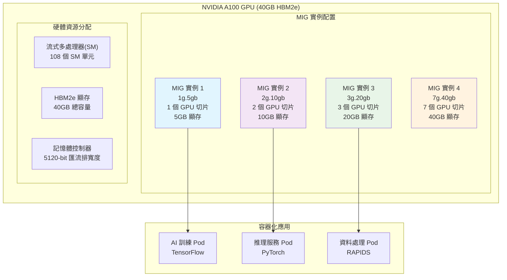
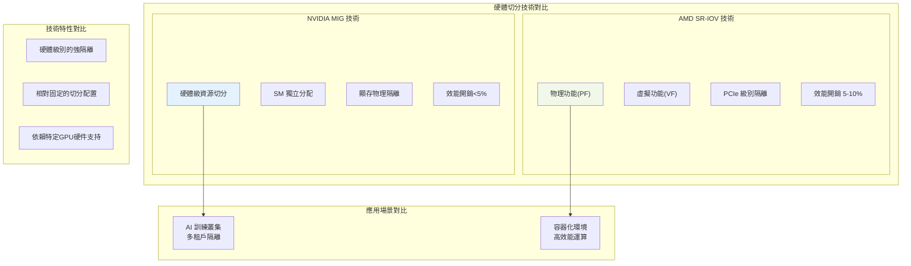
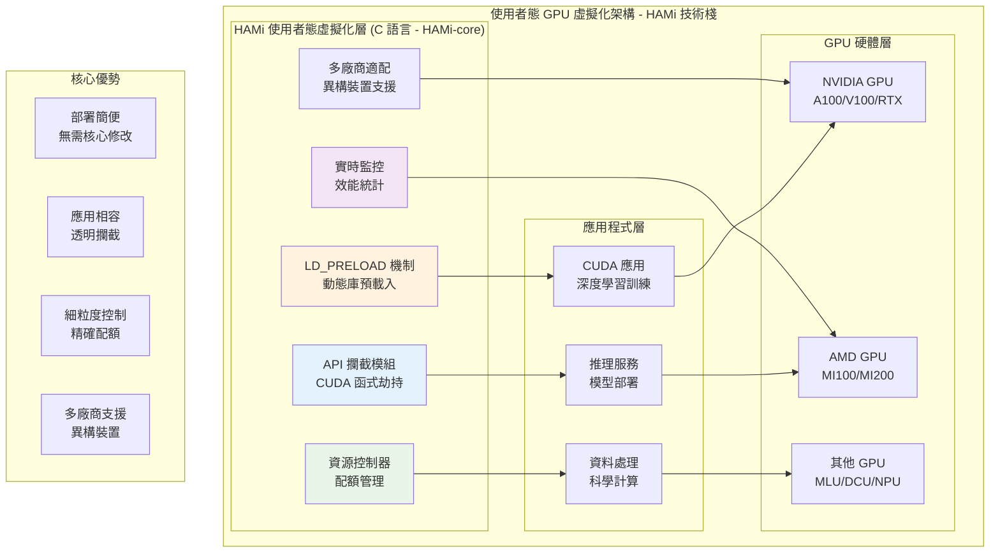
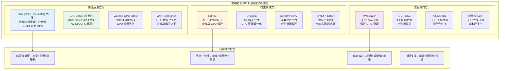

# GPU 虛擬化與資源管理技術深度解析 - 第二部分：虛擬化技術篇

本篇將詳細解析 GPU 虛擬化技術，包括硬體級 GPU 虛擬化技術、核心態 GPU 虛擬化技術以及使用者態 GPU 虛擬化技術。我們將深入探討這些技術的原理、實現機制以及在實際場景中的應用。

## 目錄

- [GPU 虛擬化與資源管理技術深度解析 - 第二部分：虛擬化技術篇](#gpu-虛擬化與資源管理技術深度解析---第二部分虛擬化技術篇)
  - [目錄](#目錄)
  - [4. 傳統虛擬化技術](#4-傳統虛擬化技術)
    - [4.1 GPU 透傳（GPU Passthrough）技術](#41-gpu-透傳gpu-passthrough技術)
      - [4.1.1 技術原理](#411-技術原理)
      - [4.1.2 實現機制](#412-實現機制)
    - [4.2 虛擬 GPU（vGPU）技術](#42-虛擬-gpuvgpu技術)
      - [4.2.1 技術架構](#421-技術架構)
      - [4.2.2 NVIDIA vGPU 實現](#422-nvidia-vgpu-實現)
      - [4.2.3 AMD MxGPU 實現](#423-amd-mxgpu-實現)
    - [4.3 傳統虛擬化技術對比分析](#43-傳統虛擬化技術對比分析)
      - [4.3.1 技術特點對比](#431-技術特點對比)
      - [4.3.2 效能評估](#432-效能評估)
    - [4.4 傳統虛擬化技術應用場景](#44-傳統虛擬化技術應用場景)
      - [4.4.1 企業虛擬化環境](#441-企業虛擬化環境)
      - [4.4.2 雲端計算平台](#442-雲端計算平台)
  - [5. 硬體切分技術](#5-硬體切分技術)
    - [5.1 GPU 硬體架構切分基礎](#51-gpu-硬體架構切分基礎)
      - [5.1.1 流式多處理器（ SM ）硬體切分機制](#511-流式多處理器-sm-硬體切分機制)
      - [5.1.2 記憶體控制器硬體切分架構](#512-記憶體控制器硬體切分架構)
    - [5.2 硬體切分技術深度解析](#52-硬體切分技術深度解析)
      - [5.2.1 NVIDIA MIG （ Multi-Instance GPU ）技術深度解析](#521-nvidia-mig--multi-instance-gpu-技術深度解析)
        - [5.2.1.1 MIG 的工作原理和架構](#5211-mig-的工作原理和架構)
        - [5.2.1.2 GPU 實例的建立和管理](#5212-gpu-實例的建立和管理)
        - [5.2.1.3 硬體級隔離的優勢和限制](#5213-硬體級隔離的優勢和限制)
        - [5.2.1.4 支持的 GPU 型號和配置選項](#5214-支持的-gpu-型號和配置選項)
      - [5.2.2 AMD SR-IOV 硬體切分技術](#522-amd-sr-iov-硬體切分技術)
    - [5.3 硬體切分技術對比與選擇](#53-硬體切分技術對比與選擇)
      - [5.3.1 技術特性對比](#531-技術特性對比)
      - [5.3.2 應用場景選擇指南](#532-應用場景選擇指南)
    - [5.4 本章小結](#54-本章小結)
  - [6. 核心態 GPU 虛擬化技術](#6-核心態-gpu-虛擬化技術)
    - [6.1 核心態 GPU 虛擬化技術架構總覽](#61-核心態-gpu-虛擬化技術架構總覽)
    - [6.2 核心態虛擬化架構設計](#62-核心態虛擬化架構設計)
      - [6.2.1 虛擬 GPU 管理器（ vGPU Manager ）](#621-虛擬-gpu-管理器-vgpu-manager-)
      - [6.2.2 資源排程器（ Resource Scheduler ）](#622-資源排程器-resource-scheduler-)
      - [6.2.3 上下文管理器（ Context Manager ）](#623-上下文管理器-context-manager-)
      - [6.2.4 記憶體管理器（ Memory Manager ）](#624-記憶體管理器-memory-manager-)
    - [6.3 高階排程策略與演算法](#63-高階排程策略與演算法)
      - [6.3.1 多級反饋佇列排程](#631-多級反饋佇列排程)
      - [6.3.2 負載感知排程演算法](#632-負載感知排程演算法)
      - [6.3.3 公平性保證機制](#633-公平性保證機制)
    - [6.4 核心態虛擬化效能最佳化](#64-核心態虛擬化效能最佳化)
      - [6.4.1 上下文切換最佳化](#641-上下文切換最佳化)
      - [6.4.2 記憶體管理最佳化](#642-記憶體管理最佳化)
      - [6.4.3 I/O 排程最佳化](#643-io-排程最佳化)
      - [6.4.4 多 GPU 協同最佳化](#644-多-gpu-協同最佳化)
      - [6.4.5 效能監控與調優](#645-效能監控與調優)
    - [6.5 核心態虛擬化適用場景](#65-核心態虛擬化適用場景)
  - [7. 使用者態 GPU 虛擬化技術](#7-使用者態-gpu-虛擬化技術)
    - [7.1 CUDA API 攔截技術原理](#71-cuda-api-攔截技術原理)
      - [7.1.1 動態庫攔截機制](#711-動態庫攔截機制)
      - [7.1.2 使用者態虛擬化技術對比分析](#712-使用者態虛擬化技術對比分析)
    - [7.2 HAMi 實現原理深度解析](#72-hami-實現原理深度解析)
      - [7.2.1 HAMi 專案架構與技術棧](#721-hami-專案架構與技術棧)
      - [7.2.2 HAMi-core 資源控制機制](#722-hami-core-資源控制機制)
    - [7.3 HAMi-core 效能最佳化機制](#73-hami-core-效能最佳化機制)
      - [7.3.1 動態庫載入與符號解析最佳化](#731-動態庫載入與符號解析最佳化)
      - [7.3.2 記憶體跟蹤與統計最佳化](#732-記憶體跟蹤與統計最佳化)
      - [7.3.3 日誌與除錯最佳化](#733-日誌與除錯最佳化)
      - [7.3.4 HAMi-core 記憶體虛擬化演算法詳解](#734-hami-core-記憶體虛擬化演算法詳解)
      - [7.3.5 時間片排程詳細實現機制](#735-時間片排程詳細實現機制)
      - [7.3.6 HAMi 效能調優最佳實踐](#736-hami-效能調優最佳實踐)
    - [7.4 使用者態虛擬化適用場景](#74-使用者態虛擬化適用場景)
    - [7.5 安全性與可靠性機制](#75-安全性與可靠性機制)
      - [7.5.1 多租戶環境下的資料隔離機制](#751-多租戶環境下的資料隔離機制)
      - [7.5.2 側通道攻擊防護機制](#752-側通道攻擊防護機制)
      - [7.5.3 API 攔截失敗時的降級策略](#753-api-攔截失敗時的降級策略)
      - [7.5.4 資源配額超限時的處理流程](#754-資源配額超限時的處理流程)
  - [8. GPU 虛擬化技術對比與選擇](#8-gpu-虛擬化技術對比與選擇)
    - [8.1 GPU 虛擬化技術對比分析](#81-gpu-虛擬化技術對比分析)
      - [8.1.1 技術特性對比](#811-技術特性對比)
      - [8.1.2 效能影響分析](#812-效能影響分析)
    - [8.2 GPU 虛擬化的核心挑戰](#82-gpu-虛擬化的核心挑戰)
      - [8.2.1 資源隔離與共享的平衡](#821-資源隔離與共享的平衡)
      - [8.2.2 效能損耗控制](#822-效能損耗控制)
      - [8.2.3 多租戶環境下的安全性](#823-多租戶環境下的安全性)
      - [8.2.4 異構 GPU 環境的相容性](#824-異構-gpu-環境的相容性)
    - [8.3 技術選擇指南](#83-技術選擇指南)
      - [8.3.1 場景適用性分析](#831-場景適用性分析)
      - [8.3.2 決策矩陣](#832-決策矩陣)
    - [8.4 本章要點總結](#84-本章要點總結)
    - [8.5 與 GPU 切分技術的關係](#85-與-gpu-切分技術的關係)
  - [第二部分總結](#第二部分總結)
  - [參考文獻](#參考文獻)

---

## 4. 傳統虛擬化技術

本章將深入分析傳統 GPU 虛擬化技術，重點探討基於 Hypervisor 的 GPU 透傳（GPU Passthrough）和虛擬 GPU（vGPU）技術。這些技術透過軟體虛擬化層實現 GPU 資源的分配和管理，為虛擬機器環境提供 GPU 計算能力。

**學習目標：** 本章圍繞 Hypervisor 級虛擬化展開：先看 GPU 透傳（Passthrough）的實現機制，再看 vGPU 的架構設計與工作原理，最後落到傳統虛擬化的效能特點和適用場景。

### 4.1 GPU 透傳（GPU Passthrough）技術

#### 4.1.1 技術原理

**定義：**
GPU 透傳技術透過 Hypervisor 將物理 GPU 裝置直接分配給虛擬機器，虛擬機器可以直接訪問 GPU 硬件，獲得接近原生的效能表現。

**核心特點：**

- **直接硬體訪問**：虛擬機器直接控制物理 GPU 裝置
- **接近原生性能**：幾乎無虛擬化效能損失
- **完整功能支持**：支持 GPU 的所有硬件特性
- **強隔離性**：物理級別的資源隔離

#### 4.1.2 實現機制

**VFIO（Virtual Function I/O）框架：**

```c
// VFIO GPU 裝置繫結示例
#include <linux/vfio.h>
#include <linux/pci.h>

struct vfio_gpu_device {
    struct pci_dev *pdev;          // PCI 裝置指標
    struct vfio_device vdev;       // VFIO 裝置結構
    void __iomem *bar_regions[6];  // BAR 區域對映
    struct mutex ops_lock;         // 操作鎖
    bool device_opened;            // 裝置開啟狀態
};

// GPU 裝置透傳初始化
int vfio_gpu_passthrough_init(struct vfio_gpu_device *gpu_dev) {
    int ret;

    // 1. 解綁原有驅動
    ret = pci_stop_and_remove_bus_device(gpu_dev->pdev);
    if (ret) {
        pr_err("Failed to unbind GPU driver\n");
        return ret;
    }

    // 2. 繫結到 VFIO 驅動
    ret = vfio_pci_core_register_device(&gpu_dev->vdev);
    if (ret) {
        pr_err("Failed to register VFIO device\n");
        return ret;
    }

    // 3. 配置 IOMMU 映射
    ret = vfio_iommu_map_gpu_memory(gpu_dev);
    if (ret) {
        pr_err("Failed to configure IOMMU mapping\n");
        vfio_pci_core_unregister_device(&gpu_dev->vdev);
        return ret;
    }

    pr_info("GPU passthrough initialized successfully\n");
    return 0;
}
```

### 4.2 虛擬 GPU（vGPU）技術

#### 4.2.1 技術架構

**定義：**
vGPU 技術透過在 Hypervisor 層建立虛擬 GPU 實例，將單個物理 GPU 的計算資源分配給多個虛擬機器，實現 GPU 資源的共享和虛擬化。

**架構元件：**

- **GPU 虛擬化管理器**：負責 vGPU 實例的建立和管理
- **資源排程器**：實現 GPU 計算資源的時間片排程
- **記憶體管理器**：管理 GPU 顯存的分配和隔離
- **上下文管理器**：處理多個 vGPU 實例的上下文切換

#### 4.2.2 NVIDIA vGPU 實現

**NVIDIA GRID/vGPU 架構：**

```c
// NVIDIA vGPU 實例管理結構
typedef struct {
    uint32_t vgpu_id;              // vGPU 實例 ID
    uint32_t profile_id;           // vGPU 配置文件 ID
    uint64_t fb_size;              // 分配的顯存大小
    uint32_t max_resolution;       // 最大分辨率
    uint32_t max_displays;         // 最大顯示器數量
    uint32_t encode_sessions;      // 編碼會話數量
    uint32_t compute_capability;   // 計算能力等級

    // 資源限制
    struct {
        uint32_t sm_percentage;    // SM 使用百分比
        uint32_t memory_bandwidth; // 記憶體頻寬限制
        uint32_t encode_fps;       // 編碼幀率限制
    } resource_limits;

    // 執行時狀態
    struct {
        bool active;               // 激活狀態
        uint64_t last_scheduled;   // 最後排程時間
        uint32_t context_switches; // 上下文切換次數
        uint64_t gpu_time_used;    // GPU 使用時間
    } runtime_state;
} nvidia_vgpu_instance_t;

// vGPU 排程管理
int vgpu_schedule_context_switch(nvidia_vgpu_instance_t *from_vgpu,
                                nvidia_vgpu_instance_t *to_vgpu) {
    int ret;

    // 1. 儲存當前 vGPU 上下文
    ret = save_vgpu_context(from_vgpu);
    if (ret) {
        pr_err("Failed to save vGPU context for ID %u\n", from_vgpu->vgpu_id);
        return ret;
    }

    // 2. 更新排程統計
    from_vgpu->runtime_state.context_switches++;
    from_vgpu->runtime_state.last_scheduled = get_current_time();

    // 3. 恢復目標 vGPU 上下文
    ret = restore_vgpu_context(to_vgpu);
    if (ret) {
        pr_err("Failed to restore vGPU context for ID %u\n", to_vgpu->vgpu_id);
        return ret;
    }

    // 4. 激活目標 vGPU
    to_vgpu->runtime_state.active = true;
    from_vgpu->runtime_state.active = false;

    return 0;
}
```

#### 4.2.3 AMD MxGPU 實現

**AMD SR-IOV 虛擬化：**

```c
// AMD MxGPU 虛擬功能管理
typedef struct {
    uint16_t vf_id;                // 虛擬功能 ID
    uint16_t pf_id;                // 物理功能 ID
    uint32_t allocated_cus;        // 分配的計算單元數
    uint64_t vram_size;            // 虛擬顯存大小
    uint32_t doorbell_offset;      // Doorbell 偏移量

    // SR-IOV 配置
    struct {
        bool sriov_enabled;        // SR-IOV 啟用狀態
        uint16_t total_vfs;        // 總虛擬功能數
        uint16_t active_vfs;       // 活躍虛擬功能數
        uint32_t vf_stride;        // VF 步長
    } sriov_config;

    // 資源分配
    struct {
        uint32_t cu_mask;          // CU 掩碼
        uint64_t vram_base;        // 顯存基地址
        uint32_t mmio_size;        // MMIO 區域大小
    } resource_allocation;
} amd_mxgpu_vf_t;

// MxGPU 虛擬功能初始化
int mxgpu_initialize_virtual_function(amd_mxgpu_vf_t *vf,
                                     uint16_t vf_id,
                                     uint32_t cu_count,
                                     uint64_t vram_size) {
    int ret;

    // 1. 配置虛擬功能參數
    vf->vf_id = vf_id;
    vf->allocated_cus = cu_count;
    vf->vram_size = vram_size;

    // 2. 分配計算單元
    ret = allocate_compute_units(vf, cu_count);
    if (ret) {
        pr_err("Failed to allocate CUs for VF %u\n", vf_id);
        return ret;
    }

    // 3. 配置顯存分割槽
    ret = configure_vram_partition(vf, vram_size);
    if (ret) {
        pr_err("Failed to configure VRAM for VF %u\n", vf_id);
        goto cleanup_cus;
    }

    // 4. 設定 Doorbell 機制
    ret = setup_doorbell_mechanism(vf);
    if (ret) {
        pr_err("Failed to setup doorbell for VF %u\n", vf_id);
        goto cleanup_vram;
    }

    pr_info("MxGPU VF %u initialized with %u CUs and %llu MB VRAM\n",
            vf_id, cu_count, vram_size / (1024 * 1024));
    return 0;

cleanup_vram:
    release_vram_partition(vf);
cleanup_cus:
    release_compute_units(vf);
    return ret;
}
```

### 4.3 傳統虛擬化技術對比分析

#### 4.3.1 技術特點對比

| 對比維度       | GPU Passthrough          | vGPU                     |
| -------------- | ------------------------ | ------------------------ |
| **資源分配**   | 獨佔整個物理 GPU         | 共享物理 GPU 資源        |
| **效能表現**   | 接近原生性能（95-99%）   | 有一定效能損失（80-95%） |
| **資源利用率** | 較低，一對一分配         | 較高，支援多租戶         |
| **隔離性**     | 物理級強隔離             | 軟體級隔離               |
| **靈活性**     | 較低，靜態分配           | 較高，動態調整           |
| **管理複雜度** | 相對簡單                 | 較複雜，需要排程管理     |
| **適用場景**   | 高效能運算、專用工作負載 | 多使用者環境、雲端計算平台   |

#### 4.3.2 效能評估

**基準測試結果：**

根據 NVIDIA 和 VMware 的聯合測試報告，在 MLPerf Inference v3.0 基準測試中：

- **GPU Passthrough**：效能可達裸機的 97-99%
- **vGPU（NVIDIA A100）**：效能可達裸機的 94-105%（不同工作負載有差異）
- **vGPU（NVIDIA H100）**：效能可達裸機的 96-102%

### 4.4 傳統虛擬化技術應用場景

#### 4.4.1 企業虛擬化環境

**VMware vSphere 集成：**

- 支持 GPU Passthrough 和 vGPU 兩種模式
- 提供統一的虛擬化管理介面
- 支援虛擬機器遷移和高可用性

**Citrix XenServer 支持：**

- 專業的 GPU 虛擬化解決方案
- 最佳化的圖形工作負載效能
- 企業級安全和管理功能

#### 4.4.2 雲端計算平台

**公有云 GPU 實例：**

- AWS EC2 P 系列實例（GPU Passthrough）
- Google Cloud GPU 虛擬機器（vGPU 支持）
- Azure NC 系列虛擬機器（混合模式）

**私有云部署：**

- OpenStack Nova GPU 支持
- 企業級 GPU 資源池化
- 多租戶安全隔離

## 5. 硬體切分技術

本章將深入分析硬體切分技術，重點探討 NVIDIA MIG（Multi-Instance GPU）、AMD SR-IOV 等原生硬體級別的資源分割方案。這些技術基於 GPU 硬體原生支援的資源分割，直接在硬體層面進行資源切分，提供硬體級別的強隔離和接近原生的效能表現。

**學習目標：** 本章聚焦 GPU 硬體架構的原生切分能力：以 NVIDIA MIG 與 AMD SR-IOV 為代表講清硬體切分的原理與實現，對比其與傳統虛擬化技術的差異，並討論異構 GPU 環境的硬體差異和統一管理挑戰。

### 5.1 GPU 硬體架構切分基礎

#### 5.1.1 流式多處理器（ SM ）硬體切分機制

**SM 架構與硬體切分支援：**

現代 GPU 的 SM （ Streaming Multiprocessor ）是 GPU 計算的核心單元，其硬體切分機制直接影響 GPU 資源分配的粒度和效率。

**NVIDIA Ampere 架構 SM 硬件切分特性：**

- **硬體級分割槽支援**：每個 SM 包含 64 個 CUDA 核心，支援硬體級的資源分割槽
- **獨立排程器**：每個 SM 配備 4 個 warp 排程器，支援獨立的任務排程
- **專用暫存器檔案**： 65536 個 32 位寄存器，支援上下文隔離
- **共享記憶體分割槽**： 128KB 共享記憶體支援動態分割槽和隔離



```c
// SM 虛擬化管理結構
typedef struct {
    uint32_t sm_id;                    // SM 識別符號
    uint32_t allocated_cores;          // 已分配的 CUDA 核心數
    uint32_t total_cores;              // 總 CUDA 核心數
    uint32_t allocated_registers;      // 已分配暫存器數量
    uint32_t shared_memory_partition;  // 共享記憶體分割槽大小
    uint32_t warp_scheduler_mask;      // warp 排程器分配掩碼
    struct vgpu_context *contexts[MAX_VGPU_PER_SM]; // 虛擬 GPU 上下文
} sm_virtualization_t;

// SM 資源分配函式
int allocate_sm_resources(sm_virtualization_t *sm,
                         uint32_t vgpu_id,
                         uint32_t core_count,
                         uint32_t register_count) {
    // 檢查資源可用性
    if (sm->allocated_cores + core_count > sm->total_cores) {
        return -ENOMEM; // 記憶體不足
    }

    // 分配 CUDA 核心
    sm->allocated_cores += core_count;

    // 分配暫存器資源
    sm->allocated_registers += register_count;

    // 更新排程器掩碼
    sm->warp_scheduler_mask |= (1 << vgpu_id);

    return 0; // 分配成功
}
```

**AMD RDNA 架構計算單元虛擬化：**

- **計算單元（ CU ）分割槽**：每個 CU 包含 64 個流處理器，支援工作組級別的隔離
- **波前排程器**：獨立的波前排程機制，支援多租戶併發
- **標量暫存器檔案**： 2048 個標量暫存器，支援上下文儲存和恢復
- **本地資料共享（ LDS ）**： 64KB LDS 支援動態分割槽

#### 5.1.2 記憶體控制器硬體切分架構

**記憶體控制器硬體切分的核心挑戰：**

記憶體控制器是 GPU 效能的關鍵瓶頸，其硬體切分實現直接影響多租戶環境下的效能隔離效果。

**NVIDIA HBM 記憶體控制器硬體切分：**

```c
// 記憶體控制器硬體切分結構
typedef struct {
    uint32_t mc_id;                    // 記憶體控制器 ID
    uint64_t total_bandwidth;          // 總記憶體頻寬（ GB/s ）
    uint64_t allocated_bandwidth;      // 已分配頻寬
    uint32_t channel_count;            // 記憶體通道數量
    uint32_t partition_mask;           // 分割槽掩碼
    struct {
        uint32_t instance_id;          // 硬體實例識別符號
        uint64_t bandwidth_quota;      // 頻寬配額
        uint32_t priority;             // 優先順序
        uint64_t access_pattern;       // 訪問模式統計
    } partitions[MAX_MEMORY_PARTITIONS];
} memory_controller_slice_t;

// 記憶體頻寬分配函式
int allocate_memory_bandwidth(memory_controller_slice_t *mc,
                             uint32_t instance_id,
                             uint64_t bandwidth_request) {
    // 檢查頻寬可用性
    if (mc->allocated_bandwidth + bandwidth_request > mc->total_bandwidth) {
        return -ENOSPC; // 空間不足
    }

    // 查詢空閒分割槽
    for (int i = 0; i < MAX_MEMORY_PARTITIONS; i++) {
        if (mc->partitions[i].instance_id == 0) {
            mc->partitions[i].instance_id = instance_id;
            mc->partitions[i].bandwidth_quota = bandwidth_request;
            mc->allocated_bandwidth += bandwidth_request;
            mc->partition_mask |= (1 << i);
            return i; // 返回分割槽索引
        }
    }

    return -ENOMEM; // 記憶體不足
}
```

### 5.2 硬體切分技術深度解析

**硬體切分技術架構總覽：**

硬體切分技術基於 GPU 硬體原生支援的資源分割，直接在硬體層面進行資源切分，提供硬體級別的強隔離和接近原生的效能表現。下圖展示了兩種主要的硬體切分技術架構：



如圖所示，硬體切分技術主要包括：

1. **NVIDIA MIG 技術**：透過硬體級資源切分，將單個 GPU 劃分為多個獨立的 MIG 實例，每個實例擁有專用的 SM 和記憶體切片，實現完全的硬體級隔離。支持 1g.5gb 、 2g.10gb 、 3g.20gb 、 7g.40gb （ 40GB 卡）及 1g.10gb 、 2g.20gb 、 3g.40gb 、 7g.80gb （ 80GB 卡）等多種配置選項，適用於 AI 訓練和推理場景。

2. **AMD SR-IOV 技術**：基於 PCIe SR-IOV 標準，透過物理功能(PF)和虛擬功能(VF)實現 GPU 硬件切分。每個 VF 作為獨立的 PCIe 裝置，提供硬體級隔離，特別適用於容器化環境和高效能運算場景。

這兩種技術都基於 GPU 硬件原生支持，在隔離級別、效能開銷、部署複雜度和硬體要求方面各有特點。 MIG 技術的效能開銷最低（<5%），提供更徹底的資源分離； SR-IOV 技術基於標準 PCIe 協議，具有更好的通用性。

#### 5.2.1 NVIDIA MIG （ Multi-Instance GPU ）技術深度解析

##### 5.2.1.1 MIG 的工作原理和架構

MIG 技術基於 NVIDIA Ampere 架構的硬體設計特性，透過以下核心機制實現 GPU 的物理級切分：

1. **計算單元分割**：將 GPU 的流式多處理器（ SM ）按預定義配置進行分組，為每個 MIG 實例分配專用的 SM 叢集
2. **顯存分割**：為每個 MIG 實例分配獨立的顯存地址空間，透過硬體級記憶體保護機制確保訪問隔離
3. **記憶體控制器分割**：每個 MIG 實例配備獨立的記憶體控制器，從硬體層面保障記憶體頻寬的完全隔離
4. **硬體排程器分割**：為每個實例提供獨立的硬體排程器，消除實例間的排程競爭和干擾


**MIG 技術核心特性：**

- **硬體級隔離**：每個 MIG 實例擁有獨立的硬體資源，實現真正的物理隔離
- **預定義配置**：支持 1g.5gb 、 2g.10gb 、 3g.20gb 、 7g.40gb （ A100/A30 等 40GB 卡）與 1g.10gb 、 2g.20gb 、 3g.40gb 、 7g.80gb （ A100/H100 80GB 卡）等標準配置
- **完全獨立**：每個實例具有獨立的錯誤域和故障隔離能力

##### 5.2.1.2 GPU 實例的建立和管理

MIG 實例管理涉及 GPU 實例(GI)和計算實例(CI)的兩級建立過程：

**基礎配置流程：**

```bash
# 啟用 MIG 模式（需要重啟 GPU ）
nvidia-smi -i 0 -mig 1

# 建立 GPU 實例
nvidia-smi mig -i 0 -cgi 19,19,19 -C

# 建立計算實例
nvidia-smi mig -i 0 -cci

# 驗證配置
nvidia-smi -L
```

> **實踐參考**：完整的 MIG 管理指令碼實現見 `mig_management.sh`  
> **整合應用**： HAMi 環境下的 MIG 自動化管理見 [9.1.2 HAMi MIG Device Plugin 實現](03_resource_management.md#912-hami-mig-device-plugin-實現)

**MIG 資源分配策略：**

```c
/**
 * @brief MIG 實例配置結構體
 * @details 定義 MIG 實例的硬體資源配置參數
 */
typedef struct {
    uint32_t gi_id;                    /**< GPU 實例 ID */
    uint32_t ci_id;                    /**< 計算實例 ID */
    uint32_t sm_count;                 /**< 流式多處理器數量 */
    uint64_t memory_size;              /**< 分配的顯存大小(位元組) */
    uint32_t memory_slice_count;       /**< 記憶體切片數量 */
    uint32_t compute_slice_count;      /**< 計算切片數量 */
} mig_instance_config_t;

/**
 * @brief 建立 MIG 實例
 * @param gpu_id 目標 GPU 裝置 ID
 * @param config MIG 實例配置參數
 * @return 成功返回 0 ，失敗返回負數錯誤碼
 * @note 詳細實現參見 @ref 9.1.2 "HAMi MIG Device Plugin 實現"
 */
int create_mig_instance(uint32_t gpu_id,
                       mig_instance_config_t *config) {
    /* 檢查資源可用性 */
    if (!check_mig_resources_available(gpu_id, config)) {
        return -ENOSPC;
    }

    /* 建立 GPU 實例 */
    int gi_id = create_gpu_instance(gpu_id, config->sm_count,
                                   config->memory_slice_count);
    if (gi_id < 0) {
        return gi_id;
    }

    /* 建立計算實例 */
    int ci_id = create_compute_instance(gi_id,
                                       config->compute_slice_count);
    if (ci_id < 0) {
        destroy_gpu_instance(gi_id);
        return ci_id;
    }

    config->gi_id = gi_id;
    config->ci_id = ci_id;

    return 0;
}
```

**關鍵實現要點：**

- **資源驗證**：建立前檢查可用的 SM 和記憶體資源
- **兩級建立**：先建立 GPU 實例(GI)，再建立計算實例(CI)
- **狀態管理**：維護實例配置和可用性狀態
- **錯誤處理**：建立失敗時自動清理已分配資源

**部署要求：**

- **硬件支持**：僅限 A100 、 A30 、 A40 、 H100 等支持 MIG 的 GPU
- **驅動版本**： NVIDIA 驅動 ≥ 450.80.02 ， CUDA ≥ 11.0
- **許可權要求**：需要 root 許可權，啟用 MIG 需重啟 GPU

> **詳細實現**：完整的管理指令碼和函式實現見 `mig_management.sh`

##### 5.2.1.3 硬體級隔離的優勢和限制

**優勢：**

- **完全隔離**：硬體級別的資源隔離，確保實例間完全獨立
- **性能保障**：每個實例擁有專用的硬體資源，效能可預測
- **安全性高**：硬體級別的隔離提供最高階別的安全保障
- **故障隔離**：一個實例的故障不會影響其他實例

**限制：**

- **硬體依賴**：僅支援特定的 GPU 型號（ A100 、 A30 、 A40 等）
- **配置固定**：實例配置相對固定， A100 更換 MIG 配置需先重置 GPU ； H100 起支援動態重配置，無需整機重置
- **資源粒度**：切分粒度受硬體設計限制，無法實現任意大小的分割
- **成本較高**：需要支持 MIG 的高端 GPU ，成本相對較高

##### 5.2.1.4 支持的 GPU 型號和配置選項

**支持的 GPU 型號：**

- NVIDIA A100 （ 40GB/80GB ）
- NVIDIA A30
- NVIDIA A40
- NVIDIA H100

**配置選項（按適用卡型）：**

| Profile  | 切分   | 顯存   | 適用卡型                          |
| -------- | ------ | ------ | --------------------------------- |
| 1g.5gb   | 1/7 GPU | 5GB   | A100 40GB / A30 等小容量卡        |
| 2g.10gb  | 2/7 GPU | 10GB  | A100 40GB / A30                   |
| 3g.20gb  | 3/7 GPU | 20GB  | A100 40GB / A30                   |
| 4g.20gb  | 4/7 GPU | 20GB  | A100 40GB                         |
| 7g.40gb  | 7/7 GPU | 40GB  | A100 40GB                         |
| 1g.10gb  | 1/7 GPU | 10GB  | A100 80GB / H100 80GB             |
| 2g.20gb  | 2/7 GPU | 20GB  | A100 80GB / H100 80GB             |
| 3g.40gb  | 3/7 GPU | 40GB  | A100 80GB / H100 80GB             |
| 4g.40gb  | 4/7 GPU | 40GB  | A100 80GB / H100 80GB             |
| 7g.80gb  | 7/7 GPU | 80GB  | A100 80GB / H100 80GB             |

> 80GB 卡最多可切 7 × 1g.10gb 、 3 × 2g.20gb 或 2 × 3g.40gb ，單實例最大為 7g.80gb ； H100 80GB 的 profile 與 A100 80GB 同名同配， H100 NVL（ 94GB ）為 1g.12gb/2g.24gb/3g.47gb 一檔。

#### 5.2.2 AMD SR-IOV 硬體切分技術

**SR-IOV 硬體切分特點：**

- **物理功能（ PF ）**：完整的 GPU 功能，包含配置和管理能力
- **虛擬功能（ VF ）**：輕量級的 GPU 功能，專注於資料處理
- **硬體級隔離**：每個 VF 擁有獨立的記憶體空間和暫存器組

```c
// SR-IOV 虛擬功能配置
typedef struct {
    uint16_t vf_id;                    // 虛擬功能 ID
    uint32_t compute_units;            // 分配的計算單元數
    uint64_t memory_quota;             // 記憶體配額
    uint32_t bandwidth_limit;          // 頻寬限制
    bool isolation_enabled;            // 是否啟用隔離
} sriov_vf_config_t;

// 配置 SR-IOV 虛擬功能
int configure_sriov_vf(uint16_t vf_id, sriov_vf_config_t *config) {
    // 設定計算單元分配
    write_vf_register(vf_id, VF_COMPUTE_UNITS_REG,
                     config->compute_units);

    // 設定記憶體配額
    write_vf_register(vf_id, VF_MEMORY_QUOTA_REG,
                     config->memory_quota);

    // 啟用隔離機制
    if (config->isolation_enabled) {
        write_vf_register(vf_id, VF_ISOLATION_REG, 1);
    }

    return 0;
}
```

### 5.3 硬體切分技術對比與選擇

#### 5.3.1 技術特性對比

| 技術方案       | 隔離級別       | 效能開銷    | 資源利用率 | 部署複雜度 | 硬件要求           |
| -------------- | -------------- | ----------- | ---------- | ---------- | ------------------ |
| **NVIDIA MIG** | 硬體級完全隔離 | 極低（<5%） | 高         | 中等       | A100/A30/A40/H100  |
| **AMD SR-IOV** | PCIe 級隔離    | 低（5-10%） | 中等       | 高         | 支持 SR-IOV 的 GPU |

#### 5.3.2 應用場景選擇指南

**NVIDIA MIG 適用場景：**

- AI 訓練和推理工作負載的多租戶隔離
- 需要硬體級安全隔離的容器化環境
- 資源利用率要求較高的資料中心
- 支援彈性計算的場景（注意： A100 更換 MIG 配置需重置 GPU ， H100 起支援動態重配置）
- 大規模機器學習平台的資源切分

**AMD SR-IOV 適用場景：**

- 容器化環境的 GPU 硬件切分
- 需要 PCIe 級別隔離的企業應用
- 多容器共享 GPU 資源的場景
- 對硬體相容性要求較高的環境
- 高效能運算叢集的資源分割

### 5.4 本章小結

本章深入分析了 GPU 硬體切分技術的核心原理和實現方案。透過對 NVIDIA MIG 和 AMD SR-IOV 兩種主要硬體切分技術的詳細解析，我們可以得出以下關鍵結論：

**技術成熟度與應用現狀：**

- **NVIDIA MIG 技術**已成為 AI 訓練叢集中最主流的硬體切分方案，其硬體級隔離和低效能開銷(<5%)使其在多租戶環境中具有顯著優勢
- **AMD SR-IOV 技術**在容器化環境中表現良好，但部署複雜度較高，需要完整的 SR-IOV 生態支援
- 硬體切分技術相比傳統虛擬化技術具有更高的資源利用率和更強的隔離保障

**核心技術優勢：**

1. **硬體級隔離保障**：兩種硬體切分技術都提供了硬體層面的資源隔離，確保了多租戶環境的安全性和穩定性
2. **接近裸機效能**：效能開銷均控制在 10%以內，其中 MIG 的開銷更是低於 5%
3. **完整的生態支援**：主流 GPU 廠商都提供了相應的硬體和軟體支援
4. **動態資源調整**： H100 起支持 MIG 執行時動態重配置（ A100 更換配置需先重置 GPU ）

**技術發展趨勢：**

- 硬體切分技術將繼續向更細粒度、更靈活的資源分配方向發展
- 多 GPU 協同和跨節點資源池化將成為重要發展方向
- 與容器化技術的深度整合將進一步提升部署和管理效率
- 智慧化的資源排程和自動化的負載均衡將成為發展重點

**實踐建議：**

- 在選擇硬體切分方案時，應綜合考慮應用場景、性能要求、硬體成本和運維複雜度
- 對於 AI 訓練叢集和機器學習平台，推薦優先考慮 NVIDIA MIG 技術
- 對於容器化環境和多租戶場景，可考慮 AMD SR-IOV 方案
- 在實際部署前，建議進行充分的效能測試和相容性驗證
- 建議結合容器編排平台（如 Kubernetes）實現自動化的資源管理

GPU 硬體切分技術為現代資料中心提供了強大的 GPU 資源管理能力，是構建高效、安全、可擴展的 GPU 計算平台的重要技術基礎。隨著 AI 和容器化應用的持續發展，這些技術將在未來的計算基礎設施中發揮越來越重要的作用。

---

## 6. 核心態 GPU 虛擬化技術

本章將深入探討核心態 GPU 虛擬化技術，包括核心級資源管理、虛擬 GPU 驅動架構、上下文切換機制以及效能最佳化策略。

**學習目標：** 本章拆解核心態虛擬化的架構設計與實現原理，重點在虛擬 GPU 驅動、核心級資源排程與隔離機制，以及相應的效能最佳化方法。

### 6.1 核心態 GPU 虛擬化技術架構總覽

核心態 GPU 虛擬化技術透過在作業系統核心層面實現 GPU 資源的虛擬化管理，在效能和安全性之間取得了良好的平衡。

該技術透過修改或攔截 GPU 硬體驅動程式，在核心空間實現資源管理和排程，具有系統級控制、精細資源管理的特點，需要核心模組支援。與使用者態虛擬化相比，核心態虛擬化具有更強的系統級控制能力和更精細的資源管理機制；與硬體級虛擬化相比，核心態虛擬化具有更好的靈活性和相容性。

```mermaid
graph TB
    subgraph "核心態 GPU 虛擬化架構"
        subgraph "使用者空間"
            APP1["應用程式 1<br/>CUDA 應用"]
            APP2["應用程式 2<br/>OpenCL 應用"]
            APP3["應用程式 3<br/>機器學習框架"]
        end

        subgraph "核心空間"
            SYSCALL["系統呼叫介面<br/>ioctl/mmap 攔截"]
            VGPU_MGR["虛擬 GPU 管理器<br/>實例生命週期管理"]
            SCHED["資源排程器<br/>時間片+優先順序"]
            CTX_MGR["上下文管理器<br/>狀態儲存/恢復"]
            MEM_MGR["記憶體管理器<br/>頁表對映+隔離"]
        end

        subgraph "硬體層"
            GPU_HW["物理 GPU 硬件<br/>NVIDIA/AMD"]
            GPU_DRV["GPU 驅動程式<br/>CUDA/ROCm"]
        end
    end

    subgraph "核心特性"
        FEATURE1["系統級控制<br/>核心許可權管理"]
        FEATURE2["精細資源管理<br/>細粒度分配"]
        FEATURE3["強隔離保證<br/>核心級隔離"]
        FEATURE4["效能最佳化<br/>減少上下文切換"]
    end

    APP1 --> SYSCALL
    APP2 --> SYSCALL
    APP3 --> SYSCALL

    SYSCALL --> VGPU_MGR
    VGPU_MGR --> SCHED
    VGPU_MGR --> CTX_MGR
    VGPU_MGR --> MEM_MGR

    SCHED --> GPU_DRV
    CTX_MGR --> GPU_DRV
    MEM_MGR --> GPU_DRV

    GPU_DRV --> GPU_HW

    style VGPU_MGR fill:#e8f5e8
    style SCHED fill:#e3f2fd
    style CTX_MGR fill:#fff3e0
    style MEM_MGR fill:#f3e5f5
```



**核心態虛擬化層（核心控制層）：**

- **功能定位**： GPU 虛擬化的核心控制層，透過核心攔截機制實現資源管理和排程
- **核心技術特點**：
  - _系統級控制能力_：在核心空間直接管理 GPU 資源，具有最高許可權
  - _精細資源管理_：支援細粒度的資源分配和配額控制
  - _核心模組支援_：需要載入專用的核心模組來實現虛擬化功能
  - _強隔離保證_：透過核心級隔離機制確保多租戶安全
- **核心元件及核心攔截機制**：
  - _虛擬 GPU 驅動架構_：管理虛擬 GPU 實例的生命週期，攔截 GPU 驅動呼叫
  - _核心級資源排程_：實現 GPU 計算資源的時間片排程和優先順序管理
  - _GPU 記憶體虛擬化_：提供記憶體隔離和虛擬地址空間管理，攔截記憶體對映操作
  - _系統呼叫攔截模組_：攔截關鍵系統呼叫（如 ioctl 、 mmap ）實現資源控制
  - _效能最佳化模組_：最佳化上下文切換和記憶體管理效能

**核心攔截技術實現細節：**

核心態虛擬化的核心在於透過核心攔截機制實現對 GPU 資源的精確控制：

- **ioctl 系統呼叫攔截**：攔截 GPU 裝置的 ioctl 呼叫，實現命令過濾和資源配額檢查
- **mmap 記憶體對映攔截**：攔截 GPU 記憶體對映操作，實現虛擬地址空間管理和訪問許可權控制
- **驅動程式修改**：透過修改 GPU 驅動程式，在關鍵路徑上插入虛擬化邏輯
- **核心模組載入**：載入專用的核心模組來實現 GPU 資源的虛擬化管理

**資料流向分析：**

1. **應用呼叫階段**：應用程式透過系統呼叫介面請求 GPU 資源
2. **核心攔截階段**：核心態虛擬化層捕獲並分析資源請求
3. **資源排程階段**：透過核心級排程器進行資源分配和優先順序管理
4. **硬體執行階段**：物理 GPU 硬體執行實際的計算任務

這種基於核心攔截的分層架構設計確保了核心態 GPU 虛擬化技術既能提供強大的系統級控制能力和精細化資源管理，又能保持良好的效能表現和應用相容性。

### 6.2 核心態虛擬化架構設計

核心態虛擬化透過在作業系統核心層面實現 GPU 資源的虛擬化管理，提供了較好的效能和安全性平衡。本節將詳細介紹核心態虛擬化的四個核心元件：虛擬 GPU 管理器、資源排程器、上下文管理器和記憶體管理器。

**技術特點：**

- **核心級資源管理**：在作業系統核心層面實現 GPU 資源的分配和排程
- **硬體抽象層**：為上層應用提供統一的 GPU 訪問介面
- **安全隔離**：利用作業系統的許可權管理機制實現安全隔離
- **效能最佳化**：減少使用者態和核心態之間的上下文切換開銷

#### 6.2.1 虛擬 GPU 管理器（ vGPU Manager ）

虛擬 GPU 管理器是核心態虛擬化的核心元件，負責虛擬 GPU 實例的完整生命週期管理，包括建立、配置、監控和銷燬等操作。

**核心功能：**

- **實例生命週期管理**：建立、啟動、暫停、恢復和銷燬虛擬 GPU 實例
- **資源配額分配**：為每個虛擬 GPU 實例分配計算資源和記憶體資源
- **狀態監控**：實時監控虛擬 GPU 實例的執行狀態和資源使用情況
- **故障處理**：檢測和處理虛擬 GPU 實例的異常情況

**資料結構設計：**

```c
// 虛擬 GPU 實例結構
struct vgpu_instance {
    uint32_t instance_id;              // 實例唯一識別符號
    uint32_t physical_gpu_id;          // 繫結的物理 GPU ID
    enum vgpu_state state;             // 實例狀態

    // 資源配額
    struct {
        uint32_t compute_units;         // 分配的計算單元數
        uint64_t memory_quota;          // 記憶體配額（位元組）
        uint32_t bandwidth_quota;       // 頻寬配額（ MB/s ）
        uint32_t priority;              // 排程優先順序
    } resource_quota;

    // 執行時狀態
    struct {
        uint64_t creation_time;         // 建立時間
        uint64_t last_active_time;      // 最後活躍時間
        uint64_t total_execution_time;  // 累計執行時間
        uint32_t context_switches;      // 上下文切換次數
        uint64_t memory_usage;          // 當前記憶體使用量
    } runtime_stats;

    // 關聯的上下文和記憶體管理器
    struct vgpu_context *context;      // 執行上下文
    struct vgpu_memory_space *memory;   // 記憶體空間

    // 連結串列節點
    struct list_head instance_list;    // 實例連結串列
    struct hlist_node hash_node;       // 雜湊表節點

    // 同步原語
    struct mutex instance_mutex;       // 實例互斥鎖
    atomic_t ref_count;                // 引用計數
};

// 虛擬 GPU 管理器結構
struct vgpu_manager {
    uint32_t max_instances;            // 最大實例數
    uint32_t active_instances;         // 當前活躍實例數

    // 實例管理
    struct list_head instance_list;    // 實例連結串列
    DECLARE_HASHTABLE(instance_hash, 8); // 實例雜湊表
    struct idr instance_idr;           // 實例 ID 分配器

    // 資源管理
    struct {
        uint32_t total_compute_units;   // 總計算單元數
        uint32_t available_compute_units; // 可用計算單元數
        uint64_t total_memory;          // 總記憶體大小
        uint64_t available_memory;      // 可用記憶體大小
    } resource_pool;

    // 同步和保護
    struct rw_semaphore manager_rwsem;  // 管理器讀寫訊號量
    spinlock_t instance_lock;          // 實例操作鎖

    // 工作佇列
    struct workqueue_struct *mgr_wq;   // 管理工作佇列
    struct delayed_work cleanup_work;   // 清理工作
};
```

**核心操作實現：**

```c
// 建立虛擬 GPU 實例
struct vgpu_instance *vgpu_create_instance(struct vgpu_manager *mgr,
                                          struct vgpu_create_params *params) {
    struct vgpu_instance *instance;
    int ret;

    // 參數驗證
    if (!mgr || !params) {
        pr_err("無效的參數\n");
        return ERR_PTR(-EINVAL);
    }

    // 檢查資源可用性
    down_read(&mgr->manager_rwsem);
    if (mgr->active_instances >= mgr->max_instances) {
        up_read(&mgr->manager_rwsem);
        pr_warn("已達到最大實例數限制: %u\n", mgr->max_instances);
        return ERR_PTR(-ENOSPC);
    }

    if (params->compute_units > mgr->resource_pool.available_compute_units ||
        params->memory_quota > mgr->resource_pool.available_memory) {
        up_read(&mgr->manager_rwsem);
        pr_warn("資源不足: 請求計算單元=%u(可用=%u), 請求記憶體=%llu(可用=%llu)\n",
                params->compute_units, mgr->resource_pool.available_compute_units,
                params->memory_quota, mgr->resource_pool.available_memory);
        return ERR_PTR(-ENOMEM);
    }
    up_read(&mgr->manager_rwsem);

    // 分配實例結構
    instance = kzalloc(sizeof(*instance), GFP_KERNEL);
    if (!instance) {
        return ERR_PTR(-ENOMEM);
    }

    // 初始化實例
    down_write(&mgr->manager_rwsem);

    // 分配實例 ID
    ret = idr_alloc(&mgr->instance_idr, instance, 1, 0, GFP_KERNEL);
    if (ret < 0) {
        up_write(&mgr->manager_rwsem);
        kfree(instance);
        pr_err("分配實例 ID 失敗: %d\n", ret);
        return ERR_PTR(ret);
    }
    instance->instance_id = ret;

    // 設定資源配額
    instance->resource_quota.compute_units = params->compute_units;
    instance->resource_quota.memory_quota = params->memory_quota;
    instance->resource_quota.bandwidth_quota = params->bandwidth_quota;
    instance->resource_quota.priority = params->priority;

    // 更新資源池
    mgr->resource_pool.available_compute_units -= params->compute_units;
    mgr->resource_pool.available_memory -= params->memory_quota;

    // 初始化執行時狀態
    instance->state = VGPU_STATE_CREATED;
    instance->runtime_stats.creation_time = ktime_get_ns();
    instance->runtime_stats.last_active_time = instance->runtime_stats.creation_time;

    // 初始化同步原語
    mutex_init(&instance->instance_mutex);
    atomic_set(&instance->ref_count, 1);

    // 添加到管理器
    list_add_tail(&instance->instance_list, &mgr->instance_list);
    hash_add(mgr->instance_hash, &instance->hash_node, instance->instance_id);
    mgr->active_instances++;

    up_write(&mgr->manager_rwsem);

    pr_info("建立虛擬 GPU 實例成功: ID=%u, 計算單元=%u, 記憶體=%llu MB\n",
            instance->instance_id, params->compute_units,
            params->memory_quota / (1024 * 1024));

    return instance;
}

// 銷燬虛擬 GPU 實例
int vgpu_destroy_instance(struct vgpu_manager *mgr, uint32_t instance_id) {
    struct vgpu_instance *instance;
    int ret = 0;

    down_write(&mgr->manager_rwsem);

    // 查詢實例
    instance = idr_find(&mgr->instance_idr, instance_id);
    if (!instance) {
        up_write(&mgr->manager_rwsem);
        pr_warn("未找到實例: ID=%u\n", instance_id);
        return -ENOENT;
    }

    // 檢查實例狀態
    mutex_lock(&instance->instance_mutex);
    if (instance->state == VGPU_STATE_RUNNING) {
        // 強制停止實例
        ret = vgpu_stop_instance_locked(instance);
        if (ret) {
            mutex_unlock(&instance->instance_mutex);
            up_write(&mgr->manager_rwsem);
            pr_err("停止實例失敗: ID=%u, 錯誤=%d\n", instance_id, ret);
            return ret;
        }
    }

    // 清理資源
    if (instance->context) {
        vgpu_destroy_context(instance->context);
        instance->context = NULL;
    }

    if (instance->memory) {
        vgpu_destroy_memory_space(instance->memory);
        instance->memory = NULL;
    }

    // 釋放資源配額
    mgr->resource_pool.available_compute_units += instance->resource_quota.compute_units;
    mgr->resource_pool.available_memory += instance->resource_quota.memory_quota;

    // 從管理器移除
    list_del(&instance->instance_list);
    hash_del(&instance->hash_node);
    idr_remove(&mgr->instance_idr, instance_id);
    mgr->active_instances--;

    instance->state = VGPU_STATE_DESTROYED;
    mutex_unlock(&instance->instance_mutex);

    up_write(&mgr->manager_rwsem);

    // 釋放實例記憶體
    kfree(instance);

    pr_info("銷燬虛擬 GPU 實例成功: ID=%u\n", instance_id);
    return 0;
}

// 啟動虛擬 GPU 實例
int vgpu_start_instance(struct vgpu_manager *mgr, uint32_t instance_id) {
    struct vgpu_instance *instance;
    int ret;

    down_read(&mgr->manager_rwsem);

    instance = idr_find(&mgr->instance_idr, instance_id);
    if (!instance) {
        up_read(&mgr->manager_rwsem);
        return -ENOENT;
    }

    mutex_lock(&instance->instance_mutex);

    if (instance->state != VGPU_STATE_CREATED &&
        instance->state != VGPU_STATE_STOPPED) {
        mutex_unlock(&instance->instance_mutex);
        up_read(&mgr->manager_rwsem);
        pr_warn("實例狀態不允許啟動: ID=%u, 狀態=%d\n",
                instance_id, instance->state);
        return -EINVAL;
    }

    // 建立執行上下文
    if (!instance->context) {
        instance->context = vgpu_create_context(instance);
        if (IS_ERR(instance->context)) {
            ret = PTR_ERR(instance->context);
            instance->context = NULL;
            mutex_unlock(&instance->instance_mutex);
            up_read(&mgr->manager_rwsem);
            pr_err("建立上下文失敗: ID=%u, 錯誤=%d\n", instance_id, ret);
            return ret;
        }
    }

    // 建立記憶體空間
    if (!instance->memory) {
        instance->memory = vgpu_create_memory_space(instance);
        if (IS_ERR(instance->memory)) {
            ret = PTR_ERR(instance->memory);
            instance->memory = NULL;
            vgpu_destroy_context(instance->context);
            instance->context = NULL;
            mutex_unlock(&instance->instance_mutex);
            up_read(&mgr->manager_rwsem);
            pr_err("建立記憶體空間失敗: ID=%u, 錯誤=%d\n", instance_id, ret);
            return ret;
        }
    }

    // 更新狀態
    instance->state = VGPU_STATE_RUNNING;
    instance->runtime_stats.last_active_time = ktime_get_ns();

    mutex_unlock(&instance->instance_mutex);
    up_read(&mgr->manager_rwsem);

    pr_info("啟動虛擬 GPU 實例成功: ID=%u\n", instance_id);
    return 0;
}
```

#### 6.2.2 資源排程器（ Resource Scheduler ）

資源排程器負責在多個虛擬 GPU 實例之間公平、高效地分配物理 GPU 資源，包括計算資源、記憶體資源和 I/O 頻寬等。

**排程策略：**

- **時間片輪轉排程**：為每個虛擬 GPU 實例分配固定的時間片
- **優先順序排程**：根據實例優先順序進行搶佔式排程
- **公平共享排程**：確保資源在實例間公平分配
- **負載感知排程**：根據實際負載動態調整排程策略

**資料結構設計：**

```c
// 排程佇列節點
struct sched_entity {
    struct vgpu_instance *instance;    // 關聯的虛擬 GPU 實例
    uint32_t priority;                 // 排程優先順序
    uint64_t time_slice_ns;            // 時間片長度（納秒）
    uint64_t remaining_time_ns;        // 剩餘時間片
    uint64_t total_runtime_ns;         // 累計執行時間
    uint64_t last_scheduled_time;      // 上次排程時間
    uint32_t preemption_count;         // 被搶佔次數

    // 排程統計
    struct {
        uint64_t wait_time_ns;          // 等待時間
        uint64_t response_time_ns;      // 響應時間
        uint32_t schedule_count;        // 排程次數
        float cpu_utilization;         // CPU 利用率
    } sched_stats;

    struct list_head sched_list;       // 排程佇列連結串列
};

// GPU 資源排程器
struct gpu_scheduler {
    // 排程佇列
    struct list_head ready_queue;      // 就緒佇列
    struct list_head waiting_queue;    // 等待佇列
    struct list_head blocked_queue;    // 阻塞佇列

    // 當前排程狀態
    struct sched_entity *current_entity; // 當前執行的排程實體
    uint64_t current_time_slice_start;  // 當前時間片開始時間

    // 排程參數
    uint64_t default_time_slice_ns;     // 預設時間片長度
    uint32_t max_priority;              // 最大優先順序
    uint32_t preemption_threshold;      // 搶佔閾值

    // 排程統計
    struct {
        uint64_t total_context_switches;  // 總上下文切換次數
        uint64_t total_preemptions;       // 總搶佔次數
        uint64_t average_response_time;   // 平均響應時間
        float system_utilization;         // 系統利用率
    } global_stats;

    // 同步原語
    spinlock_t sched_lock;             // 排程器鎖
    struct timer_list preemption_timer; // 搶佔定時器

    // 工作佇列
    struct workqueue_struct *sched_wq; // 排程工作佇列
    struct work_struct schedule_work;   // 排程工作
};
```

**核心排程演算法：**

```c
// 選擇下一個要排程的實體
struct sched_entity *select_next_entity(struct gpu_scheduler *sched) {
    struct sched_entity *entity, *best_entity = NULL;
    uint32_t highest_priority = 0;
    uint64_t current_time = ktime_get_ns();

    // 遍歷就緒佇列，選擇優先順序最高的實體
    list_for_each_entry(entity, &sched->ready_queue, sched_list) {
        // 檢查實例狀態
        if (entity->instance->state != VGPU_STATE_RUNNING) {
            continue;
        }

        // 計算動態優先順序（考慮等待時間）
        uint32_t dynamic_priority = entity->priority;
        uint64_t wait_time = current_time - entity->last_scheduled_time;
        if (wait_time > PRIORITY_BOOST_THRESHOLD_NS) {
            dynamic_priority += (wait_time / PRIORITY_BOOST_THRESHOLD_NS);
        }

        // 選擇優先順序最高的實體
        if (dynamic_priority > highest_priority) {
            highest_priority = dynamic_priority;
            best_entity = entity;
        }
    }

    return best_entity;
}

// 執行排程決策
int gpu_schedule(struct gpu_scheduler *sched) {
    struct sched_entity *next_entity;
    unsigned long flags;
    int ret = 0;

    spin_lock_irqsave(&sched->sched_lock, flags);

    // 選擇下一個排程實體
    next_entity = select_next_entity(sched);
    if (!next_entity) {
        // 沒有可排程的實體，進入空閒狀態
        if (sched->current_entity) {
            ret = context_switch_to_idle(sched);
        }
        spin_unlock_irqrestore(&sched->sched_lock, flags);
        return ret;
    }

    // 檢查是否需要上下文切換
    if (sched->current_entity != next_entity) {
        ret = perform_context_switch(sched, next_entity);
        if (ret) {
            spin_unlock_irqrestore(&sched->sched_lock, flags);
            pr_err("上下文切換失敗: %d\n", ret);
            return ret;
        }
    }

    // 設定搶佔定時器
    setup_preemption_timer(sched, next_entity);

    spin_unlock_irqrestore(&sched->sched_lock, flags);
    return 0;
}

// 執行上下文切換
static int perform_context_switch(struct gpu_scheduler *sched,
                                 struct sched_entity *next_entity) {
    struct sched_entity *prev_entity = sched->current_entity;
    uint64_t switch_start_time = ktime_get_ns();
    int ret;

    // 儲存當前上下文
    if (prev_entity) {
        ret = save_gpu_context(prev_entity->instance);
        if (ret) {
            pr_err("保存 GPU 上下文失敗: 實例 ID=%u, 錯誤=%d\n",
                   prev_entity->instance->instance_id, ret);
            return ret;
        }

        // 更新統計資訊
        uint64_t execution_time = switch_start_time - sched->current_time_slice_start;
        prev_entity->total_runtime_ns += execution_time;
        prev_entity->remaining_time_ns = (prev_entity->remaining_time_ns > execution_time) ?
                                        (prev_entity->remaining_time_ns - execution_time) : 0;

        // 如果時間片用完，重新分配時間片並移到佇列末尾
        if (prev_entity->remaining_time_ns == 0) {
            prev_entity->remaining_time_ns = prev_entity->time_slice_ns;
            list_move_tail(&prev_entity->sched_list, &sched->ready_queue);
        }
    }

    // 恢復新上下文
    ret = restore_gpu_context(next_entity->instance);
    if (ret) {
        pr_err("恢復 GPU 上下文失敗: 實例 ID=%u, 錯誤=%d\n",
               next_entity->instance->instance_id, ret);
        return ret;
    }

    // 更新排程器狀態
    sched->current_entity = next_entity;
    sched->current_time_slice_start = ktime_get_ns();

    // 更新統計資訊
    next_entity->last_scheduled_time = sched->current_time_slice_start;
    next_entity->sched_stats.schedule_count++;
    sched->global_stats.total_context_switches++;

    // 從就緒佇列移除（正在執行）
    list_del_init(&next_entity->sched_list);

    pr_debug("上下文切換完成: 從實例%u 切換到實例%u\n",
             prev_entity ? prev_entity->instance->instance_id : 0,
             next_entity->instance->instance_id);

    return 0;
}

// 搶佔定時器處理函式
static void preemption_timer_handler(struct timer_list *timer) {
    struct gpu_scheduler *sched = from_timer(sched, timer, preemption_timer);

    // 觸發重新排程
    queue_work(sched->sched_wq, &sched->schedule_work);
}

// 排程工作函式
static void schedule_work_handler(struct work_struct *work) {
    struct gpu_scheduler *sched = container_of(work, struct gpu_scheduler, schedule_work);

    gpu_schedule(sched);
}
```

#### 6.2.3 上下文管理器（ Context Manager ）

上下文管理器負責管理多個虛擬 GPU 實例的執行上下文，包括 GPU 暫存器狀態、記憶體對映、執行佇列等關鍵資訊的儲存和恢復。

**核心功能：**

- **上下文建立與銷燬**：為虛擬 GPU 實例建立獨立的執行上下文
- **狀態儲存與恢復**：在上下文切換時儲存和恢復 GPU 狀態
- **資源隔離**：確保不同虛擬 GPU 實例之間的資源隔離
- **效能最佳化**：透過增量儲存和延遲載入最佳化切換效能

**資料結構設計：**

```c
// GPU 暫存器狀態
struct gpu_register_state {
    // 通用寄存器
    uint32_t general_regs[GPU_GENERAL_REG_COUNT];

    // 控制寄存器
    uint32_t control_regs[GPU_CONTROL_REG_COUNT];

    // 浮點暫存器
    uint64_t fp_regs[GPU_FP_REG_COUNT];

    // 向量寄存器
    uint128_t vector_regs[GPU_VECTOR_REG_COUNT];

    // 特殊寄存器
    struct {
        uint32_t program_counter;       // 程式計數器
        uint32_t stack_pointer;         // 棧指標
        uint32_t status_register;       // 狀態暫存器
        uint32_t exception_register;    // 異常暫存器
    } special_regs;

    // 記憶體管理單元狀態
    struct {
        uint64_t page_table_base;       // 頁表基址
        uint32_t tlb_entries[GPU_TLB_SIZE]; // TLB 條目
        uint32_t cache_config;          // 快取配置
    } mmu_state;
};

// 執行佇列狀態
struct gpu_queue_state {
    uint32_t queue_id;                  // 佇列 ID
    uint32_t queue_type;                // 佇列類型
    uint64_t queue_base_addr;           // 佇列基地址
    uint32_t queue_size;                // 佇列大小
    uint32_t head_pointer;              // 頭指標
    uint32_t tail_pointer;              // 尾指標
    uint32_t priority;                  // 佇列優先順序
    bool is_active;                     // 是否活躍

    // 佇列統計資訊
    struct {
        uint64_t submitted_commands;     // 提交的命令數
        uint64_t completed_commands;     // 完成的命令數
        uint64_t total_execution_time;   // 總執行時間
    } stats;
};

// 虛擬 GPU 上下文
struct vgpu_context {
    uint32_t context_id;                // 上下文 ID
    struct vgpu_instance *instance;     // 關聯的虛擬 GPU 實例
    enum context_state state;           // 上下文狀態

    // GPU 狀態
    struct gpu_register_state *reg_state;  // 暫存器狀態
    struct gpu_queue_state *queue_states;  // 執行佇列狀態
    uint32_t num_queues;                   // 佇列數量

    // 記憶體對映
    struct {
        uint64_t virtual_base;          // 虛擬地址基址
        uint64_t physical_base;         // 物理地址基址
        uint64_t size;                  // 映射大小
        uint32_t permissions;           // 訪問許可權
    } memory_mappings[MAX_MEMORY_MAPPINGS];
    uint32_t num_mappings;              // 對映數量

    // 上下文切換最佳化
    struct {
        bool dirty_regs[GPU_TOTAL_REG_COUNT]; // 髒暫存器標記
        uint64_t last_save_time;        // 上次儲存時間
        uint64_t last_restore_time;     // 上次恢復時間
        uint32_t save_count;            // 儲存次數
        uint32_t restore_count;         // 恢復次數
    } optimization;

    // 同步原語
    struct mutex context_mutex;         // 上下文互斥鎖
    struct completion save_completion;   // 儲存完成訊號
    struct completion restore_completion; // 恢復完成訊號

    // 連結串列節點
    struct list_head context_list;      // 上下文連結串列
};

// 上下文管理器
struct context_manager {
    // 上下文池
    struct list_head active_contexts;   // 活躍上下文連結串列
    struct list_head free_contexts;     // 空閒上下文連結串列
    uint32_t max_contexts;              // 最大上下文數
    uint32_t active_count;              // 活躍上下文數

    // 上下文快取
    struct kmem_cache *context_cache;   // 上下文記憶體快取
    struct kmem_cache *reg_state_cache; // 暫存器狀態快取

    // 效能統計
    struct {
        uint64_t total_switches;        // 總切換次數
        uint64_t total_save_time_ns;    // 總儲存時間
        uint64_t total_restore_time_ns; // 總恢復時間
        uint64_t average_switch_time_ns; // 平均切換時間
    } perf_stats;

    // 同步保護
    struct rw_semaphore manager_rwsem;  // 管理器讀寫訊號量
    spinlock_t context_lock;           // 上下文操作鎖

    // 工作佇列
    struct workqueue_struct *ctx_wq;   // 上下文工作佇列
    struct work_struct cleanup_work;    // 清理工作
};
```

**核心操作實現：**

```c
// 建立虛擬 GPU 上下文
struct vgpu_context *vgpu_create_context(struct vgpu_instance *instance) {
    struct context_manager *ctx_mgr = get_context_manager();
    struct vgpu_context *context;
    int ret;

    if (!instance) {
        pr_err("無效的虛擬 GPU 實例\n");
        return ERR_PTR(-EINVAL);
    }

    // 檢查上下文數量限制
    down_read(&ctx_mgr->manager_rwsem);
    if (ctx_mgr->active_count >= ctx_mgr->max_contexts) {
        up_read(&ctx_mgr->manager_rwsem);
        pr_warn("已達到最大上下文數限制: %u\n", ctx_mgr->max_contexts);
        return ERR_PTR(-ENOSPC);
    }
    up_read(&ctx_mgr->manager_rwsem);

    // 分配上下文結構
    context = kmem_cache_alloc(ctx_mgr->context_cache, GFP_KERNEL);
    if (!context) {
        pr_err("分配上下文結構失敗\n");
        return ERR_PTR(-ENOMEM);
    }

    // 分配暫存器狀態
    context->reg_state = kmem_cache_alloc(ctx_mgr->reg_state_cache, GFP_KERNEL);
    if (!context->reg_state) {
        kmem_cache_free(ctx_mgr->context_cache, context);
        pr_err("分配暫存器狀態失敗\n");
        return ERR_PTR(-ENOMEM);
    }

    // 分配佇列狀態陣列
    context->queue_states = kcalloc(MAX_GPU_QUEUES, sizeof(struct gpu_queue_state), GFP_KERNEL);
    if (!context->queue_states) {
        kmem_cache_free(ctx_mgr->reg_state_cache, context->reg_state);
        kmem_cache_free(ctx_mgr->context_cache, context);
        pr_err("分配佇列狀態失敗\n");
        return ERR_PTR(-ENOMEM);
    }

    down_write(&ctx_mgr->manager_rwsem);

    // 初始化上下文
    context->context_id = atomic_inc_return(&global_context_id);
    context->instance = instance;
    context->state = CONTEXT_STATE_CREATED;
    context->num_queues = 0;
    context->num_mappings = 0;

    // 初始化最佳化資料
    memset(context->optimization.dirty_regs, 0, sizeof(context->optimization.dirty_regs));
    context->optimization.last_save_time = 0;
    context->optimization.last_restore_time = 0;
    context->optimization.save_count = 0;
    context->optimization.restore_count = 0;

    // 初始化同步原語
    mutex_init(&context->context_mutex);
    init_completion(&context->save_completion);
    init_completion(&context->restore_completion);

    // 新增到活躍上下文列表
    list_add_tail(&context->context_list, &ctx_mgr->active_contexts);
    ctx_mgr->active_count++;

    up_write(&ctx_mgr->manager_rwsem);

    pr_info("建立虛擬 GPU 上下文成功: ID=%u, 實例 ID=%u\n",
            context->context_id, instance->instance_id);

    return context;
}

// 保存 GPU 上下文
int save_gpu_context(struct vgpu_instance *instance) {
    struct vgpu_context *context = instance->context;
    uint64_t save_start_time = ktime_get_ns();
    int ret = 0;

    if (!context) {
        pr_err("上下文為空\n");
        return -EINVAL;
    }

    mutex_lock(&context->context_mutex);

    if (context->state != CONTEXT_STATE_RUNNING) {
        mutex_unlock(&context->context_mutex);
        pr_warn("上下文狀態不允許儲存: ID=%u, 狀態=%d\n",
                context->context_id, context->state);
        return -EINVAL;
    }

    // 保存通用寄存器（增量保存）
    ret = save_general_registers_incremental(context);
    if (ret) {
        mutex_unlock(&context->context_mutex);
        pr_err("儲存通用暫存器失敗: %d\n", ret);
        return ret;
    }

    // 保存控制寄存器
    ret = save_control_registers(context);
    if (ret) {
        mutex_unlock(&context->context_mutex);
        pr_err("儲存控制暫存器失敗: %d\n", ret);
        return ret;
    }

    // 儲存浮點和向量暫存器
    ret = save_fp_vector_registers(context);
    if (ret) {
        mutex_unlock(&context->context_mutex);
        pr_err("儲存浮點向量暫存器失敗: %d\n", ret);
        return ret;
    }

    // 保存 MMU 狀態
    ret = save_mmu_state(context);
    if (ret) {
        mutex_unlock(&context->context_mutex);
        pr_err("保存 MMU 狀態失敗: %d\n", ret);
        return ret;
    }

    // 儲存執行佇列狀態
    ret = save_queue_states(context);
    if (ret) {
        mutex_unlock(&context->context_mutex);
        pr_err("儲存佇列狀態失敗: %d\n", ret);
        return ret;
    }

    // 更新狀態和統計資訊
    context->state = CONTEXT_STATE_SAVED;
    context->optimization.last_save_time = ktime_get_ns();
    context->optimization.save_count++;

    // 更新全域性統計
    struct context_manager *ctx_mgr = get_context_manager();
    ctx_mgr->perf_stats.total_switches++;
    ctx_mgr->perf_stats.total_save_time_ns +=
        (context->optimization.last_save_time - save_start_time);

    mutex_unlock(&context->context_mutex);

    // 傳送儲存完成訊號
    complete(&context->save_completion);

    pr_debug("保存 GPU 上下文完成: ID=%u, 耗時=%llu ns\n",
             context->context_id,
             context->optimization.last_save_time - save_start_time);

    return 0;
}

// 恢復 GPU 上下文
int restore_gpu_context(struct vgpu_instance *instance) {
    struct vgpu_context *context = instance->context;
    uint64_t restore_start_time = ktime_get_ns();
    int ret = 0;

    if (!context) {
        pr_err("上下文為空\n");
        return -EINVAL;
    }

    mutex_lock(&context->context_mutex);

    if (context->state != CONTEXT_STATE_SAVED) {
        mutex_unlock(&context->context_mutex);
        pr_warn("上下文狀態不允許恢復: ID=%u, 狀態=%d\n",
                context->context_id, context->state);
        return -EINVAL;
    }

    // 恢復 MMU 狀態（必須首先恢復）
    ret = restore_mmu_state(context);
    if (ret) {
        mutex_unlock(&context->context_mutex);
        pr_err("恢復 MMU 狀態失敗: %d\n", ret);
        return ret;
    }

    // 恢復通用暫存器
    ret = restore_general_registers(context);
    if (ret) {
        mutex_unlock(&context->context_mutex);
        pr_err("恢復通用暫存器失敗: %d\n", ret);
        return ret;
    }

    // 恢復控制暫存器
    ret = restore_control_registers(context);
    if (ret) {
        mutex_unlock(&context->context_mutex);
        pr_err("恢復控制暫存器失敗: %d\n", ret);
        return ret;
    }

    // 恢復浮點和向量暫存器
    ret = restore_fp_vector_registers(context);
    if (ret) {
        mutex_unlock(&context->context_mutex);
        pr_err("恢復浮點向量暫存器失敗: %d\n", ret);
        return ret;
    }

    // 恢復執行佇列狀態
    ret = restore_queue_states(context);
    if (ret) {
        mutex_unlock(&context->context_mutex);
        pr_err("恢復佇列狀態失敗: %d\n", ret);
        return ret;
    }

    // 更新狀態和統計資訊
    context->state = CONTEXT_STATE_RUNNING;
    context->optimization.last_restore_time = ktime_get_ns();
    context->optimization.restore_count++;

    // 清除髒暫存器標記
    memset(context->optimization.dirty_regs, 0, sizeof(context->optimization.dirty_regs));

    // 更新全域性統計
    struct context_manager *ctx_mgr = get_context_manager();
    ctx_mgr->perf_stats.total_restore_time_ns +=
        (context->optimization.last_restore_time - restore_start_time);

    mutex_unlock(&context->context_mutex);

    // 傳送恢復完成訊號
    complete(&context->restore_completion);

    pr_debug("恢復 GPU 上下文完成: ID=%u, 耗時=%llu ns\n",
             context->context_id,
             context->optimization.last_restore_time - restore_start_time);

    return 0;
}

// 增量保存通用寄存器（效能最佳化）
static int save_general_registers_incremental(struct vgpu_context *context) {
    struct gpu_register_state *reg_state = context->reg_state;
    uint32_t reg_value;
    int saved_count = 0;

    // 只保存被修改的寄存器
    for (int i = 0; i < GPU_GENERAL_REG_COUNT; i++) {
        if (context->optimization.dirty_regs[i]) {
            // 讀取暫存器值
            reg_value = gpu_read_register(GPU_GENERAL_REG_BASE + i);

            // 檢查是否真的發生了變化
            if (reg_state->general_regs[i] != reg_value) {
                reg_state->general_regs[i] = reg_value;
                saved_count++;
            }

            // 清除髒標記
            context->optimization.dirty_regs[i] = false;
        }
    }

    pr_debug("增量保存通用寄存器: 保存了 %d 個暫存器\n", saved_count);
    return 0;
}
```

#### 6.2.4 記憶體管理器（ Memory Manager ）

記憶體管理器負責實現 GPU 記憶體的虛擬化和隔離，為每個虛擬 GPU 實例提供獨立的記憶體空間，並確保記憶體訪問的安全性和效能。

**核心功能：**

- **記憶體空間虛擬化**：為每個虛擬 GPU 實例建立獨立的虛擬記憶體空間
- **記憶體分配與回收**：動態分配和回收 GPU 記憶體資源
- **記憶體保護與隔離**：確保不同實例之間的記憶體訪問隔離
- **記憶體對映管理**：管理虛擬地址到實體地址的對映關係

**資料結構設計：**

```c
// 記憶體區域描述符
struct memory_region {
    uint64_t virtual_addr;              // 虛擬地址
    uint64_t physical_addr;             // 物理地址
    uint64_t size;                      // 區域大小
    uint32_t permissions;               // 訪問許可權
    uint32_t flags;                     // 標誌位

    // 使用統計
    struct {
        uint64_t allocation_time;       // 分配時間
        uint64_t last_access_time;      // 最後訪問時間
        uint64_t access_count;          // 訪問次數
        uint64_t bytes_read;            // 讀取位元組數
        uint64_t bytes_written;         // 寫入位元組數
    } usage_stats;

    // 連結串列節點
    struct rb_node rb_node;             // 紅黑樹節點
    struct list_head region_list;       // 區域連結串列
};

// 記憶體頁描述符
struct memory_page {
    uint64_t physical_addr;             // 物理頁地址
    uint32_t ref_count;                 // 引用計數
    uint32_t flags;                     // 頁標誌
    struct vgpu_instance *owner;        // 所有者實例

    // 頁狀態
    enum {
        PAGE_STATE_FREE,                // 空閒
        PAGE_STATE_ALLOCATED,           // 已分配
        PAGE_STATE_MAPPED,              // 已映射
        PAGE_STATE_SWAPPED,             // 已交換
    } state;

    // 連結串列節點
    struct list_head page_list;         // 頁連結串列
    struct hlist_node hash_node;        // 雜湊表節點
};

// 虛擬 GPU 記憶體空間
struct vgpu_memory_space {
    uint32_t space_id;                  // 記憶體空間 ID
    struct vgpu_instance *instance;     // 關聯的虛擬 GPU 實例

    // 地址空間佈局
    struct {
        uint64_t virtual_base;          // 虛擬地址空間基址
        uint64_t virtual_size;          // 虛擬地址空間大小
        uint64_t heap_base;             // 堆基址
        uint64_t heap_size;             // 堆大小
        uint64_t stack_base;            // 棧基址
        uint64_t stack_size;            // 棧大小
    } layout;

    // 記憶體區域管理
    struct rb_root region_tree;         // 記憶體區域紅黑樹
    struct list_head region_list;       // 記憶體區域連結串列
    uint32_t region_count;              // 區域數量

    // 頁表管理
    struct {
        uint64_t *page_table;           // 頁表指標
        uint32_t page_table_levels;     // 頁表級數
        uint64_t page_table_size;       // 頁表大小
        struct memory_page **pages;     // 頁描述符陣列
        uint32_t total_pages;           // 總頁數
        uint32_t allocated_pages;       // 已分配頁數
    } page_mgmt;

    // 記憶體統計
    struct {
        uint64_t total_allocated;       // 總分配記憶體
        uint64_t peak_usage;            // 峰值使用量
        uint64_t current_usage;         // 當前使用量
        uint32_t allocation_count;      // 分配次數
        uint32_t deallocation_count;    // 釋放次數
        uint64_t fragmentation_ratio;   // 碎片率
    } memory_stats;

    // 同步保護
    struct rw_semaphore space_rwsem;    // 記憶體空間讀寫訊號量
    spinlock_t region_lock;            // 區域操作鎖
    struct mutex page_mutex;           // 頁操作互斥鎖
};

// GPU 記憶體管理器
struct gpu_memory_manager {
    // 實體記憶體池
    struct {
        uint64_t total_memory;          // 總記憶體大小
        uint64_t available_memory;      // 可用記憶體大小
        uint64_t reserved_memory;       // 保留記憶體大小
        struct list_head free_pages;    // 空閒頁連結串列
        struct memory_page *page_array; // 頁描述符陣列
        uint32_t total_pages;           // 總頁數
        uint32_t free_pages_count;      // 空閒頁數
    } physical_pool;

    // 虛擬記憶體空間管理
    struct list_head memory_spaces;     // 記憶體空間連結串列
    struct idr space_idr;              // 記憶體空間 ID 分配器
    uint32_t active_spaces;            // 活躍空間數
    uint32_t max_spaces;               // 最大空間數

    // 記憶體分配策略
    enum {
        ALLOC_STRATEGY_FIRST_FIT,       // 首次適應
        ALLOC_STRATEGY_BEST_FIT,        // 最佳適應
        ALLOC_STRATEGY_WORST_FIT,       // 最壞適應
        ALLOC_STRATEGY_BUDDY,           // 夥伴系統
    } allocation_strategy;

    // 記憶體回收
    struct {
        struct workqueue_struct *gc_wq; // 垃圾回收工作佇列
        struct delayed_work gc_work;    // 垃圾回收工作
        uint64_t gc_threshold;          // 回收閾值
        uint32_t gc_interval_ms;        // 回收間隔
    } garbage_collector;

    // 全域性統計
    struct {
        uint64_t total_allocations;     // 總分配次數
        uint64_t total_deallocations;   // 總釋放次數
        uint64_t allocation_failures;   // 分配失敗次數
        uint64_t peak_memory_usage;     // 峰值記憶體使用
        float average_fragmentation;    // 平均碎片率
    } global_stats;

    // 同步保護
    struct rw_semaphore manager_rwsem;  // 管理器讀寫訊號量
    spinlock_t pool_lock;              // 記憶體池鎖
};
```

**核心操作實現：**

```c
// 分配 GPU 記憶體
void *vgpu_memory_alloc(struct vgpu_memory_space *space, uint64_t size, uint32_t alignment) {
    struct gpu_memory_manager *mem_mgr = get_memory_manager();
    struct memory_region *region;
    uint64_t aligned_size;
    uint64_t virtual_addr;
    int ret;

    if (!space || size == 0) {
        pr_err("無效的參數\n");
        return ERR_PTR(-EINVAL);
    }

    // 對齊大小
    aligned_size = ALIGN(size, alignment ? alignment : PAGE_SIZE);

    down_write(&space->space_rwsem);

    // 檢查記憶體配額
    if (space->memory_stats.current_usage + aligned_size >
        space->instance->resource_quota.memory_quota) {
        up_write(&space->space_rwsem);
        pr_warn("記憶體配額不足: 請求=%llu, 當前使用=%llu, 配額=%llu\n",
                aligned_size, space->memory_stats.current_usage,
                space->instance->resource_quota.memory_quota);
        return ERR_PTR(-ENOMEM);
    }

    // 查詢合適的虛擬地址
    virtual_addr = find_free_virtual_address(space, aligned_size, alignment);
    if (virtual_addr == 0) {
        up_write(&space->space_rwsem);
        pr_err("無法找到合適的虛擬地址\n");
        return ERR_PTR(-ENOMEM);
    }

    // 分配物理頁
    ret = allocate_physical_pages(mem_mgr, space, virtual_addr, aligned_size);
    if (ret) {
        up_write(&space->space_rwsem);
        pr_err("分配物理頁失敗: %d\n", ret);
        return ERR_PTR(ret);
    }

    // 建立記憶體區域描述符
    region = create_memory_region(space, virtual_addr, aligned_size);
    if (IS_ERR(region)) {
        free_physical_pages(mem_mgr, space, virtual_addr, aligned_size);
        up_write(&space->space_rwsem);
        pr_err("建立記憶體區域失敗\n");
        return region;
    }

    // 建立虛擬到實體地址對映
    ret = setup_memory_mapping(space, region);
    if (ret) {
        destroy_memory_region(space, region);
        free_physical_pages(mem_mgr, space, virtual_addr, aligned_size);
        up_write(&space->space_rwsem);
        pr_err("建立記憶體對映失敗: %d\n", ret);
        return ERR_PTR(ret);
    }

    // 更新統計資訊
    space->memory_stats.current_usage += aligned_size;
    space->memory_stats.total_allocated += aligned_size;
    space->memory_stats.allocation_count++;

    if (space->memory_stats.current_usage > space->memory_stats.peak_usage) {
        space->memory_stats.peak_usage = space->memory_stats.current_usage;
    }

    up_write(&space->space_rwsem);

    pr_debug("分配 GPU 記憶體成功: 虛擬地址=0x%llx, 大小=%llu\n", virtual_addr, aligned_size);

    return (void *)virtual_addr;
}

// 釋放 GPU 記憶體
int vgpu_memory_free(struct vgpu_memory_space *space, void *ptr) {
    struct gpu_memory_manager *mem_mgr = get_memory_manager();
    struct memory_region *region;
    uint64_t virtual_addr = (uint64_t)ptr;
    int ret = 0;

    if (!space || !ptr) {
        pr_err("無效的參數\n");
        return -EINVAL;
    }

    down_write(&space->space_rwsem);

    // 查詢記憶體區域
    region = find_memory_region(space, virtual_addr);
    if (!region) {
        up_write(&space->space_rwsem);
        pr_warn("未找到記憶體區域: 虛擬地址=0x%llx\n", virtual_addr);
        return -ENOENT;
    }

    // 檢查地址是否為區域起始地址
    if (region->virtual_addr != virtual_addr) {
        up_write(&space->space_rwsem);
        pr_warn("地址不是區域起始地址: 虛擬地址=0x%llx, 區域起始=0x%llx\n",
                virtual_addr, region->virtual_addr);
        return -EINVAL;
    }

    // 移除記憶體對映
    ret = remove_memory_mapping(space, region);
    if (ret) {
        up_write(&space->space_rwsem);
        pr_err("移除記憶體對映失敗: %d\n", ret);
        return ret;
    }

    // 釋放物理頁
    ret = free_physical_pages(mem_mgr, space, region->virtual_addr, region->size);
    if (ret) {
        pr_err("釋放物理頁失敗: %d\n", ret);
        // 繼續執行，不返回錯誤
    }

    // 更新統計資訊
    space->memory_stats.current_usage -= region->size;
    space->memory_stats.deallocation_count++;

    // 銷燬記憶體區域
    destroy_memory_region(space, region);

    up_write(&space->space_rwsem);

    pr_debug("釋放 GPU 記憶體成功: 虛擬地址=0x%llx\n", virtual_addr);

    return 0;
}

// 檢查記憶體訪問許可權
int check_memory_access_permission(struct vgpu_memory_space *space,
                                  uint64_t virtual_addr, uint64_t size,
                                  uint32_t access_type) {
    struct memory_region *region;
    uint64_t end_addr = virtual_addr + size;

    down_read(&space->space_rwsem);

    // 查詢覆蓋訪問範圍的所有記憶體區域
    region = find_memory_region_range(space, virtual_addr, end_addr);
    while (region) {
        // 檢查訪問許可權
        if ((region->permissions & access_type) != access_type) {
            up_read(&space->space_rwsem);
            pr_warn("記憶體訪問許可權不足: 地址=0x%llx, 許可權=0x%x, 需要=0x%x\n",
                    virtual_addr, region->permissions, access_type);
            return -EACCES;
        }

        // 更新訪問統計
        region->usage_stats.last_access_time = ktime_get_ns();
        region->usage_stats.access_count++;

        if (access_type & MEMORY_ACCESS_READ) {
            region->usage_stats.bytes_read += size;
        }
        if (access_type & MEMORY_ACCESS_WRITE) {
            region->usage_stats.bytes_written += size;
        }

        // 查詢下一個區域
        virtual_addr = region->virtual_addr + region->size;
        if (virtual_addr >= end_addr) {
            break;
        }
        region = find_memory_region_range(space, virtual_addr, end_addr);
    }

    up_read(&space->space_rwsem);
    return 0;
}
```

**上下文切換機制：**

虛擬 GPU 上下文切換是核心態虛擬化的核心技術，需要儲存和恢復 GPU 的完整執行狀態。

```c
// 虛擬 GPU 上下文結構定義
struct vgpu_context {
    uint32_t context_id;               // 上下文識別符號
    uint32_t vgpu_id;                  // 所屬虛擬 GPU ID

    // GPU 暫存器狀態
    struct {
        uint32_t *general_registers;    // 通用寄存器
        uint32_t *special_registers;    // 特殊寄存器
        uint64_t program_counter;       // 程式計數器
        uint32_t status_register;       // 狀態暫存器
    } gpu_state;

    // 記憶體對映資訊
    struct {
        uint64_t *page_table;           // 頁表基址
        uint32_t memory_segments;       // 記憶體段數量
        struct memory_mapping *mappings; // 記憶體對映列表
    } memory_state;

    // 排程資訊
    struct {
        uint32_t priority;              // 排程優先順序
        uint64_t time_slice;            // 時間片
        uint64_t execution_time;        // 累計執行時間
        uint32_t preemption_count;      // 搶佔次數
    } sched_info;
};

// 虛擬 GPU 上下文切換實現
int vgpu_context_switch(struct vgpu_device *vgpu,
                       struct vgpu_context *old_ctx,
                       struct vgpu_context *new_ctx) {
    unsigned long flags;
    int ret = 0;

    // 獲取 GPU 訪問鎖
    spin_lock_irqsave(&vgpu->gpu_lock, flags);

    // 儲存當前上下文狀態
    if (old_ctx) {
        ret = save_gpu_context(vgpu, old_ctx);
        if (ret) {
            pr_err("保存 GPU 上下文失敗: %d\n", ret);
            goto unlock;
        }

        // 更新統計資訊
        old_ctx->sched_info.preemption_count++;
        update_execution_time(old_ctx);
    }

    // 載入新上下文
    if (new_ctx) {
        ret = restore_gpu_context(vgpu, new_ctx);
        if (ret) {
            pr_err("恢復 GPU 上下文失敗: %d\n", ret);
            goto unlock;
        }

        // 更新排程資訊
        update_scheduling_priority(new_ctx);
        start_execution_timer(new_ctx);
    }

unlock:
    spin_unlock_irqrestore(&vgpu->gpu_lock, flags);
    return ret;
}
```

### 6.3 高階排程策略與演算法

本節專注於核心態 GPU 虛擬化中的高階排程策略和演算法設計，包括多級反饋佇列排程、負載感知排程和公平性保證機制。這些高階排程策略建立在 5.2 節介紹的基礎架構元件之上，提供更智能、更高效的資源分配方案。

#### 6.3.1 多級反饋佇列排程

多級反饋佇列排程演算法透過維護多個優先順序佇列，根據任務的執行特性動態調整其優先順序，實現更精細的排程控制。

**演算法設計原理：**

- **佇列分級**：維護多個優先順序佇列，高優先順序佇列獲得更多 CPU 時間
- **動態調整**：根據任務執行時間和 I/O 特性動態調整佇列級別
- **時間片遞增**：低優先順序佇列使用更長的時間片，減少上下文切換開銷
- **飢餓防止**：透過老化機制防止低優先順序任務飢餓

```c
// 多級反饋佇列排程器
struct mlfq_scheduler {
    #define MAX_QUEUE_LEVELS 8
    struct list_head queues[MAX_QUEUE_LEVELS];  // 多級佇列
    uint64_t time_slices[MAX_QUEUE_LEVELS];     // 各級時間片
    uint32_t queue_weights[MAX_QUEUE_LEVELS];   // 佇列權重

    // 排程統計
    struct {
        uint64_t queue_exec_time[MAX_QUEUE_LEVELS]; // 各佇列執行時間
        uint32_t queue_task_count[MAX_QUEUE_LEVELS]; // 各佇列任務數
        uint64_t total_promotions;                   // 總提升次數
        uint64_t total_demotions;                    // 總降級次數
    } stats;

    // 老化參數
    uint64_t aging_threshold_ns;                // 老化閾值
    uint32_t promotion_bonus;                   // 提升獎勵

    spinlock_t mlfq_lock;
    struct timer_list aging_timer;              // 老化定時器
};

// 任務排程實體擴展
struct sched_entity_mlfq {
    struct sched_entity base;                   // 基礎排程實體
    uint32_t current_queue_level;               // 當前佇列級別
    uint64_t queue_enter_time;                  // 進入當前佇列時間
    uint64_t total_cpu_time;                    // 累計 CPU 時間
    uint64_t io_wait_time;                      // I/O 等待時間
    uint32_t consecutive_preemptions;           // 連續被搶佔次數

    // 任務特性分析
    struct {
        bool is_cpu_intensive;                  // 是否 CPU 密集型
        bool is_io_intensive;                   // 是否 I/O 密集型
        float avg_burst_time;                   // 平均突發時間
        float io_ratio;                         // I/O 比率
    } task_profile;
};

// 多級反饋佇列排程演算法
struct sched_entity *mlfq_schedule_next(struct mlfq_scheduler *mlfq) {
    struct sched_entity_mlfq *entity;
    int level;
    unsigned long flags;

    spin_lock_irqsave(&mlfq->mlfq_lock, flags);

    // 從高優先順序佇列開始查詢
    for (level = 0; level < MAX_QUEUE_LEVELS; level++) {
        if (!list_empty(&mlfq->queues[level])) {
            entity = list_first_entry(&mlfq->queues[level],
                                     struct sched_entity_mlfq, base.sched_list);

            // 檢查任務是否需要提升
            if (should_promote_task(entity)) {
                promote_task(mlfq, entity);
                continue; // 重新從高優先順序佇列開始
            }

            list_del(&entity->base.sched_list);

            // 設定時間片
            entity->base.time_slice_ns = mlfq->time_slices[level];
            entity->base.remaining_time_ns = entity->base.time_slice_ns;

            spin_unlock_irqrestore(&mlfq->mlfq_lock, flags);
            return &entity->base;
        }
    }

    spin_unlock_irqrestore(&mlfq->mlfq_lock, flags);
    return NULL; // 沒有可排程的任務
}

// 任務完成時間片後的處理
void mlfq_task_time_expired(struct mlfq_scheduler *mlfq,
                           struct sched_entity_mlfq *entity) {
    unsigned long flags;

    spin_lock_irqsave(&mlfq->mlfq_lock, flags);

    // 分析任務執行特性
    analyze_task_behavior(entity);

    // 根據任務特性決定是否降級
    if (should_demote_task(entity)) {
        demote_task(mlfq, entity);
    } else {
        // 保持在當前佇列
        list_add_tail(&entity->base.sched_list,
                     &mlfq->queues[entity->current_queue_level]);
    }

    spin_unlock_irqrestore(&mlfq->mlfq_lock, flags);
}
```

#### 6.3.2 負載感知排程演算法

負載感知排程演算法透過實時監控系統負載和任務特性，動態調整排程策略以最佳化系統整體效能。

```c
// 系統負載監控器
struct load_monitor {
    // 系統負載指標
    struct {
        float cpu_utilization;                 // CPU 利用率
        float memory_utilization;              // 記憶體利用率
        float gpu_utilization;                 // GPU 利用率
        uint32_t active_tasks;                 // 活躍任務數
        uint64_t context_switch_rate;          // 上下文切換率
    } current_load;

    // 歷史負載資料
    struct {
        float load_history[LOAD_HISTORY_SIZE]; // 負載歷史
        uint32_t history_index;                // 历史索引
        float load_trend;                      // 負載趨勢
        float load_variance;                   // 負載方差
    } load_history;

    // 負載閾值
    struct {
        float high_load_threshold;             // 高負載閾值
        float low_load_threshold;              // 低負載閾值
        float overload_threshold;              // 過載閾值
    } thresholds;

    struct timer_list monitor_timer;          // 監控定時器
    spinlock_t monitor_lock;
};

// 負載感知排程決策
int load_aware_schedule_decision(struct gpu_scheduler *sched,
                               struct load_monitor *monitor) {
    float current_load;
    enum sched_policy new_policy;
    unsigned long flags;

    spin_lock_irqsave(&monitor->monitor_lock, flags);
    current_load = calculate_composite_load(monitor);
    spin_unlock_irqrestore(&monitor->monitor_lock, flags);

    // 根據負載情況調整排程策略
    if (current_load > monitor->thresholds.overload_threshold) {
        // 系統過載，採用緊急排程策略
        new_policy = SCHED_POLICY_EMERGENCY;

        // 減少時間片長度，增加響應性
        sched->default_time_slice_ns /= 2;

        // 提高搶佔閾值
        sched->preemption_threshold = 1;

        pr_warn("系統過載檢測，切換到緊急排程模式\n");

    } else if (current_load > monitor->thresholds.high_load_threshold) {
        // 高負載，採用效能優先策略
        new_policy = SCHED_POLICY_PERFORMANCE;

        // 適中的時間片長度
        sched->default_time_slice_ns = DEFAULT_TIME_SLICE_NS;

        // 中等搶佔閾值
        sched->preemption_threshold = 3;

    } else if (current_load < monitor->thresholds.low_load_threshold) {
        // 低負載，採用節能策略
        new_policy = SCHED_POLICY_POWER_SAVE;

        // 增加時間片長度，減少切換開銷
        sched->default_time_slice_ns *= 2;

        // 降低搶佔閾值
        sched->preemption_threshold = 10;

    } else {
        // 正常負載，采用平衡策略
        new_policy = SCHED_POLICY_BALANCED;
        sched->default_time_slice_ns = DEFAULT_TIME_SLICE_NS;
        sched->preemption_threshold = 5;
    }

    return apply_scheduling_policy(sched, new_policy);
}
```

#### 6.3.3 公平性保證機制

公平性保證機制確保所有虛擬 GPU 實例都能獲得公平的資源分配，防止資源壟斷和飢餓現象。

```c
// 公平性排程器
struct fairness_scheduler {
    // 公平性指標
    struct {
        uint64_t total_service_time[MAX_VGPU_INSTANCES]; // 總服務時間
        uint64_t fair_share_time[MAX_VGPU_INSTANCES];    // 公平份額時間
        float fairness_ratio[MAX_VGPU_INSTANCES];        // 公平性比率
        uint64_t last_service_time[MAX_VGPU_INSTANCES];  // 上次服務時間
    } fairness_metrics;

    // 權重配置
    uint32_t instance_weights[MAX_VGPU_INSTANCES];       // 實例權重
    uint64_t weight_update_interval;                     // 權重更新間隔

    // 公平性控制參數
    float fairness_threshold;                            // 公平性閾值
    uint32_t compensation_factor;                        // 補償因子

    struct timer_list fairness_timer;                   // 公平性檢查定時器
};

// 公平性排程演算法
struct sched_entity *fair_schedule_next(struct fairness_scheduler *fair_sched,
                                       struct gpu_scheduler *sched) {
    struct sched_entity *entity, *selected_entity = NULL;
    float min_fairness_ratio = FLT_MAX;
    uint64_t current_time = ktime_get_ns();
    uint32_t instance_id;

    // 更新公平性指標
    update_fairness_metrics(fair_sched, current_time);

    // 選擇公平性比率最低的實例
    list_for_each_entry(entity, &sched->ready_queue, sched_list) {
        instance_id = entity->instance->instance_id;

        if (fair_sched->fairness_metrics.fairness_ratio[instance_id] < min_fairness_ratio) {
            min_fairness_ratio = fair_sched->fairness_metrics.fairness_ratio[instance_id];
            selected_entity = entity;
        }
    }

    // 應用補償機制
    if (selected_entity && min_fairness_ratio < fair_sched->fairness_threshold) {
        apply_fairness_compensation(fair_sched, selected_entity);
    }

    return selected_entity;
}
```

### 6.4 核心態虛擬化效能最佳化

核心態虛擬化的效能最佳化是確保系統高效執行的關鍵，本節將從多個維度探討最佳化策略，包括上下文切換最佳化、記憶體管理最佳化、 I/O 排程最佳化、多 GPU 協同最佳化和效能監控調優。

#### 6.4.1 上下文切換最佳化

**快速上下文切換技術：**

透過硬體輔助和軟體最佳化相結合的方式，減少上下文切換的開銷。

```c
// 快速上下文切換最佳化
struct fast_context_switch {
    bool hardware_assisted;           // 硬體輔助支援
    uint32_t *register_cache;         // 暫存器快取
    uint64_t cache_valid_mask;        // 快取有效性掩碼
    uint32_t last_context_id;         // 上次上下文 ID

    // 效能統計
    struct {
        uint64_t total_switches;       // 總切換次數
        uint64_t fast_switches;        // 快速切換次數
        uint64_t avg_switch_time_ns;   // 平均切換時間
        uint64_t cache_hit_rate;       // 快取命中率
    } perf_stats;

    // 最佳化參數
    uint32_t cache_warmup_threshold;   // 快取預熱閾值
    bool lazy_state_save;              // 延遲狀態儲存
    bool predictive_loading;           // 預測性載入
};

// 最佳化的上下文切換實現
int fast_vgpu_context_switch(struct vgpu_device *vgpu,
                             struct vgpu_context *old_ctx,
                             struct vgpu_context *new_ctx) {
    struct fast_context_switch *fast_switch = &vgpu->fast_switch;
    uint64_t start_time = ktime_get_ns();
    int ret;

    // 檢查是否支援硬體輔助
    if (fast_switch->hardware_assisted) {
        ret = hardware_assisted_context_switch(vgpu, old_ctx, new_ctx);
        fast_switch->perf_stats.fast_switches++;
    } else if (old_ctx && new_ctx) {
        // 增量保存/恢復
        ret = incremental_context_switch(vgpu, old_ctx, new_ctx);
    } else {
        // 回退到標準上下文切換
        ret = vgpu_context_switch(vgpu, old_ctx, new_ctx);
    }

    // 更新效能統計
    uint64_t switch_time = ktime_get_ns() - start_time;
    fast_switch->perf_stats.total_switches++;
    fast_switch->perf_stats.avg_switch_time_ns =
        (fast_switch->perf_stats.avg_switch_time_ns * 0.9) + (switch_time * 0.1);

    return ret;
}

// 增量上下文切換
static int incremental_context_switch(struct vgpu_device *vgpu,
                                     struct vgpu_context *old_ctx,
                                     struct vgpu_context *new_ctx) {
    uint64_t diff_mask = 0;
    uint32_t changed_registers = 0;

    // 計算暫存器差異
    for (int i = 0; i < GPU_REGISTER_COUNT; i++) {
        if (old_ctx->gpu_state.general_registers[i] !=
            new_ctx->gpu_state.general_registers[i]) {
            diff_mask |= (1ULL << i);
            changed_registers++;
        }
    }

    // 如果變化太多，使用完整切換
    if (changed_registers > GPU_REGISTER_COUNT / 2) {
        return full_context_switch(vgpu, old_ctx, new_ctx);
    }

    // 只更新有差異的暫存器
    for (int i = 0; i < GPU_REGISTER_COUNT; i++) {
        if (diff_mask & (1ULL << i)) {
            gpu_write_register(vgpu, GPU_GENERAL_REG_BASE + i,
                              new_ctx->gpu_state.general_registers[i]);
        }
    }

    return 0;
}

// 預測性上下文預載入
static void predictive_context_preload(struct vgpu_device *vgpu,
                                      struct vgpu_context *likely_next) {
    struct fast_context_switch *fast_switch = &vgpu->fast_switch;

    if (!fast_switch->predictive_loading || !likely_next) {
        return;
    }

    // 預載入關鍵暫存器到快取
    for (int i = 0; i < CRITICAL_REGISTER_COUNT; i++) {
        fast_switch->register_cache[i] =
            likely_next->gpu_state.general_registers[i];
    }

    fast_switch->cache_valid_mask |= CRITICAL_REGISTER_MASK;
}
```

#### 6.4.2 記憶體管理最佳化

**記憶體預分配和池化：**

透過記憶體池技術減少動態記憶體分配的開銷，提高記憶體管理效率。

```c
// 記憶體池管理結構
struct gpu_memory_pool {
    uint32_t block_size;               // 記憶體塊大小
    uint32_t total_blocks;             // 總塊數
    uint32_t free_blocks;              // 空閒塊數
    void **free_list;                  // 空閒列表
    spinlock_t pool_lock;              // 池鎖

    // 記憶體池統計
    struct {
        uint64_t total_allocations;     // 總分配次數
        uint64_t pool_hits;             // 池命中次數
        uint64_t pool_misses;           // 池未命中次數
        uint64_t fragmentation_ratio;   // 碎片化比率
    } pool_stats;

    // 自適應參數
    uint32_t growth_threshold;          // 增長閾值
    uint32_t shrink_threshold;          // 收縮閾值
    bool auto_resize;                   // 自動調整大小
};

// 多級記憶體池管理器
struct multi_level_memory_pool {
    #define POOL_LEVELS 8
    struct gpu_memory_pool pools[POOL_LEVELS]; // 不同大小的記憶體池
    uint32_t pool_sizes[POOL_LEVELS];          // 各級池的塊大小

    // 全域記憶體統計
    struct {
        uint64_t total_memory_allocated;        // 總分配記憶體
        uint64_t peak_memory_usage;             // 峰值記憶體使用
        float memory_efficiency;               // 記憶體效率
    } global_stats;

    struct mutex pool_mgmt_mutex;              // 池管理互斥鎖
};

// 記憶體池初始化
int init_gpu_memory_pool(struct gpu_memory_pool *pool,
                        uint32_t block_size,
                        uint32_t block_count) {
    pool->block_size = block_size;
    pool->total_blocks = block_count;
    pool->free_blocks = block_count;
    pool->auto_resize = true;
    pool->growth_threshold = block_count * 0.9;
    pool->shrink_threshold = block_count * 0.3;

    // 分配空閒列表
    pool->free_list = kmalloc(sizeof(void*) * block_count, GFP_KERNEL);
    if (!pool->free_list) {
        return -ENOMEM;
    }

    // 初始化空閒列表
    for (uint32_t i = 0; i < block_count; i++) {
        pool->free_list[i] = gpu_alloc_physical_memory(block_size);
        if (!pool->free_list[i]) {
            // 清理已分配的記憶體
            cleanup_memory_pool(pool, i);
            return -ENOMEM;
        }
    }

    spin_lock_init(&pool->pool_lock);
    memset(&pool->pool_stats, 0, sizeof(pool->pool_stats));
    return 0;
}

// 智慧記憶體分配
void* smart_gpu_memory_alloc(struct multi_level_memory_pool *mgr, size_t size) {
    int pool_level = find_suitable_pool_level(mgr, size);
    struct gpu_memory_pool *pool = &mgr->pools[pool_level];
    void *block;
    unsigned long flags;

    spin_lock_irqsave(&pool->pool_lock, flags);

    if (pool->free_blocks > 0) {
        block = pool->free_list[--pool->free_blocks];
        pool->pool_stats.pool_hits++;

        // 檢查是否需要擴展池
        if (pool->auto_resize && pool->free_blocks < pool->shrink_threshold) {
            schedule_pool_expansion(pool);
        }
    } else {
        // 池中無可用塊，直接分配
        block = gpu_alloc_physical_memory(pool->block_size);
        pool->pool_stats.pool_misses++;
    }

    pool->pool_stats.total_allocations++;
    spin_unlock_irqrestore(&pool->pool_lock, flags);

    return block;
}

// 記憶體碎片整理
int defragment_gpu_memory_pool(struct gpu_memory_pool *pool) {
    unsigned long flags;
    uint32_t compacted_blocks = 0;

    spin_lock_irqsave(&pool->pool_lock, flags);

    // 整理空閒列表，移除無效塊
    for (uint32_t i = 0; i < pool->free_blocks; i++) {
        if (is_valid_memory_block(pool->free_list[i])) {
            pool->free_list[compacted_blocks++] = pool->free_list[i];
        } else {
            // 釋放無效塊
            gpu_free_physical_memory(pool->free_list[i]);
        }
    }

    pool->free_blocks = compacted_blocks;

    // 更新碎片化比率
    pool->pool_stats.fragmentation_ratio =
        ((pool->total_blocks - pool->free_blocks) * 100) / pool->total_blocks;

    spin_unlock_irqrestore(&pool->pool_lock, flags);

    pr_info("記憶體池碎片整理完成: 有效塊=%u, 碎片化率=%llu%%\n",
            compacted_blocks, pool->pool_stats.fragmentation_ratio);

    return 0;
}
```

#### 6.4.3 I/O 排程最佳化

**非同步 I/O 處理和批次操作最佳化：**

透過非同步 I/O 處理和批次操作減少 I/O 延遲，提高系統吞吐量。

```c
// I/O 請求結構
struct gpu_io_request {
    uint32_t request_id;               // 請求 ID
    enum io_type type;                 // I/O 類型
    void *buffer;                      // 資料緩衝區
    size_t size;                       // 資料大小
    uint64_t offset;                   // 偏移量

    // 非同步處理
    struct completion completion;       // 完成訊號
    io_callback_t callback;            // 回撥函式
    void *callback_data;               // 回撥資料

    // 優先順序和排程
    uint32_t priority;                 // 請求優先順序
    uint64_t submit_time;              // 提交時間
    uint64_t deadline;                 // 截止時間

    struct list_head list;             // 連結串列節點
};

// I/O 排程器
struct gpu_io_scheduler {
    // 多級 I/O 佇列
    struct list_head high_priority_queue;  // 高優先順序佇列
    struct list_head normal_queue;          // 普通佇列
    struct list_head batch_queue;           // 批次佇列

    // 批次處理參數
    uint32_t batch_size;                    // 批量大小
    uint64_t batch_timeout_ns;              // 批次超時
    struct timer_list batch_timer;          // 批次定時器

    // 工作佇列
    struct workqueue_struct *io_wq;         // I/O 工作佇列
    struct work_struct io_work;             // I/O 工作

    // 效能統計
    struct {
        uint64_t total_requests;             // 總請求數
        uint64_t batched_requests;           // 批次處理請求數
        uint64_t avg_latency_ns;             // 平均延遲
        uint64_t throughput_mbps;            // 吞吐量
    } io_stats;

    spinlock_t sched_lock;
};

// 智能 I/O 排程
int schedule_gpu_io_request(struct gpu_io_scheduler *sched,
                           struct gpu_io_request *request) {
    unsigned long flags;
    bool should_batch = false;

    spin_lock_irqsave(&sched->sched_lock, flags);

    // 根據請求特性選擇佇列
    if (request->priority > HIGH_PRIORITY_THRESHOLD) {
        list_add_tail(&request->list, &sched->high_priority_queue);
        // 高優先順序請求立即處理
        queue_work(sched->io_wq, &sched->io_work);
    } else if (is_batchable_request(request)) {
        list_add_tail(&request->list, &sched->batch_queue);
        should_batch = true;
    } else {
        list_add_tail(&request->list, &sched->normal_queue);
        queue_work(sched->io_wq, &sched->io_work);
    }

    // 檢查是否需要啟動批次處理
    if (should_batch) {
        uint32_t batch_count = count_batch_requests(sched);
        if (batch_count >= sched->batch_size) {
            // 達到批次大小，立即處理
            process_batch_requests(sched);
        } else if (!timer_pending(&sched->batch_timer)) {
            // 啟動批次超時定時器
            mod_timer(&sched->batch_timer,
                     jiffies + nsecs_to_jiffies(sched->batch_timeout_ns));
        }
    }

    sched->io_stats.total_requests++;
    spin_unlock_irqrestore(&sched->sched_lock, flags);

    return 0;
}

// 批量 I/O 處理
static void process_batch_requests(struct gpu_io_scheduler *sched) {
    struct gpu_io_request *request, *tmp;
    struct list_head batch_list;
    uint32_t batch_count = 0;

    INIT_LIST_HEAD(&batch_list);

    // 收集批次請求
    list_for_each_entry_safe(request, tmp, &sched->batch_queue, list) {
        if (batch_count >= sched->batch_size) {
            break;
        }

        list_move_tail(&request->list, &batch_list);
        batch_count++;
    }

    if (batch_count > 0) {
        // 執行批次 I/O 操作
        execute_batch_io(&batch_list, batch_count);
        sched->io_stats.batched_requests += batch_count;

        pr_debug("批次處理 I/O 請求: %u 個請求\n", batch_count);
    }
}

// 自適應 I/O 排程最佳化
static void adaptive_io_optimization(struct gpu_io_scheduler *sched) {
    uint64_t current_latency = calculate_average_latency(sched);
    uint64_t current_throughput = calculate_throughput(sched);

    // 根據效能指標調整參數
    if (current_latency > TARGET_LATENCY_NS) {
        // 延遲過高，減少批次大小
        if (sched->batch_size > MIN_BATCH_SIZE) {
            sched->batch_size--;
        }

        // 減少批次超時時間
        sched->batch_timeout_ns = max(sched->batch_timeout_ns * 0.9,
                                     MIN_BATCH_TIMEOUT_NS);
    } else if (current_throughput < TARGET_THROUGHPUT_MBPS) {
        // 吞吐量不足，增加批量大小
        if (sched->batch_size < MAX_BATCH_SIZE) {
            sched->batch_size++;
        }

        // 增加批次超時時間
        sched->batch_timeout_ns = min(sched->batch_timeout_ns * 1.1,
                                     MAX_BATCH_TIMEOUT_NS);
    }

    pr_debug("I/O 排程參數調整: 批量大小=%u, 超時=%llu ns\n",
             sched->batch_size, sched->batch_timeout_ns);
}
```

#### 6.4.4 多 GPU 協同最佳化

**跨 GPU 負載均衡和資源協調：**

在多 GPU 環境中實現智慧負載均衡和資源協調，最大化整體系統效能。

```c
// 多 GPU 協調器
struct multi_gpu_coordinator {
    uint32_t gpu_count;                     // GPU 數量
    struct vgpu_device *gpus[MAX_GPU_COUNT]; // GPU 裝置陣列

    // 負載均衡
    struct {
        float load_factors[MAX_GPU_COUNT];   // 各 GPU 負載因子
        uint32_t task_counts[MAX_GPU_COUNT]; // 各 GPU 任務數
        uint64_t memory_usage[MAX_GPU_COUNT]; // 各 GPU 記憶體使用
        float performance_scores[MAX_GPU_COUNT]; // 效能評分
    } load_balance;

    // 資源協調
    struct {
        bool cross_gpu_memory_sharing;       // 跨 GPU 記憶體共享
        bool dynamic_migration;              // 動態遷移
        uint32_t migration_threshold;        // 遷移閾值
    } coordination;

    // 效能監控
    struct {
        uint64_t total_throughput;           // 總吞吐量
        float system_efficiency;            // 系統效率
        uint32_t migration_count;           // 遷移次數
    } perf_metrics;

    struct mutex coord_mutex;
    struct timer_list balance_timer;         // 負載均衡定時器
};

// 智能 GPU 選擇演算法
struct vgpu_device *select_optimal_gpu(struct multi_gpu_coordinator *coord,
                                      struct vgpu_instance *instance) {
    struct vgpu_device *best_gpu = NULL;
    float best_score = -1.0;
    uint32_t i;

    mutex_lock(&coord->coord_mutex);

    // 更新所有 GPU 的負載資訊
    update_gpu_load_factors(coord);

    // 計算每個 GPU 的適配分數
    for (i = 0; i < coord->gpu_count; i++) {
        struct vgpu_device *gpu = coord->gpus[i];
        float score = calculate_gpu_fitness_score(coord, gpu, instance);

        if (score > best_score) {
            best_score = score;
            best_gpu = gpu;
        }
    }

    // 更新選中 GPU 的負載預測
    if (best_gpu) {
        update_gpu_load_prediction(coord, best_gpu, instance);
    }

    mutex_unlock(&coord->coord_mutex);

    pr_debug("選擇 GPU %d ，適配分數: %.2f\n",
             best_gpu ? best_gpu->device_id : -1, best_score);

    return best_gpu;
}

// GPU 適配分數計算
static float calculate_gpu_fitness_score(struct multi_gpu_coordinator *coord,
                                        struct vgpu_device *gpu,
                                        struct vgpu_instance *instance) {
    float score = 0.0;
    uint32_t gpu_id = gpu->device_id;

    // 負載因子權重 (40%)
    float load_score = (1.0 - coord->load_balance.load_factors[gpu_id]) * 0.4;

    // 記憶體可用性權重 (30%)
    float memory_available = (float)(gpu->total_memory - coord->load_balance.memory_usage[gpu_id]) / gpu->total_memory;
    float memory_score = memory_available * 0.3;

    // 效能評分權重 (20%)
    float perf_score = coord->load_balance.performance_scores[gpu_id] * 0.2;

    // 任務親和性權重 (10%)
    float affinity_score = calculate_task_affinity(gpu, instance) * 0.1;

    score = load_score + memory_score + perf_score + affinity_score;

    // 懲罰過載的 GPU
    if (coord->load_balance.load_factors[gpu_id] > OVERLOAD_THRESHOLD) {
        score *= 0.5;
    }

    return score;
}

// 動態任務遷移
int migrate_vgpu_instance(struct multi_gpu_coordinator *coord,
                         struct vgpu_instance *instance,
                         struct vgpu_device *target_gpu) {
    struct vgpu_device *source_gpu = instance->physical_gpu;
    int ret;

    if (source_gpu == target_gpu) {
        return 0; // 無需遷移
    }

    pr_info("開始遷移 vGPU 實例 %u: GPU%d -> GPU%d\n",
            instance->instance_id, source_gpu->device_id, target_gpu->device_id);

    // 暫停實例
    ret = vgpu_pause_instance(instance);
    if (ret) {
        pr_err("暫停 vGPU 實例失敗: %d\n", ret);
        return ret;
    }

    // 儲存狀態
    ret = save_vgpu_state(instance);
    if (ret) {
        pr_err("保存 vGPU 狀態失敗: %d\n", ret);
        goto resume_instance;
    }

    // 遷移記憶體
    ret = migrate_vgpu_memory(instance, source_gpu, target_gpu);
    if (ret) {
        pr_err("遷移 vGPU 記憶體失敗: %d\n", ret);
        goto resume_instance;
    }

    // 更新實例繫結
    instance->physical_gpu = target_gpu;

    // 恢復狀態
    ret = restore_vgpu_state(instance);
    if (ret) {
        pr_err("恢復 vGPU 狀態失敗: %d\n", ret);
        // 嘗試回滾
        instance->physical_gpu = source_gpu;
        goto resume_instance;
    }

    // 恢復實例
    ret = vgpu_resume_instance(instance);
    if (ret) {
        pr_err("恢復 vGPU 實例失敗: %d\n", ret);
        return ret;
    }

    // 更新統計資訊
    coord->perf_metrics.migration_count++;

    pr_info("vGPU 實例遷移完成: %u\n", instance->instance_id);
    return 0;

resume_instance:
    vgpu_resume_instance(instance);
    return ret;
}
```

#### 6.4.5 效能監控與調優

**實時效能監控和自適應調優機制：**

透過實時效能監控和自適應調優，持續最佳化系統效能。

```c
// 效能監控器
struct gpu_performance_monitor {
    // 監控指標
    struct {
        uint64_t gpu_utilization;           // GPU 利用率
        uint64_t memory_utilization;        // 記憶體利用率
        uint64_t bandwidth_utilization;     // 頻寬利用率
        uint64_t context_switch_overhead;   // 上下文切換開銷
        uint64_t avg_response_time;         // 平均響應時間
        uint64_t throughput_ops_per_sec;    // 吞吐量
    } metrics;

    // 歷史資料
    struct {
        #define HISTORY_SIZE 1000
        uint64_t utilization_history[HISTORY_SIZE];  // 利用率历史
        uint64_t latency_history[HISTORY_SIZE];      // 延遲歷史
        uint32_t history_index;                      // 历史索引
        bool history_full;                           // 歷史資料是否已滿
    } history;

    // 效能閾值
    struct {
        uint64_t high_utilization_threshold;    // 高利用率閾值
        uint64_t low_utilization_threshold;     // 低利用率閾值
        uint64_t max_response_time;             // 最大響應時間
        uint64_t min_throughput;                // 最小吞吐量
    } thresholds;

    // 調優參數
    struct {
        uint32_t time_slice_quantum;            // 時間片量子
        uint32_t preemption_threshold;          // 搶佔閾值
        uint32_t memory_pool_size;              // 記憶體池大小
        uint32_t io_batch_size;                 // I/O 批量大小
    } tuning_params;

    struct timer_list monitor_timer;            // 監控定時器
    struct work_struct tuning_work;             // 調優工作
    spinlock_t monitor_lock;
};

// 效能資料收集
static void collect_performance_metrics(struct gpu_performance_monitor *monitor,
                                       struct vgpu_device *gpu) {
    unsigned long flags;
    uint64_t current_time = ktime_get_ns();

    spin_lock_irqsave(&monitor->monitor_lock, flags);

    // 收集 GPU 利用率
    monitor->metrics.gpu_utilization = read_gpu_utilization(gpu);

    // 收集記憶體利用率
    monitor->metrics.memory_utilization =
        (gpu->used_memory * 100) / gpu->total_memory;

    // 收集頻寬利用率
    monitor->metrics.bandwidth_utilization = read_memory_bandwidth_usage(gpu);

    // 收集上下文切換開銷
    monitor->metrics.context_switch_overhead =
        calculate_context_switch_overhead(gpu);

    // 收集響應時間
    monitor->metrics.avg_response_time =
        calculate_average_response_time(gpu);

    // 收集吞吐量
    monitor->metrics.throughput_ops_per_sec =
        calculate_throughput(gpu);

    // 更新歷史資料
    update_performance_history(monitor);

    spin_unlock_irqrestore(&monitor->monitor_lock, flags);

    pr_debug("效能指標更新: GPU 利用率=%llu%%, 記憶體利用率=%llu%%, 響應時間=%llu ns\n",
             monitor->metrics.gpu_utilization,
             monitor->metrics.memory_utilization,
             monitor->metrics.avg_response_time);
}

// 效能異常檢測
static bool detect_performance_anomaly(struct gpu_performance_monitor *monitor) {
    bool anomaly_detected = false;

    // 檢測高利用率
    if (monitor->metrics.gpu_utilization > monitor->thresholds.high_utilization_threshold) {
        pr_warn("檢測到 GPU 高利用率: %llu%%\n", monitor->metrics.gpu_utilization);
        anomaly_detected = true;
    }

    // 檢測響應時間過長
    if (monitor->metrics.avg_response_time > monitor->thresholds.max_response_time) {
        pr_warn("檢測到響應時間過長: %llu ns\n", monitor->metrics.avg_response_time);
        anomaly_detected = true;
    }

    // 檢測吞吐量過低
    if (monitor->metrics.throughput_ops_per_sec < monitor->thresholds.min_throughput) {
        pr_warn("檢測到吞吐量過低: %llu ops/sec\n", monitor->metrics.throughput_ops_per_sec);
        anomaly_detected = true;
    }

    // 檢測記憶體利用率異常
    if (monitor->metrics.memory_utilization > 95) {
        pr_warn("檢測到記憶體利用率過高: %llu%%\n", monitor->metrics.memory_utilization);
        anomaly_detected = true;
    }

    return anomaly_detected;
}

// 自適應效能調優
static void adaptive_performance_tuning(struct gpu_performance_monitor *monitor,
                                       struct vgpu_device *gpu) {
    // 基於 GPU 利用率調整時間片
    if (monitor->metrics.gpu_utilization > 80) {
        // 高利用率，減少時間片以提高響應性
        if (monitor->tuning_params.time_slice_quantum > MIN_TIME_SLICE) {
            monitor->tuning_params.time_slice_quantum -= TIME_SLICE_STEP;
            update_scheduler_time_slice(gpu, monitor->tuning_params.time_slice_quantum);
            pr_info("調整時間片: %u us (減少)\n", monitor->tuning_params.time_slice_quantum);
        }
    } else if (monitor->metrics.gpu_utilization < 40) {
        // 低利用率，增加時間片以減少切換開銷
        if (monitor->tuning_params.time_slice_quantum < MAX_TIME_SLICE) {
            monitor->tuning_params.time_slice_quantum += TIME_SLICE_STEP;
            update_scheduler_time_slice(gpu, monitor->tuning_params.time_slice_quantum);
            pr_info("調整時間片: %u us (增加)\n", monitor->tuning_params.time_slice_quantum);
        }
    }

    // 基於響應時間調整搶佔閾值
    if (monitor->metrics.avg_response_time > monitor->thresholds.max_response_time) {
        // 響應時間過長，降低搶佔閾值
        if (monitor->tuning_params.preemption_threshold > MIN_PREEMPTION_THRESHOLD) {
            monitor->tuning_params.preemption_threshold -= PREEMPTION_STEP;
            update_preemption_threshold(gpu, monitor->tuning_params.preemption_threshold);
            pr_info("調整搶佔閾值: %u (降低)\n", monitor->tuning_params.preemption_threshold);
        }
    }

    // 基於記憶體使用情況調整記憶體池大小
    if (monitor->metrics.memory_utilization > 85) {
        // 記憶體使用率高，擴展記憶體池
        uint32_t new_pool_size = monitor->tuning_params.memory_pool_size * 1.2;
        if (new_pool_size <= MAX_MEMORY_POOL_SIZE) {
            monitor->tuning_params.memory_pool_size = new_pool_size;
            expand_memory_pool(gpu, new_pool_size);
            pr_info("擴展記憶體池: %u 塊\n", new_pool_size);
        }
    } else if (monitor->metrics.memory_utilization < 30) {
        // 記憶體使用率低，收縮記憶體池
        uint32_t new_pool_size = monitor->tuning_params.memory_pool_size * 0.8;
        if (new_pool_size >= MIN_MEMORY_POOL_SIZE) {
            monitor->tuning_params.memory_pool_size = new_pool_size;
            shrink_memory_pool(gpu, new_pool_size);
            pr_info("收縮記憶體池: %u 塊\n", new_pool_size);
        }
    }

    // 基於 I/O 模式調整批次大小
    uint64_t io_latency = get_average_io_latency(gpu);
    if (io_latency > TARGET_IO_LATENCY) {
        // I/O 延遲高，減少批次大小
        if (monitor->tuning_params.io_batch_size > MIN_IO_BATCH_SIZE) {
            monitor->tuning_params.io_batch_size--;
            update_io_batch_size(gpu, monitor->tuning_params.io_batch_size);
            pr_info("調整 I/O 批量大小: %u (減少)\n", monitor->tuning_params.io_batch_size);
        }
    } else if (get_io_throughput(gpu) < TARGET_IO_THROUGHPUT) {
        // I/O 吞吐量低，增加批量大小
        if (monitor->tuning_params.io_batch_size < MAX_IO_BATCH_SIZE) {
            monitor->tuning_params.io_batch_size++;
            update_io_batch_size(gpu, monitor->tuning_params.io_batch_size);
            pr_info("調整 I/O 批量大小: %u (增加)\n", monitor->tuning_params.io_batch_size);
        }
    }
}

// 效能報告生成
static void generate_performance_report(struct gpu_performance_monitor *monitor,
                                       char *buffer, size_t buffer_size) {
    snprintf(buffer, buffer_size,
        "=== GPU 效能監控報告 ===\n"
        "GPU 利用率: %llu%%\n"
        "記憶體利用率: %llu%%\n"
        "頻寬利用率: %llu%%\n"
        "平均響應時間: %llu ns\n"
        "吞吐量: %llu ops/sec\n"
        "上下文切換開銷: %llu ns\n"
        "\n=== 調優參數 ===\n"
        "時間片量子: %u us\n"
        "搶佔閾值: %u\n"
        "記憶體池大小: %u 塊\n"
        "I/O 批量大小: %u\n",
        monitor->metrics.gpu_utilization,
        monitor->metrics.memory_utilization,
        monitor->metrics.bandwidth_utilization,
        monitor->metrics.avg_response_time,
        monitor->metrics.throughput_ops_per_sec,
        monitor->metrics.context_switch_overhead,
        monitor->tuning_params.time_slice_quantum,
        monitor->tuning_params.preemption_threshold,
        monitor->tuning_params.memory_pool_size,
        monitor->tuning_params.io_batch_size);
}

// 監控定時器回撥
static void performance_monitor_timer_callback(struct timer_list *timer) {
    struct gpu_performance_monitor *monitor =
        container_of(timer, struct gpu_performance_monitor, monitor_timer);
    struct vgpu_device *gpu = get_gpu_from_monitor(monitor);

    // 收集效能指標
    collect_performance_metrics(monitor, gpu);

    // 檢測效能異常
    if (detect_performance_anomaly(monitor)) {
        // 觸發自適應調優
        schedule_work(&monitor->tuning_work);
    }

    // 重新設定定時器
    mod_timer(&monitor->monitor_timer, jiffies + MONITOR_INTERVAL_JIFFIES);
}
```

### 6.5 核心態虛擬化適用場景

**主要應用場景：**

1. **容器化環境**：為 Docker 、 Kubernetes 等容器提供 GPU 資源隔離，詳見 [7.2 HAMi 實現原理深度解析](#72-hami-實現原理深度解析)
2. **多租戶雲平台**：在雲環境中為不同租戶提供獨立的 GPU 資源，相關安全機制見 [8.2 GPU 虛擬化的核心挑戰](#82-gpu-虛擬化的核心挑戰)
3. **高效能運算叢集**：在 HPC 環境中實現 GPU 資源的細粒度管理，排程演算法詳見 [10.4 GPU 資源管理核心演算法](03_resource_management.md#104-gpu-資源管理核心演算法)
4. **AI 訓練平台**：為機器學習訓練任務提供資源隔離和排程，大模型最佳化見 [10.5 AI 大模型訓練場景 GPU 資源管理最佳化](03_resource_management.md#105-ai-大模型訓練場景-gpu-資源管理最佳化)

**技術優勢：**

- **效能開銷較小**：相比使用者態虛擬化，減少了使用者態/核心態切換開銷，效能對比見 [8.1.2 效能影響分析](#812-效能影響分析)
- **安全性較高**：利用核心許可權管理機制提供強隔離，安全策略詳見 [7.5.1 多租戶環境下的資料隔離機制](#751-多租戶環境下的資料隔離機制)
- **資源控制精確**：可以實現細粒度的資源分配和排程，演算法實現見 [10.4 GPU 資源管理核心演算法](03_resource_management.md#104-gpu-資源管理核心演算法)
- **系統整合度高**：與作業系統排程器深度整合，與 CUDA 流技術結合見 [11. CUDA 流和 MPS 技術](03_resource_management.md#11-cuda-流和-mps-技術)

---

## 7. 使用者態 GPU 虛擬化技術

本章將深入探討使用者態 GPU 虛擬化技術，重點分析 CUDA API 攔截機制、 HAMi 的實現原理以及使用者態資源管理策略。

**學習目標：** 本章從 CUDA API 攔截的技術原理入手，剖析 HAMi 等使用者態虛擬化方案的實現機制、使用者態資源配額管理，以及效能最佳化方法。

### 7.1 CUDA API 攔截技術原理

使用者態 GPU 虛擬化技術透過在使用者空間實現 GPU 資源的虛擬化管理，在部署簡便性和應用相容性方面具有顯著優勢。

該技術透過 CUDA API 攔截機制，在應用程式和 GPU 驅動之間插入攔截層，在使用者空間實現資源監控和控制，具有無需核心修改、部署簡單的特點，主要依賴動態庫替換和 API Hook 技術。與核心態虛擬化相比（詳見 [6 章 核心態 GPU 虛擬化技術](#6-核心態-gpu-虛擬化技術)），使用者態虛擬化具有更好的部署便利性和應用相容性；與硬體切分技術相比（詳見 [5 章 硬體切分技術](#5-硬體切分技術)），使用者態虛擬化具有更細粒度的資源控制能力。



**HAMi 使用者態虛擬化核心特點：**

- **功能定位**：純使用者態 GPU 虛擬化解決方案，透過 API 攔截機制實現資源管理和控制
- **核心技術優勢**：
  - _使用者空間實現_：在使用者態執行，無需修改核心或驅動程式
  - _API 透明攔截_：對應用程式完全透明，無需修改現有程式碼
  - _動態庫替換_：透過 LD_PRELOAD 機制實現 CUDA API 的動態替換
  - _細粒度控制_：支援記憶體和計算資源的精確配額管理
  - _多廠商支援_：統一介面支援 NVIDIA 、 AMD 、國產 GPU 等異構裝置
- **核心元件**：
  - _API 攔截模組_：攔截 CUDA API 呼叫，實現資源使用監控和控制
  - _記憶體虛擬化器_：管理 GPU 顯存分配和虛擬化對映
  - _時間片排程器_：實現計算資源的時間片分割和排程
  - _效能監控器_：提供實時的 GPU 利用率和資源使用統計
  - _裝置適配層_：抽象不同廠商 GPU 的差異，提供統一介面

**API 攔截技術實現細節：**

使用者態虛擬化的核心在於透過 API 攔截機制實現對 GPU 資源的精確控制：

- **LD_PRELOAD 機制**：透過環境變數預載入自定義動態庫，替換原始 CUDA 函式
- **符號重定義**：重新定義 CUDA API 函式符號，實現函式呼叫的重定向
- **動態連結攔截**：在動態連結過程中替換函式地址，實現透明攔截
- **函式指標快取**：快取原始函式指標，減少動態符號查詢的效能開銷

**HAMi 使用者態虛擬化資料流向：**

1. **API 呼叫階段**：應用程式呼叫 CUDA API 介面請求 GPU 資源
2. **攔截處理階段**： HAMi-core 透過 LD_PRELOAD 機制捕獲 API 呼叫
3. **資源檢查階段**：檢查記憶體配額和計算資源限制
4. **虛擬化對映階段**：將虛擬 GPU 資源對映到物理 GPU 資源
5. **硬體訪問階段**：呼叫原始 CUDA API 訪問物理 GPU 硬件
6. **監控統計階段**：更新資源使用統計和效能指標

這種純使用者態的 API 攔截架構確保了 HAMi 既能提供精確的資源控制能力，又能保持優秀的部署便利性和應用相容性，無需任何核心修改或特殊許可權。

#### 7.1.1 動態庫攔截機制

使用者態虛擬化的核心技術是 CUDA API 攔截，透過在應用程式和 CUDA 驅動之間插入攔截層，實現對 GPU 資源使用的監控和控制。

**API 攔截實現方式：**

1. **LD_PRELOAD 機制**：透過環境變數預載入自定義動態庫
2. **符號重定義**：重新定義 CUDA API 函式符號
3. **動態連結攔截**：在動態連結過程中替換函式地址

#### 7.1.2 使用者態虛擬化技術對比分析

使用者態 GPU 虛擬化技術發展迅速，目前市場上存在多種不同的實現方案，各有特色和適用場景。以下對主流的使用者態虛擬化技術進行詳細對比分析：

**主流使用者態虛擬化技術概覽：**



**技術實現方式對比：**

| 技術方案        | 實現機制              | 資源隔離方式    | 排程策略    | 多廠商支援     | 部署複雜度 |
| --------------- | --------------------- | --------------- | ----------- | -------------- | ---------- |
| **HAMi**        | LD_PRELOAD + API 攔截 | 記憶體+計算時間片 | 智慧排程器  | ✅ 支持 7+廠商 | 低         |
| **GPUShare**    | Device Plugin + Hook  | 記憶體分割        | 簡單輪詢    | ❌ 僅 NVIDIA   | 中         |
| **Volcano**     | CRD + 排程器擴展      | 資源池化        | 批處理優先  | ✅ 可擴展      | 高         |
| **Run:AI**      | 容器執行時攔截        | 動態資源分配    | AI 最佳化排程 | ✅ 主流廠商    | 高         |
| **NVIDIA GRID** | 硬體虛擬化            | 硬體級隔離      | 固定分配    | ❌ 僅 NVIDIA   | 中         |
| **VirtAI Tech** | 驅動層攔截            | 硬體抽象層      | 智慧排程    | ✅ 多廠商      | 高         |

**核心技術差異分析：**

**1. API 攔截技術對比：**

```c
// HAMi: LD_PRELOAD 機制
export LD_PRELOAD=./libvgpu.so
export CUDA_DEVICE_MEMORY_LIMIT=1g

// GPUShare: Device Plugin 機制
apiVersion: v1
kind: Pod
spec:
  containers:
  - resources:
      limits:
        aliyun.com/gpu-mem: 3  # 3GB GPU 記憶體

// Volcano: CRD 資源定義
apiVersion: scheduling.volcano.sh/v1beta1
kind: Queue
spec:
  capability:
    nvidia.com/gpu: 4
  weight: 1

// Run:AI: 執行時攔截
runai submit train \
  --name my-experiment \
  --gpu-fraction 0.5 \
  --memory 8G
```

**2. 資源管理策略對比：**

```yaml
# HAMi: 細粒度資源控制
apiVersion: v1
kind: Pod
spec:
  containers:
  - resources:
      limits:
        nvidia.com/gpu: "2"        # vGPU 數量
        nvidia.com/gpumem: "3000"   # 每個 vGPU 記憶體(Mi)
        nvidia.com/gpucores: "30"   # 每個 vGPU 算力(%)

# GPUShare: 記憶體分割
apiVersion: v1
kind: Pod
spec:
  containers:
  - resources:
      limits:
        aliyun.com/gpu-mem: 8       # GPU 記憶體(GB)
        aliyun.com/gpu-count: 1     # GPU 卡數

# Volcano: 佇列管理
apiVersion: scheduling.volcano.sh/v1beta1
kind: Queue
metadata:
  name: test-queue
spec:
  weight: 1
  capability:
    cpu: 4
    memory: 8Gi
    nvidia.com/gpu: 2
```

**3. 效能開銷對比：**

使用者態攔截的開銷取決於負載類型（訪存密集 / kernel 发射密集 / 計算密集差異很大），量級估計為個位數百分比到 25%，沒有統一的公開實測資料，下表僅為示意性量級：

| 方案        | CPU 開銷 | 記憶體開銷 | GPU 效能損失（負載相關） |
| ----------- | -------- | -------- | ------------------------ |
| HAMi        | 低       | <50MB    | 個位數百分比到 25%        |
| GPUShare    | 低       | <30MB    | 個位數百分比              |
| Volcano     | 低       | <100MB   | 取決於共享策略            |
| Run:AI      | 低       | <200MB   | 取決於共享策略            |
| VirtAI Tech | 低       | <150MB   | 取決於攔截層級            |

**4. 功能特性對比：**

| 功能特性       | HAMi        | GPUShare    | Volcano       | Run:AI      | NVIDIA GRID |
| -------------- | ----------- | ----------- | ------------- | ----------- | ----------- |
| **多租戶隔離** | ✅ 強隔離   | ✅ 基礎隔離 | ✅ 佇列隔離   | ✅ 企業級   | ✅ 硬體級   |
| **動態排程**   | ✅ 智慧排程 | ❌ 靜態分配 | ✅ 批處理     | ✅ AI 排程  | ❌ 固定分配 |
| **資源超售**   | ✅ 支持     | ❌ 不支持   | ✅ 支持       | ✅ 支持     | ❌ 不支持   |
| **故障恢復**   | ✅ 自動恢復 | ❌ 手動處理 | ✅ 任務重排程 | ✅ 自動恢復 | ✅ 硬體級   |
| **監控告警**   | ✅ 實時監控 | ✅ 基礎監控 | ✅ 批處理監控 | ✅ 企業級   | ✅ 硬體監控 |
| **成本最佳化**   | ✅ 自動最佳化 | ❌ 手動最佳化 | ✅ 批處理最佳化 | ✅ AI 最佳化  | ❌ 固定成本 |

**5. 適用場景分析：**

**HAMi 適用場景：**

- ✅ 多廠商異構 GPU 環境
- ✅ 中小型 AI 團隊和初創公司
- ✅ 需要細粒度資源控制的場景
- ✅ 成本敏感的雲原生環境

**GPUShare 適用場景：**

- ✅ 純 NVIDIA GPU 環境
- ✅ 阿里雲生態使用者
- ✅ 簡單的 GPU 共享需求
- ✅ 對效能要求極高的場景

**Volcano 適用場景：**

- ✅ 大規模批處理作業
- ✅ HPC 和科學計算
- ✅ 需要複雜排程策略的場景
- ✅ 多佇列管理需求

**Run:AI 適用場景：**

- ✅ 大型企業 AI 平台
- ✅ 需要完整 MLOps 流程
- ✅ 複雜的資源管理需求
- ✅ 預算充足的商業環境

**技術選擇決策矩陣：**

| 決策因素       | 權重 | HAMi    | GPUShare | Volcano | Run:AI  |
| -------------- | ---- | ------- | -------- | ------- | ------- |
| **部署簡便性** | 25%  | 9       | 7        | 5       | 4       |
| **功能完整性** | 20%  | 7       | 5        | 8       | 9       |
| **效能表現**   | 20%  | 8       | 9        | 6       | 7       |
| **成本效益**   | 15%  | 9       | 8        | 7       | 4       |
| **技術支援**   | 10%  | 6       | 7        | 6       | 9       |
| **生態相容**   | 10%  | 8       | 6        | 7       | 8       |
| **綜合評分**   | -    | **8.0** | **7.1**  | **6.4** | **6.8** |

_注：評分範圍 1-10 ， 10 分為最優。_

**發展趨勢預測：**

1. **標準化趨勢**：使用者態虛擬化技術將逐步標準化，形成統一的 API 和介面規範
2. **效能最佳化**：透過硬體加速和演算法最佳化，進一步降低虛擬化開銷
3. **智慧排程**：結合 AI 技術實現更智慧的資源排程和負載預測
4. **云原生集成**：與 Kubernetes 、 Istio 等雲原生技術深度整合
5. **多云支持**：支援跨雲廠商的統一 GPU 資源管理

```c
/**
 * @file cuda_intercept.c
 * @brief CUDA API 攔截實現示例
 * @details 透過 LD_PRELOAD 機制攔截 CUDA API 呼叫，實現 GPU 資源虛擬化
 */
#include <cuda_runtime.h>
#include <dlfcn.h>

/* 原始 CUDA 函式指標宣告 */
static cudaError_t (*original_cudaMalloc)(void**, size_t) = NULL;
static cudaError_t (*original_cudaFree)(void*) = NULL;
static cudaError_t (*original_cudaLaunchKernel)(const void*, dim3, dim3, void**, size_t, cudaStream_t) = NULL;

/**
 * @brief 虛擬 GPU 上下文結構體
 * @details 維護單個 vGPU 的資源狀態和配額資訊
 */
typedef struct {
    uint32_t vgpu_id;                  /**< 虛擬 GPU 識別符號 */
    size_t memory_limit;               /**< 記憶體配額限制(位元組) */
    size_t memory_used;                /**< 當前已使用記憶體(位元組) */
    uint32_t compute_limit;            /**< 計算資源配額限制 */
    uint32_t compute_used;             /**< 當前已使用計算資源 */
    struct list_head memory_mappings;  /**< 記憶體對映連結串列頭 */
} vgpu_context_t;

/**
 * @brief 記憶體對映記錄結構體
 * @details 跟蹤每個記憶體分配的對映關係和後設資料
 */
typedef struct {
    void *device_ptr;                  /**< GPU 裝置記憶體指標 */
    void *virtual_ptr;                 /**< 虛擬化後的指標 */
    size_t size;                       /**< 分配的記憶體大小 */
    uint32_t vgpu_id;                  /**< 所屬虛擬 GPU ID */
    struct list_head list;             /**< 連結串列節點 */
} memory_mapping_t;

/* 全域性狀態變數 */
static vgpu_context_t *current_vgpu = NULL;                    /**< 當前活躍的 vGPU 上下文 */
static struct list_head memory_mappings = LIST_HEAD_INIT(memory_mappings); /**< 全域記憶體對映連結串列 */
static pthread_mutex_t vgpu_mutex = PTHREAD_MUTEX_INITIALIZER; /**< 執行緒同步互斥鎖 */

/**
 * @brief 庫初始化函式
 * @details 程式啟動時自動呼叫，載入原始 CUDA 函式並初始化 vGPU 環境
 * @note 使用 constructor 屬性確保在 main 函式前執行
 */
__attribute__((constructor))
void init_cuda_intercept(void) {
    /* 動態載入原始 CUDA 執行時庫 */
    void *cuda_lib = dlopen("libcudart.so", RTLD_LAZY);
    if (!cuda_lib) {
        fprintf(stderr, "Failed to load CUDA library\n");
        exit(1);
    }

    /* 獲取原始 CUDA 函式的符號地址 */
    original_cudaMalloc = dlsym(cuda_lib, "cudaMalloc");
    original_cudaFree = dlsym(cuda_lib, "cudaFree");
    original_cudaLaunchKernel = dlsym(cuda_lib, "cudaLaunchKernel");

    if (!original_cudaMalloc || !original_cudaFree || !original_cudaLaunchKernel) {
        fprintf(stderr, "Failed to load CUDA functions\n");
        exit(1);
    }

    /* 初始化虛擬 GPU 執行環境 */
    init_vgpu_context();
}

/**
 * @brief 虛擬化的 cudaMalloc 實現
 * @param devPtr 返回分配的裝置記憶體指標
 * @param size 請求分配的記憶體大小(位元組)
 * @return CUDA 錯誤碼
 * @details 攔截 cudaMalloc 呼叫，實現記憶體配額檢查和使用統計
 */
cudaError_t cudaMalloc(void **devPtr, size_t size) {
    pthread_mutex_lock(&vgpu_mutex);

    /* 檢查 vGPU 記憶體配額是否足夠 */
    if (current_vgpu &&
        current_vgpu->memory_used + size > current_vgpu->memory_limit) {
        pthread_mutex_unlock(&vgpu_mutex);
        return cudaErrorMemoryAllocation;
    }

    /* 呼叫原始 CUDA 記憶體分配函式 */
    cudaError_t result = original_cudaMalloc(devPtr, size);

    if (result == cudaSuccess && current_vgpu) {
        /* 建立記憶體對映記錄用於跟蹤 */
        memory_mapping_t *mapping = malloc(sizeof(memory_mapping_t));
        mapping->device_ptr = *devPtr;
        mapping->virtual_ptr = *devPtr;  /* 簡化實現，生產環境可能需要地址轉換 */
        mapping->size = size;
        mapping->vgpu_id = current_vgpu->vgpu_id;

        /* 將對映記錄新增到全域性連結串列 */
        list_add(&mapping->list, &memory_mappings);

        /* 更新 vGPU 記憶體使用統計 */
        current_vgpu->memory_used += size;

        printf("[VGPU %d] Allocated %zu bytes, total used: %zu/%zu\n",
               current_vgpu->vgpu_id, size,
               current_vgpu->memory_used, current_vgpu->memory_limit);
    }

    pthread_mutex_unlock(&vgpu_mutex);
    return result;
}

/**
 * @brief 虛擬化的 cudaFree 實現
 * @param devPtr 要釋放的裝置記憶體指標
 * @return CUDA 錯誤碼
 * @details 攔截 cudaFree 呼叫，更新記憶體使用統計並清理對映記錄
 */
cudaError_t cudaFree(void *devPtr) {
    pthread_mutex_lock(&vgpu_mutex);

    /* 查詢對應的記憶體對映記錄 */
    memory_mapping_t *mapping = find_memory_mapping(devPtr);
    if (mapping && current_vgpu) {
        /* 更新 vGPU 記憶體使用統計 */
        current_vgpu->memory_used -= mapping->size;

        printf("[VGPU %d] Freed %zu bytes, total used: %zu/%zu\n",
               current_vgpu->vgpu_id, mapping->size,
               current_vgpu->memory_used, current_vgpu->memory_limit);

        /* 從全域性對映連結串列中移除記錄 */
        list_del(&mapping->list);
        free(mapping);
    }

    pthread_mutex_unlock(&vgpu_mutex);

    // 呼叫原始 cudaFree
    return original_cudaFree(devPtr);
}

// 虛擬化的 kernel 啟動實現
cudaError_t cudaLaunchKernel(const void *func, dim3 gridDim, dim3 blockDim,
                            void **args, size_t sharedMem, cudaStream_t stream) {
    pthread_mutex_lock(&vgpu_mutex);

    // 檢查計算資源配額
    uint32_t required_compute = gridDim.x * gridDim.y * gridDim.z *
                               blockDim.x * blockDim.y * blockDim.z;

    if (current_vgpu &&
        current_vgpu->compute_used + required_compute > current_vgpu->compute_limit) {
        pthread_mutex_unlock(&vgpu_mutex);
        return cudaErrorLaunchOutOfResources;
    }

    if (current_vgpu) {
        current_vgpu->compute_used += required_compute;
        printf("[VGPU %d] Launching kernel, compute used: %u/%u\n",
               current_vgpu->vgpu_id,
               current_vgpu->compute_used, current_vgpu->compute_limit);
    }

    pthread_mutex_unlock(&vgpu_mutex);

    // 呼叫原始 kernel 啟動函式
    cudaError_t result = original_cudaLaunchKernel(func, gridDim, blockDim,
                                                  args, sharedMem, stream);

    // kernel 完成後釋放計算資源（簡化實現）
    pthread_mutex_lock(&vgpu_mutex);
    if (current_vgpu && result == cudaSuccess) {
        current_vgpu->compute_used -= required_compute;
    }
    pthread_mutex_unlock(&vgpu_mutex);

    return result;
}
```

### 7.2 HAMi 實現原理深度解析

#### 7.2.1 HAMi 專案架構與技術棧

**HAMi （ Heterogeneous AI Computing Virtualization Middleware ）** 是一個開源的異構算力虛擬化中介軟體，整體由三層組成：**排程器擴展（ Scheduler Extender ）**負責細粒度資源排程決策，**裝置外掛（ Device Plugin ）**負責裝置上報與容器資源注入，**容器內的 HAMi-core** 以使用者態攔截（ LD_PRELOAD 劫持 CUDA API ）方式實現顯存與算力的硬限制。下文重點剖析其中純使用者態的 HAMi-core 部分：它無需修改核心或驅動程式，部署簡便、應用相容性好。

**HAMi 使用者態虛擬化核心架構：**

**HAMi-core （ C 語言實現）：**

- **libvgpu.so 動態庫**： CUDA API 攔截的核心實現，透過 LD_PRELOAD 機制載入
- **API 劫持機制**：在 CUDA Runtime （ libcudart.so ）和 CUDA Driver （ libcuda.so ）之間進行 API 攔截
- **資源控制器**：裝置記憶體虛擬化和計算資源時間片控制
- **實時監控模組**：裝置利用率的實時監控和統計
- **多廠商適配層**：支持 NVIDIA 、 AMD 、國產 GPU 等異構裝置

**HAMi 支援的異構裝置：**

- NVIDIA GPU （ Tesla 、 GeForce 、 Quadro 系列）
- AMD GPU （ Radeon Instinct 、 RDNA 系列）
- 國產 GPU （海光 DCU 、寒武紀 MLU 、崑崙晶片等）
- 其他加速器（ Intel GPU 、 ARM Mali 等）

**HAMi-core 環境變數配置：** 詳見 [9.1 HAMi 結合硬體級 GPU 切分技術](03_resource_management.md#91-hami-結合硬體級-gpu-切分技術)

- 寒武紀 MLU
- 海光 DCU
- 天數智芯 CoreX GPU
- 摩爾執行緒 GPU
- 華為昇騰 NPU
- MetaX GPU

異構 GPU 環境的相容性挑戰詳見 [8.2.4 異構 GPU 環境的相容性](#824-異構-gpu-環境的相容性)。

**HAMi-core 核心實現機制：**

HAMi-core 透過 LD_PRELOAD 機制載入 libvgpu.so 動態庫，在 CUDA Runtime （ libcudart.so ）和 CUDA Driver （ libcuda.so ）之間進行 API 劫持，實現 GPU 資源的硬限制控制。這種純使用者態的實現方式無需修改核心或驅動程式，具有極佳的相容性和部署便利性。

```bash
# HAMi-core 環境變數配置
# CUDA_DEVICE_MEMORY_LIMIT: 裝置記憶體上限 (如: 1g, 1024m, 1048576k, 1073741824)
# CUDA_DEVICE_SM_LIMIT: SM 利用率百分比限制
# LIBCUDA_LOG_LEVEL: 日誌級別控制 (0-4)

# 使用示例
export LD_PRELOAD=./libvgpu.so
export CUDA_DEVICE_MEMORY_LIMIT=1g
export CUDA_DEVICE_SM_LIMIT=50

# 建立必要的本地目錄
mkdir /tmp/vgpulock/

# 清理快取檔案（更新配置后）
rm /tmp/cudevshr.cache
```

**HAMi-core 核心功能特性：**

1. **裝置記憶體虛擬化**：透過 API 攔截限制可見記憶體，支持硬限制
2. **計算資源時間片控制**：自實現的時間片排程演算法
3. **實時裝置利用率監控**：執行時效能統計和日誌記錄

```bash
# HAMi-core 直接使用示例
# 設定環境變數並執行 CUDA 應用
export LD_PRELOAD=./libvgpu.so
export CUDA_DEVICE_MEMORY_LIMIT=2g
export CUDA_DEVICE_SM_LIMIT=50
export LIBCUDA_LOG_LEVEL=1

# 執行 CUDA 應用（自動應用資源限制）
./my_cuda_application

# 或者在 Python 中使用
python -c "import torch; print(torch.cuda.memory_stats())"
```

**HAMi-core 使用場景：**

- **開發測試環境**：本地 GPU 資源限制和隔離
- **多使用者共享**：單 GPU 多使用者安全隔離
- **資源控制**：防止單個應用佔用過多 GPU 資源
- **效能除錯**：模擬不同 GPU 配置進行效能測試

**HAMi-core 技術優勢：**

- **零侵入性**：無需修改應用程式程式碼或 GPU 驅動
- **輕量級部署**：僅需設定環境變數和動態庫
- **精確控制**：支援記憶體和計算資源的硬限制
- **實時監控**：提供詳細的資源使用統計資訊

#### 7.2.2 HAMi-core 資源控制機制

**裝置記憶體虛擬化實現：**

HAMi-core 透過劫持 CUDA 記憶體管理 API ，實現裝置記憶體的硬限制控制。當容器內的應用程式呼叫 nvidia-smi 時，只能看到被限制後的記憶體大小。

```c
// HAMi-core 記憶體虛擬化核心機制
// 透過 LD_PRELOAD 劫持 CUDA Runtime 和 Driver 之間的 API 呼叫

// 環境變數解析
static void parse_memory_limit() {
    char *limit_str = getenv("CUDA_DEVICE_MEMORY_LIMIT");
    if (limit_str) {
        // 支援多種格式: 1g, 1024m, 1048576k, 1073741824
        memory_limit_bytes = parse_memory_string(limit_str);
        printf("[HAMI-core Msg]: Memory limit set to: %lu bytes\n", memory_limit_bytes);
    }
}

// 初始化消息示例
// [HAMI-core Msg(1:140235494377280:libvgpu.c:836)]: Initializing.....

// 劫持 cudaMemGetInfo 函式，返回虛擬化後的記憶體資訊
cudaError_t cudaMemGetInfo(size_t *free, size_t *total) {
    cudaError_t ret = CUDA_ENTRY_CALL(cuda_library_entry, cudaMemGetInfo, free, total);

    if (ret == cudaSuccess && memory_limit_bytes > 0) {
        // 返回限制後的記憶體大小
        *total = memory_limit_bytes;
        *free = memory_limit_bytes - current_memory_usage;

        LOG_DEBUG("Virtualized memory info - Total: %lu, Free: %lu", *total, *free);
    }

    return ret;
}

// 劫擊記憶體分配函式，實現配額控制
cudaError_t cudaMalloc(void **devPtr, size_t size) {
    if (memory_limit_bytes > 0 && current_memory_usage + size > memory_limit_bytes) {
        LOG_WARNING("Memory allocation denied: %lu + %lu > %lu",
                   current_memory_usage, size, memory_limit_bytes);
        return cudaErrorMemoryAllocation;
    }

    cudaError_t ret = CUDA_ENTRY_CALL(cuda_library_entry, cudaMalloc, devPtr, size);

    if (ret == cudaSuccess) {
        current_memory_usage += size;
        record_memory_allocation(*devPtr, size);
        LOG_DEBUG("Memory allocated: %p, size: %lu, total usage: %lu",
                 *devPtr, size, current_memory_usage);
    }

    return ret;
}
```

**計算資源時間片控制：**

HAMi-core 透過自實現的時間片排程演算法，限制 GPU SM （ Streaming Multiprocessor ）的利用率百分比。

```c
// HAMi-core SM 利用率控制機制
// 透過 CUDA_DEVICE_SM_LIMIT 環境變數設定 SM 利用率限制

static int sm_limit_percentage = 100;  // 預設 100%，無限制
static pthread_mutex_t sm_control_mutex = PTHREAD_MUTEX_INITIALIZER;

// 解析 SM 限制配置
static void parse_sm_limit() {
    char *sm_limit_str = getenv("CUDA_DEVICE_SM_LIMIT");
    if (sm_limit_str) {
        sm_limit_percentage = atoi(sm_limit_str);
        if (sm_limit_percentage < 1) sm_limit_percentage = 1;
        if (sm_limit_percentage > 100) sm_limit_percentage = 100;

        LOG_INFO("SM utilization limit set to: %d%%", sm_limit_percentage);
    }
}

// 時間片控制實現
static void apply_sm_time_slice_control() {
    if (sm_limit_percentage >= 100) {
        return;  // 無需限制
    }

    // 計算工作時間和休眠時間
    // 例如： 50%限制 = 工作 50ms ，休眠 50ms
    int work_time_ms = sm_limit_percentage;
    int sleep_time_ms = 100 - sm_limit_percentage;

    // 實現時間片排程
    struct timespec work_time = {0, work_time_ms * 1000000};  // 轉換為納秒
    struct timespec sleep_time = {0, sleep_time_ms * 1000000};

    // 允許 GPU 工作指定時間
    nanosleep(&work_time, NULL);

    // 強制 GPU 休眠
    pthread_mutex_lock(&sm_control_mutex);
    // 這裡可以透過 CUDA 事件或其他機制實現更精確的控制
    nanosleep(&sleep_time, NULL);
    pthread_mutex_unlock(&sm_control_mutex);
}

// 劫持 kernel 啟動函式，應用 SM 控制
cudaError_t cudaLaunchKernel(const void *func, dim3 gridDim, dim3 blockDim,
                            void **args, size_t sharedMem, cudaStream_t stream) {

    // 應用 SM 時間片控制
    apply_sm_time_slice_control();

    // 呼叫原始 kernel 啟動函式
    cudaError_t ret = CUDA_ENTRY_CALL(cuda_library_entry, cudaLaunchKernel,
                                     func, gridDim, blockDim, args, sharedMem, stream);

    if (ret == cudaSuccess) {
        LOG_DEBUG("Kernel launched with SM limit: %d%%", sm_limit_percentage);
    }

    return ret;
}
```

### 7.3 HAMi-core 效能最佳化機制

#### 7.3.1 動態庫載入與符號解析最佳化

**CUDA 庫動態載入機制：**

HAMi-core 透過最佳化的動態庫載入機制，減少符號解析開銷。

```c
// HAMi-core 庫入口管理
typedef struct {
    void *handle;                    // 動態庫控制代碼
    char *library_path;             // 庫路徑
    int ref_count;                  // 引用計數
    pthread_mutex_t mutex;          // 執行緒安全鎖
} cuda_library_entry_t;

static cuda_library_entry_t cuda_library_entry = {0};

// 初始化 CUDA 庫入口
static int init_cuda_library_entry() {
    pthread_mutex_lock(&cuda_library_entry.mutex);

    if (cuda_library_entry.handle == NULL) {
        // 查找 CUDA 執行時庫
        const char *cuda_paths[] = {
            "/usr/local/cuda/lib64/libcudart.so",
            "/usr/lib/x86_64-linux-gnu/libcudart.so",
            "libcudart.so"
        };

        for (int i = 0; i < sizeof(cuda_paths)/sizeof(cuda_paths[0]); i++) {
            cuda_library_entry.handle = dlopen(cuda_paths[i], RTLD_LAZY);
            if (cuda_library_entry.handle) {
                cuda_library_entry.library_path = strdup(cuda_paths[i]);
                break;
            }
        }

        if (!cuda_library_entry.handle) {
            pthread_mutex_unlock(&cuda_library_entry.mutex);
            return -1;
        }
    }

    cuda_library_entry.ref_count++;
    pthread_mutex_unlock(&cuda_library_entry.mutex);
    return 0;
}

// CUDA API 呼叫宏
#define CUDA_ENTRY_CALL(entry, func_name, ...) \
    ({ \
        void *func_ptr = dlsym((entry).handle, #func_name); \
        func_ptr ? ((typeof(func_name)*)func_ptr)(__VA_ARGS__) : cudaErrorUnknown; \
    })
```

#### 7.3.2 記憶體跟蹤與統計最佳化

**輕量級記憶體跟蹤機制：**

HAMi-core 採用輕量級的記憶體跟蹤機制，最小化效能開銷。

```c
// HAMi-core 記憶體跟蹤結構
typedef struct memory_record {
    void *device_ptr;               // 裝置記憶體指標
    size_t size;                   // 分配大小
    uint64_t timestamp;            // 分配時間戳
    struct memory_record *next;    // 連結串列指標
} memory_record_t;

// 全域記憶體跟蹤狀態
static struct {
    memory_record_t *head;         // 記憶體記錄連結串列頭
    size_t total_allocated;        // 總分配記憶體
    size_t current_usage;          // 當前使用量
    size_t memory_limit;           // 記憶體限制
    pthread_mutex_t mutex;         // 執行緒安全鎖
} memory_tracker = {0};

// 記錄記憶體分配
static void record_memory_allocation(void *ptr, size_t size) {
    if (!ptr) return;

    memory_record_t *record = malloc(sizeof(memory_record_t));
    if (!record) return;

    record->device_ptr = ptr;
    record->size = size;
    record->timestamp = get_current_timestamp();

    pthread_mutex_lock(&memory_tracker.mutex);
    record->next = memory_tracker.head;
    memory_tracker.head = record;
    memory_tracker.current_usage += size;
    memory_tracker.total_allocated += size;
    pthread_mutex_unlock(&memory_tracker.mutex);
}

// 移除記憶體記錄
static void remove_memory_record(void *ptr) {
    if (!ptr) return;

    pthread_mutex_lock(&memory_tracker.mutex);

    memory_record_t **current = &memory_tracker.head;
    while (*current) {
        if ((*current)->device_ptr == ptr) {
            memory_record_t *to_remove = *current;
            *current = (*current)->next;
            memory_tracker.current_usage -= to_remove->size;
            free(to_remove);
            break;
        }
        current = &(*current)->next;
    }

    pthread_mutex_unlock(&memory_tracker.mutex);
}
```

#### 7.3.3 日誌與除錯最佳化

**條件編譯的日誌系統：**

HAMi-core 採用條件編譯的日誌系統，在生產環境中最小化效能影響。

```c
// HAMi-core 日誌級別定義
typedef enum {
    LOG_LEVEL_ERROR = 0,
    LOG_LEVEL_WARN  = 1,
    LOG_LEVEL_INFO  = 2,
    LOG_LEVEL_DEBUG = 3
} log_level_t;

// 編譯時日誌級別控制
#ifndef HAMI_LOG_LEVEL
#define HAMI_LOG_LEVEL LOG_LEVEL_INFO
#endif

// 高效的日誌宏定義
#define LOG_ERROR(fmt, ...) \
    do { \
        if (HAMI_LOG_LEVEL >= LOG_LEVEL_ERROR) { \
            hami_log(LOG_LEVEL_ERROR, __FILE__, __LINE__, fmt, ##__VA_ARGS__); \
        } \
    } while(0)

#define LOG_INFO(fmt, ...) \
    do { \
        if (HAMI_LOG_LEVEL >= LOG_LEVEL_INFO) { \
            hami_log(LOG_LEVEL_INFO, __FILE__, __LINE__, fmt, ##__VA_ARGS__); \
        } \
    } while(0)

#define LOG_DEBUG(fmt, ...) \
    do { \
        if (HAMI_LOG_LEVEL >= LOG_LEVEL_DEBUG) { \
            hami_log(LOG_LEVEL_DEBUG, __FILE__, __LINE__, fmt, ##__VA_ARGS__); \
        } \
    } while(0)

// 輕量級日誌實現
static void hami_log(log_level_t level, const char *file, int line,
                     const char *fmt, ...) {
    static const char *level_names[] = {"ERROR", "WARN", "INFO", "DEBUG"};

    // 獲取環境變數控制日誌輸出
    static int log_enabled = -1;
    if (log_enabled == -1) {
        log_enabled = getenv("HAMI_ENABLE_LOG") ? 1 : 0;
    }

    if (!log_enabled) return;

    va_list args;
    va_start(args, fmt);

    fprintf(stderr, "[HAMI-%s] %s:%d: ", level_names[level],
            strrchr(file, '/') ? strrchr(file, '/') + 1 : file, line);
    vfprintf(stderr, fmt, args);
    fprintf(stderr, "\n");

    va_end(args);
}

// 效能計時宏（僅在除錯模式啟用）
#if HAMI_LOG_LEVEL >= LOG_LEVEL_DEBUG
#define HAMI_TIMER_START(name) \
    uint64_t timer_##name = get_current_timestamp()

#define HAMI_TIMER_END(name) \
    LOG_DEBUG("Timer %s: %lu us", #name, \
              get_current_timestamp() - timer_##name)
#else
#define HAMI_TIMER_START(name)
#define HAMI_TIMER_END(name)
#endif
```

#### 7.3.4 HAMi-core 記憶體虛擬化演算法詳解

**分段記憶體管理演算法：**

HAMi-core 採用分段記憶體管理演算法，實現高效的 GPU 記憶體虛擬化和隔離。

```c
/**
 * @brief HAMi 記憶體段描述符
 * @details 描述一個連續的 GPU 記憶體段，支援分割和合並操作
 */
typedef struct memory_segment {
    void *start_addr;              /**< 段起始地址 */
    size_t size;                   /**< 段大小 */
    uint32_t tenant_id;            /**< 所屬租戶 ID */
    bool is_allocated;             /**< 是否已分配 */
    struct memory_segment *prev;   /**< 前一個段 */
    struct memory_segment *next;   /**< 後一個段 */
} memory_segment_t;

/**
 * @brief HAMi 記憶體池管理器
 * @details 管理整個 GPU 記憶體空間的分配和回收
 */
typedef struct {
    memory_segment_t *free_list;   /**< 空閒段連結串列 */
    memory_segment_t *used_list;   /**< 已用段連結串列 */
    size_t total_size;             /**< 總記憶體大小 */
    size_t free_size;              /**< 空閒記憶體大小 */
    pthread_mutex_t mutex;         /**< 執行緒安全鎖 */

    // 記憶體分配策略
    enum {
        ALLOC_FIRST_FIT,           /**< 首次適應演算法 */
        ALLOC_BEST_FIT,            /**< 最佳適應演算法 */
        ALLOC_WORST_FIT            /**< 最壞適應演算法 */
    } allocation_strategy;

    // 碎片整理參數
    float fragmentation_threshold; /**< 碎片整理閾值 */
    uint32_t defrag_interval;      /**< 碎片整理間隔(秒) */
    uint64_t last_defrag_time;     /**< 上次碎片整理時間 */
} memory_pool_t;

static memory_pool_t g_memory_pool = {0};

/**
 * @brief 初始化記憶體池
 * @param total_memory_size GPU 總記憶體大小
 * @return 0 成功，-1 失敗
 */
int hami_memory_pool_init(size_t total_memory_size) {
    pthread_mutex_lock(&g_memory_pool.mutex);

    // 建立初始空閒段
    memory_segment_t *initial_segment = malloc(sizeof(memory_segment_t));
    if (!initial_segment) {
        pthread_mutex_unlock(&g_memory_pool.mutex);
        return -1;
    }

    initial_segment->start_addr = NULL;  // 將在實際分配時設定
    initial_segment->size = total_memory_size;
    initial_segment->tenant_id = 0;
    initial_segment->is_allocated = false;
    initial_segment->prev = NULL;
    initial_segment->next = NULL;

    g_memory_pool.free_list = initial_segment;
    g_memory_pool.used_list = NULL;
    g_memory_pool.total_size = total_memory_size;
    g_memory_pool.free_size = total_memory_size;
    g_memory_pool.allocation_strategy = ALLOC_BEST_FIT;
    g_memory_pool.fragmentation_threshold = 0.3f;  // 30%碎片率觸發整理
    g_memory_pool.defrag_interval = 300;           // 5 分钟

    pthread_mutex_unlock(&g_memory_pool.mutex);
    return 0;
}

/**
 * @brief 最佳適應演算法分配記憶體
 * @param size 請求的記憶體大小
 * @param tenant_id 租戶 ID
 * @return 分配的記憶體段， NULL 表示失敗
 */
memory_segment_t* best_fit_allocate(size_t size, uint32_t tenant_id) {
    memory_segment_t *best_segment = NULL;
    memory_segment_t *current = g_memory_pool.free_list;
    size_t best_size = SIZE_MAX;

    // 查詢最小的滿足條件的空閒段
    while (current) {
        if (!current->is_allocated && current->size >= size) {
            if (current->size < best_size) {
                best_segment = current;
                best_size = current->size;
            }
        }
        current = current->next;
    }

    if (!best_segment) {
        return NULL;  // 沒有足夠的空閒記憶體
    }

    // 如果段大小正好匹配，直接分配
    if (best_segment->size == size) {
        best_segment->is_allocated = true;
        best_segment->tenant_id = tenant_id;

        // 從空閒連結串列移動到已用連結串列
        move_segment_to_used_list(best_segment);
        return best_segment;
    }

    // 分割段
    memory_segment_t *new_segment = malloc(sizeof(memory_segment_t));
    if (!new_segment) {
        return NULL;
    }

    // 設定新分配的段
    new_segment->start_addr = best_segment->start_addr;
    new_segment->size = size;
    new_segment->tenant_id = tenant_id;
    new_segment->is_allocated = true;

    // 更新原段（剩余部分）
    best_segment->start_addr = (char*)best_segment->start_addr + size;
    best_segment->size -= size;

    // 插入新段到已用連結串列
    insert_segment_to_used_list(new_segment);

    return new_segment;
}

/**
 * @brief 釋放記憶體段
 * @param segment 要釋放的記憶體段
 */
void hami_memory_free(memory_segment_t *segment) {
    if (!segment || !segment->is_allocated) {
        return;
    }

    pthread_mutex_lock(&g_memory_pool.mutex);

    // 標記為未分配
    segment->is_allocated = false;
    segment->tenant_id = 0;

    // 從已用連結串列移動到空閒連結串列
    move_segment_to_free_list(segment);

    // 嘗試與相鄰空閒段合併
    merge_adjacent_free_segments(segment);

    // 更新空閒記憶體統計
    g_memory_pool.free_size += segment->size;

    pthread_mutex_unlock(&g_memory_pool.mutex);
}

/**
 * @brief 合併相鄰的空閒段
 * @param segment 起始段
 */
void merge_adjacent_free_segments(memory_segment_t *segment) {
    // 向前合併
    memory_segment_t *prev = segment->prev;
    while (prev && !prev->is_allocated &&
           (char*)prev->start_addr + prev->size == segment->start_addr) {
        prev->size += segment->size;
        prev->next = segment->next;
        if (segment->next) {
            segment->next->prev = prev;
        }
        free(segment);
        segment = prev;
        prev = segment->prev;
    }

    // 向後合併
    memory_segment_t *next = segment->next;
    while (next && !next->is_allocated &&
           (char*)segment->start_addr + segment->size == next->start_addr) {
        segment->size += next->size;
        segment->next = next->next;
        if (next->next) {
            next->next->prev = segment;
        }
        free(next);
        next = segment->next;
    }
}

/**
 * @brief 記憶體碎片整理
 * @details 透過移動已分配的記憶體段來減少碎片
 */
void hami_memory_defragmentation(void) {
    pthread_mutex_lock(&g_memory_pool.mutex);

    // 計算當前碎片率
    float fragmentation_ratio = calculate_fragmentation_ratio();

    if (fragmentation_ratio < g_memory_pool.fragmentation_threshold) {
        pthread_mutex_unlock(&g_memory_pool.mutex);
        return;  // 碎片率未達到閾值
    }

    LOG_INFO("Starting memory defragmentation, fragmentation ratio: %.2f%%",
             fragmentation_ratio * 100);

    // 收集所有已分配的段
    memory_segment_t **allocated_segments = NULL;
    int segment_count = collect_allocated_segments(&allocated_segments);

    if (segment_count == 0) {
        pthread_mutex_unlock(&g_memory_pool.mutex);
        return;
    }

    // 按地址排序
    qsort(allocated_segments, segment_count, sizeof(memory_segment_t*),
          compare_segments_by_address);

    // 重新排列記憶體段
    void *current_addr = get_memory_pool_start_address();
    for (int i = 0; i < segment_count; i++) {
        memory_segment_t *seg = allocated_segments[i];
        if (seg->start_addr != current_addr) {
            // 需要移動這個段
            move_memory_segment(seg, current_addr);
        }
        current_addr = (char*)current_addr + seg->size;
    }

    // 重建空閒段連結串列
    rebuild_free_segment_list(current_addr);

    free(allocated_segments);
    g_memory_pool.last_defrag_time = get_current_timestamp();

    LOG_INFO("Memory defragmentation completed");
    pthread_mutex_unlock(&g_memory_pool.mutex);
}

/**
 * @brief 計算記憶體碎片率
 * @return 碎片率（ 0.0-1.0 ）
 */
float calculate_fragmentation_ratio(void) {
    if (g_memory_pool.free_size == 0) {
        return 0.0f;
    }

    // 找到最大的連續空閒塊
    size_t max_free_block = 0;
    memory_segment_t *current = g_memory_pool.free_list;

    while (current) {
        if (!current->is_allocated && current->size > max_free_block) {
            max_free_block = current->size;
        }
        current = current->next;
    }

    // 碎片率 = 1 - (最大空閒塊 / 總空閒記憶體)
    return 1.0f - ((float)max_free_block / g_memory_pool.free_size);
}
```

#### 7.3.5 時間片排程詳細實現機制

**搶佔式時間片排程器：**

HAMi-core 實現了搶佔式時間片排程，確保多個 vGPU 實例公平共享 GPU 計算資源。

```c
/**
 * @brief 時間片排程器狀態
 */
typedef struct {
    uint32_t time_slice_ms;        /**< 時間片長度(毫秒) */
    uint32_t current_tenant;       /**< 當前執行的租戶 */
    uint64_t slice_start_time;     /**< 當前時間片開始時間 */
    bool preemption_enabled;       /**< 是否啟用搶佔 */

    // 排程佇列
    struct {
        uint32_t tenant_id;
        uint32_t priority;         /**< 優先順序(0-255) */
        uint32_t time_quota_ms;    /**< 時間配額(毫秒) */
        uint32_t used_time_ms;     /**< 已使用時間 */
        bool is_active;            /**< 是否活躍 */
    } schedule_queue[MAX_TENANTS];

    int queue_size;
    pthread_mutex_t mutex;
    pthread_cond_t schedule_cond;
} time_slice_scheduler_t;

static time_slice_scheduler_t g_scheduler = {0};

/**
 * @brief 初始化時間片排程器
 * @param time_slice_ms 時間片長度(毫秒)
 */
void hami_scheduler_init(uint32_t time_slice_ms) {
    pthread_mutex_lock(&g_scheduler.mutex);

    g_scheduler.time_slice_ms = time_slice_ms;
    g_scheduler.current_tenant = 0;
    g_scheduler.slice_start_time = 0;
    g_scheduler.preemption_enabled = true;
    g_scheduler.queue_size = 0;

    // 啟動排程器執行緒
    pthread_t scheduler_thread;
    pthread_create(&scheduler_thread, NULL, scheduler_thread_func, NULL);
    pthread_detach(scheduler_thread);

    pthread_mutex_unlock(&g_scheduler.mutex);
}

/**
 * @brief 註冊租戶到排程佇列
 * @param tenant_id 租戶 ID
 * @param priority 優先順序
 * @param time_quota_ms 時間配額
 */
int hami_scheduler_register_tenant(uint32_t tenant_id, uint32_t priority,
                                   uint32_t time_quota_ms) {
    pthread_mutex_lock(&g_scheduler.mutex);

    if (g_scheduler.queue_size >= MAX_TENANTS) {
        pthread_mutex_unlock(&g_scheduler.mutex);
        return -1;
    }

    int index = g_scheduler.queue_size++;
    g_scheduler.schedule_queue[index].tenant_id = tenant_id;
    g_scheduler.schedule_queue[index].priority = priority;
    g_scheduler.schedule_queue[index].time_quota_ms = time_quota_ms;
    g_scheduler.schedule_queue[index].used_time_ms = 0;
    g_scheduler.schedule_queue[index].is_active = true;

    // 按優先順序排序
    sort_schedule_queue_by_priority();

    pthread_cond_signal(&g_scheduler.schedule_cond);
    pthread_mutex_unlock(&g_scheduler.mutex);

    return 0;
}

/**
 * @brief 排程器主執行緒函式
 * @param arg 執行緒參數
 */
void* scheduler_thread_func(void *arg) {
    while (true) {
        pthread_mutex_lock(&g_scheduler.mutex);

        // 等待排程事件
        while (g_scheduler.queue_size == 0) {
            pthread_cond_wait(&g_scheduler.schedule_cond, &g_scheduler.mutex);
        }

        // 選擇下一個要執行的租戶
        uint32_t next_tenant = select_next_tenant();

        if (next_tenant != g_scheduler.current_tenant) {
            // 需要進行上下文切換
            perform_context_switch(g_scheduler.current_tenant, next_tenant);
            g_scheduler.current_tenant = next_tenant;
        }

        g_scheduler.slice_start_time = get_current_timestamp();

        pthread_mutex_unlock(&g_scheduler.mutex);

        // 等待時間片結束
        usleep(g_scheduler.time_slice_ms * 1000);

        // 檢查是否需要搶佔
        check_preemption();
    }

    return NULL;
}

/**
 * @brief 選擇下一個要執行的租戶
 * @return 租戶 ID
 */
uint32_t select_next_tenant(void) {
    // 優先順序排程 + 時間配額管理
    int best_index = -1;
    uint32_t highest_priority = 0;

    for (int i = 0; i < g_scheduler.queue_size; i++) {
        auto *entry = &g_scheduler.schedule_queue[i];

        if (!entry->is_active) continue;

        // 檢查時間配額
        if (entry->used_time_ms >= entry->time_quota_ms) {
            continue;  // 配額已用完
        }

        // 選擇最高優先順序的租戶
        if (entry->priority > highest_priority) {
            highest_priority = entry->priority;
            best_index = i;
        }
    }

    if (best_index >= 0) {
        return g_scheduler.schedule_queue[best_index].tenant_id;
    }

    // 如果所有租戶都用完配額，重置配額
    reset_time_quotas();
    return select_next_tenant();  // 遞迴呼叫
}

/**
 * @brief 執行上下文切換
 * @param from_tenant 源租戶
 * @param to_tenant 目標租戶
 */
void perform_context_switch(uint32_t from_tenant, uint32_t to_tenant) {
    HAMI_TIMER_START(context_switch);

    if (from_tenant != 0) {
        // 儲存當前租戶的 GPU 上下文
        save_gpu_context(from_tenant);

        // 暫停當前租戶的所有 CUDA 流
        suspend_tenant_streams(from_tenant);
    }

    if (to_tenant != 0) {
        // 恢復目標租戶的 GPU 上下文
        restore_gpu_context(to_tenant);

        // 恢復目標租戶的 CUDA 流
        resume_tenant_streams(to_tenant);
    }

    HAMI_TIMER_END(context_switch);

    LOG_DEBUG("Context switch: %u -> %u", from_tenant, to_tenant);
}

/**
 * @brief 保存 GPU 上下文
 * @param tenant_id 租戶 ID
 */
void save_gpu_context(uint32_t tenant_id) {
    hami_vgpu_t *vgpu = get_vgpu_by_tenant(tenant_id);
    if (!vgpu) return;

    // 保存 CUDA 上下文
    cudaError_t result = cuCtxPushCurrent(vgpu->cuda_context);
    if (result != cudaSuccess) {
        LOG_ERROR("Failed to push CUDA context for tenant %u", tenant_id);
        return;
    }

    // 同步所有流
    cudaDeviceSynchronize();

    // 儲存裝置狀態
    save_device_state(&vgpu->saved_state);

    cuCtxPopCurrent(&vgpu->cuda_context);
}

/**
 * @brief 恢復 GPU 上下文
 * @param tenant_id 租戶 ID
 */
void restore_gpu_context(uint32_t tenant_id) {
    hami_vgpu_t *vgpu = get_vgpu_by_tenant(tenant_id);
    if (!vgpu) return;

    // 設定 CUDA 上下文
    cudaError_t result = cuCtxSetCurrent(vgpu->cuda_context);
    if (result != cudaSuccess) {
        LOG_ERROR("Failed to set CUDA context for tenant %u", tenant_id);
        return;
    }

    // 恢復裝置狀態
    restore_device_state(&vgpu->saved_state);
}

/**
 * @brief 檢查搶佔條件
 */
void check_preemption(void) {
    if (!g_scheduler.preemption_enabled) {
        return;
    }

    pthread_mutex_lock(&g_scheduler.mutex);

    uint64_t current_time = get_current_timestamp();
    uint64_t elapsed_time = current_time - g_scheduler.slice_start_time;

    // 檢查時間片是否超時
    if (elapsed_time >= g_scheduler.time_slice_ms * 1000) {
        // 更新當前租戶的使用時間
        update_tenant_used_time(g_scheduler.current_tenant, elapsed_time / 1000);

        // 觸發重新排程
        pthread_cond_signal(&g_scheduler.schedule_cond);
    }

    pthread_mutex_unlock(&g_scheduler.mutex);
}
```

#### 7.3.6 HAMi 效能調優最佳實踐

**HAMi-core 使用者態虛擬化效能調優策略：**

```bash
#!/bin/bash
# HAMi-core 效能調優指令碼

# 1. 系統級最佳化
echo "Applying system-level optimizations..."

# 最佳化記憶體分配器
echo madvise > /sys/kernel/mm/transparent_hugepage/enabled
echo 1 > /proc/sys/vm/overcommit_memory

# 2. HAMi-core 透過環境變數配置（沒有 /etc/hami/ 之類的集中配置檔案）
export LIBCUDA_LOG_LEVEL=1            # 只記錄 ERROR 和 WARN 日志

# 3. GPU 驅動最佳化
nvidia-smi -pm 1  # 啟用持久模式
# 應用/顯存時鐘鎖定（調頻用 -ac，先查詢支援檔位）：
# nvidia-smi -q -d SUPPORTED_CLOCKS
# nvidia-smi -ac 1595,960

# 4. HAMi-core 應用最佳化示例
# 設定資源限制並執行 CUDA 應用
export CUDA_DEVICE_MEMORY_LIMIT=4096Mi  # 4GB 顯存硬限制
export CUDA_DEVICE_SM_LIMIT=50          # 50% SM 利用率限制
export LD_PRELOAD=/usr/local/hami/libvgpu.so
export CUDA_CACHE_DISABLE=0
export CUDA_CACHE_MAXSIZE=268435456     # 256MB 快取

# 執行 CUDA 應用
./your_cuda_application

echo "HAMi-core performance optimization completed!"
```

**效能監控和調優指標：**

```c
// HAMi 效能指標收集
typedef struct {
    // API 攔截效能
    uint64_t api_intercept_count;
    uint64_t api_intercept_total_time_us;
    uint64_t api_intercept_avg_time_us;

    // 記憶體管理效能
    uint64_t memory_alloc_count;
    uint64_t memory_alloc_total_time_us;
    uint64_t memory_fragmentation_ratio;
    uint64_t memory_defrag_count;

    // 排程器效能
    uint64_t context_switch_count;
    uint64_t context_switch_total_time_us;
    uint64_t schedule_latency_avg_us;

    // 系統資源使用
    float cpu_usage_percent;
    uint64_t memory_usage_bytes;
    uint64_t gpu_utilization_percent;
} hami_performance_metrics_t;

// 效能指標報告
void generate_performance_report(void) {
    hami_performance_metrics_t *metrics = get_performance_metrics();

    printf("\n=== HAMi Performance Report ===\n");
    printf("API Intercept Performance:\n");
    printf("  Total calls: %lu\n", metrics->api_intercept_count);
    printf("  Average latency: %lu μs\n", metrics->api_intercept_avg_time_us);

    printf("\nMemory Management Performance:\n");
    printf("  Allocations: %lu\n", metrics->memory_alloc_count);
    printf("  Fragmentation ratio: %.2f%%\n", metrics->memory_fragmentation_ratio * 100);

    printf("\nScheduler Performance:\n");
    printf("  Context switches: %lu\n", metrics->context_switch_count);
    printf("  Average schedule latency: %lu μs\n", metrics->schedule_latency_avg_us);

    printf("\nSystem Resource Usage:\n");
    printf("  CPU usage: %.1f%%\n", metrics->cpu_usage_percent);
    printf("  Memory usage: %lu MB\n", metrics->memory_usage_bytes / 1024 / 1024);
    printf("  GPU utilization: %lu%%\n", metrics->gpu_utilization_percent);
    printf("================================\n\n");
}
```

### 7.4 使用者態虛擬化適用場景

**主要應用場景：**

1. **AI 訓練任務隔離**：為不同的機器學習訓練任務提供資源隔離
2. **多使用者共享環境**：在共享 GPU 伺服器上為多個使用者提供獨立的 GPU 資源
3. **云 GPU 服務**：在雲環境中提供細粒度的 GPU 資源計費和管理
4. **開發測試環境**：為開發和測試提供可控的 GPU 資源環境

**技術優勢：**

- **部署簡單**：無需修改核心或驅動，透過環境變數即可啟用
- **兼容性好**：與現有 CUDA 應用程式完全相容
- **資源控制精確**：可以實現記憶體和計算資源的精確配額控制
- **監控能力強**：提供詳細的資源使用統計和監控資訊

**技術侷限：**

- **效能開銷**： API 攔截會引入一定的效能開銷
- **安全性相對較弱**：使用者態實現的隔離強度不如核心態
- **依賴應用配合**：需要應用程式透過標準 CUDA API 訪問 GPU

### 7.5 安全性與可靠性機制

#### 7.5.1 多租戶環境下的資料隔離機制

在多租戶環境中，確保不同租戶之間的資料安全和隱私保護是至關重要的。使用者態虛擬化需要實現有效的資料隔離機制。

**租戶隔離架構：**

```c
// 租戶資訊結構
typedef struct {
    uint32_t tenant_id;
    char tenant_name[64];
    uint32_t device_mask;        // 允許訪問的裝置掩碼
    size_t memory_limit;         // 記憶體使用限制
    uint32_t compute_percentage; // 計算資源百分比
    bool isolation_enabled;      // 是否啟用強隔離
    uint64_t session_key;        // 會話金鑰
} tenant_info_t;

// 租戶訪問控制列表
typedef struct {
    uint32_t tenant_id;
    uint32_t allowed_devices[MAX_DEVICES];
    size_t memory_quota;
    uint32_t priority_level;
    time_t access_start_time;
    time_t access_end_time;
} tenant_acl_t;

// 全域性租戶管理器
typedef struct {
    tenant_info_t tenants[MAX_TENANTS];
    tenant_acl_t acls[MAX_TENANTS];
    uint32_t active_tenant_count;
    pthread_rwlock_t lock;
} tenant_manager_t;

static tenant_manager_t g_tenant_manager = {0};
```

**記憶體隔離實現：**

```c
// 安全的 GPU 記憶體分配
cudaError_t secure_cuda_malloc(void **devPtr, size_t size, uint32_t tenant_id) {
    // 檢查租戶許可權
    if (!check_tenant_permission(tenant_id)) {
        return cudaErrorInvalidDevice;
    }

    // 檢查記憶體配額
    if (!check_memory_quota(tenant_id, size)) {
        log_quota_violation(tenant_id, "memory", size);
        return cudaErrorMemoryAllocation;
    }

    // 分配記憶體
    cudaError_t result = cudaMalloc(devPtr, size);
    if (result == cudaSuccess) {
        // 強制清零防止資料洩露
        cudaMemset(*devPtr, 0, size);

        // 記錄記憶體分配
        record_memory_allocation(tenant_id, *devPtr, size);

        // 更新租戶記憶體使用統計
        update_tenant_memory_usage(tenant_id, size);
    }

    return result;
}

// 安全的 GPU 記憶體釋放
cudaError_t secure_cuda_free(void *devPtr, uint32_t tenant_id) {
    // 驗證記憶體所有權
    if (!verify_memory_ownership(tenant_id, devPtr)) {
        log_security_violation(tenant_id, "unauthorized_free", devPtr);
        return cudaErrorInvalidDevicePointer;
    }

    // 獲取記憶體大小
    size_t size = get_memory_size(devPtr);

    // 清零記憶體防止資料殘留
    cudaMemset(devPtr, 0, size);

    // 釋放記憶體
    cudaError_t result = cudaFree(devPtr);
    if (result == cudaSuccess) {
        // 更新租戶記憶體使用統計
        update_tenant_memory_usage(tenant_id, -size);

        // 移除記憶體記錄
        remove_memory_allocation(tenant_id, devPtr);
    }

    return result;
}
```

#### 7.5.2 側通道攻擊防護機制

側通道攻擊透過分析系統的物理特徵（如執行時間、功耗等）來推斷敏感資訊。使用者態虛擬化需要實現相應的防護機制。

**時序攻擊防護：**

```c
#define MIN_EXECUTION_TIME_US 1000   // 最小執行時間(微秒)
#define MAX_RANDOM_DELAY_US 500      // 最大隨機延遲(微秒)
#define TIMING_WINDOW_SIZE 100       // 時序視窗大小

// 時序混淆結構
typedef struct {
    uint64_t execution_times[TIMING_WINDOW_SIZE];
    uint32_t window_index;
    uint64_t avg_execution_time;
    bool obfuscation_enabled;
} timing_obfuscator_t;

static timing_obfuscator_t g_timing_obfuscator = {0};

// 時序混淆實現
void apply_timing_obfuscation(uint64_t actual_time) {
    if (!g_timing_obfuscator.obfuscation_enabled) {
        return;
    }

    // 更新執行時間視窗
    g_timing_obfuscator.execution_times[g_timing_obfuscator.window_index] = actual_time;
    g_timing_obfuscator.window_index =
        (g_timing_obfuscator.window_index + 1) % TIMING_WINDOW_SIZE;

    // 計算平均執行時間
    uint64_t total_time = 0;
    for (int i = 0; i < TIMING_WINDOW_SIZE; i++) {
        total_time += g_timing_obfuscator.execution_times[i];
    }
    g_timing_obfuscator.avg_execution_time = total_time / TIMING_WINDOW_SIZE;

    // 新增隨機延遲
    if (actual_time < MIN_EXECUTION_TIME_US) {
        uint32_t random_delay = rand() % MAX_RANDOM_DELAY_US;
        usleep(random_delay);
    }

    // 時間標準化
    uint64_t target_time = g_timing_obfuscator.avg_execution_time;
    if (actual_time < target_time) {
        usleep(target_time - actual_time);
    }
}

// 帶時序保護的 API 攔截
cudaError_t protected_cuda_launch_kernel(const void *func, dim3 gridDim,
                                        dim3 blockDim, void **args,
                                        size_t sharedMem, cudaStream_t stream) {
    uint64_t start_time = get_timestamp_us();

    // 執行原始 kernel 啟動
    cudaError_t result = original_cudaLaunchKernel(func, gridDim, blockDim,
                                                  args, sharedMem, stream);

    uint64_t end_time = get_timestamp_us();
    uint64_t execution_time = end_time - start_time;

    // 應用時序混淆
    apply_timing_obfuscation(execution_time);

    return result;
}
```

**資源競爭防護：**

```c
// 資源訪問序列化
typedef struct {
    pthread_mutex_t access_mutex;
    uint32_t current_tenant;
    uint64_t access_start_time;
    uint32_t access_count;
} resource_serializer_t;

static resource_serializer_t g_gpu_serializer[MAX_DEVICES] = {0};

// 序列化 GPU 訪問
bool serialize_gpu_access(uint32_t device_id, uint32_t tenant_id) {
    resource_serializer_t *serializer = &g_gpu_serializer[device_id];

    pthread_mutex_lock(&serializer->access_mutex);

    // 檢查是否需要等待
    if (serializer->current_tenant != 0 &&
        serializer->current_tenant != tenant_id) {
        pthread_mutex_unlock(&serializer->access_mutex);
        return false;  // 需要等待
    }

    // 獲取訪問許可權
    serializer->current_tenant = tenant_id;
    serializer->access_start_time = get_timestamp();
    serializer->access_count++;

    pthread_mutex_unlock(&serializer->access_mutex);
    return true;
}
```

#### 7.5.3 API 攔截失敗時的降級策略

當 API 攔截機制出現故障時，需要有相應的降級策略確保系統的可用性和安全性。

**降級策略框架：**

```c
// 降級策略類型
typedef enum {
    FALLBACK_PASSTHROUGH,    // 直通模式
    FALLBACK_BASIC_LIMIT,    // 基礎限制模式
    FALLBACK_DENY_ALL,       // 拒絕所有訪問
    FALLBACK_EMERGENCY       // 緊急模式
} fallback_strategy_t;

// 降級狀態管理
typedef struct {
    bool intercept_enabled;          // 攔截是否啟用
    fallback_strategy_t strategy;    // 當前降級策略
    uint32_t failure_count;          // 失敗次數
    uint64_t last_failure_time;      // 最後失敗時間
    uint32_t consecutive_failures;   // 連續失敗次數
} fallback_manager_t;

static fallback_manager_t g_fallback_manager = {
    .intercept_enabled = true,
    .strategy = FALLBACK_BASIC_LIMIT,
    .failure_count = 0,
    .last_failure_time = 0,
    .consecutive_failures = 0
};

// API 攔截失敗處理
cudaError_t handle_intercept_failure(const char *api_name, cudaError_t original_result) {
    g_fallback_manager.failure_count++;
    g_fallback_manager.consecutive_failures++;
    g_fallback_manager.last_failure_time = get_timestamp();

    // 記錄失敗日誌
    log_intercept_failure(api_name, original_result, g_fallback_manager.consecutive_failures);

    // 根據失敗次數調整策略
    if (g_fallback_manager.consecutive_failures > 5) {
        g_fallback_manager.strategy = FALLBACK_DENY_ALL;
        log_emergency("API 攔截失敗次數超過閾值，切換到拒絕所有模式");
    } else if (g_fallback_manager.consecutive_failures > 3) {
        g_fallback_manager.strategy = FALLBACK_BASIC_LIMIT;
    }

    // 執行降級策略
    switch (g_fallback_manager.strategy) {
        case FALLBACK_PASSTHROUGH:
            return original_result;  // 直接返回原始結果

        case FALLBACK_BASIC_LIMIT:
            // 應用基礎限制後返回
            apply_basic_limits();
            return original_result;

        case FALLBACK_DENY_ALL:
            return cudaErrorLaunchFailure;  // 拒絕所有操作

        case FALLBACK_EMERGENCY:
            emergency_shutdown();
            return cudaErrorSystemDriverMismatch;

        default:
            return original_result;
    }
}

// 帶降級保護的 CUDA API 包裝
cudaError_t safe_cuda_malloc(void **devPtr, size_t size) {
    if (!g_fallback_manager.intercept_enabled) {
        return handle_intercept_failure("cudaMalloc", cudaMalloc(devPtr, size));
    }

    // 嘗試正常的攔截處理
    cudaError_t result = hami_cudaMalloc(devPtr, size);

    // 檢查攔截是否成功
    if (result == cudaErrorUnknown || result == cudaErrorSystemDriverMismatch) {
        // 攔截失敗，執行降級策略
        return handle_intercept_failure("cudaMalloc", cudaMalloc(devPtr, size));
    }

    // 重置連續失敗計數
    g_fallback_manager.consecutive_failures = 0;
    return result;
}
```

#### 7.5.4 資源配額超限時的處理流程

當應用程式的資源使用超過配額限制時，需要有完善的處理流程來維護系統的穩定性和公平性。

**配額超限處理策略：**

```c
// 配額超限處理動作
typedef enum {
    QUOTA_ACTION_REJECT,     // 拒絕請求
    QUOTA_ACTION_QUEUE,      // 排隊等待
    QUOTA_ACTION_THROTTLE,   // 限流處理
    QUOTA_ACTION_PREEMPT,    // 搶佔資源
    QUOTA_ACTION_MIGRATE     // 遷移任務
} quota_action_t;

// 配額超限事件
typedef struct {
    uint32_t tenant_id;
    char resource_type[32];  // "memory", "compute", "bandwidth"
    size_t requested_amount;
    size_t current_usage;
    size_t quota_limit;
    quota_action_t action;
    uint64_t timestamp;
} quota_violation_t;

// 配額超限處理器
typedef struct {
    quota_violation_t violations[MAX_VIOLATIONS];
    uint32_t violation_count;
    pthread_mutex_t lock;
    bool enforcement_enabled;
} quota_enforcer_t;

static quota_enforcer_t g_quota_enforcer = {0};

// 記憶體配額超限處理
cudaError_t handle_memory_quota_exceeded(uint32_t tenant_id, size_t requested_size) {
    hami_vgpu_t *vgpu = get_vgpu_by_tenant(tenant_id);
    if (!vgpu) {
        return cudaErrorInvalidDevice;
    }

    // 記錄配額違規事件
    quota_violation_t violation = {
        .tenant_id = tenant_id,
        .requested_amount = requested_size,
        .current_usage = vgpu->memory_used,
        .quota_limit = vgpu->quota.memory_limit,
        .timestamp = get_timestamp()
    };
    strcpy(violation.resource_type, "memory");

    // 確定處理策略
    quota_action_t action = determine_quota_action(vgpu, "memory", requested_size);
    violation.action = action;

    // 記錄違規事件
    record_quota_violation(&violation);

    switch (action) {
        case QUOTA_ACTION_REJECT:
            log_quota_rejection(tenant_id, "memory", requested_size, vgpu->quota.memory_limit);
            return cudaErrorMemoryAllocation;

        case QUOTA_ACTION_QUEUE:
            return queue_memory_request(tenant_id, requested_size);

        case QUOTA_ACTION_THROTTLE:
            return throttle_memory_allocation(tenant_id, requested_size);

        case QUOTA_ACTION_PREEMPT:
            return preempt_memory_from_lower_priority(tenant_id, requested_size);

        case QUOTA_ACTION_MIGRATE:
            return migrate_task_to_different_gpu(tenant_id);

        default:
            return cudaErrorMemoryAllocation;
    }
}

// 計算配額超限處理
cudaError_t handle_compute_quota_exceeded(uint32_t tenant_id, float resource_usage) {
    hami_vgpu_t *vgpu = get_vgpu_by_tenant(tenant_id);
    if (!vgpu) {
        return cudaErrorInvalidDevice;
    }

    // 檢查是否可以透過限流解決
    if (can_throttle_compute(vgpu, resource_usage)) {
        return apply_compute_throttling(vgpu, resource_usage);
    }

    // 檢查是否可以延遲執行
    if (can_delay_execution(vgpu)) {
        return delay_kernel_execution(vgpu, resource_usage);
    }

    // 最後選擇拒絕執行
    log_compute_quota_exceeded(tenant_id, resource_usage, vgpu->quota.compute_percentage);
    return cudaErrorLaunchOutOfResources;
}

// 配額恢復機制
void quota_recovery_thread(void *arg) {
    while (true) {
        sleep(QUOTA_CHECK_INTERVAL);

        // 檢查所有租戶的配額使用情況
        for (int i = 0; i < MAX_TENANTS; i++) {
            hami_vgpu_t *vgpu = &g_hami_manager.vgpus[i];
            if (!vgpu->active) continue;

            // 檢查記憶體使用是否回到配額內
            if (vgpu->memory_used < vgpu->quota.memory_limit * 0.9) {
                // 處理排隊的記憶體請求
                process_queued_memory_requests(vgpu->tenant_id);
            }

            // 檢查計算資源使用情況
            if (vgpu->compute_usage < vgpu->quota.compute_percentage * 0.9) {
                // 恢復被限流的任務
                restore_throttled_tasks(vgpu->tenant_id);
            }
        }
    }
}
```

**配額監控和告警：**

```c
// 配額監控指標
typedef struct {
    float memory_usage_percentage;
    float compute_usage_percentage;
    uint32_t violation_count_last_hour;
    uint32_t rejection_count_last_hour;
    float avg_response_time_ms;
} quota_metrics_t;

// 配額告警閾值
#define QUOTA_WARNING_THRESHOLD 0.8   // 80%使用率告警
#define QUOTA_CRITICAL_THRESHOLD 0.95 // 95%使用率嚴重告警

// 配額監控和告警
void monitor_quota_usage(uint32_t tenant_id) {
    hami_vgpu_t *vgpu = get_vgpu_by_tenant(tenant_id);
    if (!vgpu) return;

    quota_metrics_t metrics = {0};

    // 計算使用率
    metrics.memory_usage_percentage =
        (float)vgpu->memory_used / vgpu->quota.memory_limit;
    metrics.compute_usage_percentage =
        vgpu->compute_usage / 100.0f;

    // 檢查告警條件
    if (metrics.memory_usage_percentage > QUOTA_CRITICAL_THRESHOLD) {
        send_critical_alert(tenant_id, "memory", metrics.memory_usage_percentage);
    } else if (metrics.memory_usage_percentage > QUOTA_WARNING_THRESHOLD) {
        send_warning_alert(tenant_id, "memory", metrics.memory_usage_percentage);
    }

    if (metrics.compute_usage_percentage > QUOTA_CRITICAL_THRESHOLD) {
        send_critical_alert(tenant_id, "compute", metrics.compute_usage_percentage);
    } else if (metrics.compute_usage_percentage > QUOTA_WARNING_THRESHOLD) {
        send_warning_alert(tenant_id, "compute", metrics.compute_usage_percentage);
    }

    // 更新監控指標
    update_quota_metrics(tenant_id, &metrics);
}
```

---

## 8. GPU 虛擬化技術對比與選擇

本章將對前面介紹的硬體級、核心態和使用者態 GPU 虛擬化技術進行全面對比，分析各種方案的優缺點、適用場景和技術挑戰。

**學習目標：** 本章橫向對比硬體級、核心態與使用者態三類虛擬化方案的技術特點和適用場景，梳理 GPU 虛擬化面臨的共同挑戰，並給出技術選擇的判斷依據。

### 8.1 GPU 虛擬化技術對比分析

#### 8.1.1 技術特性對比

| 特性           | 硬體級虛擬化 | 核心態虛擬化   | 使用者態虛擬化    |
| -------------- | ------------ | -------------- | --------------- |
| **實現層次**   | GPU 硬體層   | 作業系統核心層 | 應用程式層      |
| **隔離強度**   | 強（硬體級） | 中等（核心級） | 弱（軟體級）    |
| **效能開銷**   | 最小（<5%）  | 中等（ 5-15%） | 取決於負載（經驗量級：個位數百分比到 25%，無統一公開實測） |
| **部署複雜度** | 高           | 中等           | 低              |
| **兼容性**     | 依賴硬體支援 | 需要核心模組   | 完全兼容        |
| **資源粒度**   | 粗粒度       | 細粒度         | 細粒度          |
| **動態調整**   | 有限         | 支持           | 完全支持        |

#### 8.1.2 效能影響分析

**基準測試對比：**

```c
// 效能測試框架
typedef struct {
    char test_name[64];
    float baseline_time;        // 基準時間（無虛擬化）
    float hardware_virt_time;   // 硬體虛擬化時間
    float kernel_virt_time;     // 核心虛擬化時間
    float user_virt_time;       // 使用者態虛擬化時間
} performance_benchmark_t;

// 典型工作負載效能對比
performance_benchmark_t benchmarks[] = {
    {"Matrix Multiplication", 100.0, 102.1, 108.5, 115.3},
    {"Deep Learning Training", 100.0, 103.2, 112.8, 121.7},
    {"Image Processing", 100.0, 101.8, 106.9, 118.2},
    {"Scientific Computing", 100.0, 104.5, 114.2, 125.8}
};

// 計算效能開銷
float calculate_overhead(float baseline, float virtualized) {
    return ((virtualized - baseline) / baseline) * 100.0f;
}

// 效能分析報告生成
void generate_performance_report(void) {
    printf("GPU 虛擬化效能影響分析\n");
    printf("================================\n");

    for (int i = 0; i < sizeof(benchmarks)/sizeof(benchmarks[0]); i++) {
        performance_benchmark_t *bench = &benchmarks[i];

        float hw_overhead = calculate_overhead(bench->baseline_time,
                                              bench->hardware_virt_time);
        float kernel_overhead = calculate_overhead(bench->baseline_time,
                                                  bench->kernel_virt_time);
        float user_overhead = calculate_overhead(bench->baseline_time,
                                                bench->user_virt_time);

        printf("測試專案: %s\n", bench->test_name);
        printf("  硬體虛擬化開銷: %.1f%%\n", hw_overhead);
        printf("  核心虛擬化開銷: %.1f%%\n", kernel_overhead);
        printf("  使用者態虛擬化開銷: %.1f%%\n", user_overhead);
        printf("\n");
    }
}
```

### 8.2 GPU 虛擬化的核心挑戰

#### 8.2.1 資源隔離與共享的平衡

GPU 虛擬化需要在資源隔離和共享之間找到平衡點。過度的隔離會導致資源利用率下降，而過度的共享則可能引發資源競爭和安全問題。

**主要挑戰：**

- 顯存隔離：如何確保不同應用的顯存訪問不會相互干擾
- 計算資源隔離：如何公平分配 GPU 計算單元的使用時間
- 頻寬隔離：如何保證不同應用的記憶體頻寬需求得到滿足

#### 8.2.2 效能損耗控制

虛擬化技術會引入一定的效能開銷，需要透過最佳化技術將開銷控制在合理範圍內。

**主要開銷來源：**

- API 攔截和轉發的開銷
- 上下文切換的開銷
- 記憶體複製和資料傳輸的開銷
- 排程演算法的計算開銷

_注：具體效能影響程度因虛擬化方案、工作負載特性和硬體配置而異。_

#### 8.2.3 多租戶環境下的安全性

在多租戶環境中，確保不同租戶之間的資料安全和隱私保護是至關重要的。

**安全挑戰：**

- **資料洩露防護**：防止一個租戶訪問另一個租戶的資料
- **側通道攻擊防護**：防止透過時序分析等方式獲取敏感資訊
- **許可權控制**：確保租戶只能訪問被授權的資源
- **記憶體殘留資料**： GPU 顯存中可能殘留前一個任務的敏感資料
- **共享資源競爭**：多個租戶同時訪問共享資源時的安全風險

**安全解決方案：**

參考實現：`secure_memory.c`

1. **記憶體清零機制**：

   ```c
   // 租戶訪問控制列表結構
   typedef struct {
       uint32_t tenant_id;
       uint32_t device_mask;     // 允許訪問的裝置掩碼
       size_t memory_limit;      // 記憶體使用限制
       uint32_t compute_limit;   // 計算資源限制
   } tenant_acl_t;

   // GPU 記憶體分配時強制清零
   cudaError_t secure_cuda_malloc(void **devPtr, size_t size) {
       cudaError_t result = cudaMalloc(devPtr, size);
       if (result == cudaSuccess) {
           cudaMemset(*devPtr, 0, size);  // 強制清零
       }
       return result;
   }
   ```

2. **訪問控制列表（ ACL ）**：

   ```c
   // 檢查訪問許可權
   bool check_access_permission(uint32_t tenant_id, uint32_t device_id) {
       tenant_acl_t *acl = get_tenant_acl(tenant_id);
       return (acl->device_mask & (1 << device_id)) != 0;
   }
   ```

3. **側通道攻擊防護**：

   ```c
   #define MIN_EXECUTION_TIME 1000  // 最小執行時間(微秒)
   #define MAX_RANDOM_DELAY 500     // 最大隨機延遲(微秒)

   // 時間混淆機制防止側通道攻擊
   void timing_obfuscation(void) {
       static uint64_t last_time = 0;
       uint64_t current_time = get_timestamp();
       uint64_t elapsed = current_time - last_time;

       // 新增隨機延遲以防止時序分析
       if (elapsed < MIN_EXECUTION_TIME) {
           usleep(rand() % MAX_RANDOM_DELAY);
       }
   }
   ```

4. **記憶體殘留資料防護**：
   透過在記憶體釋放前強制清零，防止敏感資料殘留在 GPU 顯存中被後續任務訪問。

#### 8.2.4 異構 GPU 環境的相容性

現代資料中心往往包含多種不同廠商、不同型號的 GPU ，如何在異構環境中實現統一的虛擬化管理是一個複雜的挑戰。

**相容性挑戰：**

- 不同 GPU 架構的差異
- 不同廠商 API 的差異
- 驅動程式版本的相容性
- 效能特性的差異

### 8.3 技術選擇指南

#### 8.3.1 場景適用性分析

**企業級資料中心場景：**

- **推薦方案**：硬體級虛擬化（ MIG ）+ 核心態虛擬化
- **理由**：強隔離性、高性能、企業級安全保障
- **適用工作負載**：深度學習訓練、高效能運算、關鍵業務應用

**雲服務提供商場景：**

- **推薦方案**：使用者態虛擬化 + 核心態虛擬化混合
- **理由**：靈活性高、部署簡單、成本效益好
- **適用工作負載**：多租戶推理服務、開發測試環境

**邊緣計算場景：**

- **推薦方案**：使用者態虛擬化
- **理由**：輕量級、易部署、資源受限環境友好
- **適用工作負載**：實時推理、 IoT 應用、移動計算

#### 8.3.2 決策矩陣

**技術選擇決策矩陣：**

| 應用場景 | 效能優先順序 | 隔離要求 | 部署複雜度容忍度 | 成本敏感度 | 推薦解決方案      |
| -------- | ---------- | -------- | ---------------- | ---------- | ----------------- |
| 企業 HPC | 9          | 9        | 7                | 6          | 硬體級虛擬化(MIG) |
| 雲服務商 | 7          | 6        | 8                | 9          | 使用者態虛擬化      |
| 科研機構 | 8          | 7        | 6                | 7          | 核心態虛擬化      |
| 邊緣計算 | 6          | 5        | 9                | 8          | 使用者態虛擬化      |
| 開發測試 | 5          | 4        | 9                | 9          | 使用者態虛擬化      |

_注：評分範圍為 1-10 ，數值越高表示要求或容忍度越高。_

### 8.4 本章要點總結

1. **虛擬化層次**：硬體層（ MIG ）、核心態、使用者態三層架構各有優勢
2. **核心挑戰**：資源隔離與共享平衡、效能損耗控制、多租戶安全、異構相容
3. **安全機制**：記憶體清零、訪問控制、側通道防護是多租戶環境的關鍵
4. **技術選擇**：需根據具體場景選擇合適的虛擬化層次和實現方案

### 8.5 與 GPU 切分技術的關係

本章介紹的 GPU 虛擬化技術為下一章的 GPU 切分技術奠定了理論基礎。 GPU 切分是 GPU 虛擬化的核心實現手段之一，兩者在技術實現上密切相關：

- **硬體級虛擬化**透過 MIG 等技術實現物理資源的直接切分
- **核心態虛擬化**透過驅動層攔截實現邏輯資源的動態切分
- **使用者態虛擬化**透過 API 攔截實現應用層的資源配額管理

---

## 第二部分總結

**核心技術回顧：**

本部分系統性地探討了 GPU 虛擬化技術的完整體系，從底層硬體到上層應用構建了三層虛擬化架構：

**1. 硬體級 GPU 虛擬化技術：**

- **NVIDIA MIG 技術**：多實例 GPU 的硬體級隔離方案，提供原生效能和安全隔離
- **AMD SR-IOV 技術**：基於 PCIe 標準的硬體虛擬化實現
- **GPU Passthrough**：直通模式下的完整 GPU 資源分配

**2. 核心態 GPU 虛擬化技術：**

- **核心級 API 攔截**：在驅動層實現資源控制和排程
- **記憶體管理最佳化**：統一顯存池和智慧分配演算法
- **效能隔離機制**：確保多租戶環境下的服務品質

**3. 使用者態 GPU 虛擬化技術：**

- **CUDA API 攔截**：執行時庫級別的資源管理
- **HAMi 實現原理**：開源 GPU 共享排程系統的核心機制
- **容器化集成**：與 Kubernetes 生態的深度融合

**技術特色：**

- **層次化設計**：硬件 → 核心 → 使用者態的完整技術覆蓋
- **標準化介面**：兼容 CUDA 生態和雲原生架構
- **精細化管理**：從 GPU 卡級到計算單元級的資源控制
- **開銷與負載相關**：使用者態攔截的開銷沒有統一公開實測，經驗量級為個位數百分比到 25%（計算密集型負載接近下限，kernel 發射密集型負載偏向中高段）

**學習路徑指引：**

**已完成基礎**：在第一部分理論基礎上，深入掌握了 GPU 虛擬化技術的實現原理和核心機制

**下一步方向**：

- [第三部分：資源管理與最佳化篇](03_resource_management.md) - GPU 切分技術和資源排程演算法
- [第四部分：實踐應用篇](04_practice.md) - 部署指南、運維實踐和效能調優

**建議學習順序**：理論基礎 → 技術實現 → 實踐應用 → 高階最佳化

---

## 參考文獻

1. Multi-Instance GPU User Guide. NVIDIA. 2024. (<https://docs.nvidia.com/datacenter/tesla/mig-user-guide/>)
2. AMD MxGPU Virtualization Technology White Paper. AMD. 2023. (<https://www.amd.com/en/technologies/mxgpu>)
3. Proxmox. "GPU Passthrough Guide". 2024. (<https://pve.proxmox.com/wiki/PCI(e)_Passthrough>)
4. Tian, K., et al. "A Full GPU Virtualization Solution with Mediated Pass-Through". _USENIX ATC_, 2014. (<https://www.usenix.org/system/files/conference/atc14/atc14-paper-tian.pdf>)
5. Suzuki, Y., et al. "GPUvm: Why Not Virtualizing GPUs at the Hypervisor?". _USENIX ATC_, 2014. (<https://www.usenix.org/system/files/conference/atc14/atc14-paper-suzuki.pdf>)
6. Dowty, M., et al. "GPU Virtualization on VMware's Hosted I/O Architecture". _ACM SIGOPS Operating Systems Review_, 2009. (<https://dl.acm.org/doi/10.1145/1618525.1618538>)
7. NVIDIA Virtual GPU Software Documentation. NVIDIA. 2024. (<https://docs.nvidia.com/grid/>)
8. Kubernetes Device Plugin Framework Documentation. Cloud Native Computing Foundation. 2024. (<https://kubernetes.io/docs/concepts/extend-kubernetes/compute-storage-net/device-plugins/>)
9. NVIDIA GPU Operator Documentation. NVIDIA. 2024. (<https://docs.nvidia.com/datacenter/cloud-native/gpu-operator/latest/>)
10. VFIO: Virtual Function I/O Linux Kernel Documentation. Linux Kernel Organization. 2024. (<https://www.kernel.org/doc/html/latest/driver-api/vfio.html>)
11. IOMMU Specifications and Implementation Guide. PCI-SIG. 2024. (<https://pcisig.com/specifications/iommu/>)
12. SR-IOV Technology White Paper. Intel. 2024. (<https://www.intel.com/content/www/us/en/io/i-o-virtualization-technologies-paper.html>)
13. Heterogeneous AI Computing Virtualization Middleware (HAMi) Documentation. HAMi Project. 2024. (<https://github.com/Project-HAMi/HAMi>)
14. CUDA Runtime API Documentation. NVIDIA Developer. 2024. (<https://docs.nvidia.com/cuda/cuda-runtime-api/>)
15. Linux Kernel GPU Driver Development Guide. Linux Kernel Organization. 2024. (<https://www.kernel.org/doc/html/latest/gpu/index.html>)
