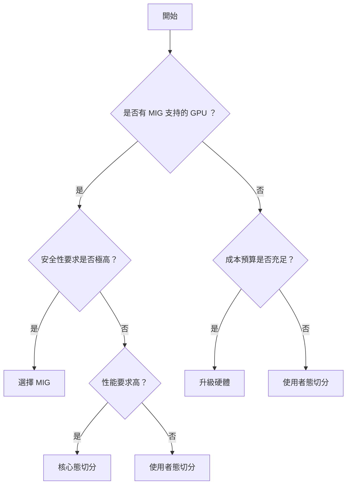
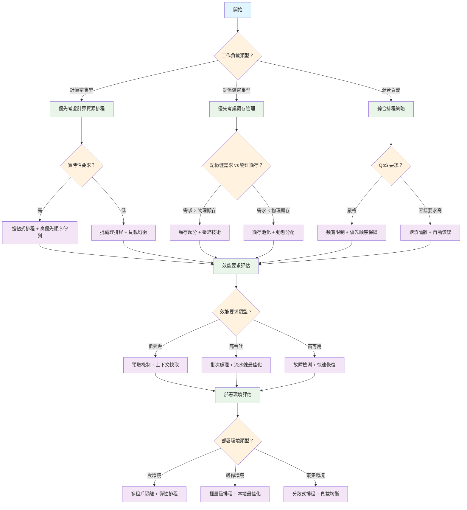

# GPU 虛擬化與資源管理技術深度解析 - 第三部分：資源管理與最佳化篇

本篇主要介紹 GPU 資源管理與最佳化技術，包括 GPU 切分技術、 CUDA 流和 MPS 技術、 GPU 資源管理核心技術與演算法等。

## 目錄

- [GPU 虛擬化與資源管理技術深度解析 - 第三部分：資源管理與最佳化篇](#gpu-虛擬化與資源管理技術深度解析---第三部分資源管理與最佳化篇)
  - [目錄](#目錄)
  - [9. GPU 切分技術深度解析](#9-gpu-切分技術深度解析)
    - [9.1 HAMi 結合硬體級 GPU 切分技術](#91-hami-結合硬體級-gpu-切分技術)
      - [9.1.1 HAMi 與 MIG 技術的整合架構](#911-hami-與-mig-技術的整合架構)
      - [9.1.2 HAMi MIG Device Plugin 實現](#912-hami-mig-device-plugin-實現)
      - [9.1.3 HAMi 排程器的 MIG 感知排程](#913-hami-排程器的-mig-感知排程)
      - [9.1.4 HAMi 動態 MIG 切片插件](#914-hami-動態-mig-切片插件)
      - [9.1.5 HAMi-MIG 整合的優勢](#915-hami-mig-整合的優勢)
    - [9.2 HAMi GPU 切分實踐應用](#92-hami-gpu-切分實踐應用)
      - [9.2.1 HAMi 在 Kubernetes 環境下的 GPU 切分架構](#921-hami-在-kubernetes-環境下的-gpu-切分架構)
      - [9.2.2 上層應用如何使用 HAMi GPU 切分服務](#922-上層應用如何使用-hami-gpu-切分服務)
        - [9.2.2.1 AI 訓練任務的 GPU 切分使用](#9221-ai-訓練任務的-gpu-切分使用)
        - [9.2.2.2 推理服務的 GPU 切分部署](#9222-推理服務的-gpu-切分部署)
      - [9.2.3 HAMi 與虛擬化技術的結合實現](#923-hami-與虛擬化技術的結合實現)
        - [9.2.3.1 HAMi-core 虛擬化層整合](#9231-hami-core-虛擬化層整合)
        - [9.2.3.2 混合切分策略實現](#9232-混合切分策略實現)
        - [9.2.3.3 智慧資源彈性伸縮](#9233-智慧資源彈性伸縮)
        - [9.2.3.4 動態切分效能最佳化](#9234-動態切分效能最佳化)
    - [9.3 切分技術選型指南](#93-切分技術選型指南)
      - [9.3.1 技術方案對比](#931-技術方案對比)
      - [9.3.2 應用場景選擇](#932-應用場景選擇)
      - [9.3.3 部署決策流程](#933-部署決策流程)
      - [9.3.4 效能調優建議](#934-效能調優建議)
    - [9.4 與虛擬化技術的關聯](#94-與虛擬化技術的關聯)
  - [10. GPU 資源管理核心技術與演算法](#10-gpu-資源管理核心技術與演算法)
    - [10.1 顯存管理技術](#101-顯存管理技術)
      - [10.1.1 顯存池化和動態分配](#1011-顯存池化和動態分配)
      - [10.1.2 統一記憶體（ Unified Memory ）](#1012-統一記憶體-unified-memory-)
      - [10.1.3 顯存超分（ Overcommit ）](#1013-顯存超分-overcommit-)
    - [10.2 計算資源排程技術](#102-計算資源排程技術)
      - [10.2.1 GPU 核心的時間片分配](#1021-gpu-核心的時間片分配)
      - [10.2.2 多工併發執行策略](#1022-多工併發執行策略)
      - [10.2.3 優先順序排程和搶佔機制](#1023-優先順序排程和搶佔機制)
    - [10.3 效能隔離機制](#103-效能隔離機制)
      - [10.3.1 頻寬限制和 QoS 保障](#1031-頻寬限制和-qos-保障)
      - [10.3.2 錯誤隔離和故障恢復](#1032-錯誤隔離和故障恢復)
      - [10.3.3 監控和效能分析工具](#1033-監控和效能分析工具)
    - [10.4 GPU 資源管理核心演算法](#104-gpu-資源管理核心演算法)
      - [10.4.1 顯存管理演算法](#1041-顯存管理演算法)
        - [10.4.1.1 顯存池化管理](#10411-顯存池化管理)
        - [10.4.1.2 顯存超分技術](#10412-顯存超分技術)
        - [10.4.1.3 統一記憶體管理](#10413-統一記憶體管理)
      - [10.4.2 計算資源排程演算法](#1042-計算資源排程演算法)
        - [10.4.2.1 多級佇列排程器](#10421-多級佇列排程器)
        - [10.4.2.2 時間片分配演算法](#10422-時間片分配演算法)
        - [10.4.2.3 負載均衡演算法](#10423-負載均衡演算法)
      - [10.4.3 效能隔離演算法](#1043-效能隔離演算法)
        - [10.4.3.1 頻寬限制演算法](#10431-頻寬限制演算法)
        - [10.4.3.2 錯誤隔離機制](#10432-錯誤隔離機制)
      - [10.4.4 監控與效能分析演算法](#1044-監控與效能分析演算法)
        - [10.4.4.1 實時效能監控](#10441-實時效能監控)
        - [10.4.4.2 效能預測演算法](#10442-效能預測演算法)
        - [10.4.4.3 自適應最佳化演算法](#10443-自適應最佳化演算法)
      - [10.4.5 演算法效能評估](#1045-演算法效能評估)
        - [10.4.5.1 基準測試框架](#10451-基準測試框架)
        - [10.4.5.2 演算法複雜度分析](#10452-演算法複雜度分析)
        - [10.4.5.3 演算法效能對比](#10453-演算法效能對比)
        - [10.4.5.4 最佳實踐](#10454-最佳實踐)
    - [10.5 AI 大模型訓練場景 GPU 資源管理最佳化](#105-ai-大模型訓練場景-gpu-資源管理最佳化)
      - [10.5.1 大模型訓練的 GPU 資源需求特徵](#1051-大模型訓練的-gpu-資源需求特徵)
      - [10.5.2 動態資源排程最佳化](#1052-動態資源排程最佳化)
      - [10.5.3 記憶體最佳化策略](#1053-記憶體最佳化策略)
    - [10.6 技術選型決策樹](#106-技術選型決策樹)
  - [11. CUDA 流和 MPS 技術](#11-cuda-流和-mps-技術)
    - [11.1 CUDA 流技術原理](#111-cuda-流技術原理)
      - [11.1.1 CUDA 流基礎概念](#1111-cuda-流基礎概念)
      - [11.1.2 併發執行模型](#1112-併發執行模型)
      - [11.1.3 流排程機制](#1113-流排程機制)
    - [11.2 CUDA 多行程服務（ MPS ）](#112-cuda-多行程服務-mps-)
      - [11.2.1 MPS 架構原理](#1121-mps-架構原理)
      - [11.2.2 資源隔離機制](#1122-資源隔離機制)
      - [11.2.3 效能隔離策略](#1123-效能隔離策略)
    - [11.3 技術對比與選擇](#113-技術對比與選擇)
      - [11.3.1 CUDA 流 vs MPS 技術對比](#1131-cuda-流-vs-mps-技術對比)
      - [11.3.2 與虛擬化技術的協同](#1132-與虛擬化技術的協同)
    - [11.4 效能最佳化實踐](#114-效能最佳化實踐)
      - [11.4.1 CUDA 流最佳化策略](#1141-cuda-流最佳化策略)
      - [11.4.2 MPS 效能調優](#1142-mps-效能調優)
    - [11.5 應用場景與最佳實踐](#115-應用場景與最佳實踐)
      - [11.5.1 深度學習訓練最佳化](#1151-深度學習訓練最佳化)
      - [11.5.2 推理服務最佳化](#1152-推理服務最佳化)
    - [11.6 監控與除錯](#116-監控與除錯)
      - [11.6.1 CUDA 流性能分析](#1161-cuda-流性能分析)
      - [11.6.2 MPS 監控工具](#1162-mps-監控工具)
    - [11.7 故障排查指南](#117-故障排查指南)
      - [11.7.1 常見 CUDA 流問題](#1171-常見-cuda-流問題)
      - [11.7.2 MPS 故障排查](#1172-mps-故障排查)
  - [12. GPU 遠端呼叫技術](#12-gpu-遠端呼叫技術)
    - [12.1 遠端 GPU 呼叫的基本原理](#121-遠端-gpu-呼叫的基本原理)
      - [12.1.1 網路透明的 GPU 訪問機制](#1211-網路透明的-gpu-訪問機制)
      - [12.1.2 客戶端-伺服器架構設計](#1212-客戶端-伺服器架構設計)
      - [12.1.3 網路通訊協議](#1213-網路通訊協議)
    - [12.2 效能最佳化策略](#122-效能最佳化策略)
      - [12.2.1 延遲最佳化](#1221-延遲最佳化)
      - [12.2.2 頻寬最佳化](#1222-頻寬最佳化)
    - [12.3 快取最佳化](#123-快取最佳化)
      - [12.3.1 結果快取機制](#1231-結果快取機制)
      - [12.3.2 智慧預取策略](#1232-智慧預取策略)
    - [12.4 容錯與可靠性](#124-容錯與可靠性)
      - [12.4.1 故障檢測機制](#1241-故障檢測機制)
      - [12.4.2 故障恢復策略](#1242-故障恢復策略)
      - [12.4.3 高可用性架構](#1243-高可用性架構)
    - [12.5 安全性保障機制](#125-安全性保障機制)
      - [12.5.1 身份認證與授權](#1251-身份認證與授權)
      - [12.5.2 資料加密傳輸](#1252-資料加密傳輸)
      - [12.5.3 訪問控制策略](#1253-訪問控制策略)
      - [12.5.4 安全審計日誌](#1254-安全審計日誌)
    - [12.6 錯誤處理和異常管理](#126-錯誤處理和異常管理)
      - [12.6.1 錯誤分類體系](#1261-錯誤分類體系)
      - [12.6.2 異常恢復策略](#1262-異常恢復策略)
      - [12.6.3 錯誤傳播機制](#1263-錯誤傳播機制)
      - [12.6.4 降級與熔斷機制](#1264-降級與熔斷機制)
    - [12.7 效能監控和診斷](#127-效能監控和診斷)
      - [12.7.1 效能指標體系](#1271-效能指標體系)
      - [12.7.2 監控告警機制](#1272-監控告警機制)
      - [12.7.3 診斷工具與方法](#1273-診斷工具與方法)
    - [12.8 安全配置最佳實踐](#128-安全配置最佳實踐)
      - [12.8.1 網路安全配置](#1281-網路安全配置)
      - [12.8.2 資料保護策略](#1282-資料保護策略)
      - [12.8.3 合規性要求](#1283-合規性要求)
  - [第三部分總結](#第三部分總結)

---

## 9. GPU 切分技術深度解析

本章將深入探討 GPU 切分技術的實現原理，重點以 HAMi 為例說明軟體級 GPU 切分在 Kubernetes 環境下的實際應用。關於 GPU 切分技術的基本定義和分類，請參考[2.3.2 節 GPU 切分技術](01_basic_theory.md#232-gpu-切分技術)。

**學習目標：** 本章以 NVIDIA MIG 的配置方法與 HAMi 在 Kubernetes 下的 GPU 切分實現為主線，說明上層應用如何使用切分服務，以及切分與虛擬化技術的結合方式。

### 9.1 HAMi 結合硬體級 GPU 切分技術

#### 9.1.1 HAMi 與 MIG 技術的整合架構

HAMi 透過與 NVIDIA MIG 技術的深度整合，為 Kubernetes 環境提供了硬體級 GPU 切分能力。這種整合架構結合了 MIG 的硬體級隔離優勢（詳見 [5.2.1 NVIDIA MIG 技術深度解析](02_virtualization.md#521-nvidia-mig--multi-instance-gpu-技術深度解析)）和 HAMi 的容器化管理能力，為雲原生 AI 應用提供了高效能、高隔離的 GPU 資源服務。

**整合優勢：**

- **硬體級隔離**：利用 MIG 的物理隔離能力，確保容器間完全獨立
- **自動化管理**： HAMi 自動發現和管理 MIG 實例，簡化運維複雜度
- **統一排程**：透過 Kubernetes 原生接口提供 MIG 資源的統一排程

**HAMi-MIG 整合架構：**

```text
┌─────────────────────────────────────────────────────────────┐
│                    Kubernetes 叢集                           │
├─────────────────────────────────────────────────────────────┤
│  HAMi 排程器擴展  │  HAMi Device Plugin  │  HAMi-core         │
├─────────────────────────────────────────────────────────────┤
│                    容器執行時層                               │
├─────────────────┬─────────────────┬─────────────────────────┤
│   MIG Instance  │   MIG Instance  │     MIG Instance        │
│      1g.5gb     │      2g.10gb    │        4g.20gb          │
│   (Pod A)       │   (Pod B)       │      (Pod C)            │
├─────────────────┼─────────────────┼─────────────────────────┤
│ HAMi-core       │ HAMi-core       │    HAMi-core            │
│ 資源控制         │ 資源控制          │    資源控制              │
└─────────────────┴─────────────────┴─────────────────────────┘
```

#### 9.1.2 HAMi MIG Device Plugin 實現

HAMi 透過擴展的 Device Plugin 來管理 MIG 實例，實現 MIG 資源的自動發現、分配和監控。

**核心元件：**

- **MIGDevicePlugin**：實現 Kubernetes Device Plugin 接口，管理 MIG 資源
- **MIGManager**：負責 MIG 實例的生命週期管理
- **MIGInstance**：封裝單個 MIG 實例的完整狀態資訊

**主要功能：**

- **ListAndWatch**：實現裝置發現和監控，持續監控 MIG 實例狀態變化
- **Allocate**：實現裝置分配，設定 MIG 相關環境變數和裝置檔案

**關鍵實現邏輯**：

```go
// MIGDevicePlugin HAMi MIG 裝置外掛
type MIGDevicePlugin struct {
    resourceName string                       // 資源名稱
    socket       string                       // Unix socket 路徑
    server       *grpc.Server                 // gRPC 伺服器
    devices      map[string]*pluginapi.Device // 裝置對映表
    migManager   *MIGManager                  // MIG 實例管理器
}

// ListAndWatch 實現裝置發現和監控
func (m *MIGDevicePlugin) ListAndWatch(e *pluginapi.Empty,
    s pluginapi.DevicePlugin_ListAndWatchServer) error {
    // 初始裝置列表傳送
    devices := make([]*pluginapi.Device, 0)
    for _, instance := range m.migManager.instances {
        if instance.Available {
            devices = append(devices, &pluginapi.Device{
                ID:     instance.ID,
                Health: pluginapi.Healthy,
            })
        }
    }
    // 持續監控裝置狀態變化...
}

// Allocate 實現裝置分配
func (m *MIGDevicePlugin) Allocate(ctx context.Context,
    reqs *pluginapi.AllocateRequest) (*pluginapi.AllocateResponse, error) {
    // 設定 MIG 相關環境變數
    response.Envs["CUDA_VISIBLE_DEVICES"] = fmt.Sprintf("MIG-%s", instance.ID)
    response.Envs["NVIDIA_MIG_CONFIG_DEVICES"] = instance.ID
    response.Envs["HAMI_MIG_PROFILE"] = instance.Profile
    // 新增裝置檔案和掛載 HAMi-core 庫...
}
```

> **完整實現**：詳見 `mig_device_plugin.go`

#### 9.1.3 HAMi 排程器的 MIG 感知排程

HAMi 排程器擴展了 Kubernetes 的排程能力，實現了 MIG 感知的智慧排程。

**核心元件：**

- **MIGAwarePlugin**：實現 HAMi MIG 感知排程外掛，提供 MIG 資源的過濾和評分功能
- **Filter 方法**：檢查節點是否滿足 Pod 的 MIG 資源需求
- **Score 方法**：根據 MIG 資源匹配度為節點打分
- **資源解析**：解析 Pod 中的 MIG 資源請求，支援多種 MIG 配置

**關鍵實現邏輯**：

```go
// MIGAwarePlugin 實現 HAMi MIG 感知排程外掛
type MIGAwarePlugin struct {
    handle framework.Handle // Kubernetes 排程框架控制代碼
}

// Filter 實現節點過濾邏輯
func (p *MIGAwarePlugin) Filter(ctx context.Context,
    state *framework.CycleState, pod *v1.Pod,
    nodeInfo *framework.NodeInfo) *framework.Status {
    // 檢查 Pod 是否請求 HAMi MIG 資源
    migRequest := getMIGResourceRequest(pod)
    if migRequest == nil {
        return framework.NewStatus(framework.Success, "")
    }
    // 檢查節點是否有足夠的 MIG 資源
    availableMIG := getAvailableMIGResources(nodeInfo.Node())
    if !canSatisfyMIGRequest(migRequest, availableMIG) {
        return framework.NewStatus(framework.Unschedulable, "節點 MIG 資源不足")
    }
    return framework.NewStatus(framework.Success, "")
}

// getMIGResourceRequest 解析 Pod 中的 MIG 資源請求
// 動態 MIG 模式下，任務仍以 nvidia.com/gpu + nvidia.com/gpumem 宣告資源，
// 透過註解 nvidia.com/vgpu-mode: "mig" 限定到 MIG 節點；
// HAMi 不暴露 hami.io/mig-* 形式的資源名，具體切多小的實例由裝置外掛
// 按 device-config 中的 MIG 模板自動匹配
func getMIGResourceRequest(pod *v1.Pod) *MIGResourceRequest {
    if pod.Annotations["nvidia.com/vgpu-mode"] != "mig" {
        return nil
    }
    for _, container := range pod.Spec.Containers {
        if gpu, exists := container.Resources.Requests["nvidia.com/gpu"]; exists {
            mem := container.Resources.Requests["nvidia.com/gpumem"]
            return &MIGResourceRequest{
                Count:       int(gpu.Value()),
                MemRequestMB: mem.Value(), // 由外掛匹配滿足該顯存需求的 MIG 模板
            }
        }
    }
    return nil
}
```

> **完整實現**：詳見 `mig_scheduler.go`

#### 9.1.4 HAMi 動態 MIG 切片插件

HAMi 動態 MIG 切片外掛擴展了靜態 MIG 配置（參見 [5.2.1.2 GPU 實例的建立和管理](02_virtualization.md#5212-gpu-實例的建立和管理)），實現了按需建立和自動管理 MIG 實例的能力。

**核心特性：**

- **按需建立**：根據 Pod 資源請求動態建立 MIG 實例
- **統一介面**：為 HAMi-core 和 MIG 提供一致的 vGPU API
- **智慧選擇**：自動選擇最優的虛擬化方式（ MIG 或 HAMi-core ）
- **混合排程**：支援同一節點上 MIG 和 HAMi-core 並存

> **詳細文件**：完整的動態切片實現見 [NVIDIA GPU MPS 和 MIG 動態切片外掛](https://project-hami.io/zh/docs/developers/dynamic-mig/)

**配置特性：**

- **MIG 几何配置**：支持 A100 等 GPU 的多種 MIG 實例規格（ 1g.5gb 、 2g.10gb 、 3g.20gb 、 7g.40gb ）
- **節點配置**：支援按節點配置操作模式（ hami-core 或 mig ）
- **自動選擇**：根據資源需求自動選擇最優虛擬化方式
- **強制模式**：支援透過註解強制使用特定虛擬化技術

**配置示例**：

```yaml
# hami-scheduler-device-configMap
apiVersion: v1
data:
  device-config.yaml: |
    nvidia:
      resourceCountName: nvidia.com/gpu
      resourceMemoryName: nvidia.com/gpumem
      resourceCoreName: nvidia.com/gpucores
      knownMigGeometries:
      - models: [ "A100-SXM4-40GB", "A100-40GB-PCIe" ]
        allowedGeometries:
          - 
            - name: 1g.5gb
              memory: 5120
              count: 7
          - 
            - name: 2g.10gb
              memory: 10240
              count: 3
      nodeconfig:
        - name: nodeA
          operatingmode: hami-core
        - name: nodeB
          operatingmode: mig
```

> **完整配置**：詳見 `hami-device-config.yaml`

#### 9.1.5 HAMi-MIG 整合的優勢

**技術優勢：**

- **硬體級隔離**：利用 MIG 的硬體級隔離能力，確保容器間完全獨立
- **云原生集成**：與 Kubernetes 深度集成，提供原生的容器化 GPU 服務
- **自動化管理**：自動發現和管理 MIG 實例，簡化運維複雜度
- **靈活排程**：支援多種 MIG 配置的混合排程，最佳化資源利用率
- **統一介面**：為不同虛擬化技術提供統一的 vGPU 池管理

**排程策略：**

- **Binpack 排程**：優先填滿節點資源，提高資源利用率
- **Spread 排程**：分散部署任務，提高可用性和負載均衡
- **混合排程**：結合 CPU 、記憶體、 GPU 記憶體的綜合排程決策

**應用場景：**

- **企業級 AI 訓練**：為大規模深度學習訓練提供高效能、高隔離的 GPU 資源
- **多租戶推理服務**：為不同租戶提供獨立的 GPU 實例，確保服務品質
- **混合工作負載**：同時支援訓練和推理任務的混合部署
- **資源池化**：實現 GPU 資源的統一管理和動態分配
- **開發測試環境**：為開發團隊提供靈活的 GPU 資源分配

### 9.2 HAMi GPU 切分實踐應用

#### 9.2.1 HAMi 在 Kubernetes 環境下的 GPU 切分架構

**HAMi GPU 切分的整體架構：**

HAMi 透過結合 Kubernetes 原生排程機制和底層虛擬化技術，實現了完整的 GPU 切分解決方案。其架構分為三個層次：

1. **Kubernetes 叢集層**：排程器擴展、裝置外掛、 Webhook
2. **節點管理層**：裝置發現、資源分配、監控服務
3. **容器執行層**： HAMi-core 虛擬化庫、 API 攔截、資源控制

**HAMi GPU 切分的工作流程：**

```yaml
# 1. 使用者提交 GPU 切分請求
apiVersion: v1
kind: Pod
metadata:
  name: ai-training-job
spec:
  containers:
    - name: pytorch-container
      image: pytorch/pytorch:1.12.0-cuda11.3-cudnn8-runtime
      resources:
        limits:
          nvidia.com/gpu: "2" # 請求 2 個 vGPU 實例
          nvidia.com/gpumem: "4000" # 每個 vGPU 分配 4GB 記憶體
          nvidia.com/gpucores: "50" # 每個 vGPU 使用 50%計算資源
      command: ["python", "train.py"]
```

**HAMi 排程決策過程：**

核心排程邏輯包括：

- **資源解析**：解析 Pod 的 GPU 資源請求（記憶體、計算核心、數量）
- **節點過濾**：檢查節點是否有足夠的 GPU 資源滿足請求
- **可用性檢查**：驗證 GPU 記憶體和計算資源的可用性
- **排程決策**：返回滿足條件的可排程節點列表

**關鍵實現邏輯**：

```go
type GPUScheduler struct {
    deviceManager *DeviceManager
    nodeResources map[string]*NodeGPUResources
}

type GPURequest struct {
    MemoryMB       int64
    CorePercentage int
    Count          int
}

// GPU 資源排程決策
func (s *GPUScheduler) Filter(pod *v1.Pod, nodes []*v1.Node) []*v1.Node {
    var feasibleNodes []*v1.Node
    // 解析 Pod 的 GPU 資源請求
    gpuRequest := parseGPURequest(pod)
    for _, node := range nodes {
        nodeResource := s.nodeResources[node.Name]
        // 檢查節點是否有足夠的 GPU 資源
        if canSchedule := s.checkGPUAvailability(nodeResource, gpuRequest); canSchedule {
            feasibleNodes = append(feasibleNodes, node)
        }
    }
    return feasibleNodes
}

// 檢查 GPU 資源可用性
func (s *GPUScheduler) checkGPUAvailability(nodeRes *NodeGPUResources, req *GPURequest) bool {
    for _, gpu := range nodeRes.GPUs {
        if gpu.AvailableMemory >= req.MemoryMB && gpu.AvailableCores >= req.CorePercentage {
            return true
        }
    }
    return false
}
```

> **完整實現**：詳見 `gpu_scheduler.go`

#### 9.2.2 上層應用如何使用 HAMi GPU 切分服務

##### 9.2.2.1 AI 訓練任務的 GPU 切分使用

**PyTorch 分散式訓練示例：**

關鍵特性：

- **資源規格**：每個 worker 使用 1 個 vGPU ，分配 6GB 顯存，使用 75%計算資源
- **分布式配置**：支持 4 個並行訓練任務，自動配置分散式環境
- **透明集成**：應用程式程式碼無需修改， HAMi 自動進行資源控制和排程
- **環境變數**：自動設定 MASTER_ADDR 、 MASTER_PORT 、 WORLD_SIZE 等分散式參數

**配置示例**：

```yaml
# pytorch-distributed-training.yaml
apiVersion: batch/v1
kind: Job
metadata:
  name: pytorch-distributed-training
spec:
  parallelism: 4 # 4 個並行訓練任務
  template:
    spec:
      containers:
        - name: pytorch-worker
          image: pytorch/pytorch:1.12.0-cuda11.3-cudnn8-runtime
          resources:
            limits:
              nvidia.com/gpu: "1" # 每個 worker 使用 1 個 vGPU
              nvidia.com/gpumem: "6000" # 分配 6GB 顯存
              nvidia.com/gpucores: "75" # 使用 75%計算資源
          env:
            - name: MASTER_ADDR
              value: "pytorch-master"
            - name: WORLD_SIZE
              value: "4"
          command:
            ["python", "-m", "torch.distributed.launch", "train_distributed.py"]
```

> **完整配置**：詳見 `pytorch-distributed-training.yaml` > **訓練程式碼**：詳見 `train_distributed.py`

##### 9.2.2.2 推理服務的 GPU 切分部署

**多模型推理服務示例：**

關鍵特性：

- **高密度部署**： 8 個推理實例，每個使用 1 個 vGPU 、 2GB 顯存、 25%計算資源
- **服務發現**：透過 Kubernetes Service 提供 HTTP 和 gRPC 接口
- **負載均衡**：自動分發推理請求到不同實例
- **透明排程**： HAMi 自動進行資源排程，客戶端無感知

> **部署配置**：詳見 `model-serving-deployment.yaml` > **客戶端程式碼**：詳見 `inference_client.py`

#### 9.2.3 HAMi 與虛擬化技術的結合實現

HAMi 透過將使用者態虛擬化技術與 Kubernetes 排程器深度整合，實現了透明、高效的 GPU 切分服務。本節詳細說明 HAMi 如何結合虛擬化技術為上層應用提供 GPU 切分能力。

##### 9.2.3.1 HAMi-core 虛擬化層整合

HAMi 透過 HAMi-core 實現了使用者態 GPU 虛擬化，與 Kubernetes 排程器緊密整合：

**HAMi 架構中的虛擬化層：**

```go
// pkg/scheduler/scheduler.go - HAMi 排程器擴展
package scheduler

import (
    "context"
    "fmt"
    v1 "k8s.io/api/core/v1"
    "k8s.io/apimachinery/pkg/runtime"
    "k8s.io/kubernetes/pkg/scheduler/framework"
)

// HAMiSchedulerExtender HAMi 排程器擴展
type HAMiSchedulerExtender struct {
    handle framework.Handle
}

// Filter 實現 GPU 資源過濾
func (h *HAMiSchedulerExtender) Filter(ctx context.Context, state *framework.CycleState, pod *v1.Pod, nodeInfo *framework.NodeInfo) *framework.Status {
    // 檢查節點 GPU 資源可用性
    gpuRequest := getGPUResourceRequest(pod)
    if gpuRequest == nil {
        return nil // 不需要 GPU 資源
    }

    // 獲取節點 GPU 資源狀態
    nodeGPUStatus := h.getNodeGPUStatus(nodeInfo.Node())

    // 檢查顯存資源
    if gpuRequest.Memory > nodeGPUStatus.AvailableMemory {
        return framework.NewStatus(framework.Unschedulable,
            fmt.Sprintf("insufficient GPU memory: requested %d, available %d",
                gpuRequest.Memory, nodeGPUStatus.AvailableMemory))
    }

    // 檢查計算資源
    if gpuRequest.Cores > nodeGPUStatus.AvailableCores {
        return framework.NewStatus(framework.Unschedulable,
            fmt.Sprintf("insufficient GPU cores: requested %d, available %d",
                gpuRequest.Cores, nodeGPUStatus.AvailableCores))
    }

    return nil
}

type GPUResourceRequest struct {
    Memory int64  // 顯存需求（ MB ）
    Cores  int64  // 計算核心需求（百分比）
}

type NodeGPUStatus struct {
    TotalMemory     int64
    AvailableMemory int64
    TotalCores      int64
    AvailableCores  int64
    GPUCount        int
}
```

**2. 自適應調整演算法：**

基於機器學習的自適應調整演算法：

```c
// 動態調整決策演算法
int adaptive_slicing_decision(dynamic_slicing_engine_t *engine) {
    workload_metrics_t *metrics = &engine->current_metrics;

    // 第一步：負載模式識別
    workload_pattern_t pattern = classify_workload_pattern(metrics);

    switch (pattern) {
    case PATTERN_COMPUTE_INTENSIVE:
        // 計算密集型：增加時間切分，減少空間切分
        return adjust_for_compute_intensive(engine);

    case PATTERN_MEMORY_INTENSIVE:
        // 記憶體密集型：增加空間切分，最佳化記憶體分配
        return adjust_for_memory_intensive(engine);

    case PATTERN_MIXED_WORKLOAD:
        // 混合負載：采用混合切分策略
        return adjust_for_mixed_workload(engine);

    case PATTERN_BURSTY_TRAFFIC:
        // 突发流量：啟用彈性擴縮容
        return adjust_for_bursty_traffic(engine);

    default:
        return maintain_current_configuration(engine);
    }
}

// 計算密集型負載調整策略
static int adjust_for_compute_intensive(dynamic_slicing_engine_t *engine) {
    // 減少分割槽數，增加每個分割槽的計算資源
    if (engine->current_partition_count > MIN_PARTITIONS) {
        engine->target_partition_count =
            max(MIN_PARTITIONS, engine->current_partition_count - 1);

        // 同時減少時間片長度，提高響應性
        adjust_time_slice_duration(0.8); // 減少 20%

        return schedule_partition_adjustment(engine);
    }
    return 0;
}

// 記憶體密集型負載調整策略
static int adjust_for_memory_intensive(dynamic_slicing_engine_t *engine) {
    // 增加分割槽數，提供更細粒度的記憶體隔離
    if (engine->current_partition_count < MAX_PARTITIONS) {
        engine->target_partition_count =
            min(MAX_PARTITIONS, engine->current_partition_count + 1);

        // 啟用記憶體壓縮和超分技術
        enable_memory_overcommit(1.5); // 1.5 倍超分

        return schedule_partition_adjustment(engine);
    }
    return 0;
}
```

**3. 預測性資源排程：**

基於歷史資料和機器學習的預測性排程：

```c
// 負載預測模型
typedef struct {
    float feature_weights[FEATURE_COUNT];   // 特徵權重
    float bias;                             // 偏置項
    float learning_rate;                    // 學習率
    int training_samples;                   // 訓練樣本數
} prediction_model_t;

// 負載預測演算法
float predict_future_load(prediction_model_t *model,
                         workload_metrics_t *current_metrics) {
    float features[FEATURE_COUNT] = {
        current_metrics->gpu_utilization,
        current_metrics->memory_utilization,
        current_metrics->average_latency_ms / 1000.0f, // 歸一化
        (float)current_metrics->active_tasks / MAX_TASKS,
        get_time_of_day_factor(),  // 時間因子
        get_day_of_week_factor()   // 周期因子
    };

    float prediction = model->bias;
    for (int i = 0; i < FEATURE_COUNT; i++) {
        prediction += features[i] * model->feature_weights[i];
    }

    // 應用激活函式（ sigmoid ）
    return 1.0f / (1.0f + expf(-prediction));
}

// 預測性資源預分配
int predictive_resource_allocation(dynamic_slicing_engine_t *engine) {
    // 預測未來 5 分鐘的負載
    float predicted_load = predict_future_load(&engine->prediction_model,
                                              &engine->current_metrics);

    // 基於預測結果提前調整資源
    if (predicted_load > LOAD_THRESHOLD_HIGH) {
        // 預期高負載：提前增加資源
        return preemptive_scale_up(engine);
    } else if (predicted_load < LOAD_THRESHOLD_LOW) {
        // 預期低負載：提前釋放資源
        return preemptive_scale_down(engine);
    }

    return 0; // 無需調整
}
```

##### 9.2.3.2 混合切分策略實現

混合切分策略結合時間切分和空間切分的優勢，實現更靈活的資源管理：

**關鍵實現邏輯**：

```c
// 混合排程條目結構
typedef struct {
    int partition_id;        // 空間分割槽 ID
    int time_slice_id;       // 時間片 ID
    int priority;            // 優先順序
    uint64_t start_time;     // 開始時間(微秒)
    uint64_t duration;       // 持續時間(微秒)
} hybrid_schedule_entry_t;

// 混合切分任務排程演算法
int schedule_hybrid_task(gpu_task_t *task) {
    // 第一階段：空間分割槽分配    // 根據任務的記憶體需求分配獨立的 GPU 分割槽
    int partition = allocate_spatial_partition(task->memory_requirement);
    if (partition < 0) {
        printf("Failed to allocate spatial partition\n");
        return -1;
    }

    // 第二階段：時間片分配    // 在分配的分割槽內進行時間排程
    int time_slot = allocate_time_slot(partition, task->estimated_duration);
    if (time_slot < 0) {
        release_spatial_partition(partition, task->memory_requirement);
        return -1;
    }

    // 第三階段：任務執行
    hybrid_schedule_entry_t entry = {
        .partition_id = partition,
        .time_slice_id = time_slot,
        .priority = task->priority
    };

    return execute_hybrid_task(task, &entry);
}
```

> **完整實現**：詳見 `hybrid_slicing.c`

**1. 二維資源排程矩陣：**

```c
// 二維排程矩陣
typedef struct {
    int spatial_partition;      // 空間分割槽 ID
    int temporal_slot;          // 時間片 ID
    task_priority_t priority;   // 任務優先順序
    resource_quota_t quota;     // 資源配額
    bool is_occupied;          // 佔用狀態
    uint64_t allocation_time;   // 分配時間
} schedule_cell_t;

typedef struct {
    schedule_cell_t cells[MAX_SPATIAL_PARTITIONS][MAX_TEMPORAL_SLOTS];
    int active_spatial_partitions;
    int active_temporal_slots;
    pthread_mutex_t matrix_lock;
} scheduling_matrix_t;

// 混合排程演算法
int hybrid_schedule_task(gpu_task_t *task, scheduling_matrix_t *matrix) {
    pthread_mutex_lock(&matrix->matrix_lock);

    // 第一階段：空間維度最佳化分配
    int best_spatial = find_optimal_spatial_partition(task, matrix);
    if (best_spatial < 0) {
        pthread_mutex_unlock(&matrix->matrix_lock);
        return -ENOMEM; // 空間資源不足
    }

    // 第二階段：時間維度最佳化分配
    int best_temporal = find_optimal_temporal_slot(task, matrix, best_spatial);
    if (best_temporal < 0) {
        pthread_mutex_unlock(&matrix->matrix_lock);
        return -EBUSY; // 時間資源不足
    }

    // 第三階段：資源預留和配置
    schedule_cell_t *cell = &matrix->cells[best_spatial][best_temporal];
    cell->is_occupied = true;
    cell->priority = task->priority;
    cell->allocation_time = get_current_time_us();

    // 配置資源配額
    configure_resource_quota(cell, task);

    pthread_mutex_unlock(&matrix->matrix_lock);

    printf("Task %d scheduled: spatial=%d, temporal=%d\n",
           task->task_id, best_spatial, best_temporal);

    return 0;
}
```

**2. 動態負載均衡演算法：**

```c
// 負載均衡器
typedef struct {
    float partition_loads[MAX_PARTITIONS];  // 各分割槽負載
    float target_load_per_partition;        // 目標負載
    int rebalance_threshold_percent;        // 重平衡閾值
    uint64_t last_rebalance_time;          // 上次重平衡時間
} load_balancer_t;

// 動態負載重平衡
int dynamic_load_rebalancing(load_balancer_t *balancer,
                            scheduling_matrix_t *matrix) {
    // 計算負載不平衡程度
    float load_variance = calculate_load_variance(balancer);

    if (load_variance > balancer->rebalance_threshold_percent / 100.0f) {
        // 執行負載重平衡
        return execute_load_migration(balancer, matrix);
    }

    return 0; // 負載平衡，無需調整
}

// 任務遷移演算法
static int execute_load_migration(load_balancer_t *balancer,
                                 scheduling_matrix_t *matrix) {
    // 找到負載最高和最低的分割槽
    int overloaded_partition = find_max_load_partition(balancer);
    int underloaded_partition = find_min_load_partition(balancer);

    if (overloaded_partition < 0 || underloaded_partition < 0) {
        return -1;
    }

    // 選擇合適的任務進行遷移
    gpu_task_t *migration_task = select_migration_candidate(
        matrix, overloaded_partition);

    if (migration_task) {
        // 執行任務遷移
        return migrate_task(migration_task, overloaded_partition,
                           underloaded_partition, matrix);
    }

    return 0;
}
```

##### 9.2.3.3 智慧資源彈性伸縮

**1. 彈性伸縮觸發機制：**

```c
// 彈性伸縮配置
typedef struct {
    float scale_up_threshold;       // 擴容閾值
    float scale_down_threshold;     // 縮容閾值
    int scale_up_cooldown_sec;      // 擴容冷卻時間
    int scale_down_cooldown_sec;    // 縮容冷卻時間
    int min_partitions;             // 最小分割槽數
    int max_partitions;             // 最大分割槽數
    bool auto_scaling_enabled;      // 自動伸縮開關
} elastic_scaling_config_t;

// 彈性伸縮決策引擎
int elastic_scaling_decision(dynamic_slicing_engine_t *engine,
                            elastic_scaling_config_t *config) {
    if (!config->auto_scaling_enabled) {
        return 0;
    }

    float current_utilization = engine->current_metrics.gpu_utilization;
    uint64_t current_time = get_current_time_us();

    // 擴容決策
    if (current_utilization > config->scale_up_threshold) {
        if (is_cooldown_expired(engine->last_scale_up_time,
                               config->scale_up_cooldown_sec)) {
            return execute_scale_up(engine, config);
        }
    }

    // 縮容決策
    if (current_utilization < config->scale_down_threshold) {
        if (is_cooldown_expired(engine->last_scale_down_time,
                               config->scale_down_cooldown_sec)) {
            return execute_scale_down(engine, config);
        }
    }

    return 0;
}

// 智慧擴容演算法
static int execute_scale_up(dynamic_slicing_engine_t *engine,
                           elastic_scaling_config_t *config) {
    if (engine->current_partition_count >= config->max_partitions) {
        return -ENOSPC; // 已達最大分割槽數
    }

    // 計算最優擴容數量
    int scale_amount = calculate_optimal_scale_amount(engine, true);
    int new_partition_count = min(config->max_partitions,
                                 engine->current_partition_count + scale_amount);

    // 執行分割槽擴容
    for (int i = engine->current_partition_count; i < new_partition_count; i++) {
        if (create_new_partition(i) != 0) {
            break; // 建立失敗，停止擴容
        }
    }

    engine->current_partition_count = new_partition_count;
    engine->last_scale_up_time = get_current_time_us();

    printf("Scaled up to %d partitions\n", new_partition_count);
    return 0;
}
```

**2. 漸進式資源調整：**

```c
// 漸進式調整策略
typedef struct {
    float adjustment_step_size;     // 調整步長
    int max_adjustment_steps;       // 最大調整步數
    int current_step;              // 當前步數
    float target_utilization;      // 目標利用率
    bool adjustment_active;         // 調整激活狀態
} gradual_adjustment_t;

// 漸進式資源調整演算法
int gradual_resource_adjustment(dynamic_slicing_engine_t *engine,
                               gradual_adjustment_t *adjustment) {
    if (!adjustment->adjustment_active) {
        return 0;
    }

    float current_util = engine->current_metrics.gpu_utilization;
    float util_diff = adjustment->target_utilization - current_util;

    // 計算本次調整量
    float adjustment_amount = util_diff * adjustment->adjustment_step_size;

    // 應用調整
    if (fabs(adjustment_amount) > 0.01f) { // 1%閾值
        apply_utilization_adjustment(engine, adjustment_amount);
        adjustment->current_step++;

        // 檢查是否完成調整
        if (adjustment->current_step >= adjustment->max_adjustment_steps ||
            fabs(util_diff) < 0.02f) { // 2%容差
            adjustment->adjustment_active = false;
            adjustment->current_step = 0;
            printf("漸進式調整完成\n");
        }
    }

    return 0;
}
```

##### 9.2.3.4 動態切分效能最佳化

**1. 切分開銷最小化：**

```c
// 切分開銷監控
typedef struct {
    uint64_t context_switch_time_us;    // 上下文切換時間
    uint64_t memory_migration_time_us;  // 記憶體遷移時間
    uint64_t scheduling_overhead_us;    // 排程開銷
    float overhead_percentage;          // 開銷百分比
} slicing_overhead_metrics_t;

// 開銷最佳化演算法
int optimize_slicing_overhead(dynamic_slicing_engine_t *engine) {
    slicing_overhead_metrics_t overhead;
    measure_slicing_overhead(&overhead);

    // 如果開銷超過 5%，啟用最佳化
    if (overhead.overhead_percentage > 0.05f) {
        // 減少切分頻率
        increase_time_slice_duration(1.2f); // 增加 20%

        // 啟用上下文快取
        enable_context_caching(true);

        // 最佳化記憶體遷移策略
        optimize_memory_migration_strategy();

        printf("切分開銷已最佳化: %.2f%% -> 目標 <5%%\n",
               overhead.overhead_percentage * 100);
    }

    return 0;
}
```

**2. 自適應排程演算法：**

```c
// 自適應排程器
typedef struct {
    scheduling_algorithm_t current_algorithm;  // 當前演算法
    float algorithm_performance[ALGORITHM_COUNT]; // 算法性能
    int algorithm_usage_count[ALGORITHM_COUNT];   // 使用計數
    uint64_t last_algorithm_switch_time;          // 上次切換時間
} adaptive_scheduler_t;

// 排程演算法自適應選擇
int adaptive_algorithm_selection(adaptive_scheduler_t *scheduler,
                                workload_metrics_t *metrics) {
    // 評估當前演算法效能
    float current_performance = evaluate_algorithm_performance(
        scheduler->current_algorithm, metrics);

    // 更新效能統計
    scheduler->algorithm_performance[scheduler->current_algorithm] =
        (scheduler->algorithm_performance[scheduler->current_algorithm] * 0.9f) +
        (current_performance * 0.1f); // 指數移動平均

    // 尋找更優演算法
    scheduling_algorithm_t best_algorithm = find_best_algorithm(scheduler);

    // 如果找到更優演算法且效能提升超過 10%，則切換
    if (best_algorithm != scheduler->current_algorithm) {
        float improvement = scheduler->algorithm_performance[best_algorithm] -
                           scheduler->algorithm_performance[scheduler->current_algorithm];

        if (improvement > 0.1f) {
            return switch_scheduling_algorithm(scheduler, best_algorithm);
        }
    }

    return 0;
}
```

### 9.3 切分技術選型指南

GPU 切分技術的選型決策需要基於多維度的技術評估和業務需求分析，本節提供系統化的技術選型決策框架和實踐指導原則。

#### 9.3.1 技術方案對比

| 對比維度       | 硬體級切分（ MIG ） | 軟體級切分（使用者態） | 軟體級切分（核心態） |
| -------------- | ------------------- | -------------------- | -------------------- |
| **隔離程度**   | 完全硬體隔離        | API 級別隔離         | 系統呼叫級隔離       |
| **效能開銷**   | 無額外開銷          | 5-15%                | 2-8%                 |
| **資源粒度**   | 固定配置            | 靈活配置             | 靈活配置             |
| **硬件要求**   | A100/H100 等        | 通用 GPU             | 通用 GPU             |
| **部署複雜度** | 中等                | 簡單                 | 複雜                 |
| **故障隔離**   | 完全隔離            | 部分隔離             | 較好隔離             |
| **成本**       | 高                  | 低                   | 中等                 |

#### 9.3.2 應用場景選擇

**1. 高安全性要求場景：**

- **推薦方案**：硬體級切分（ MIG ）
- **適用場景**：金融、醫療、政府等對安全性要求極高的行業
- **關鍵優勢**：硬體級隔離，完全避免資料洩露風險

**2. 成本敏感場景：**

- **推薦方案**：軟體級切分（使用者態）
- **適用場景**：中小企業、開發測試環境、教育機構
- **關鍵優勢**：部署簡單，成本低，適用於現有 GPU 硬件

**3. 高效能要求場景：**

- **推薦方案**：硬體級切分（ MIG ）或核心態切分
- **適用場景**： AI 訓練、高效能運算、實時推理
- **關鍵優勢**：效能開銷最小，資源保障性強

**4. 靈活性要求場景：**

- **推薦方案**：軟體級切分（核心態）
- **適用場景**：雲服務提供商、多租戶平台
- **關鍵優勢**：動態資源調整，支援複雜的資源管理策略

#### 9.3.3 部署決策流程



#### 9.3.4 效能調優建議

**硬體級切分最佳化：**

- 合理規劃實例配置，避免資源碎片化
- 根據工作負載特性選擇合適的實例大小
- 定期監控實例利用率，及時調整配置

**軟體級切分最佳化：**

- 最佳化 API 攔截路徑，減少函式呼叫開銷
- 實現智慧快取機制，減少重複計算
- 採用非同步處理，提高併發效能

**通用最佳化策略：**

- 實施負載均衡，避免熱點問題
- 建立監控體系，及時發現效能瓶頸
- 定期進行效能基準測試，驗證最佳化效果

### 9.4 與虛擬化技術的關聯

本章介紹的 GPU 切分技術是第三章 GPU 虛擬化技術的具體實現和深化。兩者在技術實現上存在密切關聯：

**技術層次對應關係：**

- **硬體級切分（ MIG ）** ↔ **硬體層虛擬化**： MIG 技術是硬體層虛擬化的典型實現
- **軟體級切分** ↔ **核心態/使用者態虛擬化**：透過 API 攔截和系統呼叫攔截實現資源切分
- **容錯與可靠性** ↔ **多租戶安全性**：確保切分後的資源隔離和安全保障

**實現機制互補：**

- 虛擬化技術提供了理論基礎和架構框架
- 切分技術提供了具體的實現方案和演算法細節
- 兩者結合實現了完整的 GPU 資源管理解決方案

接下來的章節將進一步深入探討 GPU 資源管理的核心技術實現。

---

## 10. GPU 資源管理核心技術與演算法

本章將深入探討 GPU 資源管理的核心技術，包括顯存管理、計算資源排程等關鍵技術的實現原理。

**學習目標：** 本章覆蓋顯存池化與動態分配、統一記憶體的工作原理與應用場景、顯存超分的風險控制，以及計算資源排程的最佳化方法。

### 10.1 顯存管理技術

顯存管理技術是實現 GPU 資源高效利用的核心技術，包括顯存池化、動態分配、統一記憶體等。

#### 10.1.1 顯存池化和動態分配

顯存池化是提高 GPU 資源利用率的關鍵技術。需要說明的是，「將多個 GPU 卡的顯存合併為一個顯存池」並非 CUDA 的通用能力，只有在特定框架或驅動能力（如 vGPU 池化方案、遠端 GPU 呼叫中介軟體、支援聚合顯存的專有驅動）之下才能實現；實現顯存的動態分配和管理後，收益主要體現在分配靈活性與利用率上。

參考實現：`hybrid_slicing.c`

1. **全域性顯存池**：

   全域性顯存池管理實現了動態分配和紅黑樹最佳化，支援高效的記憶體分配和回收。

2. **記憶體碎片整理**：

   記憶體碎片整理演算法包括標記、壓縮和指標更新三個階段，詳細可以參考：[CUDA Memory Management](https://docs.nvidia.com/cuda/cuda-memory-management.html)

#### 10.1.2 統一記憶體（ Unified Memory ）

統一記憶體技術允許 CPU 和 GPU 共享同一地址空間，詳細可以參考：[CUDA Unified Memory](https://docs.nvidia.com/cuda/cuda-c-programming-guide/index.html#unified-memory)。

統一記憶體管理的核心功能包括：

1. **統一記憶體分配**：

   統一記憶體的動態分配實現了虛擬地址到實體地址的對映，支持 CPU 和 GPU 的透明訪問。

2. **頁面遷移機制**：

   統一記憶體頁面遷移機制支援非同步和同步遷移，根據訪問模式自動最佳化資料位置。

#### 10.1.3 顯存超分（ Overcommit ）

顯存超分允許分配超過物理顯存大小的虛擬顯存，透過智慧的記憶體管理策略提高 GPU 資源利用率。

架構圖可以參考:[GPU 顯存超分技術架構](images/memory_overcommit_architecture.svg)。

參考實現：`memory_overcommit.c`。

**1. 超分配策略**：

- **按需分頁（ Demand Paging ）**：

  - 只有在實際訪問時才分配物理顯存
  - 使用頁表管理虛擬到實體地址的對映
  - 支援寫時複製（ Copy-on-Write ）機制
  - 延遲分配策略減少記憶體浪費

- **記憶體壓縮技術**：

  - 對不常用的顯存頁面進行實時壓縮
  - 使用 LZ4 、 ZSTD 等高效壓縮演算法
  - 壓縮比通常可達 2-4 倍
  - 解壓縮延遲控制在微秒級別

- **分層儲存策略**：

  - **熱資料**：保留在 GPU 顯存中
  - **溫資料**：壓縮儲存在顯存中
  - **冷資料**：遷移到系統記憶體或 NVMe 儲存
  - 基於訪問頻率和時間區域性性進行分層

- **智慧預測演算法**：
  - 基於歷史訪問模式預測記憶體需求
  - 機器學習模型預測頁面訪問機率
  - 提前進行記憶體遷移和預載入
  - 減少缺頁中斷的效能影響

**2. 風險控制機制**：

- **記憶體壓力監控**：

  - 實時監控顯存使用率和碎片化程度
  - 設定多級告警閾值（ 75%、 85%、 95%）
  - 動態調整超分比例（ 1.2x - 3.0x ）
  - 預測性告警機制防止 OOM

- **優雅降級策略**：

  - **輕度壓力**：啟用記憶體壓縮和頁面換出
  - **中度壓力**：限制新的記憶體分配請求
  - **重度壓力**：強制回收長時間未使用的記憶體
  - **極限壓力**：終止低優先順序任務釋放記憶體

- **QoS 保障機制**：

  - 為不同優先順序任務預留專用記憶體
  - 高優先順序任務享有記憶體分配優先權
  - 實施記憶體配額和速率限制
  - 防止單個任務耗盡所有顯存資源

- **故障恢復機制**：
  - **檢查點機制**：定期儲存任務狀態
  - **快速重啟**： OOM 後快速恢復任務執行
  - **記憶體洩漏檢測**：自動檢測和回收洩漏記憶體
  - **降級執行**：在記憶體不足時降低精度或批大小

**3. 效能最佳化策略**：

- **預取機制**：

  - 基於訪問模式預取可能需要的資料
  - 利用 GPU 空閒時間進行後台預取
  - 減少缺頁中斷對效能的影響

- **批量操作**：

  - 批次處理記憶體分配和釋放請求
  - 減少系統呼叫開銷
  - 提高記憶體管理效率

- **NUMA 感知**：
  - 考慮 NUMA 拓撲進行記憶體分配
  - 優先使用本地記憶體節點
  - 減少跨節點記憶體訪問延遲

**4. 監控和除錯工具**：

- **記憶體使用視覺化**：

  - 實時顯示物理和虛擬記憶體使用情況
  - 記憶體分配熱力圖和時間線
  - 碎片化程度和壓縮效率統計

- **性能分析工具**：
  - 缺頁中斷頻率和處理時間統計
  - 記憶體遷移和壓縮效能分析
  - 超分效果和風險評估報告

**5. 最佳實踐建議**：

- **合理設定超分比例**：根據工作負載特徵設定 1.5-2.5 倍超分
- **監控關鍵指標**：重點關注缺頁率、壓縮比、遷移延遲
- **定期調優**：根據實際使用情況調整策略參數
- **應急預案**：制定記憶體不足時的應急處理流程

### 10.2 計算資源排程技術

#### 10.2.1 GPU 核心的時間片分配

基於多級佇列排程器，支持 5 個優先順序等級，實現高優先順序任務優先執行，同優先順序任務公平共享時間片。

架構圖可以參考：[GPU 時間片排程機制](images/time_slicing_mechanism.svg)。

參考實現：`gpu_scheduler.c`。

**排程器核心資料結構**：

```c
// GPU 任務結構
struct gpu_task {
    struct list_head list;
    int task_id;
    int priority;
    void *data;
    size_t data_size;
    struct completion completion;
    int (*execute)(struct gpu_task *task);
    int assigned_unit_id;        // 分配的執行單元 ID
    uint64_t start_time;         // 任務開始時間戳
};

// 優先順序定義
enum task_priority {
    PRIORITY_REALTIME = 0,   // 實時任務
    PRIORITY_HIGH = 1,       // 高優先順序
    PRIORITY_NORMAL = 2,     // 普通優先順序
    PRIORITY_LOW = 3,        // 低優先順序
    PRIORITY_IDLE = 4,       // 空閒任務
    NUM_PRIORITIES
};

// 多級佇列排程器
typedef struct {
    struct list_head priority_queues[NUM_PRIORITIES];
    int queue_weights[NUM_PRIORITIES];  // 佇列權重
    int current_priority;               // 當前排程優先順序
    spinlock_t scheduler_lock;          // 排程器鎖
} priority_scheduler_t;
```

關鍵元件包括：

- `gpu_task` 結構：封裝任務資訊、優先順序和執行函式指標
- `priority_scheduler_t`：實現多級優先順序佇列，支持 5 個優先順序等級
- 原子操作和自旋鎖確保多執行緒安全

完整實現參見：`priority_scheduler.c`

**時間片分配演算法**：

核心排程邏輯：

- 優先順序搶佔式排程：高優先順序任務優先執行
- 時間片輪轉：同優先順序任務公平共享時間片
- 原子操作保證排程器狀態一致性

關鍵函式 `schedule_time_slice()` 實現了從高到低遍歷優先順序佇列的排程演算法。

**上下文切換最佳化**：

GPU 裝置管理介面支援多廠商 GPU 的抽象化操作。

#### 10.2.2 多工併發執行策略

現代 GPU 支援多工併發執行，需要合理的排程策略：

參考實現：`gpu_scheduler.c`

**併發執行器結構**：

```c
// 併發執行器
typedef struct {
    spinlock_t queue_lock;           // 佇列鎖
    int max_concurrent_tasks;        // 最大併發任務數
    int active_task_count;           // 當前活躍任務數
    struct list_head task_queue;     // 任務佇列
    sem_t concurrency_sem;           // 並發訊號量
} concurrent_executor_t;

// 任務提交
int submit_concurrent_task(struct gpu_task *task) {
    // 等待併發槽位
    if (down_interruptible(&executor.concurrency_sem)) {
        return -ERESTARTSYS;
    }

    // 新增到執行佇列
    spin_lock(&executor.queue_lock);
    list_add_tail(&task->list, &executor.task_queue);
    executor.active_task_count++;
    spin_unlock(&executor.queue_lock);

    // 啟動任務執行
    schedule_task_execution(task);

    return 0;
}
```

關鍵元件設計：

- `concurrent_executor_t`：透過訊號量控制最大併發數，防止資源過載
- `load_balancer_t`：實現多 GPU 負載均衡，支援輪詢和最小負載演算法
- 活躍任務列表管理當前執行狀態

**併發任務管理**：

核心管理機制：

- **任務提交**：`submit_concurrent_task()` 透過訊號量控制併發度，防止系統過載
- **負載均衡**：`select_gpu_for_task()` 實現最小負載優先的 GPU 選擇演算法
- **非同步執行**：利用工作佇列機制實現任務的非同步排程和執行
- **狀態同步**：透過互斥鎖和自旋鎖保證多執行緒環境下的資料一致性

#### 10.2.3 優先順序排程和搶佔機制

優先順序排程確保重要任務能夠及時得到執行：

參考實現：`priority_scheduler.c`

**1. 多級優先順序佇列**：

關鍵設計要點：

- **優先順序佇列**：每個優先順序維護獨立的任務佇列和時間片配置
- **搶佔管理器**：支援高優先順序任務對低優先順序任務的搶佔
- **定時器機制**：實現基於時間片的任務切換
- **原子計數**：確保任務統計的準確性

**2. 搶佔機制實現**：

核心搶佔流程：

- **優先順序檢查**：`preempt_current_task()` 驗證搶佔條件，確保高優先順序任務優先
- **上下文保存**：儲存被搶佔任務的 GPU 寄存器、記憶體對映和流狀態
- **任務切換**：原子性地更新當前執行任務，避免競態條件
- **上下文恢復**：`resume_preempted_task()` 恢復任務執行環境

搶佔機制確保實時任務能夠及時響應，同時保證被搶佔任務能夠正確恢復執行。

**3. 上下文儲存與恢復**：

上下文管理的關鍵技術：

- **GPU 上下文結構**：封裝暫存器狀態、記憶體對映和 CUDA 流狀態
- **原子保存**：`save_gpu_context()` 確保上下文資料的完整性和一致性
- **記憶體管理**：動態分配上下文儲存空間，支援不同規模的任務
- **狀態恢復**：精確恢復 GPU 執行環境，保證任務無縫繼續執行

上下文切換是搶佔式排程的核心，直接影響系統的響應效能和任務執行正確性。

### 10.3 效能隔離機制

效能隔離機制確保不同優先順序任務在資源上公平競爭，提供一致的效能保證。

#### 10.3.1 頻寬限制和 QoS 保障

記憶體頻寬是 GPU 效能的關鍵因素，需要實現有效的頻寬管理：

參考實現：`qos_manager.c`

**1. 頻寬監控和限制**：

頻寬管理核心元件：

- **頻寬控制器**：實時監控和限制 GPU 記憶體頻寬使用，支援原子操作統計
- **QoS 策略**：為不同優先順序任務定義頻寬保證、突發限制和延遲閾值
- **請求佇列**：管理頻寬分配請求，支援非同步分配和完成通知

完整實現參見：`qos_manager.c`

**2. 頻寬分配演算法**：

核心分配策略：

- **即時分配**：當可用頻寬充足時，`allocate_bandwidth()` 立即分配資源
- **佇列等待**：資源不足時加入等待佇列，支援優先順序排程
- **原子統計**：使用原子操作維護頻寬使用統計，避免競態條件
- **完成通知**：透過 completion 機制實現非同步分配結果通知

演算法確保高優先順序任務優先獲得頻寬資源，同時避免系統過載。

**3. QoS 保障機制**：

QoS 監控和保障的核心機制：

- **QoS 管理器**：維護各優先順序的 QoS 策略，支援定時監控和違規統計
- **違規檢測**：`qos_violation_check()` 實時監控延遲和頻寬保證違規
- **自動恢復**：檢測到違規時自動觸發資源重新分配和優先順序調整
- **統計分析**：記錄違規次數，為系統調優提供資料支援

QoS 機制確保關鍵任務的服務品質，防止資源競爭導致的效能下降。

#### 10.3.2 錯誤隔離和故障恢復

錯誤隔離確保一個任務的故障不會影響其他任務：

參考實現：`error_handler.c`

**1. 錯誤檢測和隔離**：

錯誤處理核心元件：

- **錯誤隔離器**：維護被隔離任務列表，支援定時檢查和工作佇列恢復
- **錯誤類型分類**：涵蓋記憶體故障、計算超時、硬件故障、驅動崩潰等 6 種錯誤類型
- **錯誤資訊記錄**：詳細記錄錯誤類型、時間、上下文，便於故障分析

完整實現參見：`error_handler.c`

**2. 錯誤檢測機制**：

多層次錯誤檢測策略：

- **主動檢測**：`detect_gpu_error()` 定期檢查記憶體損壞、計算超時和硬體狀態
- **即時隔離**：`isolate_faulty_task()` 立即停止故障任務，清理 GPU 資源
- **狀態管理**：原子性地更新任務狀態，避免錯誤傳播
- **通知機制**：及時通知其他元件，確保系統穩定性

檢測機制採用分層設計，從硬體層到應用層全面監控 GPU 執行狀態。

**3. 故障恢復機制**：

智慧故障恢復策略：

- **故障恢復管理器**：支援延遲工作佇列、重試計數和恢復佇列管理
- **自動恢復**：`auto_fault_recovery()` 根據錯誤類型選擇恢復策略，支援最大重試限制
- **分類恢復**：`attempt_task_recovery()` 針對不同錯誤類型實施專門的恢復演算法
- **狀態清理**：恢復成功後自動清除錯誤狀態，重新排程任務

恢復機制確保系統在面臨故障時能夠自動恢復，最大化系統可用性。

#### 10.3.3 監控和效能分析工具

全面的監控和分析工具是效能最佳化的基礎：

參考實現：`performance_monitor.c`

**1. 效能指標收集**：

```c
// 效能監控結構
typedef struct {
    atomic64_t memory_usage;            // 記憶體使用量
    atomic64_t bandwidth_usage;         // 頻寬使用量
    atomic_t active_tasks;              // 活躍任務數
    atomic_t error_count;               // 錯誤計數
    u64 total_execution_time;           // 總執行時間
    u64 average_latency;                // 平均延遲
    struct timer_list metrics_timer;    // 指標收集定時器
    spinlock_t metrics_lock;            // 指標鎖
} performance_metrics_t;

// 效能指標收集實現 - 核心監控演算法
// 該函式負責收集 GPU 任務的實時效能資料，包括延遲、吞吐量等關鍵指標
void collect_performance_metrics(void) {
    struct gpu_task *task;
    u64 total_latency = 0;      // 累計延遲時間，用於計算平均值
    int task_count = 0;         // 活躍任務計數器
    unsigned long flags;        // 中斷標誌，用於儲存/恢復中斷狀態

    // 第一步：獲取自旋鎖並禁用中斷    // 使用 spin_lock_irqsave 確保在多核環境下的原子性操作
    // 同時禁用本地中斷，防止中斷處理程式干擾資料收集過程
    spin_lock_irqsave(&perf_metrics.metrics_lock, flags);

    // 第二步：遍歷活躍任務列表，收集效能資料    // 使用 Linux 核心的 list_for_each_entry 宏遍歷連結串列
    // 這是一個高效的連結串列遍歷方式，避免了手動指標操作
    list_for_each_entry(task, &active_tasks, list) {
        // 累加每個任務的執行時間，用於後續計算平均延遲
        total_latency += task->execution_time;
        task_count++;           // 統計活躍任務數量

        // 更新單個任務的特定效能指標
        // 包括記憶體使用量、 GPU 利用率、錯誤計數等
        update_task_metrics(task);
    }

    // 第三步：計算平均延遲    // 防止除零錯誤，只有在有活躍任務時才計算平均值
    if (task_count > 0) {
        // 計算所有任務的平均執行延遲
        // 這是系統效能的關鍵指標，用於效能分析和調優
        perf_metrics.average_latency = total_latency / task_count;
    }

    // 第四步：原子更新全域性指標    // 使用原子操作更新活躍任務數，確保多執行緒環境下的資料一致性
    atomic_set(&perf_metrics.active_tasks, task_count);

    // 第五步：釋放鎖並恢復中斷    // 恢復之前儲存的中斷狀態，釋放自旋鎖
    spin_unlock_irqrestore(&perf_metrics.metrics_lock, flags);

    // 第六步：持久化歷史資料    // 將當前收集的指標資料記錄到歷史資料庫中
    // 用於長期趨勢分析、效能基線建立和異常檢測
    record_historical_metrics();
}
```

**2. 實時監控系統**：

```c
// 監控事件類型
enum monitor_event_type {
    MONITOR_TASK_START,
    MONITOR_TASK_COMPLETE,
    MONITOR_TASK_ERROR,
    MONITOR_MEMORY_PRESSURE,
    MONITOR_BANDWIDTH_LIMIT,
    MONITOR_QOS_VIOLATION
};

// 監控事件結構
struct monitor_event {
    enum monitor_event_type type;
    struct gpu_task *task;
    unsigned long timestamp;
    union {
        struct {
            u64 memory_usage;
            u64 memory_limit;
        } memory_event;
        struct {
            u64 bandwidth_usage;
            u64 bandwidth_limit;
        } bandwidth_event;
        struct {
            int violation_type;
            u64 threshold;
            u64 actual_value;
        } qos_event;
    } data;
};

// 實時監控系統主迴圈 - 多維度系統健康檢查演算法
// 該函式實現了 GPU 系統的實時監控，採用事件驅動模式檢測各種異常情況
void real_time_monitor(void) {
    struct monitor_event event;  // 監控事件結構體，用於傳遞事件詳細資訊

    // 第一層監控：記憶體壓力檢測    // 檢查 GPU 顯存使用率、記憶體碎片化程度、分配失敗率等指標
    // 當記憶體使用率超過閾值(通常 85%)或出現大量分配失敗時觸發
    if (check_memory_pressure(&event)) {
        // 處理記憶體壓力事件：啟動記憶體回收、降低分配速率、觸發告警等
        handle_memory_pressure_event(&event);
    }

    // 第二層監控：頻寬限制檢測    // 監控 GPU 記憶體頻寬使用情況，檢測是否超過 QoS 配置的頻寬限制
    // 包括 PCIe 頻寬、 HBM 頻寬、 NVLink 頻寬等多種頻寬類型
    if (check_bandwidth_limits(&event)) {
        // 處理頻寬限制事件：調整任務優先順序、限流、負載重分配等
        handle_bandwidth_limit_event(&event);
    }

    // 第三層監控：服務品質(QoS)違規檢測    // 檢查各租戶/任務的 SLA 指標：響應時間、吞吐量、可用性等
    // 當實際效能低於承諾的服務水平時觸發違規事件
    if (check_qos_violations(&event)) {
        // 處理 QoS 違規事件：資源重新分配、優先順序提升、補償機制等
        handle_qos_violation_event(&event);
    }

    // 第四步：更新監控儀表板    // 將最新的監控資料推送到視覺化儀表板
    // 包括實時圖表更新、告警狀態重新整理、趨勢分析等
    update_monitoring_dashboard();
}
```

**3. 效能分析和報告**：

**GPU 資源管理效能報告生成**：

| 效能指標       | 資料來源                         | 計算方式                                       | 輸出格式                              | 說明                                  |
| -------------- | ------------------------------ | ---------------------------------------------- | ------------------------------------- | ------------------------------------- |
| **記憶體使用率** | `perf_metrics.memory_usage`    | `atomic64_read()` 讀取，轉換為 MB ，計算百分比 | `記憶體使用率: %llu/%llu MB (%.1f%%)`   | 顯示當前記憶體使用量/總記憶體容量及使用率 |
| **頻寬使用率** | `perf_metrics.bandwidth_usage` | `atomic64_read()` 讀取，與最大頻寬比較         | `頻寬使用率: %llu/%llu MB/s (%.1f%%)` | 顯示當前頻寬使用量/最大頻寬及使用率   |
| **活躍任務數** | `perf_metrics.active_tasks`    | `atomic_read()` 原子讀取                       | `活躍任務數: %d`                      | 當前正在執行的 GPU 任務數量           |
| **平均延遲**   | `perf_metrics.average_latency` | 直接讀取統計值                                 | `平均延遲: %llu μs`                   | GPU 任務執行的平均延遲時間            |
| **錯誤計數**   | `perf_metrics.error_count`     | `atomic_read()` 原子讀取                       | `錯誤計數: %d`                        | 累計的錯誤發生次數                    |

**函式實現特點**：

- 使用 `snprintf()` 安全格式化輸出，防止緩衝區溢位
- 採用原子操作確保多執行緒環境下資料讀取的一致性
- 動態計算緩衝區偏移量，支援連續追加輸出
- 提供完整的效能監控資料，便於系統調優和故障診斷

### 10.4 GPU 資源管理核心演算法

本節深入探討 GPU 資源管理的核心演算法實現，包括顯存管理、計算資源排程、效能隔離和監控分析等關鍵技術的演算法設計與最佳化策略。

#### 10.4.1 顯存管理演算法

##### 10.4.1.1 顯存池化管理

**顯存池架構設計：**

顯存池化管理透過預分配大塊顯存並進行細粒度管理，實現高效的記憶體分配和回收。核心包括池結構設計、塊管理演算法、最佳適應分配策略和記憶體碎片整理機制。

完整的顯存池化管理實現請參考：`memory_pool.c`。

**動態記憶體分配演算法：**

```c
// 最佳適應演算法實現
void* allocate_gpu_memory(gpu_memory_pool_t *pool, size_t size) {
    pthread_mutex_lock(&pool->pool_mutex);

    int best_fit_index = -1;
    size_t best_fit_size = SIZE_MAX;

    // 尋找最佳適應塊
    for (int i = 0; i < pool->total_blocks; i++) {
        if (pool->block_status[i] == 0 && // 空閒塊
            pool->block_sizes[i] >= size && // 大小足夠
            pool->block_sizes[i] < best_fit_size) { // 更優選擇
            best_fit_index = i;
            best_fit_size = pool->block_sizes[i];
        }
    }

    void *allocated_ptr = NULL;
    if (best_fit_index != -1) {
        // 標記為佔用
        pool->block_status[best_fit_index] = 1;
        allocated_ptr = pool->memory_blocks[best_fit_index];

        // 如果塊過大，進行分割
        if (pool->block_sizes[best_fit_index] > size + MIN_BLOCK_SIZE) {
            split_memory_block(pool, best_fit_index, size);
        }
    }

    pthread_mutex_unlock(&pool->pool_mutex);
    return allocated_ptr;
}
```

##### 10.4.1.2 顯存超分技術

**超分管理框架：**

```c
// 顯存超分管理器
typedef struct {
    size_t physical_memory;     // 物理顯存大小
    size_t virtual_memory;      // 虛擬顯存大小
    float overcommit_ratio;     // 超分比例
    void **swap_buffers;        // 交換緩衝區
    int *page_table;            // 頁表
    int *access_history;        // 訪問歷史
} gpu_overcommit_manager_t;

// LRU 頁面替換演算法
int lru_page_replacement(gpu_overcommit_manager_t *manager, int new_page) {
    int lru_page = 0;
    int min_access_time = manager->access_history[0];

    // 找到最久未使用的頁面
    for (int i = 1; i < manager->virtual_memory / PAGE_SIZE; i++) {
        if (manager->access_history[i] < min_access_time) {
            min_access_time = manager->access_history[i];
            lru_page = i;
        }
    }

    // 執行頁面交換
    swap_pages(manager, lru_page, new_page);

    return lru_page;
}
```

##### 10.4.1.3 統一記憶體管理

**統一記憶體分配器：**

核心元件：

- **統一記憶體管理器**：管理 GPU 和 CPU 之間的統一記憶體池
- **訪問模式分析**：基於頻率和區域性性分析資料訪問模式
- **智慧遷移策略**：高頻資料立即遷移，高區域性性資料預取，低頻資料延遲遷移
- **自適應最佳化**：根據執行時訪問模式動態調整遷移策略

> **完整實現**：詳見 `unified_memory_manager.c`

#### 10.4.2 計算資源排程演算法

##### 10.4.2.1 多級佇列排程器

**排程器架構：**

多級佇列排程器支援不同優先順序任務的差異化排程，包括優先順序佇列管理、任務選擇演算法、動態優先順序調整和搶佔式排程機制。

完整的多級佇列排程器實現請參考：`multi_queue_scheduler.c`

##### 10.4.2.2 時間片分配演算法

**自適應時間片演算法：**

核心特性：

- **多因子調整**：基於任務類型、 GPU 利用率、歷史效能和優先順序動態計算時間片
- **負載感知**：根據系統負載自動調整時間片長度
- **效能反饋**：基於任務執行歷史最佳化時間片分配
- **範圍限制**：確保時間片在合理範圍內，避免極端值

> **完整實現**：詳見 `adaptive_timeslice.c`

##### 10.4.2.3 負載均衡演算法

**多 GPU 負載均衡：**

支持算法：

- **最小負載優先**：選擇當前負載最低的相容 GPU
- **輪詢排程**：按順序分配任務到可用 GPU
- **加權輪詢**：基於 GPU 效能權重進行輪詢分配
- **最少連線**：選擇活躍任務數最少的 GPU
- **資源感知**：綜合考慮記憶體、計算能力和負載的智慧分配

> **完整實現**：詳見 `load_balancer.c`

#### 10.4.3 效能隔離演算法

##### 10.4.3.1 頻寬限制演算法

**QoS 頻寬控制：**

核心機制：

- **令牌桶算法**：基於令牌桶實現精確的頻寬限制和突發控制
- **多租戶 QoS**：支援不同租戶的頻寬保證和優先順序管理
- **動態分配**：根據實時需求和優先順序動態調整頻寬分配
- **自適應調整**：基於違規統計自動調整租戶優先順序和配額

> **完整實現**：詳見 `qos_bandwidth_controller.c`

##### 10.4.3.2 錯誤隔離機制

**故障檢測與隔離：**

核心功能：

- **多維度檢測**：基於錯誤類型、頻率、嚴重程度和連續性進行故障檢測
- **分級隔離**：支持警告、限制、暫停、終止等多級隔離策略
- **自動恢復**：基於錯誤率下降和隔離時長自動嘗試租戶恢復
- **資源清理**：故障隔離時自動清理租戶 GPU 資源和上下文

> **完整實現**：詳見 `fault_detector.c`

#### 10.4.4 監控與效能分析演算法

##### 10.4.4.1 實時效能監控

**效能指標收集器：**

```c
// 效能監控器
typedef struct {
    metric_buffer_t *metric_buffers;
    int buffer_count;
    sampling_config_t sampling_config;
    alert_rule_t *alert_rules;
    int rule_count;
    pthread_t monitoring_thread;
} performance_monitor_t;

// 效能資料取樣演算法 - 多緩衝區滑動視窗監控系統
// 該函式實現了高效的 GPU 效能指標取樣，支援異常檢測和實時告警
int sample_performance_metrics(performance_monitor_t *monitor) {
    // 遍歷所有監控緩衝區    // 每個緩衝區對應不同的 GPU 或不同類型的效能指標
    for (int i = 0; i < monitor->buffer_count; i++) {
        metric_buffer_t *buffer = &monitor->metric_buffers[i];

        // 第一步：取樣當前 GPU 效能指標        // 收集 GPU 利用率、記憶體使用率、溫度、功耗等關鍵指標
        // 這是一個低開銷的操作，通常透過 NVML API 實現
        gpu_metrics_t current_metrics;
        collect_gpu_metrics(&current_metrics);

        // 第二步：更新滑動視窗緩衝區        // 使用滑動視窗演算法維護最近 N 個時間點的效能資料
        // 這樣可以平滑瞬時波動，提供更穩定的效能趨勢分析
        update_sliding_window(buffer, &current_metrics);

        // 第三步：基於歷史資料進行異常檢測        // 使用統計學方法（如 3-sigma 規則）或機器學習演算法檢測異常
        // 異常包括：性能突然下降、資源使用率異常飆升、溫度過高等
        if (detect_anomaly(buffer, &current_metrics)) {
            // 觸發告警機制：发送通知、記錄日誌、啟動自動恢復流程
            trigger_alert(monitor, i, &current_metrics);
        }
    }

    return 0;  // 成功完成所有緩衝區的取樣和分析
}
```

##### 10.4.4.2 效能預測演算法

**機器學習效能預測：**

```c
// 效能預測器
typedef struct {
    float *feature_weights;     // 特徵權重
    int feature_count;
    float *historical_data;     // 歷史資料
    int data_points;
    prediction_model_t model;   // 預測模型
} performance_predictor_t;

// 線性迴歸效能預測演算法 - 基於機器學習的 GPU 效能預測系統
// 該函式使用訓練好的線性迴歸模型預測 GPU 任務的效能表現
float predict_performance(performance_predictor_t *predictor,
                         float *input_features) {
    float prediction = 0.0;  // 初始化預測值

    // 第一步：計算特徵的線性組合    // 實現線性迴歸的核心公式： y = w1*x1 + w2*x2 + ... + wn*xn
    // 其中 wi 是特徵權重， xi 是輸入特徵值
    for (int i = 0; i < predictor->feature_count; i++) {
        // 每個特徵值乘以對應的權重，累加到預測結果中
        // 特徵可能包括：任務大小、 GPU 型號、記憶體使用量、併發任務數等
        prediction += input_features[i] * predictor->feature_weights[i];
    }

    // 第二步：應用非線性激活函式    // 激活函式可以是 sigmoid 、 ReLU 、 tanh 等，用於引入非線性特性
    // 這使得模型能夠捕捉更復雜的效能模式和關係
    prediction = apply_activation_function(prediction);

    // 第三步：計算預測置信度    // 基於輸入特徵與訓練資料的相似度計算預測的可信程度
    // 置信度低的預測可能需要更保守的資源分配策略
    float confidence = calculate_prediction_confidence(predictor, input_features);

    // 第四步：返回最終預測結果    // 預測值通常表示任務執行時間、資源需求量或效能得分
    return prediction;
}
```

##### 10.4.4.3 自適應最佳化演算法

**自動調優框架：**

```c
// 自適應最佳化器
typedef struct {
    optimization_target_t targets[MAX_TARGETS];
    int target_count;
    parameter_space_t param_space;
    optimization_history_t history;
    int optimization_algorithm;
} adaptive_optimizer_t;

// 遺傳演算法最佳化 - 自適應 GPU 參數調優的進化演算法
// 該函式使用遺傳演算法自動尋找 GPU 系統的最優配置參數
int genetic_algorithm_optimize(adaptive_optimizer_t *optimizer) {
    population_t population;  // 種群：包含多個候選參數配置的集合

    // 第一步：初始化種群    // 在參數空間中隨機生成初始種群，每個個體代表一組 GPU 配置參數
    // 參數可能包括：記憶體池大小、排程時間片、快取策略等
    initialize_population(&population, optimizer->param_space);

    // 主進化迴圈：模擬自然選擇過程
    for (int generation = 0; generation < MAX_GENERATIONS; generation++) {
        // 第二步：評估每個個體的適應度        // 執行 GPU 基準測試，評估每組參數配置的效能表現
        // 適應度函式綜合考慮吞吐量、延遲、資源利用率等多個目標
        evaluate_fitness(&population, optimizer->targets);

        // 第三步：選擇操作（適者生存）
        // 使用輪盤賭選擇、錦標賽選擇等方法選出優秀個體
        // 適應度高的個體有更大機率被選中進入下一代
        population_t selected = selection(&population);

        // 第四步：交叉操作（基因重組）
        // 將選中的個體進行配對，交換部分參數生成新的後代
        // 這模擬了生物學中的基因重組過程，產生新的參數組合
        population_t offspring = crossover(&selected);

        // 第五步：變異操作（引入隨機性）
        // 以一定機率隨機修改個體的部分參數，防止演算法陷入區域性最優
        // 變異率通常設定為 1%-5%，平衡探索和利用
        mutation(&offspring, MUTATION_RATE);

        // 第六步：更新種群        // 用新生成的後代替換當前種群，進入下一代進化
        population = offspring;

        // 第七步：檢查收斂條件        // 如果種群適應度不再顯著提升，或達到預設精度，則停止進化
        if (check_convergence(&population)) {
            break;  // 提前終止，避免無效計算
        }
    }

    // 第八步：應用最優參數配置    // 將進化得到的最優參數配置應用到實際的 GPU 系統中
    apply_optimal_parameters(optimizer, &population);

    return 0;  // 最佳化成功完成
}
```

#### 10.4.5 演算法效能評估

##### 10.4.5.1 基準測試框架

**效能基準測試：**

```c
// 基準測試套件
typedef struct {
    benchmark_case_t *test_cases;
    int case_count;
    result_collector_t collector;
    comparison_baseline_t baseline;
} benchmark_suite_t;

// 執行基準測試 - 高精度 GPU 效能基準測試框架
// 該函式實現了科學嚴謹的 GPU 效能測試，確保結果的準確性和可重複性
int run_benchmark_suite(benchmark_suite_t *suite) {
    // 遍歷所有測試用例    // 每個測試用例針對不同的 GPU 工作負載模式（計算密集、記憶體密集等）
    for (int i = 0; i < suite->case_count; i++) {
        benchmark_case_t *test_case = &suite->test_cases[i];

        // 第一步： GPU 預熱階段        // 預熱是基準測試的關鍵步驟，用於：
        // 1. 激活 GPU 的動態頻率調節，使其達到穩定的工作狀態
        // 2. 預載入必要的資料到 GPU 快取中
        // 3. 消除冷啟動對測試結果的影響
        warmup_gpu(test_case->warmup_iterations);

        // 第二步：正式效能測試
        benchmark_result_t result;  // 儲存測試結果的資料結構

        // 執行多次迭代測試以獲得統計學上有意義的結果
        for (int j = 0; j < test_case->iterations; j++) {
            struct timespec start, end;  // 高精度時間戳結構

            // 記錄測試開始時間            // 使用 CLOCK_MONOTONIC 確保時間測量不受系統時間調整影響
            // 這是一個單調遞增的時鐘，適合效能測量
            clock_gettime(CLOCK_MONOTONIC, &start);

            // 執行實際的 GPU 測試負載            // 這裡執行具體的 GPU 計算任務（矩陣乘法、卷積、記憶體複製等）
            execute_test_workload(test_case);

            // 記錄測試結束時間
            clock_gettime(CLOCK_MONOTONIC, &end);

            // 計算精確的執行時間            // 將納秒精度的時間差轉換為浮點秒數
            // 這種計算方式可以達到納秒級的時間測量精度
            double elapsed = (end.tv_sec - start.tv_sec) +
                           (end.tv_nsec - start.tv_nsec) / 1e9;

            // 記錄單次測試結果            // 將執行時間新增到結果集合中，用於後續統計分析
            record_measurement(&result, elapsed);
        }

        // 第三步：統計分析和結果處理        // 計算平均值、標準差、置信區間等統計指標
        // 識別和處理異常值，生成效能報告
        analyze_benchmark_result(&result, &suite->collector);
    }

    return 0;  // 所有測試用例執行完成
}
```

##### 10.4.5.2 演算法複雜度分析

**複雜度評估工具：**

```c
// 複雜度分析器
typedef struct {
    algorithm_profile_t *profiles;
    int profile_count;
    complexity_model_t models[COMPLEXITY_TYPES];
} complexity_analyzer_t;

// 時間複雜度分析
complexity_result_t analyze_time_complexity(complexity_analyzer_t *analyzer,
                                           algorithm_profile_t *profile) {
    complexity_result_t result = {0};

    // 擬合不同複雜度模型
    for (int i = 0; i < COMPLEXITY_TYPES; i++) {
        complexity_model_t *model = &analyzer->models[i];

        // 計算擬合度
        float fitness = calculate_model_fitness(model, profile->measurements);

        if (fitness > result.best_fitness) {
            result.best_fitness = fitness;
            result.complexity_type = i;
            result.model_parameters = model->parameters;
        }
    }

    return result;
}
```

##### 10.4.5.3 演算法效能對比

下表總結了不同 GPU 資源管理演算法的效能特徵：

| 演算法類別 | 演算法名稱   | 延遲 | 吞吐量 | 記憶體效率 | 適用場景      |
| -------- | ---------- | ---- | ------ | -------- | ------------- |
| 顯存管理 | 顯存池化   | 低   | 高     | 高       | 頻繁分配/釋放 |
| 顯存管理 | 統一記憶體   | 中   | 中     | 中       | 大資料處理    |
| 顯存管理 | 顯存超分   | 高   | 低     | 極高     | 記憶體受限場景  |
| 任務排程 | 多級佇列   | 低   | 高     | 中       | 混合工作負載  |
| 任務排程 | 時間片輪轉 | 中   | 中     | 低       | 公平排程      |
| 任務排程 | 負載均衡   | 中   | 高     | 中       | 多 GPU 環境   |
| 效能隔離 | 頻寬限制   | 低   | 中     | 低       | QoS 保證      |
| 效能隔離 | 錯誤隔離   | 高   | 低     | 低       | 高可靠性      |

##### 10.4.5.4 最佳實踐

**演算法選擇指南：**

1. **高頻記憶體操作場景**：優先選擇顯存池化管理，配合最佳適應演算法
2. **大模型訓練場景**：結合統一記憶體管理和顯存超分技術
3. **多租戶環境**：採用多級佇列排程器配合頻寬限制演算法
4. **實時推理場景**：使用時間片分配演算法確保低延遲
5. **容錯要求高的場景**：啟用錯誤隔離機制和健康檢查

**效能調優建議：**

- **記憶體池大小**：根據工作負載特徵動態調整池大小
- **排程時間片**：平衡響應時間和上下文切換開銷
- **預取策略**：基於訪問模式選擇合適的預取演算法
- **監控粒度**：在效能開銷和監控精度之間找到平衡點

### 10.5 AI 大模型訓練場景 GPU 資源管理最佳化

#### 10.5.1 大模型訓練的 GPU 資源需求特徵

**資源需求模式分析：**

- **顯存密集型**：大模型參數和中間激活值需要大量顯存
- **計算密集型**：矩陣乘法和注意力計算需要高算力
- **通信密集型**：多 GPU 訓練需要高頻寬的 GPU 間通訊
- **動態資源需求**：不同訓練階段的資源需求差異巨大

**大模型訓練資源管理策略：**

```c
// 大模型訓練資源配置
typedef struct {
    uint64_t model_parameters;         // 模型參數數量
    uint64_t sequence_length;          // 序列長度
    uint32_t batch_size;               // 批次大小
    uint32_t gradient_accumulation;    // 梯度累積步數
    enum precision_type precision;     // 精度類型（ FP16/BF16/FP32 ）
    bool use_gradient_checkpointing;   // 是否使用梯度檢查點
    bool use_zero_optimizer;           // 是否使用 ZeRO 最佳化器
} llm_training_config_t;

// 大模型訓練資源估算 - 精確的 LLM 訓練資源需求計算演算法
// 該函式基於模型配置精確估算大語言模型訓練所需的 GPU 資源
struct resource_estimate estimate_llm_resources(llm_training_config_t *config) {
    struct resource_estimate est = {0};  // 初始化資源估算結果

    // 第一部分：模型參數顯存需求計算    // 計算儲存模型權重所需的顯存大小
    // 不同精度類型佔用的位元組數： FP32=4 位元組， FP16/BF16=2 位元組， INT8=1 位元組
    uint64_t param_memory = config->model_parameters *
                           get_precision_bytes(config->precision);

    // 第二部分：最佳化器狀態顯存需求計算    // Adam 最佳化器需要儲存每個參數的一階矩估計(momentum)和二階矩估計(variance)
    // 因此需要 2 倍於參數量的額外顯存空間
    uint64_t optimizer_memory = param_memory * 2;

    // 第三部分：梯度顯存需求計算    // 反向傳播過程中需要儲存每個參數的梯度
    // 梯度的顯存需求與參數顯存需求相等
    uint64_t gradient_memory = param_memory;

    // 第四部分：激活值顯存需求計算    // 前向傳播過程中的中間激活值需要儲存用於反向傳播
    // 激活值大小與序列長度、批次大小、模型大小密切相關
    // 這裡使用簡化的線性估算公式（實際情況更復雜）
    uint64_t activation_memory = config->sequence_length *
                                config->batch_size *
                                config->model_parameters / 1000; // 簡化估算

    // 第五部分：應用記憶體最佳化策略
    // 梯度檢查點最佳化：重計算激活值以節省記憶體
    // 透過犧牲計算時間來大幅減少激活值的記憶體佔用
    if (config->use_gradient_checkpointing) {
        activation_memory /= 4; // 梯度檢查點可減少 75%激活值記憶體
    }

    // ZeRO 最佳化器狀態分片：將最佳化器狀態分佈到多個 GPU
    // ZeRO-3 可以將最佳化器狀態、梯度、甚至參數都進行分片
    if (config->use_zero_optimizer) {
        optimizer_memory /= 8; // ZeRO-3 可將最佳化器狀態分片到 8 個 GPU
    }

    // 第六部分：彙總總記憶體需求    // 將所有元件的記憶體需求相加得到總的顯存需求
    est.memory_required = param_memory + optimizer_memory +
                         gradient_memory + activation_memory;

    // 第七部分：計算所需計算量    // 估算訓練過程中的浮點運算次數（ FLOPs ）
    // 大致為： 6 倍參數量 × 序列長度 × 批次大小
    // 這個公式考慮了前向傳播(2 倍)和反向傳播(4 倍)的計算開銷
    est.compute_required = config->model_parameters *
                          config->sequence_length *
                          config->batch_size * 6; // 6 倍參數量的計算

    return est;  // 返回完整的資源估算結果
}
```

#### 10.5.2 動態資源排程最佳化

**訓練階段感知的資源排程：**

- **預訓練階段**：高計算需求，相對穩定的資源使用
- **微調階段**：較低資源需求，支援多工並行
- **推理驗證階段**：低延遲需求，可與訓練任務共享資源
- **檢查點儲存階段**：高 I/O 需求，可臨時釋放計算資源

**訓練階段感知排程：**

核心特性：

- **階段檢測**：自動識別預訓練、微調、推理、檢查點等訓練階段
- **差異化排程**：根據不同階段的資源需求特點採用不同排程策略
- **動態優先順序**：基於訓練階段動態調整任務優先順序和資源權重
- **智慧暫停**：在檢查點儲存期間智慧暫停計算任務

> **完整實現**：詳見 `llm_resource_optimizer.c`

#### 10.5.3 記憶體最佳化策略

**大模型顯存最佳化技術：**

- **模型並行**：將模型參數分佈到多個 GPU
- **資料並行**：將批次資料分佈到多個 GPU
- **流水線並行**：將模型層級分佈到多個 GPU
- **混合精度訓練**：使用 FP16/BF16 降低記憶體需求
- **梯度檢查點**：重計算激活值以節省記憶體
- **CPU 解除安裝**：將部分資料解除安裝到 CPU 記憶體

**自適應記憶體最佳化：**

最佳化策略：

- **混合精度訓練**：自動選擇 FP16/BF16 精度以減少記憶體佔用
- **梯度檢查點**：重計算激活值以節省記憶體，支援可配置的檢查點間隔
- **CPU 解除安裝**：智慧解除安裝最佳化器狀態、梯度等到 CPU 記憶體
- **模型並行**：自動分析模型結構並選擇最優的並行策略
- **動態調整**：基於實時記憶體使用情況動態啟用/禁用最佳化策略

> **完整實現**：詳見 `llm_resource_optimizer.c`

### 10.6 技術選型決策樹

**GPU 資源管理技術選型指南**：



---

## 11. CUDA 流和 MPS 技術

本章將詳細介紹 CUDA 流（ CUDA Streams ）和 CUDA 多行程服務（ MPS ）技術的實現原理、應用場景和效能最佳化策略。這些技術作為應用層的併發最佳化機制，與前面章節介紹的虛擬化技術形成互補，共同構建完整的 GPU 資源管理體系。

**學習目標：** 本章講解 CUDA 流的基本概念、併發執行模型與同步機制，多流重疊計算與傳輸的用法，CUDA MPS 的工作原理、配置與容器化部署，以及兩者與 GPU 虛擬化技術的互補關係。

### 11.1 CUDA 流技術原理

#### 11.1.1 CUDA 流基礎概念

CUDA 流是 NVIDIA GPU 平行計算架構中的核心概念，它提供了一種在 GPU 上實現非同步併發執行的機制。

**CUDA 流的定義：**

- **流（ Stream ）**：一個按順序執行的 CUDA 操作序列
- **預設流（ Default Stream ）**：隱式建立的流，所有未指定流的操作都在此執行
- **非預設流（ Non-default Stream ）**：顯式建立的流，可以與其他流併發執行

```c
// CUDA 流的基本操作
cudaStream_t stream1, stream2;

// 建立流
cudaStreamCreate(&stream1);
cudaStreamCreate(&stream2);

// 非同步記憶體複製
cudaMemcpyAsync(d_data1, h_data1, size, cudaMemcpyHostToDevice, stream1);
cudaMemcpyAsync(d_data2, h_data2, size, cudaMemcpyHostToDevice, stream2);

// 在指定流中啟動核心
kernel1<<<grid, block, 0, stream1>>>(d_data1);
kernel2<<<grid, block, 0, stream2>>>(d_data2);

// 同步流
cudaStreamSynchronize(stream1);
cudaStreamSynchronize(stream2);

// 銷燬流
cudaStreamDestroy(stream1);
cudaStreamDestroy(stream2);
```

#### 11.1.2 併發執行模型

**串行模型 vs 併發模型：**

```c
// 序列執行模型
void serial_execution() {
    // 記憶體傳輸和計算序列執行
    cudaMemcpy(d_data, h_data, size, cudaMemcpyHostToDevice);
    kernel<<<grid, block>>>(d_data);
    cudaMemcpy(h_result, d_result, size, cudaMemcpyDeviceToHost);
}

// 併發執行模型
void concurrent_execution() {
    cudaStream_t stream1, stream2;
    cudaStreamCreate(&stream1);
    cudaStreamCreate(&stream2);

    // 重疊記憶體傳輸和計算
    cudaMemcpyAsync(d_data1, h_data1, size, cudaMemcpyHostToDevice, stream1);
    kernel1<<<grid, block, 0, stream1>>>(d_data1);

    cudaMemcpyAsync(d_data2, h_data2, size, cudaMemcpyHostToDevice, stream2);
    kernel2<<<grid, block, 0, stream2>>>(d_data2);

    cudaStreamSynchronize(stream1);
    cudaStreamSynchronize(stream2);
}
```

#### 11.1.3 流排程機制

**硬體層面的流排程：**

- **複製引擎（ Copy Engine ）**：專門處理記憶體傳輸操作
- **計算引擎（ Compute Engine ）**：執行 CUDA 核心
- **流多處理器（ SM ）排程**：在 SM 級別進行任務排程

```c
// 流優先順序設定
int priority_high, priority_low;
cudaDeviceGetStreamPriorityRange(&priority_low, &priority_high);

cudaStream_t high_priority_stream, low_priority_stream;
cudaStreamCreateWithPriority(&high_priority_stream, cudaStreamNonBlocking, priority_high);
cudaStreamCreateWithPriority(&low_priority_stream, cudaStreamNonBlocking, priority_low);
```

### 11.2 CUDA 多行程服務（ MPS ）

#### 11.2.1 MPS 架構原理

CUDA 多行程服務（ Multi-Process Service ）是 NVIDIA 提供的一種 GPU 共享機制，允許多個 CUDA 應用程式併發訪問同一個 GPU 。

**MPS 架構元件：**

- **MPS 控制守護行程**：管理客戶端連線和資源分配
- **MPS 伺服器**：處理 CUDA API 呼叫和核心執行
- **客戶端行程**：實際的 CUDA 應用程式

```bash
# MPS 服務啟動和配置
# 啟動 MPS 控制守護行程
nvidia-cuda-mps-control -d

# 設定 MPS 伺服器
echo "start_server -uid $USER" | nvidia-cuda-mps-control

# 設定預設限制（set_default_active_thread_percentage 只接一個百分比參數，不帶裝置號）
echo "set_default_device_pinned_mem_limit 0 2G" | nvidia-cuda-mps-control
echo "set_default_active_thread_percentage 50" | nvidia-cuda-mps-control

# 停止 MPS 服務
echo "quit" | nvidia-cuda-mps-control
```

#### 11.2.2 資源隔離機制

**MPS 資源管理特性：**

```c
// MPS 客戶端資源限制配置
struct mps_client_config {
    uint32_t active_thread_percentage;  // 活躍執行緒百分比限制
    size_t pinned_memory_limit;         // 固定記憶體限制
    uint32_t compute_mode;              // 計算模式設定
    uint32_t memory_protection;         // 記憶體保護級別
};

// 設定客戶端資源限制
int configure_mps_client(int client_id, struct mps_client_config *config) {
    // 設定活躍執行緒百分比
    if (config->active_thread_percentage > 0) {
        set_active_thread_percentage(client_id, config->active_thread_percentage);
    }

    // 設定記憶體限制
    if (config->pinned_memory_limit > 0) {
        set_pinned_memory_limit(client_id, config->pinned_memory_limit);
    }

    return 0;
}
```

#### 11.2.3 效能隔離策略

**時間分片與空間分片結合：**

```c
// MPS 效能隔離實現
struct mps_isolation_policy {
    enum {
        ISOLATION_TIME_SLICING,     // 時間分片隔離
        ISOLATION_SPACE_PARTITION,  // 空間分割槽隔離
        ISOLATION_HYBRID           // 混合隔離
    } isolation_type;

    uint32_t time_slice_ms;        // 時間片長度（毫秒）
    uint32_t sm_partition_mask;    // SM 分割槽掩碼
    uint32_t memory_partition_id;  // 記憶體分割槽 ID
};

// 應用隔離策略
int apply_isolation_policy(int client_id, struct mps_isolation_policy *policy) {
    switch (policy->isolation_type) {
        case ISOLATION_TIME_SLICING:
            return configure_time_slicing(client_id, policy->time_slice_ms);
        case ISOLATION_SPACE_PARTITION:
            return configure_space_partition(client_id, policy->sm_partition_mask);
        case ISOLATION_HYBRID:
            configure_time_slicing(client_id, policy->time_slice_ms);
            return configure_space_partition(client_id, policy->sm_partition_mask);
        default:
            return -EINVAL;
    }
}
```

### 11.3 技術對比與選擇

#### 11.3.1 CUDA 流 vs MPS 技術對比

| 特性           | CUDA 流       | MPS              |
| -------------- | ------------- | ---------------- |
| **應用場景**   | 單行程內併發  | 多行程間共享     |
| **隔離級別**   | 任務級隔離    | 行程級隔離       |
| **資源管理**   | 應用程式控制  | 系統級管理       |
| **效能開銷**   | 低            | 中等             |
| **配置複雜度** | 簡單          | 複雜             |
| **適用 GPU**   | 所有 CUDA GPU | Volta 及以上架構 |

#### 11.3.2 與虛擬化技術的協同

**技術棧層次關係：**

```text
應用層最佳化技術
├── CUDA 流（單行程內併發）
└── MPS （多行程共享）
    ↓
虛擬化層技術
├── 使用者態虛擬化（ HAMi 、 vCUDA ）
├── 核心態虛擬化（ GPU Passthrough ）
└── 硬體級虛擬化（ MIG 、 SR-IOV ）
    ↓
硬體資源層
└── 物理 GPU 硬件
```

**協同最佳化策略：**

```c
// 虛擬化環境中的 CUDA 流最佳化
struct virtualized_stream_config {
    // 虛擬化層配置
    uint32_t vgpu_instance_id;      // vGPU 實例 ID
    uint32_t allocated_sm_count;    // 分配的 SM 數量
    size_t allocated_memory;        // 分配的顯存大小

    // CUDA 流配置
    uint32_t stream_count;          // 流數量
    int stream_priority;            // 流優先順序
    uint32_t concurrent_kernels;    // 併發核心數
};

// 在虛擬化環境中最佳化 CUDA 流配置
int optimize_streams_for_vgpu(struct virtualized_stream_config *config) {
    // 根據分配的 SM 數量調整併發流數量
    uint32_t optimal_streams = min(config->stream_count,
                                  config->allocated_sm_count / 2);

    // 根據記憶體限制調整緩衝區大小
    size_t buffer_size = config->allocated_memory / optimal_streams / 4;

    // 建立最佳化的流配置
    for (uint32_t i = 0; i < optimal_streams; i++) {
        cudaStream_t stream;
        cudaStreamCreateWithPriority(&stream, cudaStreamNonBlocking,
                                    config->stream_priority);
        // 配置流特定的記憶體池
        configure_stream_memory_pool(stream, buffer_size);
    }

    return 0;
}
```

### 11.4 效能最佳化實踐

#### 11.4.1 CUDA 流最佳化策略

**記憶體傳輸與計算重疊：**

```c
// 高效的流水線執行模式
void optimized_pipeline_execution(float *h_data, float *d_data,
                                 int total_size, int chunk_size) {
    const int num_streams = 4;
    cudaStream_t streams[num_streams];

    // 建立多個流
    for (int i = 0; i < num_streams; i++) {
        cudaStreamCreate(&streams[i]);
    }

    // 流水線執行
    for (int offset = 0; offset < total_size; offset += chunk_size) {
        int stream_id = (offset / chunk_size) % num_streams;
        int current_chunk = min(chunk_size, total_size - offset);

        // 非同步記憶體傳輸
        cudaMemcpyAsync(&d_data[offset], &h_data[offset],
                       current_chunk * sizeof(float),
                       cudaMemcpyHostToDevice, streams[stream_id]);

        // 在同一流中啟動計算核心
        process_chunk<<<(current_chunk + 255) / 256, 256, 0, streams[stream_id]>>>
                     (&d_data[offset], current_chunk);

        // 非同步結果傳輸
        cudaMemcpyAsync(&h_data[offset], &d_data[offset],
                       current_chunk * sizeof(float),
                       cudaMemcpyDeviceToHost, streams[stream_id]);
    }

    // 同步所有流
    for (int i = 0; i < num_streams; i++) {
        cudaStreamSynchronize(streams[i]);
        cudaStreamDestroy(streams[i]);
    }
}
```

#### 11.4.2 MPS 效能調優

**動態資源分配策略：**

```c
// MPS 動態資源管理
struct mps_resource_monitor {
    uint32_t active_clients;           // 活躍客戶端數量
    uint32_t total_sm_utilization;     // 總 SM 利用率
    size_t total_memory_usage;         // 總記憶體使用量
    uint64_t last_update_time;         // 最後更新時間
};

// 動態調整客戶端資源分配 - MPS 智慧資源排程演算法
// 該函式實現了基於負載感知的動態資源分配，最佳化多客戶端 GPU 資源利用率
int dynamic_resource_adjustment(struct mps_resource_monitor *monitor) {
    // 第一步：計算基礎資源分配比例    // 采用公平分配策略，將 GPU 資源平均分配給所有活躍客戶端
    // 這是資源分配的起始點，後續會根據實際負載進行動態調整
    uint32_t base_thread_percentage = 100 / monitor->active_clients;

    // 第二步：基於 SM 利用率的負載感知調整    // 根據當前 GPU 流式多處理器(SM)的整體利用率動態調整資源分配策略

    if (monitor->total_sm_utilization < 70) {
        // 低負載場景最佳化        // 當 SM 利用率低於 70%時，說明 GPU 資源充足，可以允許客戶端使用更多資源
        // 這樣可以提高單個任務的執行效率，減少任務完成時間
        base_thread_percentage = min(base_thread_percentage * 1.5, 100);
    } else if (monitor->total_sm_utilization > 90) {
        // 高負載場景最佳化        // 當 SM 利用率超過 90%時，說明 GPU 資源緊張，需要限制單個客戶端的資源使用
        // 防止資源競爭導致的效能下降，確保所有客戶端都能獲得基本的執行資源
        base_thread_percentage = max(base_thread_percentage * 0.8, 10);
    }
    // 中等負載(70%-90%)時保持基礎分配不變，維持系統穩定性

    // 第三步：應用新的資源分配策略    // 遍歷所有活躍的 MPS 客戶端，為每個客戶端設定新的執行緒百分比
    for (uint32_t client_id = 0; client_id < monitor->active_clients; client_id++) {
        // 呼叫 MPS API 設定客戶端的活躍執行緒百分比
        // 這個設定會立即生效，影響客戶端後續的 kernel 啟動
        set_active_thread_percentage(client_id, base_thread_percentage);
    }

    return 0;  // 資源調整成功完成
}
```

### 11.5 應用場景與最佳實踐

#### 11.5.1 深度學習訓練最佳化

**多模型並行訓練：**

```python
# 使用 CUDA 流進行多模型訓練
import torch
import torch.cuda as cuda

class MultiModelTrainer:
    def __init__(self, models, num_streams=4):
        self.models = models
        self.streams = [cuda.Stream() for _ in range(num_streams)]
        self.num_streams = num_streams

    def parallel_training_step(self, data_batches):
        """並行訓練多個模型"""
        for i, (model, data) in enumerate(zip(self.models, data_batches)):
            stream_id = i % self.num_streams

            with cuda.stream(self.streams[stream_id]):
                # 資料傳輸到 GPU
                data = data.cuda(non_blocking=True)

                # 前向傳播
                output = model(data)

                # 計算損失
                loss = compute_loss(output, targets)

                # 反向傳播
                loss.backward()

        # 同步所有流
        for stream in self.streams:
            stream.synchronize()
```

#### 11.5.2 推理服務最佳化

**MPS 在推理服務中的應用：**

```bash
#!/bin/bash
# 推理服務 MPS 配置指令碼

# 啟動 MPS 服務
nvidia-cuda-mps-control -d
echo "start_server -uid $(id -u)" | nvidia-cuda-mps-control

# 為不同優先順序的推理服務配置資源。
# MPS 控制守護行程沒有 set_pinned_mem_limit 命令；固定顯存限制透過客戶端環境變數
# CUDA_MPS_PINNED_DEVICE_MEM_LIMIT 下发，算力占比用 CUDA_MPS_ACTIVE_THREAD_PERCENTAGE 下发
# 高優先順序服務（實時推理）
CUDA_MPS_ACTIVE_THREAD_PERCENTAGE=60 CUDA_MPS_PINNED_DEVICE_MEM_LIMIT='0=4G' ./realtime_inference

# 中優先順序服務（批量推理）
CUDA_MPS_ACTIVE_THREAD_PERCENTAGE=30 CUDA_MPS_PINNED_DEVICE_MEM_LIMIT='0=2G' ./batch_inference

# 低優先順序服務（後台任務）
CUDA_MPS_ACTIVE_THREAD_PERCENTAGE=10 CUDA_MPS_PINNED_DEVICE_MEM_LIMIT='0=1G' ./background_task
```

### 11.6 監控與除錯

#### 11.6.1 CUDA 流性能分析

**使用 NVIDIA Nsight 進行流分析：**

```c
// CUDA 流效能監控 - 高精度 GPU kernel 執行時間測量系統
// 該函式實現了基於 CUDA 事件的精確效能分析，支援流級別的效能監控
#include <cuda_profiler_api.h>

void profile_stream_performance() {
    // 第一步：啟動 CUDA 性能分析器    // 激活 NVIDIA 性能分析工具，開始收集詳細的 GPU 執行資料
    // 這將啟用時間線跟蹤、記憶體使用分析等高階效能監控功能
    cudaProfilerStart();

    // 第二步：建立 CUDA 事件物件    // CUDA 事件是 GPU 端的時間戳，提供比 CPU 時間測量更精確的效能資料
    cudaEvent_t start, stop;
    cudaEventCreate(&start);  // 建立開始時間事件
    cudaEventCreate(&stop);   // 建立結束時間事件

    // 第三步：記錄 kernel 執行開始時間    // 在指定的 CUDA 流中插入開始時間戳事件
    // 這個事件會在 GPU 執行到此點時被記錄，確保時間測量的準確性
    cudaEventRecord(start, stream);

    // 第四步：執行待測量的 CUDA 操作    // 在同一個流中啟動 GPU kernel ，所有操作都在 GPU 端非同步執行
    // grid 和 block 參數定義了 kernel 的並行執行配置
    kernel<<<grid, block, 0, stream>>>(data);

    // 第五步：記錄 kernel 執行結束時間    // 在 kernel 執行完成後插入結束時間戳事件
    cudaEventRecord(stop, stream);

    // 第六步：等待 GPU 執行完成    // 同步等待 stop 事件完成，確保所有 GPU 操作都已執行完畢
    // 這是一個阻塞呼叫，會等待直到 GPU 端的所有操作完成
    cudaEventSynchronize(stop);

    // 第七步：計算精確的執行時間    // 使用 CUDA 事件 API 計算兩個事件之間的時間差
    // 這種方法比 CPU 端時間測量更準確，因為它完全在 GPU 端進行
    float milliseconds = 0;
    cudaEventElapsedTime(&milliseconds, start, stop);

    // 第八步：輸出效能測量結果    printf("Stream execution time: %.2f ms\n", milliseconds);

    // 第九步：停止性能分析器    // 停止 CUDA 性能分析器，完成效能資料收集
    // 分析結果可以透過 NVIDIA Nsight 等工具進行詳細檢視
    cudaProfilerStop();
}
```

#### 11.6.2 MPS 監控工具

**MPS 狀態監控指令碼：**

```bash
#!/bin/bash
# MPS 監控指令碼

monitor_mps_status() {
    echo "=== MPS Status Monitor ==="

    # 檢查 MPS 服務狀態
    if pgrep -f nvidia-cuda-mps-server > /dev/null; then
        echo "MPS Server: Running"
    else
        echo "MPS Server: Stopped"
        return 1
    fi

    # 顯示客戶端資訊
    echo "Active Clients:"
    echo "get_server_list" | nvidia-cuda-mps-control

    # 顯示資源使用情況
    echo "Resource Usage:"
    nvidia-smi --query-gpu=utilization.gpu,memory.used,memory.total --format=csv,noheader,nounits

    # 顯示 MPS 配置
    echo "MPS Configuration:"
    echo "get_default_active_thread_percentage" | nvidia-cuda-mps-control
    echo "get_default_device_pinned_mem_limit 0" | nvidia-cuda-mps-control
}

# 定期監控
while true; do
    monitor_mps_status
    echo "---"
    sleep 10
done
```

### 11.7 故障排查指南

#### 11.7.1 常見 CUDA 流問題

**流同步問題診斷：**

```c
// CUDA 流除錯工具
void debug_stream_synchronization() {
    cudaError_t error;

    // 檢查流狀態
    error = cudaStreamQuery(stream);
    if (error == cudaSuccess) {
        printf("Stream completed\n");
    } else if (error == cudaErrorNotReady) {
        printf("Stream still running\n");
    } else {
        printf("Stream error: %s\n", cudaGetErrorString(error));
    }

    // 強制同步並檢查錯誤
    error = cudaStreamSynchronize(stream);
    if (error != cudaSuccess) {
        printf("Synchronization failed: %s\n", cudaGetErrorString(error));
    }
}
```

#### 11.7.2 MPS 故障排查

**MPS 服務診斷流程：**

```bash
#!/bin/bash
# MPS 故障診斷指令碼

diagnose_mps_issues() {
    echo "=== MPS Diagnostic Report ==="

    # 1. 檢查 CUDA 驅動版本
    echo "CUDA Driver Version:"
    nvidia-smi --query-gpu=driver_version --format=csv,noheader

    # 2. 檢查 MPS 行程狀態
    echo "\nMPS Processes:"
    ps aux | grep -E "(mps-control|mps-server)"

    # 3. 檢查 MPS 日志
    echo "\nMPS Logs:"
    if [ -f "/tmp/nvidia-mps/log" ]; then
        tail -20 /tmp/nvidia-mps/log
    fi

    # 4. 檢查 GPU 狀態
    echo "\nGPU Status:"
    nvidia-smi

    # 5. 測試 MPS 連線
    echo "\nTesting MPS Connection:"
    echo "get_server_list" | nvidia-cuda-mps-control
}

# 自動修復常見問題
fix_common_mps_issues() {
    echo "Attempting to fix common MPS issues..."

    # 停止現有 MPS 服務
    echo "quit" | nvidia-cuda-mps-control 2>/dev/null

    # 清理 MPS 臨時檔案
    rm -rf /tmp/nvidia-mps/

    # 重啟 MPS 服務
    nvidia-cuda-mps-control -d
    echo "start_server -uid $(id -u)" | nvidia-cuda-mps-control

    echo "MPS service restarted"
}
```

---

## 12. GPU 遠端呼叫技術

本章將詳細介紹 GPU 遠端呼叫技術的實現原理、架構設計、效能最佳化策略、安全性保障和錯誤處理機制。關於 GPU 遠端呼叫技術的基本定義和分類，請參考`2.3.3 節 GPU 遠端呼叫技術`。

**學習目標：** 本章圍繞遠端 GPU 呼叫展開：網路透明機制與客戶端-伺服器架構，效能最佳化、安全性保障與身份認證，錯誤處理、效能監控及安全配置最佳實踐。

### 12.1 遠端 GPU 呼叫的基本原理

#### 12.1.1 網路透明的 GPU 訪問機制

網路透明性是遠端 GPU 呼叫的核心特性，使得應用程式可以像訪問本地 GPU 一樣訪問遠端 GPU 。

**1. API 透明層實現**：

遠端 GPU 呼叫透過 API 攔截機制實現透明性，主要包括：

- **透明攔截**：無縫替換本地 CUDA 呼叫（如 `cudaMalloc`、`cudaMemcpy` 等）
- **請求構建**：自動構建包含魔數、版本、訊息類型的標準化遠端請求
- **參數序列化**：將函式參數序列化為網路傳輸格式
- **響應處理**：解析遠端伺服器響應，轉換為標準 CUDA 錯誤碼
- **類型適配**：支援不同記憶體複製方向的自動路由

完整的 API 攔截器實現請參考：`remote_client.c`

**2. 透明的裝置管理**：

裝置管理器負責統一管理本地和遠端 GPU 裝置，提供透明的裝置訪問介面：

- **裝置列舉**：自動發現併合並本地和遠端 GPU 裝置列表
- **裝置選擇**：根據裝置類型自動選擇本地或建立遠端連線
- **屬性查詢**：提供統一的裝置屬性查詢介面，包括網路延遲等遠端特有屬性
- **狀態管理**：維護裝置連線狀態和資源使用情況

裝置管理的完整實現請參考：`remote_client.c`

**3. 上下文管理**：

GPU 上下文管理器負責維護本地和遠端 GPU 的執行上下文：

- **上下文建立**：根據裝置類型建立本地或遠端 GPU 上下文
- **資源管理**：管理記憶體池和流資源，支援多流併發執行
- **狀態同步**：維護上下文狀態的一致性
- **生命周期管理**：自動處理上下文的建立、使用和銷燬

上下文管理的詳細實現請參考：`remote_client.c`

#### 12.1.2 客戶端-伺服器架構設計

遠端 GPU 呼叫採用客戶端-伺服器架構，客戶端負責 API 攔截和請求轉發，伺服器端負責實際的 GPU 操作執行。

**GPU 遠端呼叫架構圖：**


如上圖所示，整個架構分為三個主要部分：客戶端、網路傳輸層和服務端，支持 API 代理模式、虛擬裝置模式和分散式計算模式三種呼叫方式。

**1. 客戶端架構**：

客戶端主要負責：

- **連線管理**：維護與遠端伺服器的網路連線和狀態
- **請求轉發**：將本地 GPU 呼叫轉換為遠端請求
- **響應處理**：接收並解析伺服器響應
- **快取最佳化**：快取頻繁訪問的響應資料
- **心跳監控**：維護連線活性檢測

客戶端的完整實現請參考：`remote_client.c`

**連線管理和請求處理**：

- **連線建立**：支援非阻塞連線，包含超時控制和錯誤處理
- **請求傳送**：提供同步和非同步兩種請求傳送模式
- **序列化**：自動處理請求參數的序列化和反序列化
- **狀態管理**：維護連線狀態機，支援重連和故障恢復
  **2. 伺服器端架構**：

伺服器端主要負責：

- **連線接受**：監聽客戶端連線請求，支援多客戶端併發
- **請求處理**：解析並執行遠端 GPU 操作請求
- **資源管理**：管理 GPU 資源分配和上下文隔離
- **安全驗證**：驗證客戶端身份和請求合法性
- **響應返回**：將執行結果返回給客戶端

伺服器端的詳細實現請參考：`remote_gpu_protocol.c`

**3. 負載均衡和連線管理**：

負載均衡器支援多種策略：

- **輪詢**：依次分配請求到各伺服器
- **最少連線**：選擇連線數最少的伺服器
- **加權輪詢**：根據伺服器效能分配權重
- **GPU 利用率**：根據 GPU 使用情況動態分配

連線池管理提供：

- **連線複用**：減少連線建立開銷
- **併發控制**：限制同時連線數
- **超時處理**：避免長時間等待
- **故障恢復**：自動重連和故障轉移

詳細實現請參考：`connection_monitor.c`

#### 12.1.3 網路通訊協議

遠端 GPU 呼叫需要設計高效的網路通訊協議來傳輸 GPU 操作請求和響應。協議設計包括：

- **訊息類型**：定義各種 GPU 操作的訊息類型（ malloc 、 free 、 memcpy 、 kernel launch 等）
- **訊息頭**：包含魔數、版本、類型、 ID 、時間戳、負載大小等元資訊
- **請求訊息**：封裝 GPU 操作的參數和資料
- **響應訊息**：返回操作結果和狀態資訊
- **批處理支援**：支援多個請求的批次處理

**關鍵協議結構：**

遠端 GPU 呼叫協議定義了訊息類型、訊息頭、請求訊息和批處理請求等核心結構，支援各種 GPU 操作的遠端呼叫和批次處理。

完整的遠端呼叫協議實現請參考：`remote_call.c`。

該協議透過結構化的訊息格式和批處理機制，實現了高效的遠端 GPU 操作傳輸。

詳細的協議實現請參考：`remote_gpu_protocol.c`。

### 12.2 效能最佳化策略

遠端 GPU 呼叫的效能最佳化是確保系統實用性的關鍵，主要包括：

#### 12.2.1 延遲最佳化

- **請求批處理**：將多個小請求合併為一個大請求，並支援動態批處理大小與超時控制，減少網路往返次數、平衡延遲與吞吐量
- **非同步處理機制**：非阻塞請求提交、併發處理與回撥取結果，避免執行緒阻塞和輪詢開銷
- **連線池最佳化**：複用網路連線避免重複建立，支援預熱保活以降低首次請求延遲

詳細的最佳化實現請參考相關程式碼檔案。

#### 12.2.2 頻寬最佳化

網路頻寬的有效利用對於大資料傳輸場景至關重要：

- **資料壓縮**：支持 LZ4 、 ZSTD 、 Snappy 等多種演算法，按資料特徵自動選擇並控制壓縮閾值，在 CPU 開銷與頻寬節省之間取得平衡
- **流水線傳輸**：讀取 → 壓縮 → 加密 → 傳輸多階段並行，配合資料分塊與重疊 I/O 提升整體吞吐、隱藏延遲
- **自適應傳輸**：實時感知頻寬、延遲、丟包率，動態調整視窗大小與重傳超時，采用 TCP 友好的擁塞控制保證公平性

### 12.3 快取最佳化

智慧快取策略可以顯著減少重複資料傳輸和計算：

#### 12.3.1 結果快取機制

**快取策略**：

- **LRU 淘汰**：最近最少使用的條目優先淘汰
- **頻率權重**：結合訪問頻率和時間進行淘汰決策
- **大小感知**：考慮快取條目大小，最佳化記憶體利用率
- **預熱機制**：預先載入常用的計算結果

#### 12.3.2 智慧預取策略

**預取演算法**：

- **序列預取**：檢測連續訪問模式，預取後續資料
- **關聯預取**：基於歷史關聯性預測下一個訪問地址
- **機器學習預取**：使用神經網路預測訪問模式
- **自適應調整**：根據預取命中率動態調整策略

### 12.4 容錯與可靠性

遠端 GPU 呼叫系統需要具備強大的容錯能力來應對網路故障、伺服器宕機等異常情況：

#### 12.4.1 故障檢測機制

**心跳監控**：

- 定期傳送心跳包檢測連線狀態
- 自適應調整心跳間隔
- 支援多級超時檢測
- 網路品質評估

**健康檢查**：

- GPU 裝置狀態監控
- 系統資源使用率檢查
- 服務響應時間監控
- 異常模式識別

**示意實現（介面設計）：**

```c
// 心跳包結構
typedef struct {
    uint32_t magic;           // 魔數標識
    uint32_t sequence;        // 序列號
    uint64_t timestamp;       // 時間戳
    uint32_t payload_size;    // 負載大小
    char payload[HEARTBEAT_MAX_PAYLOAD];
} heartbeat_packet_t;

// 檢查單個連線 - 智慧心跳檢測與故障診斷演算法
// 該函式實現了基於時間視窗的連線健康狀態監控，支援自適應故障檢測
static void check_connection(connection_info_t *conn) {
    // 第一步：獲取當前精確時間戳    // 使用微秒級精度的時間戳，確保心跳間隔控制的準確性
    uint64_t now = gpu_get_timestamp_us();

    // 第二步：計算距離上次心跳的時間間隔    // 透過時間差判斷是否需要傳送新的心跳包
    uint64_t time_since_last = now - conn->last_heartbeat_sent;

    // 第三步：基於配置的心跳間隔判斷是否需要傳送心跳    // 將毫秒配置轉換為微秒進行比較，確保時間單位一致性
    if (time_since_last >= g_monitor.config.heartbeat_interval_ms * 1000) {

        // 第四步：傳送心跳包到遠端 GPU 伺服器        // 心跳包包含時間戳、序列號等資訊，用於檢測網路延遲和連線狀態
        monitor_result_t result = send_heartbeat(conn);

        // 第五步：等待並接收心跳響應        // 只有在心跳傳送成功的情況下才等待響應，避免無效等待
        if (result == MONITOR_SUCCESS) {
            // 在指定超時時間內等待伺服器的心跳響應
            // 超時時間通常設定為心跳間隔的 1/3 到 1/2
            result = receive_heartbeat_response(conn, g_monitor.config.heartbeat_timeout_ms);
        }

        // 第六步：處理心跳失敗情況
        if (result != MONITOR_SUCCESS) {
            // 累計連續失敗次數，用於判斷連線是否徹底失效
            // 這種計數機制可以避免偶發網路抖動導致的誤判
            conn->consecutive_failures++;

            // 第七步：檢查是否達到故障閾值            // 當連續失敗次數超過配置的最大值時，判定連線失效
            // 這個閾值通常設定為 3-5 次，平衡故障檢測速度和誤判率
            if (conn->consecutive_failures >= g_monitor.config.max_failures) {
                // 標記連線狀態為失敗，觸發後續的故障處理流程
                conn->status = CONNECTION_STATUS_FAILED;

                // 第八步：觸發故障回撥處理                // 通知上層應用連線失敗，啟動故障恢復機制
                // 回撥函式可能包括：重連、負載轉移、告警通知等
                if (g_monitor.config.failure_callback) {
                    g_monitor.config.failure_callback(conn->connection_id,
                                                     FAILURE_TYPE_HEARTBEAT_TIMEOUT);
                }
            }
        } else {
            // 心跳成功時重置失敗計數器            // 連線恢復正常時，清零失敗計數，為下次檢測做準備
            conn->consecutive_failures = 0;
            conn->last_successful_heartbeat = now;
        }
    }
}
```

該實現透過定期心跳檢測和故障計數機制，實現了可靠的連線狀態監控和故障檢測。

詳細實現請參考：`connection_monitor.c`

#### 12.4.2 故障恢復策略

**自動重連機制**：

- **指數退避**：連線失敗後採用指數退避策略重試
- **連線池管理**：維護多個連線，自動替換失效連線
- **服務發現**：自動發現可用的 GPU 伺服器
- **負載重分配**：將失效節點的任務重新分配到健康節點

**資料一致性保障**：

- **事務機制**：確保 GPU 操作的原子性
- **檢查點機制**：定期儲存計算狀態，支援故障恢復
- **重複檢測**：避免網路重傳導致的重複操作
- **狀態同步**：保持客戶端和伺服器狀態一致

#### 12.4.3 高可用性架構

**主備切換**：

- **熱備份**：備份伺服器實時同步主伺服器狀態
- **故障檢測**：快速檢測主伺服器故障
- **自動切換**：無縫切換到備份伺服器
- **狀態恢復**：恢復中斷的計算任務

**叢集容錯**：

- **分布式部署**： GPU 服務分佈在多個節點上
- **冗餘備份**：關鍵資料和服務多副本備份
- **故障隔離**：單節點故障不影響整體服務
- **彈性擴縮容**：根據負載和故障情況動態調整叢集規模

### 12.5 安全性保障機制

遠端 GPU 呼叫系統的安全性是企業級應用的關鍵要求，需要建立完整的安全保障體系。

#### 12.5.1 身份認證與授權

**多層次認證機制**：

| 認證類型       | 技術實現          | 安全等級 | 適用場景       |
| -------------- | ----------------- | -------- | -------------- |
| **基礎認證**   | 使用者名稱/密碼       | 低       | 開發測試環境   |
| **證書認證**   | X.509 數字證書    | 中       | 企業內網環境   |
| **雙因子認證** | 證書+動態令牌     | 高       | 生產環境       |
| **零信任認證** | 持續驗證+行為分析 | 最高     | 高安全要求場景 |

**授權控制策略**：

- **基於角色的訪問控制（ RBAC ）**：定義使用者角色和許可權矩陣
- **基於屬性的訪問控制（ ABAC ）**：根據使用者屬性、資源屬性和環境屬性動態授權
- **最小許可權原則**：使用者僅獲得完成任務所需的最小許可權
- **許可權審計**：定期審計和回收不必要的許可權

#### 12.5.2 資料加密傳輸

**端到端加密方案**：

```c
// TLS 配置示例
typedef struct {
    char* cert_file;           // 證書檔案路徑
    char* key_file;            // 私鑰檔案路徑
    char* ca_file;             // CA 證書檔案路徑
    int tls_version;           // TLS 版本（ 1.2/1.3 ）
    char* cipher_suites;       // 加密套件
    bool mutual_auth;          // 是否啟用雙向認證
} tls_config_t;

// 安全連線建立
int establish_secure_connection(const char* server_addr,
                               int port,
                               tls_config_t* config) {
    // 1. 建立 SSL 上下文
    SSL_CTX* ctx = SSL_CTX_new(TLS_client_method());

    // 2. 配置證書和金鑰
    SSL_CTX_use_certificate_file(ctx, config->cert_file, SSL_FILETYPE_PEM);
    SSL_CTX_use_PrivateKey_file(ctx, config->key_file, SSL_FILETYPE_PEM);

    // 3. 驗證證書鏈
    SSL_CTX_load_verify_locations(ctx, config->ca_file, NULL);
    SSL_CTX_set_verify(ctx, SSL_VERIFY_PEER, NULL);

    // 4. 建立安全連線
    // ... 具體實現

    return 0;
}
```

**資料完整性保護**：

- **訊息認證碼（ MAC ）**：確保資料傳輸過程中未被篡改
- **數字簽名**：驗證資料來源的真實性
- **時間戳機制**：防止重放攻擊
- **序列號驗證**：確保訊息順序和完整性

#### 12.5.3 訪問控制策略

**細粒度許可權控制**：

```c
// 許可權定義
typedef enum {
    PERM_GPU_READ = 0x01,      // GPU 狀態讀取
    PERM_GPU_WRITE = 0x02,     // GPU 配置修改
    PERM_MEMORY_ALLOC = 0x04,  // 記憶體分配
    PERM_KERNEL_LAUNCH = 0x08, // 核心啟動
    PERM_ADMIN = 0xFF          // 管理員許可權
} gpu_permission_t;

// 許可權檢查
bool check_permission(user_context_t* user,
                     gpu_permission_t required_perm) {
    // 1. 驗證使用者身份
    if (!validate_user_token(user->token)) {
        log_security_event("Invalid user token", user->user_id);
        return false;
    }

    // 2. 檢查許可權
    if ((user->permissions & required_perm) != required_perm) {
        log_security_event("Permission denied", user->user_id);
        return false;
    }

    // 3. 檢查資源配額
    if (!check_resource_quota(user)) {
        log_security_event("Resource quota exceeded", user->user_id);
        return false;
    }

    return true;
}
```

#### 12.5.4 安全審計日誌

**審計事件分類**：

- **認證事件**：登入、登出、認證失敗
- **授權事件**：許可權檢查、訪問拒絕
- **資源操作**： GPU 分配、記憶體操作、核心執行
- **配置變更**：系統配置修改、許可權變更
- **安全事件**：攻擊檢測、異常行為

### 12.6 錯誤處理和異常管理

#### 12.6.1 錯誤分類體系

**分層錯誤碼設計**：

```c
// 錯誤碼定義
typedef enum {
    // 網路層錯誤 (1000-1999)
    ERR_NETWORK_TIMEOUT = 1001,
    ERR_CONNECTION_REFUSED = 1002,
    ERR_NETWORK_UNREACHABLE = 1003,

    // 協議層錯誤 (2000-2999)
    ERR_PROTOCOL_VERSION_MISMATCH = 2001,
    ERR_INVALID_MESSAGE_FORMAT = 2002,
    ERR_MESSAGE_TOO_LARGE = 2003,

    // 認證授權錯誤 (3000-3999)
    ERR_AUTHENTICATION_FAILED = 3001,
    ERR_AUTHORIZATION_DENIED = 3002,
    ERR_TOKEN_EXPIRED = 3003,

    // GPU 操作錯誤 (4000-4999)
    ERR_GPU_OUT_OF_MEMORY = 4001,
    ERR_INVALID_DEVICE = 4002,
    ERR_KERNEL_LAUNCH_FAILED = 4003,

    // 系統錯誤 (5000-5999)
    ERR_SYSTEM_OVERLOAD = 5001,
    ERR_RESOURCE_EXHAUSTED = 5002,
    ERR_INTERNAL_ERROR = 5003
} remote_gpu_error_t;
```

#### 12.6.2 異常恢復策略

**分級恢復機制**：

| 錯誤級別       | 恢復策略 | 恢復時間 | 影響範圍   |
| -------------- | -------- | -------- | ---------- |
| **輕微錯誤**   | 自動重試 | 毫秒級   | 單個請求   |
| **中等錯誤**   | 連線重建 | 秒級     | 單個連線   |
| **嚴重錯誤**   | 服務切換 | 分鐘級   | 單個伺服器 |
| **災難性錯誤** | 叢集重建 | 小時級   | 整個叢集   |

#### 12.6.3 錯誤傳播機制

**錯誤上下文保持**：

```c
// 錯誤上下文結構
typedef struct {
    remote_gpu_error_t error_code;
    char error_message[256];
    char stack_trace[1024];
    uint64_t timestamp;
    char user_id[64];
    char operation[128];
    char additional_info[512];
} error_context_t;

// 錯誤傳播函式 - 分散式系統錯誤追蹤與上下文保持演算法
// 該函式實現了錯誤在分散式 GPU 系統中的傳播追蹤，保持完整的錯誤上下文資訊
void propagate_error(error_context_t* error_ctx,
                    const char* component) {

    // 第一步：記錄錯誤傳播路徑    // 在現有的呼叫棧追蹤資訊後追加當前元件名稱
    // 這樣可以構建完整的錯誤傳播鏈路： Client -> Network -> Server -> GPU
    snprintf(error_ctx->stack_trace + strlen(error_ctx->stack_trace),
             sizeof(error_ctx->stack_trace) - strlen(error_ctx->stack_trace),
             " -> %s", component);

    // 第二步：更新錯誤發生時間戳    // 記錄錯誤在當前元件中被處理的精確時間
    // 這有助於分析錯誤傳播的時間特徵和效能影響
    error_ctx->timestamp = get_current_timestamp();

    // 第三步：持久化錯誤資訊到日誌系統    // 將完整的錯誤上下文寫入結構化日誌
    // 包括錯誤碼、消息、呼叫棧、時間戳、使用者資訊等
    log_error(error_ctx);

    // 第四步：智慧告警觸發機制    // 根據錯誤的嚴重程度和類型決定是否觸發告警
    // 避免告警風暴，只對關鍵錯誤進行實時通知
    if (is_critical_error(error_ctx->error_code)) {
        // 觸發多渠道告警：郵件、短信、釘釘、 PagerDuty 等
        // 告警內容包括錯誤詳情、影響範圍、建議處理方案
        trigger_alert(error_ctx);
    }
}
```

#### 12.6.4 降級與熔斷機制

**熔斷器模式實現**：

```c
// 熔斷器狀態
typedef enum {
    CIRCUIT_CLOSED,    // 正常狀態
    CIRCUIT_OPEN,      // 熔斷狀態
    CIRCUIT_HALF_OPEN  // 半開狀態
} circuit_state_t;

// 熔斷器配置
typedef struct {
    int failure_threshold;     // 失敗閾值
    int timeout_ms;           // 超時時間
    int recovery_timeout_ms;  // 恢復超時
    double failure_rate_threshold; // 失敗率閾值
} circuit_breaker_config_t;
```

### 12.7 效能監控和診斷

#### 12.7.1 效能指標體系

**核心效能指標**：

| 指標類別       | 具體指標                    | 監控頻率 | 告警閾值 |
| -------------- | --------------------------- | -------- | -------- |
| **延遲指標**   | 平均響應時間、 P95/P99 延遲 | 實時     | >100ms   |
| **吞吐量指標** | QPS 、頻寬利用率            | 1 分钟   | <80%基線 |
| **錯誤率指標** | 錯誤率、超時率              | 實時     | >1%      |
| **資源指標**   | CPU/記憶體/GPU 利用率         | 30 秒    | >90%     |

#### 12.7.2 監控告警機制

**多級告警策略**：

- **預警級別**：指標接近閾值時發出預警
- **警告級別**：指標超過閾值但系統仍可用
- **嚴重級別**：系統功能受到影響
- **緊急級別**：系統不可用或資料丟失風險

#### 12.7.3 診斷工具與方法

**性能分析工具**：

```c
// 效能追蹤結構
typedef struct {
    char trace_id[64];        // 追蹤 ID
    char span_id[64];         // 跨度 ID
    uint64_t start_time;      // 開始時間
    uint64_t end_time;        // 結束時間
    char operation[128];      // 操作名稱
    char component[64];       // 元件名稱
    int status_code;          // 狀態碼
    char tags[512];           // 標籤資訊
} trace_span_t;

// 效能追蹤函式 - 分散式鏈路追蹤系統的核心實現
// 這些函式實現了類似 Jaeger/Zipkin 的分散式追蹤功能，用於 GPU 遠端呼叫的效能分析

// 開始效能追蹤跨度 - 記錄操作開始的時間點和上下文資訊
void start_trace_span(trace_span_t* span,
                     const char* operation,
                     const char* trace_id) {
    // 第一步：設定追蹤 ID    // 追蹤 ID 在整個分散式呼叫鏈中保持不變，用於關聯所有相關的操作
    // 這使得我們可以在複雜的分散式系統中追蹤單個請求的完整執行路徑
    strncpy(span->trace_id, trace_id, sizeof(span->trace_id));

    // 第二步：生成唯一的跨度 ID    // 每個操作都有唯一的跨度 ID ，用於標識呼叫鏈中的特定操作
    // 跨度 ID 通常是 64 位的隨機數或基於時間戳的唯一識別符號
    generate_span_id(span->span_id);

    // 第三步：記錄操作名稱    // 操作名稱描述了當前跨度所代表的具體操作
    // 例如："gpu_malloc", "kernel_launch", "memory_copy"等
    strncpy(span->operation, operation, sizeof(span->operation));

    // 第四步：記錄高精度開始時間戳    // 使用納秒級精度的時間戳，確保效能測量的準確性
    // 這對於分析微秒級的 GPU 操作延遲至關重要
    span->start_time = get_high_precision_timestamp();
}

// 結束效能追蹤跨度 - 記錄操作完成時間和狀態，傳送追蹤資料
void end_trace_span(trace_span_t* span, int status_code) {
    // 第一步：記錄操作結束時間    // 捕獲操作完成的精確時間點，用於計算總執行時間
    span->end_time = get_high_precision_timestamp();

    // 第二步：設定操作狀態碼    // 狀態碼指示操作是否成功完成： 0=成功，非 0=各種錯誤類型
    // 這有助於在追蹤資料中快速識別失敗的操作
    span->status_code = status_code;

    // 第三步：傳送追蹤資料到監控系統    // 將完整的跨度資訊傳送到分散式追蹤後端（如 Jaeger 、 Zipkin ）
    // 資料包括：執行時間、狀態、標籤、上下文等，用於效能分析和故障診斷
    send_trace_data(span);
}
```

### 12.8 安全配置最佳實踐

#### 12.8.1 網路安全配置

**網路隔離策略**：

- **VLAN 隔離**：將 GPU 伺服器部署在獨立的 VLAN 中
- **防火牆規則**：嚴格控制入站和出站流量
- **VPN 接入**：遠端訪問必須透過 VPN
- **DDoS 防護**：部署 DDoS 防護裝置和服務

**網路配置示例**：

```bash
# 防火牆規則配置
# 允許特定埠的 GPU 服務
iptables -A INPUT -p tcp --dport 8080 -s 10.0.0.0/8 -j ACCEPT

# 拒絕其他所有入站連線
iptables -A INPUT -j DROP

# 啟用連線跟蹤
iptables -A INPUT -m state --state ESTABLISHED,RELATED -j ACCEPT
```

#### 12.8.2 資料保護策略

**資料分類與保護**：

| **資料類型** | **保護級別** | **加密要求**  | **訪問控制** |
| ------------ | ------------ | ------------- | ------------ |
| **公開資料** | 低           | 傳輸加密      | 基礎認證     |
| **內部資料** | 中           | 傳輸+儲存加密 | 角色控制     |
| **敏感資料** | 高           | 端到端加密    | 多因子認證   |
| **機密資料** | 最高         | 硬件加密      | 零信任架構   |

#### 12.8.3 合規性要求

**行業標準符合性**：

- **ISO 27001**：資訊保安管理體系
- **SOC 2 Type II**：服務組織控制審計
- **GDPR**：通用資料保護條例
- **HIPAA**：健康保險可移植性和責任法案

**合規檢查清單**：

- ✅ 資料加密：靜態資料和傳輸資料加密
- ✅ 訪問控制：基於角色的訪問控制
- ✅ 審計日誌：完整的操作審計記錄
- ✅ 備份恢復：定期備份和恢復測試
- ✅ 漏洞管理：定期安全掃描和修復
- ✅ 事件響應：安全事件響應流程

---

## 第三部分總結

**核心內容回顧：**

本部分深入探討了 GPU 資源管理與最佳化的四大核心技術領域：

**1. GPU 切分技術深度解析：**

- HAMi 與 MIG 整合的硬體級 GPU 切分方案
- 動態切片管理和雲原生整合
- 混合排程策略最佳化資源利用率

**2. GPU 資源管理核心技術與演算法：**

- 顯存管理：統一顯存池、智能分配、超分最佳化
- 計算排程：時間片、搶佔式、公平排程演算法
- 效能隔離：硬體隔離、 QoS 保障、 SLA 管理

**3. CUDA 流和 MPS 技術：**

- CUDA 流併發：非同步執行、多流管理
- MPS 多行程服務：行程間 GPU 共享和隔離
- 效能調優和技術選型指導

**4. GPU 遠端呼叫技術：**

- 遠端呼叫架構： API 代理、虛擬裝置
- 效能最佳化：網路傳輸、快取機制
- 容錯可靠性：故障檢測、自動恢復

**技術特色：**

- **實用性**：提供完整的程式碼實現和配置示例
- **系統性**：覆蓋從硬體到應用的完整技術棧
- **創新性**：結合最新 GPU 架構和雲原生技術
- **可擴展性**：支援單 GPU 到大規模叢集部署

**核心價值：**

- **技術實現**：完整的 GPU 資源管理解決方案
- **效能最佳化**：顯著提升 GPU 資源利用效率
- **運維支援**：全面的監控除錯和故障排查
- **成本控制**：透過智慧排程降低使用成本

**下一步學習方向：**

在掌握了理論基礎（第一部分）、虛擬化技術（第二部分）和資源管理最佳化技術（第三部分）后，[第四部分：實踐應用篇](04_practice.md)將重點關注部署指南、運維實踐、效能調優和故障排查等實用內容，完成從理論到實踐的完整技術體系。

---

## 參考文獻

1. Multi-Instance GPU User Guide. NVIDIA. 2024. (<https://docs.nvidia.com/datacenter/tesla/mig-user-guide/>)
2. NVIDIA Virtual GPU Software Documentation. NVIDIA. 2024. (<https://docs.nvidia.com/grid/>)
3. Kubernetes Device Plugin Framework Documentation. Cloud Native Computing Foundation. 2024. (<https://kubernetes.io/docs/concepts/extend-kubernetes/compute-storage-net/device-plugins/>)
4. NVIDIA GPU Operator Documentation. NVIDIA. 2024. (<https://docs.nvidia.com/datacenter/cloud-native/gpu-operator/latest/>)
5. Container Device Interface (CDI) Specification. Cloud Native Computing Foundation. 2024. (<https://github.com/container-orchestrated-devices/container-device-interface>)
6. NVIDIA Management Library (NVML) Documentation. NVIDIA. 2024. (<https://docs.nvidia.com/deploy/nvml-api/nvml-api-reference.html>)
7. NVIDIA Container Toolkit Documentation. NVIDIA. 2024. (<https://docs.nvidia.com/datacenter/cloud-native/container-toolkit/latest/>)
8. CUDA C++ Programming Guide. NVIDIA. 2024. (<https://docs.nvidia.com/cuda/cuda-c-programming-guide/>)
9. CUDA Streams and Events Documentation. NVIDIA. 2024. (<https://docs.nvidia.com/cuda/cuda-c-programming-guide/index.html#streams-and-events>)
10. Multi-Process Service (MPS) Documentation. NVIDIA. 2024. (<https://docs.nvidia.com/deploy/mps/index.html>)
11. rCUDA: Remote CUDA Documentation. rCUDA Team. 2024. (<http://www.rcuda.net/>)
12. Dynamic Resource Allocation (DRA) Kubernetes Enhancement Proposal. Kubernetes SIG Node. 2022. (<https://github.com/kubernetes/enhancements/tree/master/keps/sig-node/3063-dynamic-resource-allocation>)
13. GPU Memory Management and Optimization Techniques. ACM Computing Surveys, 2023. (<https://dl.acm.org/doi/10.1145/3579354>)
14. GPU Resource Reservation and Preemption Mechanisms. ACM Symposium on Cloud Computing, 2023. (<https://dl.acm.org/doi/10.1145/3626787.3626856>)
15. Unified Resource Management Framework for Heterogeneous Computing Architectures. ACM Computing Surveys, 2023. (<https://dl.acm.org/doi/10.1145/3580001>)
16. Multi-Tier GPU Virtualization for Deep Learning in Cloud-Edge Systems. IEEE Transactions on Cloud Computing, 2023. (<https://ieeexplore.ieee.org/document/10122723>)
17. Orchestrated Co-Scheduling and Resource Partitioning for CPU-GPU-DPU Heterogeneous Systems. IEEE Transactions on Parallel and Distributed Systems, 2024. (<https://ieeexplore.ieee.org/document/11098600>)
18. Kubeflow and MLOps Platform Integration Best Practices. Kubeflow Community. 2024. (<https://www.kubeflow.org/docs/guides/gpu-management/>)
19. Prometheus Monitoring System Documentation. Prometheus.io. 2024. (<https://prometheus.io/docs/introduction/overview/>)
20. Grafana Dashboard and Visualization Documentation. Grafana Labs. 2024. (<https://grafana.com/docs/grafana/latest/>)

---
