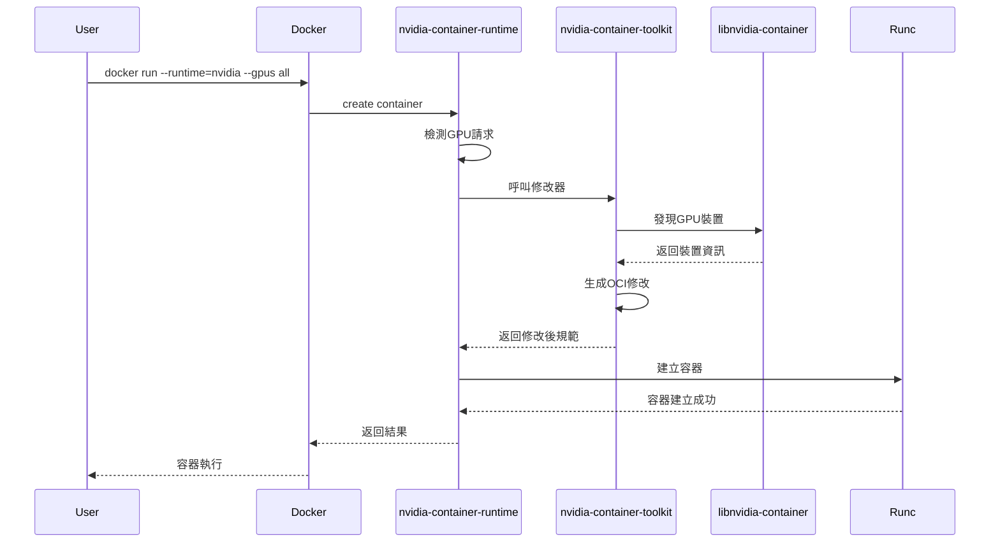

# NVIDIA Container Toolkit 原理分析與程式碼深度解析

> 程式碼地址：<https://github.com/NVIDIA/nvidia-container-toolkit>
>
> 官方文件地址：<https://docs.nvidia.com/datacenter/cloud-native/container-toolkit/latest/index.html>

## 1. 引言與背景

### 1.1 容器化技術與 GPU 計算的融合

隨著人工智慧、機器學習和高效能運算的快速發展，`GPU` 計算已成為現代計算基礎設施的重要組成部分。從深度學習訓練到科學計算，從圖形渲染到加密貨幣挖礦，`GPU` 的平行計算能力為各種計算密集型任務提供了強大的支援。

然而，傳統的容器技術在設計之初並未考慮 `GPU` 等專用硬體的支援。容器技術的核心理念是透過 `Linux` 名稱空間（`namespaces`）和控制組（`cgroups`）實現行程隔離和資源限制，但這些機制主要針對 `CPU`、記憶體、網路等通用資源，對於 `GPU` 這類特殊硬體裝置的管理存在天然的侷限性。

### 1.2 GPU 容器化面臨的技術挑戰

在容器環境中使用 `GPU` 主要面臨以下技術挑戰：

#### 1.2.1 裝置隔離與訪問控制

**挑戰描述**：容器需要安全地訪問 `GPU` 裝置，同時保持與宿主機和其他容器的隔離性。

**技術難點**：

- **`GPU` 裝置檔案（如 `/dev/nvidia0`）的安全掛載**：確保容器只能訪問其分配的 `GPU` 裝置，防止惡意容器訪問宿主機的 `GPU` 資源。
- **裝置許可權的精確控制**：透過 `Linux` 的許可權機制（如 `chmod`、`chown`）精確控制對 `GPU` 裝置檔案的訪問許可權。
- **多容器間的 `GPU` 資源隔離**：透過 `cgroups` 等機制，確保每個容器只能訪問其分配的 `GPU` 資源，防止資源衝突。

#### 1.2.2 驅動程式依賴

**挑戰描述**：`GPU` 應用需要特定版本的驅動程式和執行時庫，這些元件通常安裝在宿主機上。

**技術難點**：

- **驅動程式版本相容性管理**：確保不同容器執行的應用程式與宿主機上安裝的驅動程式版本相容，避免版本衝突導致的執行時錯誤。
- **執行時庫的動態連結**：容器內的應用程式需要能夠動態連結宿主機上的執行時庫，確保在容器環境中正常執行。
- **不同 `CUDA` 版本的共存問題**：在同一個宿主機上安裝多個不同版本的 `CUDA` 驅動程式時，需要解決版本衝突和相容性問題。

#### 1.2.3 資源管理與排程

**挑戰描述**：多個容器之間的 `GPU` 資源分配和排程需要精確的管理機制。

**技術難點**：

- **`GPU` 記憶體的分配與回收**：每個容器只能訪問其分配的 `GPU` 記憶體，防止資源衝突。
- **計算資源的公平排程**：確保所有容器都能獲得公平的 `GPU` 資源分配，避免資源浪費。
- **`GPU` 利用率的監控與最佳化**：實時監控 `GPU` 利用率，動態調整資源分配，提高資源利用率。

#### 1.2.4 相容性問題

**挑戰描述**：不同容器執行時和編排系統對 `GPU` 支援的差異性。

**技術難點**：

- **`Docker`、`containerd`、`CRI-O` 等執行時的適配**：確保 `NVIDIA Container Toolkit` 能夠與不同的容器執行時（如 `Docker`、`containerd`、`CRI-O`）無縫整合，提供一致的 `GPU` 支持。
- **`Kubernetes` 等編排系統的整合**：透過 `CDI` (Container Device Interface) 規範，實現與不同編排系統（如 `Kubernetes`）的深度集成，確保容器能夠正確發現和使用 `GPU` 裝置。
- **`OCI` 規範的擴展與相容**：符合 `OCI` (`Open Container Initiative`) 規範，確保容器映象的可移植性和相容性，避免因規範不相容導致的執行時錯誤。
- **`CDI` 規範的實現**：`NVIDIA Container Toolkit` 采用 `CDI` 規範，與 `Kubernetes` 等編排系統無縫整合，提供一致的 `GPU` 支持。
- **`MIG` (Multi-Instance GPU) 支持**：`NVIDIA Container Toolkit` 支持 `MIG` 裝置，實現多實例 `GPU` 的容器化部署。

#### 1.2.5 效能開銷

**挑戰描述**：容器化可能引入的效能損失需要最小化。

**技術難點**：

- **`GPU` 裝置訪問的延遲最佳化**：透過 `PCIe` 直接訪問 `GPU`，減少 `CPU` 到 `GPU` 的通訊延遲。
- **記憶體複製開銷的減少**：利用 `GPU` 的記憶體複製引擎，減少資料在 `CPU` 和 `GPU` 之間的複製開銷。
- **系統呼叫的最佳化**：透過 `NVIDIA Container Toolkit` 提供的 `OCI` 執行時 Shim，減少容器啟動時的系統呼叫次數。

### 1.3 NVIDIA Container Toolkit 的誕生

#### 1.3.1 发展历程

`NVIDIA Container Toolkit` 的發展經歷了多個階段：

1. **nvidia-docker v1 (2016)**：最初的解決方案，透過包裝 `Docker` 命令實現 `GPU` 支持
2. **nvidia-docker v2 (2018)**：引入 `nvidia-container-runtime`，實現了與 `Docker` 的深度集成
3. **`NVIDIA Container Toolkit` (2019-至今)**：統一的工具集，支援多種容器執行時和編排系統

#### 1.3.2 設計理念

`NVIDIA Container Toolkit` 採用以下設計理念：

**標準化**：基於 `OCI` (Open Container Initiative) 規範，確保與各種容器執行時的相容性。

**模組化**：採用分層架構，各元件職責明確，便於維護和擴展。

**透明性**：對使用者和應用程式透明，無需修改現有程式碼即可在容器中使用 `GPU`。

**安全性**：嚴格的許可權控制和裝置隔離，確保容器安全。

#### 1.3.3 核心價值

`NVIDIA Container Toolkit` 為容器化 `GPU` 計算提供了以下核心價值：

1. **簡化部署**：一鍵式安裝和配置，降低部署複雜度
2. **提高可移植性**：容器映象可在不同環境間無縫遷移
3. **增強安全性**：細粒度的許可權控制和資源隔離
4. **最佳化效能**：接近原生的 `GPU` 效能表現
5. **生態相容**：與主流容器技術棧的深度整合

### 1.4 技術架構預覽

`NVIDIA Container Toolkit` 採用分層架構設計，從底層到上層包括：

- **硬體抽象層**：`libnvidia-container` 提供底層 `GPU` 裝置管理
- **執行時整合層**：`nvidia-container-runtime` 實現與 `OCI` 執行時的整合
- **工具鏈層**：`nvidia-ctk` 等工具提供配置管理和裝置發現功能
- **介面標準層**：支持 `CDI` 等標準化裝置介面

這種架構設計確保了系統的可擴展性、可維護性和跨平台相容性，為容器化 `GPU` 計算提供了堅實的技術基礎。

---

## 2. NVIDIA Container Toolkit架構概覽

### 2.1 整體架構設計

`NVIDIA Container Toolkit` 採用分層架構設計，主要包含以下核心元件：

```text
┌─────────────────────────────────────────────────────────────┐
│                    Container Runtime                        │
│                   (Docker/containerd)                       │
├─────────────────────────────────────────────────────────────┤
│                nvidia-container-runtime                     │
│                    (OCI Runtime Shim)                       │
├─────────────────────────────────────────────────────────────┤
│                nvidia-container-toolkit                     │
│                    (Hook & Modifier)                        │
├─────────────────────────────────────────────────────────────┤
│                  libnvidia-container                        │
│                   (Core Library)                            │
├─────────────────────────────────────────────────────────────┤
│                    GPU Hardware                             │
└─────────────────────────────────────────────────────────────┘
```

### 2.2 核心元件功能概述

根據官方文件和程式碼結構，`NVIDIA Container Toolkit` 包含以下核心元件：

1. **nvidia-container-runtime**：`OCI` 相容的執行時 `shim`，負責攔截和修改容器建立請求
2. **nvidia-ctk** (v1.10.0+)：NVIDIA Container Toolkit CLI，提供配置管理和 `CDI` 規範生成功能（版本號核對日 2026-11-05，官方 changelog 口徑）
3. **nvidia-cdi-hook**：`CDI` 鉤子程式，處理 `CDI` 規範的執行時鉤子操作
4. **nvidia-container-runtime-hook**：傳統執行時鉤子，用於 `Legacy` 模式的容器修改
5. **nvidia-container-cli**：容器 CLI 工具，由 `libnvidia-container` 提供
6. **libnvidia-container1**：底層 `C` 庫，負責 `GPU` 裝置的發現和管理

> **元件說明**：
>
> - **nvidia-container-toolkit**：這是整個工具包的名稱，而非單獨的可執行檔案
> - **nvidia-ctk**：實際的命令列工具可執行檔案
> - **nvidia-cdi-hook**：專門處理 `CDI` 規範的鉤子程式
> - **nvidia-container-runtime-hook**：傳統的執行時鉤子程式
>
> **版本演進**（依據官方 changelog，核對日 2026-11-05）：
>
> - **v1.10.0-rc.1 起**：`nvidia-ctk` CLI 被收進安裝包（changelog 條目 "Include nvidia-ctk CLI in installed binaries"）
> - **v1.12.0 起**：提供 `CDI` 規範生成能力（初版為 `nvidia-ctk info generate-cdi`，rc.2 起定名 `nvidia-ctk cdi generate`）
> - **v1.16.0-rc.1 起**：`nvidia-ctk hook` 子命令遷移為獨立的 `nvidia-cdi-hook` 程序

### 2.3 包管理與依賴關係

#### 2.3.1 主要軟體包

根據程式碼中的包管理配置，`NVIDIA Container Toolkit` 主要包含以下軟體包：

- **nvidia-container-toolkit**：主包，包含所有核心功能和可執行檔案
- **nvidia-container-toolkit-base**：基礎包，包含執行時和 CLI 工具的最小集合
- **nvidia-container-toolkit-operator-extensions**：操作員擴展包（通常不发布）
- **libnvidia-container-tools**：工具包，包含 `nvidia-container-cli`
- **libnvidia-container1**：核心庫包，提供底層 C 庫

#### 2.3.2 包依賴關係

```text
├─ nvidia-container-toolkit (version)
│  ├─ libnvidia-container-tools (>= version)
│  └─ nvidia-container-toolkit-base (version)
│     ├─ libnvidia-container-tools (version)
│     └─ libnvidia-container1 (>= version)
└─ libnvidia-container1 (version)
```

**依賴關係說明**：

- **nvidia-container-toolkit**：完整安裝包，適用於所有使用場景
- **nvidia-container-toolkit-base**：最小安裝包，適用於僅使用 `CDI` 的環境
- **libnvidia-container-tools**：提供 `nvidia-container-cli` 命令行工具
- **libnvidia-container1**：核心庫，所有其他元件的基礎依賴

#### 2.3.3 廢棄包說明

> **重要提示**：以下包已被廢棄，功能已合併到`nvidia-container-toolkit`包中：
>
> - **nvidia-docker2**：已廢棄，功能合併到主包
> - **nvidia-container-runtime**：作為獨立包已廢棄，現在是`nvidia-container-toolkit`的一部分
> - **nvidia-container-runtime-hook**：作為獨立包已廢棄，現在包含在主包中
>
> 這些包可能仍然可用以確保向後相容性，但建議使用`nvidia-container-toolkit`包。
>
> **注意**：`nvidia-container-runtime`和`nvidia-container-runtime-hook`仍然作為可執行檔案存在於`nvidia-container-toolkit`包中。

#### 2.3.4 安裝建議

**推薦安裝方式**：

```bash
# 完整安裝（推薦）
sudo apt-get install nvidia-container-toolkit

# 最小安裝（僅CDI場景）
sudo apt-get install nvidia-container-toolkit-base
```

**包選擇指南**：

- **完整功能需求**：安裝`nvidia-container-toolkit`
- **僅CDI使用**：安裝`nvidia-container-toolkit-base`
- **開發除錯**：安裝`libnvidia-container-tools`

### 2.4 工作流程概述

當容器執行時建立一個需要GPU訪問的容器時，`NVIDIA Container Toolkit`的工作流程如下：

1. **容器執行時呼叫**：容器引擎 (Docker/containerd) 呼叫 `nvidia-container-runtime`
2. **請求攔截與分析**：`nvidia-container-runtime` 檢測到容器建立請求，解析 `GPU` 需求
3. **裝置發現**：透過 `libnvidia-container` 和 `NVML` 介面發現可用的 `GPU` 裝置
4. **資源收集**：收集必要的裝置檔案、庫檔案和驅動程式依賴
5. **OCI 規範修改**：生成相應的 `OCI` 規範修改，包括裝置掛載、環境變數等
6. **執行時傳遞**：將修改後的規範傳遞給底層執行時（如 `runc`）

```text
Docker/containerd → nvidia-container-runtime → nvidia-container-toolkit
                                                        ↓
                    runc ← OCI Spec (Modified) ← libnvidia-container
```

> **詳細執行流程**：第四章提供了完整的 `docker run --runtime=nvidia --gpus all` 執行示例，包含7個詳細步驟的原始碼分析和元件互動時序圖。

---

## 3. 核心元件深度解析

### 3.1 libnvidia-container1：底層裝置管理

#### 3.1.1 架構設計與職責

`libnvidia-container1`（庫包名）是整個工具鏈的基礎元件，采用 C 語言實現，提供了 `GPU` **裝置發現**、**驅動程式管理**和**容器環境配置**的核心功能。該庫透過 `libnvidia-container-tools` 包提供 `nvidia-container-cli` 命令行工具。

#### 3.1.2 裝置發現機制

`libnvidia-container` 透過以下方式發現 `GPU` 裝置：

1. **NVML 介面呼叫**：使用 `NVIDIA Management Library` 獲取 `GPU` 信息
2. **裝置檔案掃描**：掃描 `/dev` 目錄下的 `GPU` 裝置檔案
3. **驅動程式檢測**：檢測已安裝的 `NVIDIA` 驅動程式版本

#### 3.1.3 關鍵資料結構

```c
struct nvc_context {
    struct error err;
    struct nvc_config cfg;
    struct nvc_driver_info drv;
    struct nvc_device_info dev;
};

struct nvc_container {
    char *rootfs;
    char *bins_dir;
    char *libs_dir;
    uid_t uid;
    gid_t gid;
};
```

### 3.2 nvidia-container-runtime：OCI執行時整合

#### 3.2.1 OCI規範相容性

`nvidia-container-runtime` 作為 `OCI` 相容的執行時 `shim`，實現了完整的 `OCI Runtime Specification`。其核心程式碼結構如下：

```go
// internal/oci/runtime.go
type Runtime interface {
    Exec([]string) error
    String() string
}

type modifyingRuntimeWrapper struct {
    logger   logger.Interface
    runtime  Runtime
    modifier oci.SpecModifier
}
```

#### 3.2.2 執行時修改機制

當檢測到容器建立請求時，`nvidia-container-runtime`會執行以下操作：

```go
// internal/oci/runtime_modifier.go
func (r modifyingRuntimeWrapper) Exec(args []string) error {
    if len(args) == 0 {
        return fmt.Errorf("no arguments specified")
    }

    // 檢測是否為create命令
    if args[0] == "create" {
        return r.modifyAndExec(args)
    }

    // 其他命令直接傳遞給底層執行時
    return r.runtime.Exec(args)
}
```

#### 3.2.3 配置管理

`nvidia-container-runtime`透過配置檔案`/etc/nvidia-container-runtime/config.toml`進行配置管理：

```go
// internal/config/config.go
type Config struct {
    DisableRequire                 bool   `toml:"disable-require"`
    SwarmResource                  string `toml:"swarm-resource"`
    AcceptEnvvarUnprivileged       bool   `toml:"accept-nvidia-visible-devices-envvar-when-unprivileged"`
    AcceptDeviceListAsVolumeMounts bool   `toml:"accept-nvidia-visible-devices-as-volume-mounts"`
    SupportedDriverCapabilities    string `toml:"supported-driver-capabilities"`

    NVIDIAContainerCLIConfig         ContainerCLIConfig `toml:"nvidia-container-cli"`
    NVIDIACTKConfig                  CTKConfig          `toml:"nvidia-ctk"`
    NVIDIAContainerRuntimeConfig     RuntimeConfig      `toml:"nvidia-container-runtime"`
    NVIDIAContainerRuntimeHookConfig RuntimeHookConfig  `toml:"nvidia-container-runtime-hook"`
}
```

### 3.3 Container Device Interface (CDI) 實現

#### 3.3.1 CDI規範概述

`Container Device Interface` (`CDI`) 是一個標準化的介面規範，用於在容器執行時中管理裝置訪問。`NVIDIA Container Toolkit` 透過 `CDI` 規範提供了標準化的 `GPU` 裝置管理。

#### 3.3.2 CDI修改器實現

```go
// internal/modifier/cdi.go
func NewCDIModifier(logger logger.Interface, cfg *config.Config, ociSpec oci.Spec) (oci.SpecModifier, error) {
    devices := getRequestedDevices(ociSpec)

    if len(devices) == 0 {
        return modifier.NewNullModifier(), nil
    }

    registry := cdi.GetRegistry(
        cdi.WithSpecDirs(cfg.NVIDIAContainerRuntimeConfig.Modes.CDI.SpecDirs...),
    )

    return cdi.NewModifier(
        cdi.WithLogger(logger),
        cdi.WithRegistry(registry),
        cdi.WithDevices(devices...),
    ), nil
}
```

#### 3.3.3 CDI規範生成

`nvidia-ctk` 工具提供了 `CDI` 規範生成功能：

```go
// cmd/nvidia-ctk/cdi/cdi.go
func (m command) build() *cli.Command {
    return &cli.Command{
        Name:  "cdi",
        Usage: "Provide tools for interacting with Container Device Interface specifications",
        Subcommands: []*cli.Command{
            m.generateCommand(),
            m.listCommand(),
            m.transformCommand(),
        },
    }
}
```

### 3.4 裝置發現與編輯器系統

#### 3.4.1 發現器介面設計

`NVIDIA Container Toolkit` 採用了靈活的發現器模式，透過統一的介面發現各種類型的資源：

```go
// internal/discover/discover.go
type Discover interface {
    Devices() ([]Device, error)
    Mounts() ([]Mount, error)
    Hooks() ([]Hook, error)
    EnvVars() ([]EnvVar, error)
}
```

#### 3.4.2 複合發現器實現

```go
// internal/discover/list.go
type list []Discover

func Merge(discoverers ...Discover) Discover {
    var l list
    for _, d := range discoverers {
        if d == nil {
            continue
        }
        l = append(l, d)
    }
    return l
}

func (d list) Devices() ([]Device, error) {
    var allDevices []Device
    for i, di := range d {
        devices, err := di.Devices()
        if err != nil {
            return nil, fmt.Errorf("error discovering devices for discoverer %v: %v", i, err)
        }
        allDevices = append(allDevices, devices...)
    }
    return allDevices, nil
}
```

#### 3.4.3 編輯器系統

編輯器系統負責將發現的資源轉換為OCI規範修改：

```go
// internal/edits/edits.go
func FromDiscoverer(d discover.Discover) (*cdi.ContainerEdits, error) {
    devices, err := d.Devices()
    if err != nil {
        return nil, fmt.Errorf("failed to discover devices: %v", err)
    }

    envs, err := d.EnvVars()
    if err != nil {
        return nil, fmt.Errorf("failed to discover environment variables: %w", err)
    }

    mounts, err := d.Mounts()
    if err != nil {
        return nil, fmt.Errorf("failed to discover mounts: %v", err)
    }

    hooks, err := d.Hooks()
    if err != nil {
        return nil, fmt.Errorf("failed to discover hooks: %v", err)
    }

    c := NewContainerEdits()
    // 處理各種資源類型...
    return c, nil
}
```

---

## 4. 工作流程詳細分析

### 4.1 完整執行流程示例

為了更好地理解`NVIDIA Container Toolkit`的工作原理，我們透過一個完整的`docker run`例子來闡述整個執行過程。

#### 4.1.1 示例命令

GPU 注入有兩條互斥的入口路徑，下面分開演示，不要在生產環境混用（兩者同時指定時的組合行為官方文件沒有說明）：

```bash
# 路徑一：--gpus（Docker 19.03+ 語法，由 Docker 在構建容器 spec 時寫入 NVIDIA_VISIBLE_DEVICES）
docker run --runtime=nvidia --gpus all \
  nvidia/cuda:11.8-runtime-ubuntu20.04 nvidia-smi
```

```bash
# 路徑二：runtime 注入路徑，直接透過環境變數宣告可見裝置
docker run --runtime=nvidia -e NVIDIA_VISIBLE_DEVICES=0,1 \
  nvidia/cuda:11.8-runtime-ubuntu20.04 nvidia-smi
```

#### 4.1.2 執行流程詳細分析

**步驟1：Docker 守護行程接收請求**:

當使用者執行上述命令時，`Docker` 守護行程首先解析命令參數：

- `--runtime=nvidia`：指定使用 `nvidia` 容器執行時
- 路徑一的 `--gpus all`：請求所有可用 `GPU` (`Docker` 19.03+ 語法)，由 Docker 轉成對 GPU 的注入指令
- 路徑二的 `-e NVIDIA_VISIBLE_DEVICES=0,1`：環境變數指定使用 `GPU 0` 和 `1`

**步驟2：呼叫 nvidia-container-runtime**:

`Docker` 守護行程呼叫 `nvidia-container-runtime` 而不是預設的 `runc`：

```go
// cmd/nvidia-container-runtime/main.go
func main() {
    logger := logrus.New()

    // 建立執行時包裝器
    runtime, err := oci.NewModifyingRuntimeWrapper(
        logger,
        cfg,
        argv,
    )
    if err != nil {
        logger.Errorf("Failed to create runtime wrapper: %v", err)
        os.Exit(1)
    }

    // 執行執行時命令
    err = runtime.Exec(argv)
    if err != nil {
        logger.Errorf("Runtime execution failed: %v", err)
        os.Exit(1)
    }
}
```

**步驟3：OCI 規範修改**:

`nvidia-container-runtime` 檢測到這是一個 `create` 命令，開始修改 `OCI` 規範：

```go
// internal/oci/runtime_modifier.go
func (r modifyingRuntimeWrapper) modifyAndExec(args []string) error {
    // 解析OCI規範
    spec, err := r.loadSpec(bundlePath)
    if err != nil {
        return fmt.Errorf("failed to load OCI spec: %v", err)
    }

    // 應用修改器
    err = r.modifier.Modify(spec)
    if err != nil {
        return fmt.Errorf("failed to modify OCI spec: %v", err)
    }

    // 儲存修改後的規範
    err = r.saveSpec(bundlePath, spec)
    if err != nil {
        return fmt.Errorf("failed to save modified spec: %v", err)
    }

    // 呼叫底層執行時
    return r.runtime.Exec(args)
}
```

**步驟4：裝置發現與資源收集**:

系統透過 `libnvidia-container` 發現 `GPU` 裝置和相關資源：

```go
// internal/discover/devices.go
func (d *gpuDeviceDiscoverer) Devices() ([]Device, error) {
    // 使用NVML庫發現GPU裝置
    nvmlLib := nvml.New()
    if ret := nvmlLib.Init(); ret != nvml.SUCCESS {
        return nil, fmt.Errorf("failed to initialize NVML: %v", ret)
    }
    defer nvmlLib.Shutdown()

    // 獲取GPU數量
    count, ret := nvmlLib.DeviceGetCount()
    if ret != nvml.SUCCESS {
        return nil, fmt.Errorf("failed to get device count: %v", ret)
    }

    var devices []Device
    for i := 0; i < count; i++ {
        device, ret := nvmlLib.DeviceGetHandleByIndex(i)
        if ret != nvml.SUCCESS {
            continue
        }

        // 建立裝置條目
        deviceNode := fmt.Sprintf("/dev/nvidia%d", i)
        devices = append(devices, Device{
            HostPath:      deviceNode,
            ContainerPath: deviceNode,
            Permissions:   "rwm",
        })
    }

    return devices, nil
}
```

**步驟5：庫檔案和依賴發現**:

系統發現並收集必要的庫檔案：

```go
// internal/discover/libraries.go
func (d *libraryDiscoverer) Mounts() ([]Mount, error) {
    // 發現CUDA執行時庫
    libraries := []string{
        "libcuda.so.1",
        "libnvidia-ml.so.1",
        "libcudart.so.11.0",
        "libcublas.so.11",
        // ... 更多庫檔案
    }

    var mounts []Mount
    for _, lib := range libraries {
        hostPath, err := d.locateLibrary(lib)
        if err != nil {
            continue
        }

        mounts = append(mounts, Mount{
            HostPath:      hostPath,
            ContainerPath: hostPath,
            Options:       []string{"ro", "nosuid", "nodev", "bind"},
        })
    }

    return mounts, nil
}
```

**步驟6：OCI 規範更新**:

收集到的資源被新增到 `OCI` 規範中：

```json
{
  "ociVersion": "1.0.2",
  "process": {
    "env": [
      "NVIDIA_VISIBLE_DEVICES=0,1",
      "NVIDIA_DRIVER_CAPABILITIES=compute,utility"
    ]
  },
  "linux": {
    "devices": [
      {
        "path": "/dev/nvidia0",
        "type": "c",
        "major": 195,
        "minor": 0,
        "fileMode": 438,
        "uid": 0,
        "gid": 0
      },
      {
        "path": "/dev/nvidia1",
        "type": "c",
        "major": 195,
        "minor": 1,
        "fileMode": 438,
        "uid": 0,
        "gid": 0
      },
      {
        "path": "/dev/nvidiactl",
        "type": "c",
        "major": 195,
        "minor": 255,
        "fileMode": 438,
        "uid": 0,
        "gid": 0
      }
    ],
    "mounts": [
      {
        "destination": "/usr/lib/x86_64-linux-gnu/libcuda.so.1",
        "source": "/usr/lib/x86_64-linux-gnu/libcuda.so.1",
        "type": "bind",
        "options": ["ro", "nosuid", "nodev", "bind"]
      }
    ]
  }
}
```

**步驟7：容器建立與啟動**:

修改后的 `OCI` 規範被傳遞給底層執行時 (`runc`)，容器被建立並啟動。容器內的 `nvidia-smi` 命令可以正常訪問 `GPU` 裝置。

#### 4.1.3 執行時序圖



### 4.2 容器啟動流程

#### 4.2.1 環境變數檢測

當容器啟動時，`nvidia-container-runtime`首先檢查環境變數`NVIDIA_VISIBLE_DEVICES`：

```bash
# 指定特定GPU
NVIDIA_VISIBLE_DEVICES=0,1

# 使用所有GPU
NVIDIA_VISIBLE_DEVICES=all

# 禁用GPU
NVIDIA_VISIBLE_DEVICES=void
```

#### 4.2.2 OCI規範修改流程

1. **規範解析**：解析原始`OCI`規範
2. **裝置發現**：透過`libnvidia-container`發現可用`GPU`裝置
3. **許可權檢查**：驗證容器是否有許可權訪問指定裝置
4. **規範修改**：新增裝置掛載、環境變數和鉤子
5. **規範驗證**：確保修改後的規範符合`OCI`標準

#### 4.2.3 裝置掛載策略

```bash
# internal/discover/devices.go - 裝置檔案掛載對映
/dev/nvidia0 -> /dev/nvidia0
/dev/nvidiactl -> /dev/nvidiactl
/dev/nvidia-uvm -> /dev/nvidia-uvm

# internal/discover/libraries.go - 庫檔案掛載對映
/usr/lib/x86_64-linux-gnu/libcuda.so.1 -> /usr/lib/x86_64-linux-gnu/libcuda.so.1
/usr/lib/x86_64-linux-gnu/libnvidia-ml.so.1 -> /usr/lib/x86_64-linux-gnu/libnvidia-ml.so.1
```

### 4.3 執行時模式深度分析

`NVIDIA Container Toolkit` 支援多種執行時模式，每種模式針對不同的使用場景和硬體平台進行了最佳化。

#### 4.3.1 Legacy 模式 (v1.0.0+)

**概述**：`Legacy` 模式是傳統的 `GPU` 容器化方式，基於 `nvidia-docker v1` 的設計理念，透過 `nvidia-container-runtime-hook` 實現 `GPU` 資源的注入。

> **版本演進**：
>
> - **v1.0.0+**：引入基礎 `Legacy` 模式，兼容 `nvidia-docker v1` 架構
> - **v1.2.0+**：增強環境變數處理和錯誤恢復機制
> - **v1.4.0+**：最佳化 `Hook` 執行效能和裝置發現邏輯
> - **v1.6.0+**：改進 `CUDA` 相容性處理和庫檔案管理

**配置方式**：

```toml
[nvidia-container-runtime]
mode = "legacy"

[nvidia-container-runtime.modes.legacy]
cuda-compat-mode = "auto"
```

**工作原理**：

1. **環境變數驅動**：主要依賴 `NVIDIA_VISIBLE_DEVICES` 等環境變數
2. **執行時鉤子**：透過 `OCI` 執行時鉤子在容器啟動時注入 `GPU` 資源
3. **動態發現**：使用 `NVML` 庫動態發現和管理 `GPU` 裝置

**核心實現**：

```go
// Legacy 模式的裝置發現
func (l *legacyRuntime) discoverDevices() error {
    devices := os.Getenv("NVIDIA_VISIBLE_DEVICES")
    if devices == "" || devices == "void" {
        return nil
    }

    // 透過 NVML 發現 GPU 裝置
    return l.nvmlLib.Init()
}
```

**適用場景**：

- 傳統的 `Docker` 環境
- 需要與 `nvidia-docker v1` 相容的場景
- 簡單的 `GPU` 容器化需求

#### 4.3.2 CDI 模式 (v1.12.0+)

**概述**：`CDI` (`Container Device Interface`) 模式是基於 `CNCF` 標準的現代化裝置管理方式，提供了標準化、可擴展的裝置介面。

> **版本要求**：`NVIDIA Container Toolkit` v1.12.0+ 開始支援 `CDI` 規範生成

**容器執行時支援版本**：

_Docker 支援情況：_

- **開始支援版本：** Docker 25.0.0
- **預設啟用版本：** Docker 28.2.0
- **手動啟用配置 (25.0.0-28.1.1)：**

  ```json
  {
    "features": {
      "cdi": true
    }
  }
  ```

_containerd 支援情況：_

- 透過 `CRI` 插件配置支持 `CDI`
- **containerd 1.x 配置：**

```toml
version = 2
[plugins."io.containerd.grpc.v1.cri"]
  enable_cdi = true
  cdi_spec_dirs = ["/etc/cdi", "/var/run/cdi"]
```

- **containerd 2.x 配置：**

  ```toml
  version = 3
  [plugins.'io.containerd.cri.v1.runtime']
    enable_cdi = true
    cdi_spec_dirs = ["/etc/cdi", "/var/run/cdi"]
  ```

_其他執行時：_

- **CRI-O：** 預設啟用 `CDI` 支持
- **Podman：** v4.1.0+ 完整支持，無需特殊配置

**NVIDIA Container Toolkit 配置**：

```toml
[nvidia-container-runtime]
mode = "cdi"

[nvidia-container-runtime.modes.cdi]
default-kind = "nvidia.com/gpu"
annotation-prefixes = ["cdi.k8s.io/"]
spec-dirs = ["/etc/cdi", "/var/run/cdi"]
```

**CDI 規範生成與配置**：

**1. 生成 CDI 規範檔案**：

```bash
# 基礎生成命令
sudo nvidia-ctk cdi generate --output=/etc/cdi/nvidia.yaml

# 指定裝置命名策略
sudo nvidia-ctk cdi generate \
  --device-name-strategy=index,uuid \
  --output=/etc/cdi/nvidia.yaml

# 自動檢測模式 (推薦)
sudo nvidia-ctk cdi generate \
  --mode=auto \
  --output=/etc/cdi/nvidia.yaml

# 指定庫搜尋路徑
sudo nvidia-ctk cdi generate \
  --library-search-paths=/usr/lib/x86_64-linux-gnu \
  --output=/etc/cdi/nvidia.yaml
```

**2. 查看可用 CDI 裝置**：

```bash
# 列出所有 CDI 裝置
nvidia-ctk cdi list

# 輸出示例：
# nvidia.com/gpu=0
# nvidia.com/gpu=1
# nvidia.com/gpu=all
```

**3. 配置容器執行時啟用 CDI**：

```bash
# Docker 配置
sudo nvidia-ctk runtime configure --runtime=docker --cdi.enabled

# containerd 配置
sudo nvidia-ctk runtime configure --runtime=containerd --cdi.enabled

# 重啟服務
sudo systemctl restart docker
sudo systemctl restart containerd
```

**4. 使用 CDI 執行容器**：

```bash
# Docker (25.0.0+)
docker run --rm --device=nvidia.com/gpu=0 ubuntu nvidia-smi

# Podman
podman run --rm --device=nvidia.com/gpu=0 ubuntu nvidia-smi

# 使用所有 GPU
docker run --rm --device=nvidia.com/gpu=all ubuntu nvidia-smi
```

**5. 高階配置選項**：

```bash
# 指定 vendor 和 class
sudo nvidia-ctk cdi generate \
  --vendor=nvidia.com \
  --class=gpu \
  --output=/etc/cdi/nvidia.yaml

# 指定配置搜尋路徑
sudo nvidia-ctk cdi generate \
  --config-search-path=/etc/nvidia-container-runtime \
  --output=/etc/cdi/nvidia.yaml

# CSV模式下的CDI生成
sudo nvidia-ctk cdi generate \
  --mode=csv \
  --csv.mount-spec-path=/etc/nvidia-container-runtime/host-files-for-container.d \
  --output=/etc/cdi/nvidia.yaml
```

**6. 自動重新整理CDI規範**：

```bash
# 啟用systemd服務自動重新整理
sudo systemctl enable nvidia-cdi-refresh.service
sudo systemctl start nvidia-cdi-refresh.service

# 手動重新整理
sudo systemctl restart nvidia-cdi-refresh.service
```

**工作原理**：

1. **規範化介面**：使用標準的`CDI`規範定義裝置資訊
2. **宣告式配置**：透過`YAML/JSON`檔案宣告裝置規範
3. **執行時無關**：與具體的容器執行時解耦

**CDI規範示例**：

```yaml
cdiVersion: "0.5.0"
kind: "nvidia.com/gpu"
devices:
  - name: "0"
    containerEdits:
      deviceNodes:
        - path: "/dev/nvidia0"
          type: "c"
          major: 195
          minor: 0
      mounts:
        - hostPath: "/usr/lib/x86_64-linux-gnu/libcuda.so.1"
          containerPath: "/usr/lib/x86_64-linux-gnu/libcuda.so.1"
      env:
        - "NVIDIA_VISIBLE_DEVICES=0"
```

**核心實現**：

```go
// CDI模式的修改器建立
func NewCDIModifier(logger logger.Interface, cfg *config.Config, ociSpec oci.Spec) (oci.SpecModifier, error) {
    devices := getRequestedDevices(ociSpec)

    registry := cdi.GetRegistry(
        cdi.WithSpecDirs(cfg.NVIDIAContainerRuntimeConfig.Modes.CDI.SpecDirs...),
    )

    return cdi.NewModifier(
        cdi.WithLogger(logger),
        cdi.WithRegistry(registry),
        cdi.WithDevices(devices...),
    ), nil
}
```

**適用場景**：

- `Kubernetes` 等現代容器編排系統
- 需要標準化裝置管理的環境
- 多廠商裝置混合部署
- 雲原生應用

#### 4.3.3 CSV 模式 (v1.0.0+)

**概述**：`CSV` (`Comma-Separated Values`) 模式專為 `Tegra/Jetson` 等嵌入式 `GPU` 系統設計，透過 `CSV` 檔案靜態定義裝置掛載規範。

**版本演進：**

- **v1.0.0+**: 引入基礎 `CSV` 檔案解析和掛載功能
- **v1.3.0+**: 增強 `CSV` 檔案格式支援和錯誤處理
- **v1.6.0+**: 最佳化 `Tegra` 平台兼容性和性能
- **v1.10.0+**: 支援自定義 `CSV` 檔案路徑和動態載入

**配置方式**：

```toml
[nvidia-container-runtime]
mode = "csv"

[nvidia-container-runtime.modes.csv]
mount-spec-path = "/etc/nvidia-container-runtime/host-files-for-container.d"
```

**工作原理**：

1. **靜態配置**：透過 `CSV` 檔案預定義裝置和庫檔案掛載
2. **檔案驅動**：解析 `CSV` 檔案生成掛載規範
3. **平台特化**：針對 `Tegra` 平台的特殊需求最佳化

**CSV 文件格式**：

```csv
# 裝置類型, 路徑
dev, nvidiactl
dev, nvhost-gpu
dev, nvhost-ctrl
dev, nvmap
dir, /usr/lib/aarch64-linux-gnu/tegra-egl
dir, /usr/local/cuda
lib, /usr/lib/aarch64-linux-gnu/tegra/libnvidia-eglcore.so.32.1.0
lib, /usr/lib/aarch64-linux-gnu/tegra/libnvrm.so
sym, /usr/lib/aarch64-linux-gnu/libcuda.so
```

**支援的掛載類型**：

- **`dev`**: 字元裝置檔案（如`/dev/nvidia0`）
- **`lib`**: 庫檔案或常規檔案
- **`dir`**: 目錄掛載
- **`sym`**: 符號連結

**核心實現**：

```go
// CSV模式的掛載規範解析
func NewMountSpecFromLine(line string) (*MountSpec, error) {
    parts := strings.SplitN(strings.TrimSpace(line), ",", 2)
    if len(parts) < 2 {
        return nil, fmt.Errorf("failed to parse line: %v", line)
    }

    mountType := strings.TrimSpace(parts[0])
    path := strings.TrimSpace(parts[1])

    return NewMountSpec(mountType, path)
}
```

**預設CSV文件**：

- **`devices.csv`**: 包含`GPU`裝置節點定義
- **`drivers.csv`**: 驅動程式相關檔案
- **`l4t.csv`**: `Linux for Tegra`元件

**環境變數控制**：

```bash
# 預設載入基礎檔案：devices.csv, drivers.csv, l4t.csv
# 注：網上流傳的 NVIDIA_REQUIRE_JETPACK=csv-mounts=all 寫法未在官方文件核實到出處，使用前請以 CSV Mode 官方說明為準
```

**適用場景**：

- `Tegra/Jetson`嵌入式裝置
- 無`NVML`支持的`ARM`平台
- 邊緣計算和`IoT`應用
- 資源受限的嵌入式環境

### 4.4 執行時模式對比分析

#### 4.4.1 功能特性對比

| 特性             | `Legacy` 模式      | `CDI` 模式       | `CSV` 模式           |
| ---------------- | ------------------ | ---------------- | -------------------- |
| **裝置發現方式** | 動態 `NVML` 查詢   | 動態 `CDI` 規範  | 靜態 `CSV` 文件      |
| **配置方式**     | 環境變數           | `CDI` 規範檔案   | `CSV` 文件           |
| **平台支持**     | `x86_64` `GPU`     | 通用平台         | `Tegra/ARM`          |
| **標準化程度**   | 低 (`NVIDIA` 專有) | 高 (`CNCF` 標準) | 中等 (檔案格式標準)  |
| **執行時依賴**   | `NVML` 庫          | `CDI` 執行時     | 檔案系統             |
| **動態性**       | 高                 | 高               | 低（靜態配置）       |
| **複雜度**       | 中等               | 高               | 低                   |
| **效能開銷**     | 中等               | 低               | 最低                 |

#### 4.4.2 適用場景分析

**Legacy模式適用場景**：

- **傳統Docker環境**：已有的`nvidia-docker`部署
- **簡單GPU應用**：單機`GPU`容器化需求
- **快速遷移**：從`nvidia-docker` v1升級
- **開發測試**：本地開發環境

**CDI模式適用場景**：

- **Kubernetes叢集**：云原生`GPU`工作負載
- **多廠商環境**：混合`GPU/加速器`部署
- **標準化需求**：需要符合`CNCF`標準
- **大規模部署**：企業級容器平台
- **裝置管理複雜**：需要精細的裝置控制

**CSV模式適用場景**：

- **嵌入式系統**：`Tegra/Jetson`等`ARM`裝置
- **邊緣計算**：資源受限環境
- **離線部署**：無網路連線的環境
- **靜態配置**：裝置配置固定的場景
- **IoT應用**：物聯網`GPU`應用

#### 4.4.3 效能與資源消耗對比

```text
資源消耗（從低到高）：
`CSV` 模式 < `CDI` 模式 < `Legacy` 模式

啟動速度（從快到慢）：
`CSV` 模式 > `CDI` 模式 > `Legacy` 模式

靈活性（從低到高）：
`CSV` 模式 < `Legacy` 模式 < `CDI` 模式

標準化程度（從低到高）：
`Legacy` 模式 < `CSV` 模式 < `CDI` 模式
```

#### 4.4.4 模式選擇建議

**選擇 Legacy 模式的情況**：

- 現有 `nvidia-docker` 部署需要平滑升級
- 簡單的單機 `GPU` 容器化需求
- 對標準化要求不高的場景

**選擇 CDI 模式的情況**：

- 新建的 `Kubernetes GPU` 叢集
- 需要與其他廠商裝置整合
- 要求符合 `CNCF` 標準
- 大規模生產環境部署

**選擇 CSV 模式的情況**：

- `Tegra/Jetson` 等 `ARM` 嵌入式裝置
- 邊緣計算和 `IoT` 應用
- 資源受限的環境
- 靜態裝置配置場景

**Auto 模式 (自動選擇) (v1.8.0+)**：

```toml
[nvidia-container-runtime]
mode = "auto"
```

> **版本演進**：
>
> - **v1.8.0+**：引入 `Auto` 模式自動選擇機制
> - **v1.10.0+**：增強平台檢測和模式選擇邏輯
> - **v1.12.0+**：最佳化 `CDI` 規範檔案檢測和驗證
> - **v1.15.0+**：改進 `Tegra` 平台識別和相容性處理

`Auto` 模式會根據系統環境自動選擇最適合的模式：

- 檢測到 `Tegra` 系統且無 `NVML` → `CSV` 模式
- 檢測到 `CDI` 規範檔案 → `CDI` 模式
- 其他情況 → `Legacy` 模式

### 4.5 錯誤處理與日誌記錄

#### 4.5.1 錯誤處理機制

```go
// internal/oci/runtime_modifier.go
type RuntimeError struct {
    Code    int
    Message string
    Cause   error
}

func (e *RuntimeError) Error() string {
    if e.Cause != nil {
        return fmt.Sprintf("%s: %v", e.Message, e.Cause)
    }
    return e.Message
}
```

#### 4.5.2 日誌記錄策略

```go
// internal/logger/logger.go
type Interface interface {
    Debugf(string, ...interface{})
    Infof(string, ...interface{})
    Warnf(string, ...interface{})
    Errorf(string, ...interface{})
}
```

---

## 5. OCI Hooks 機制與生命週期管理

### 5.1 OCI Hooks 概述

`OCI` (`Open Container Initiative`) `Hooks` 是容器執行時規範中定義的擴展機制，允許在容器生命週期的特定階段執行自定義操作。`NVIDIA Container Toolkit` 廣泛使用 `Hooks` 機制來實現 `GPU` 裝置的動態注入和配置。

> **版本演進**（依據官方 changelog，核對日 2026-11-05）：
>
> - **v1.16.0-rc.1 起**：`nvidia-ctk hook` 子命令遷移為獨立的 `nvidia-cdi-hook` 程序，子命令保持不變

#### 5.1.1 Hook 類型與執行時機

根據 `OCI` 執行時規範，`Hooks` 分為以下幾種類型，執行時機與容器生命週期操作一一對應：

1. **`prestart`**：在 `create` 操作中執行——執行環境建立之後、使用者行程啟動之前。該 hook 已被規範**棄用**，推薦用 `createRuntime` 替代
2. **`createRuntime`**：同樣在 `create` 操作中、使用者行程啟動之前執行，執行在執行時（runtime）名稱空間；官方推薦以此替代 `prestart`
3. **`createContainer`**：仍在 `create` 操作中執行，但在 `createRuntime` 之后——此時容器行程已建立、使用者程式尚未執行，hook 執行在容器名稱空間內
4. **`startContainer`**：在 `start` 操作中、使用者行程執行之前執行（執行在容器名稱空間內）
5. **`poststart`**：在 `start` 操作中、使用者行程啟動之後、`start` 呼叫返回之前執行
6. **`poststop`**：在 `delete` 操作中、容器刪除之後、`delete` 呼叫返回之前執行

也就是說，`createRuntime`、`prestart`、`createContainer` 三者都发生在 `create` 階段（容器使用者行程啟動之前），而 `startContainer` 发生在 `start` 呼叫時、使用者行程執行之前。`NVIDIA Container Toolkit` 的裝置註入依賴的就是 `create` 階段的這幾個時機。

```go
// pkg/config/ocihook/hooks.go
type specHook struct {
    Path    string   `json:"path"`
    Args    []string `json:"args,omitempty"`
    Env     []string `json:"env,omitempty"`
    Timeout *int     `json:"timeout,omitempty"`
}
```

#### 5.1.2 NVIDIA Container Toolkit 中的 Hook 使用

`NVIDIA Container Toolkit` 主要使用以下 `Hooks`：

- **`prestart` hook**：用於 `Legacy` 模式下的裝置註入
- **`createContainer` hook**：用於 `CDI` 模式下的裝置配置
- **`createRuntime` hook**：用於 `Legacy` 模式下的執行時環境準備

### 5.2 Hook 實現機制

#### 5.2.1 Hook 建立與註冊

```go
// internal/discover/hooks.go
type cdiHookCreator struct {
    logger              logger.Interface
    nvidiaCDIHookPath   string
    requiredArgs        []string
    debugLogging        bool
    disabledHooks       map[HookName]bool
}

// Create creates a new hook with the given name and arguments.
func (c cdiHookCreator) Create(name HookName, args ...string) *Hook {
    if c.isDisabled(name, args...) {
        return nil
    }

    return &Hook{
        Lifecycle: cdi.CreateContainerHook,
        Path:      c.nvidiaCDIHookPath,
        Args:      append(c.requiredArgs(name), c.transformArgs(name, args...)...),
        Env:       []string{fmt.Sprintf("NVIDIA_CTK_DEBUG=%v", c.debugLogging)},
    }
}
```

#### 5.2.2 Hook 執行流程

```go
// internal/modifier/stable.go
type stableRuntimeModifier struct {
    logger                         logger.Interface
    nvidiaContainerRuntimeHookPath string
}

func (m stableRuntimeModifier) Modify(spec *specs.Spec) error {
    // 檢查是否已存在 NVIDIA hook
    for _, hook := range spec.Hooks.Prestart {
        if isNVIDIAContainerRuntimeHook(&hook) {
            m.logger.Info("Existing nvidia-container-runtime hook found in OCI spec")
            return nil
        }
    }

    // 添加 prestart hook
    spec.Hooks.Prestart = append(spec.Hooks.Prestart, specs.Hook{
        Path: m.nvidiaContainerRuntimeHookPath,
        Args: []string{m.nvidiaContainerRuntimeHookPath, "prestart"},
        Env:  os.Environ(),
    })

    return nil
}
```

### 5.3 nvidia-cdi-hook 實現

#### 5.3.1 CDI Hook 架構

`nvidia-cdi-hook` 是專門為 `CDI` 模式設計的 `Hook` 程序，負責在容器建立階段執行裝置相關的配置操作。

`nvidia-cdi-hook` 不是按 hook 階段分發，而是按子命令組織——CDI 規範裡的每個 hook 條目直接指向一個具體子命令。依據 `cmd/nvidia-cdi-hook/README.md`，當前提供的子命令如下：

| 子命令 | 作用 |
| ------ | ---- |
| `create-symlinks` | 在掛載進容器的目錄裡建立符號連結 |
| `update-ldcache` | 更新掛載目錄內的動態連結器快取 |
| `enable-cuda-compat` | 需要時把 CUDA compat 庫目錄加入 ldconfig 搜尋路徑 |
| `disable-device-node-modification` | 確保容器內的 `/proc/driver/nvidia/params` 不允許修改裝置節點 |
| `update-application-profile` | 透過 application profile 更新驅動設定（如 `EGLVisibleDGPUDevices`） |
| `apply-cuda-memory-limits` | 為容器內的 GPU 裝置設定 CUDA 記憶體軟/硬限制 |

> 同一套子命令實現也被 `nvidia-ctk hook` 複用（兩者透過 `ConfigureCDIHookCommand` 共享命令註冊）；執行時若遇到不認識的 hook 子命令，只會打警告不阻斷容器啟動。

#### 5.3.2 符號連結建立

`nvidia-cdi-hook` 的一個重要功能是建立必要的符號連結，確保容器內的應用程式能夠正確訪問 `GPU` 裝置和庫檔案。

```go
// internal/discover/symlinks.go
type symlinkHook struct {
    logger      logger.Interface
    targets     []string
    links       []string
}

func (h symlinkHook) createSymlinks() error {
    for i, target := range h.targets {
        link := h.links[i]

        // 檢查目標檔案是否存在
        if _, err := os.Stat(target); os.IsNotExist(err) {
            h.logger.Warnf("Target file %s does not exist, skipping symlink creation", target)
            continue
        }

        // 建立符號連結
        if err := os.Symlink(target, link); err != nil {
            if !os.IsExist(err) {
                return fmt.Errorf("failed to create symlink %s -> %s: %v", link, target, err)
            }
        }

        h.logger.Debugf("Created symlink: %s -> %s", link, target)
    }

    return nil
}
```

### 5.4 裝置發現與管理機制

#### 5.4.1 NVML 整合與 GPU 裝置發現

`NVIDIA Container Toolkit` 透過 `NVIDIA Management Library (NVML)` 實現 `GPU` 裝置的發現和管理：

```go
// pkg/nvcdi/lib-nvml.go
func (l *nvmllib) GetAllDeviceSpecs() ([]specs.Device, error) {
    nvmlLib := l.nvmllib
    if ret := nvmlLib.Init(); ret != nvml.SUCCESS {
        return nil, fmt.Errorf("failed to initialize NVML: %v", ret)
    }
    defer nvmlLib.Shutdown()

    // 獲取GPU裝置數量
    count, ret := nvmlLib.DeviceGetCount()
    if ret != nvml.SUCCESS {
        return nil, fmt.Errorf("failed to get device count: %v", ret)
    }

    var deviceSpecs []specs.Device
    for i := 0; i < count; i++ {
        device, ret := nvmlLib.DeviceGetHandleByIndex(i)
        if ret != nvml.SUCCESS {
            l.logger.Warnf("Failed to get device handle for index %d: %v", i, ret)
            continue
        }

        // 獲取裝置UUID
        uuid, ret := device.GetUUID()
        if ret != nvml.SUCCESS {
            l.logger.Warnf("Failed to get UUID for device %d: %v", i, ret)
            continue
        }

        // 獲取裝置名稱
        name, ret := device.GetName()
        if ret != nvml.SUCCESS {
            l.logger.Warnf("Failed to get name for device %d: %v", i, ret)
            continue
        }

        deviceSpecs = append(deviceSpecs, specs.Device{
            Name:           fmt.Sprintf("gpu%d", i),
            ContainerEdits: l.getContainerEditsForDevice(device, i),
        })
    }

    return deviceSpecs, nil
}
```

#### 5.4.2 MIG (Multi-Instance GPU) 支持 (v1.5.0+)

`MIG` 技術允許將單個 `GPU` 分割為多個獨立的 `GPU` 實例，`NVIDIA Container Toolkit` 自 v1.5.0 版本開始提供完整的 `MIG` 支持：

**版本演進：**

- **v1.5.0+**: 引入基礎 `MIG` 裝置發現和 `CDI` 規範生成
- **v1.8.0+**: 增強 `MIG` 裝置命名策略和 `UUID` 支持
- **v1.12.0+**: 完善 `MIG` 裝置的 `CDI` 整合和自動發現
- **v1.15.0+**: 最佳化 `MIG` 裝置效能和資源管理

```go
// pkg/nvcdi/lib-nvml.go
func (l *nvmllib) getMIGDeviceSpecs() ([]specs.Device, error) {
    var migDevices []specs.Device

    // 遍历所有GPU裝置
    for i := 0; i < l.deviceCount; i++ {
        device, ret := l.nvmllib.DeviceGetHandleByIndex(i)
        if ret != nvml.SUCCESS {
            continue
        }

        // 檢查是否啟用了 MIG 模式
        migMode, _, ret := device.GetMigMode()
        if ret != nvml.SUCCESS || migMode != nvml.DEVICE_MIG_ENABLE {
            continue
        }

        // 獲取 MIG 裝置實例
        migDeviceCount, ret := device.GetMaxMigDeviceCount()
        if ret != nvml.SUCCESS {
            continue
        }

        for j := 0; j < migDeviceCount; j++ {
            migDevice, ret := device.GetMigDeviceHandleByIndex(j)
            if ret != nvml.SUCCESS {
                continue
            }

            // 獲取 MIG 裝置 UUID
            migUUID, ret := migDevice.GetUUID()
            if ret != nvml.SUCCESS {
                continue
            }

            // 建立 MIG 裝置規範
            migDevices = append(migDevices, specs.Device{
                Name: fmt.Sprintf("mig%d-%d", i, j),
                ContainerEdits: l.getContainerEditsForMIGDevice(migDevice, i, j),
            })
        }
    }

    return migDevices, nil
}
```

#### 5.4.3 裝置命名策略與標識

`NVIDIA Container Toolkit` 採用統一的裝置命名策略：

```go
// pkg/nvcdi/namer.go
type DeviceNamer interface {
    GetDeviceName(index int, uuid string) (string, error)
    GetMIGDeviceName(parentIndex int, migIndex int, migUUID string) (string, error)
}

type deviceNamer struct {
    strategy string
}

func (d *deviceNamer) GetDeviceName(index int, uuid string) (string, error) {
    switch d.strategy {
    case "index":
        return fmt.Sprintf("gpu%d", index), nil
    case "uuid":
        return uuid, nil
    case "type-index":
        return fmt.Sprintf("nvidia.com/gpu=%d", index), nil
    default:
        return fmt.Sprintf("gpu%d", index), nil
    }
}

func (d *deviceNamer) GetMIGDeviceName(parentIndex int, migIndex int, migUUID string) (string, error) {
    switch d.strategy {
    case "index":
        return fmt.Sprintf("mig%d-%d", parentIndex, migIndex), nil
    case "uuid":
        return migUUID, nil
    case "type-index":
        return fmt.Sprintf("nvidia.com/mig=%d-%d", parentIndex, migIndex), nil
    default:
        return fmt.Sprintf("mig%d-%d", parentIndex, migIndex), nil
    }
}
```

### 5.5 Hook 錯誤處理與恢復

#### 5.5.1 Hook 執行失敗處理

```go
// internal/modifier/hook_remover.go
type nvidiaContainerRuntimeHookRemover struct {
    logger logger.Interface
}

// isNVIDIAContainerRuntimeHook checks if the provided hook is an nvidia-container-runtime-hook
func isNVIDIAContainerRuntimeHook(hook *specs.Hook) bool {
    bins := map[string]struct{}{
        config.NVIDIAContainerRuntimeHookExecutable: {},
        config.NVIDIAContainerToolkitExecutable:    {},
    }

    return bins[filepath.Base(hook.Path)] != nil
}

// Modify removes any existing NVIDIA Container Runtime hooks from the spec
func (m nvidiaContainerRuntimeHookRemover) Modify(spec *specs.Spec) error {
    if spec.Hooks == nil {
        return nil
    }

    // 移除失效的 NVIDIA hooks
    spec.Hooks.Prestart = removeNVIDIAHooks(m.logger, spec.Hooks.Prestart)
    spec.Hooks.CreateRuntime = removeNVIDIAHooks(m.logger, spec.Hooks.CreateRuntime)
    spec.Hooks.CreateContainer = removeNVIDIAHooks(m.logger, spec.Hooks.CreateContainer)

    return nil
}
```

#### 5.5.2 Hook 超時處理

```go
// pkg/config/ocihook/oci-hook.go
func CreateHook(hookFilePath string, nvidiaContainerRuntimeHookExecutablePath string) error {
    hook := specHook{
        Path: nvidiaContainerRuntimeHookExecutablePath,
        Args: []string{nvidiaContainerRuntimeHookExecutablePath, "prestart"},
        Env:  []string{"PATH=/usr/local/sbin:/usr/local/bin:/usr/sbin:/usr/bin:/sbin:/bin"},
        Timeout: &[]int{30}[0], // 30秒超時
    }

    // 序列化並寫入檔案
    hookJSON, err := json.MarshalIndent(hook, "", "  ")
    if err != nil {
        return fmt.Errorf("error marshaling hook to JSON: %v", err)
    }

    return writeHookFile(hookFilePath, hookJSON)
}
```

### 5.6 Hook 效能最佳化

#### 5.6.1 Hook 執行最佳化

為了減少 `nvidia-cdi-hook` 執行對容器啟動時間的影響，`NVIDIA Container Toolkit` 採用了以下最佳化策略：

1. **並行執行**：在安全的情況下並行執行多個 `Hook` 操作
2. **快取機制**：快取裝置發現和配置結果
3. **延遲初始化**：只在必要時才執行耗時操作

```go
// internal/discover/cache.go
type deviceCache struct {
    mu      sync.RWMutex
    devices map[string][]device.Device
    ttl     time.Duration
    lastUpdate time.Time
}

func (c *deviceCache) getDevices(key string) ([]device.Device, bool) {
    c.mu.RLock()
    defer c.mu.RUnlock()

    if time.Since(c.lastUpdate) > c.ttl {
        return nil, false
    }

    devices, exists := c.devices[key]
    return devices, exists
}
```

#### 5.6.2 Hook 資源管理

```go
// internal/runtime/runtime_factory.go
func newNVIDIAContainerRuntime(logger logger.Interface, cfg *config.Config, argv []string, driver *root.Driver) (oci.Runtime, error) {
    lowLevelRuntime, err := oci.NewLowLevelRuntime(logger, cfg.NVIDIAContainerRuntimeConfig.Runtimes)
    if err != nil {
        return nil, fmt.Errorf("error constructing low-level runtime: %v", err)
    }

    // 檢查是否為 create 子命令，避免不必要的 Hook 執行
    if !oci.HasCreateSubcommand(argv) {
        logger.Tracef("Skipping modifier for non-create subcommand")
        return lowLevelRuntime, nil
    }

    // 建立執行時修改器
    modifier, err := newSpecModifier(logger, cfg, driver)
    if err != nil {
        return nil, fmt.Errorf("error constructing OCI spec modifier: %v", err)
    }

    return oci.NewModifyingRuntimeWrapper(logger, lowLevelRuntime, modifier)
}
```

### 5.7 Hook 除錯與監控

#### 5.7.1 Hook 執行日誌

```go
// cmd/nvidia-ctk/hook/hook.go
type hookCommand struct {
    logger logger.Interface
}

func (m hookCommand) run(c *cli.Context) error {
    m.logger.Infof("Starting hook execution: %s", c.Args().First())

    defer func() {
        if r := recover(); r != nil {
            m.logger.Errorf("Hook execution panicked: %v", r)
        }
    }()

    // 記錄執行時間
    start := time.Now()
    defer func() {
        m.logger.Infof("Hook execution completed in %v", time.Since(start))
    }()

    return m.executeHook(c)
}
```

#### 5.7.2 Hook 狀態監控

```go
// internal/config/hook.go
type HookConfig struct {
    Path            string        `toml:"path"`
    Args            []string      `toml:"args"`
    Env             []string      `toml:"env"`
    Timeout         time.Duration `toml:"timeout"`
    SkipModeDetection bool        `toml:"skip-mode-detection"`
}

func (h *HookConfig) validate() error {
    if h.Path == "" {
        return fmt.Errorf("hook path cannot be empty")
    }

    if h.Timeout <= 0 {
        h.Timeout = 30 * time.Second // 預設超時時間
    }

    return nil
}
```

---

## 6. 配置管理與自定義

### 6.1 配置檔案結構

#### 6.1.1 主配置文件

`NVIDIA Container Toolkit` 的主配置檔案位於 `/etc/nvidia-container-runtime/config.toml`：

```toml
# 全局配置
disable-require = false
swarm-resource = "DOCKER_RESOURCE_GPU"
accept-nvidia-visible-devices-envvar-when-unprivileged = true
accept-nvidia-visible-devices-as-volume-mounts = false
supported-driver-capabilities = "compat32,compute,display,graphics,utility,video"

# nvidia-container-cli 配置
[nvidia-container-cli]
root = "/run/nvidia/driver"
path = "/usr/bin/nvidia-container-cli"
environment = []
debug = "/var/log/nvidia-container-toolkit.log"
ldcache = "/sbin/ldconfig"
load-kmods = true
no-cgroups = false
user = "root:video"

# nvidia-ctk 配置
[nvidia-ctk]
path = "/usr/bin/nvidia-ctk"

# nvidia-container-runtime 配置
[nvidia-container-runtime]
debug = "/var/log/nvidia-container-runtime.log"
log-level = "info"
runtimes = ["runc", "crun"]
mode = "auto"
```

#### 6.1.2 執行時模式配置

```toml
[nvidia-container-runtime.modes]

[nvidia-container-runtime.modes.csv]
mount-spec-path = "/etc/nvidia-container-runtime/host-files-for-container.d"

[nvidia-container-runtime.modes.cdi]
default-kind = "nvidia.com/gpu"
annotation-prefixes = ["cdi.k8s.io/"]
spec-dirs = ["/etc/cdi", "/var/run/cdi"]

[nvidia-container-runtime.modes.legacy]
cuda-compat-mode = "auto"
```

### 6.2 配置載入機制

#### 6.2.1 配置文件查找

```go
// internal/config/config.go
func GetConfigFilePath() string {
    if configFilePathOverride := os.Getenv(FilePathOverrideEnvVar); configFilePathOverride != "" {
        return configFilePathOverride
    }
    configRoot := "/etc"
    if XDGConfigDir := os.Getenv(configRootOverride); len(XDGConfigDir) != 0 {
        configRoot = XDGConfigDir
    }
    return filepath.Join(configRoot, RelativeFilePath)
}
```

#### 6.2.2 配置驗證

```go
// pkg/config/config.go
func (c *Config) assertValid() error {
    err := c.NVIDIAContainerCLIConfig.Ldconfig.assertValid(c.Features.AllowLDConfigFromContainer.IsEnabled())
    if err != nil {
        return errors.Join(err, errInvalidConfig)
    }
    return nil
}
```

### 6.3 環境變數配置

#### 6.3.1 核心環境變數

```bash
# 指定可見的 GPU 裝置
NVIDIA_VISIBLE_DEVICES=0,1,GPU-uuid

# 指定驅動程式能力
NVIDIA_DRIVER_CAPABILITIES=compute,utility

# 禁用特定功能
NVIDIA_DISABLE_REQUIRE=true

# 指定 CUDA 版本要求
NVIDIA_REQUIRE_CUDA="cuda>=11.0"
```

#### 6.3.2 環境變數處理

```go
// internal/config/image/capabilities.go
func (c Capabilities) String() string {
    var capabilities []string
    for capability := range c {
        capabilities = append(capabilities, string(capability))
    }
    sort.Strings(capabilities)
    return strings.Join(capabilities, ",")
}
```

---

## 7. 效能最佳化與最佳實踐

### 7.1 效能最佳化策略

#### 7.1.1 裝置發現最佳化

為了提高裝置發現的效能，`NVIDIA Container Toolkit` 採用了以下最佳化策略：

1. **快取機制**：快取裝置發現結果，避免重複掃描
2. **延遲載入**：只在需要時才進行裝置發現
3. **並行處理**：並行處理多個 `GPU` 裝置的發現

```go
// pkg/nvcdi/lib.go
type nvcdilib struct {
    logger             logger.Interface
    nvmllib            nvml.Interface
    nvsandboxutilslib  nvsandboxutils.Interface
    mode               Mode
    devicelib          device.Interface
    deviceNamers       DeviceNamers
    driverRoot         string
    devRoot            string
    // 快取相關欄位
    cachedDevices      []device.Device
    cacheValid         bool
}
```

#### 7.1.2 記憶體使用最佳化

```go
// internal/oci/spec_modifier.go
// 使用物件池減少記憶體分配
var specPool = sync.Pool{
    New: func() interface{} {
        return &specs.Spec{}
    },
}

func getSpec() *specs.Spec {
    return specPool.Get().(*specs.Spec)
}

func putSpec(spec *specs.Spec) {
    // 重置 spec 狀態
    *spec = specs.Spec{}
    specPool.Put(spec)
}
```

### 7.2 最佳實踐指南

#### 7.2.1 容器映象最佳化

1. **多階段構建**：使用多階段構建減少映象大小
2. **基礎映象選擇**：選擇合適的 `CUDA` 基礎映象
3. **層快取最佳化**：合理安排 `Dockerfile` 指令順序

```dockerfile
# 多階段構建示例
FROM nvidia/cuda:11.8-devel-ubuntu20.04 AS builder
WORKDIR /app
COPY requirements.txt .
RUN pip install --no-cache-dir -r requirements.txt

FROM nvidia/cuda:11.8-runtime-ubuntu20.04
WORKDIR /app
COPY --from=builder /usr/local/lib/python3.8/site-packages /usr/local/lib/python3.8/site-packages
COPY . .
CMD ["python", "app.py"]
```

#### 7.2.2 資源管理最佳實踐

```yaml
# Kubernetes 資源限制示例
apiVersion: v1
kind: Pod
spec:
  containers:
    - name: gpu-container
      image: nvidia/cuda:11.8-runtime-ubuntu20.04
      resources:
        limits:
          nvidia.com/gpu: 1
        requests:
          nvidia.com/gpu: 1
      env:
        # 注意：這是手寫示例，僅用於演示環境變數語義。在 K8s 生產環境裡 NVIDIA_VISIBLE_DEVICES
        # 由 device plugin 透過 allocation 響應注入，不應在 Pod 裡手寫
        - name: NVIDIA_VISIBLE_DEVICES
          value: "0"
        - name: NVIDIA_DRIVER_CAPABILITIES
          value: "compute,utility"
```

#### 7.2.3 監控和除錯

```bash
# 檢查 GPU 狀態
nvidia-smi

# 查看容器 GPU 使用情況
docker exec <container_id> nvidia-smi

# 檢查 CDI 規範
nvidia-ctk cdi list

# 生成 CDI 規範
nvidia-ctk cdi generate --output=/etc/cdi/nvidia.yaml
```

### 7.3 故障排除指南

#### 7.3.1 常見問題診斷

1. **裝置不可見**：檢查 `NVIDIA_VISIBLE_DEVICES` 環境變數
2. **驅動程式不匹配**：驗證主機和容器的驅動程式版本
3. **許可權問題**：檢查容器的裝置訪問許可權

#### 7.3.2 日志分析

```bash
# nvidia-container-runtime 沒有獨立的 systemd unit，它由容器執行時拉起，日誌隨所在執行時輸出：
# containerd 場景下檢視 journal 日志
journalctl -u containerd

# Docker 場景下檢視 dockerd 日志
journalctl -u docker

# 開啟除錯日誌：nvidia-container-runtime 沒有 NVIDIA_CONTAINER_RUNTIME_DEBUG 這類環境變數，
# 除錯路徑需改 config.toml（/etc/nvidia-container-runtime/config.toml），把 debug 項指到檔案後重啟容器執行時
# [nvidia-container-runtime]
# debug = "/tmp/nvidia-container-runtime-debug.log"
docker run --runtime=nvidia nvidia/cuda:11.8-runtime-ubuntu20.04 nvidia-smi
```

---

## 8. 容器編排系統整合要點

### 8.1 執行時整合機制

#### 8.1.1 Docker 執行時整合

**基礎配置**：

```json
// /etc/docker/daemon.json
{
  "default-runtime": "nvidia",
  "runtimes": {
    "nvidia": {
      "path": "nvidia-container-runtime",
      "runtimeArgs": []
    },
    "nvidia-cdi": {
      "path": "nvidia-container-runtime.cdi",
      "runtimeArgs": []
    },
    "nvidia-legacy": {
      "path": "nvidia-container-runtime.legacy",
      "runtimeArgs": []
    }
  },
  "features": {
    "cdi": true
  }
}
```

**Docker 配置要點**：

- **執行時註冊**：將 `nvidia-container-runtime` 註冊為可用執行時
- **`CDI` 支持**：啟用 `Container Device Interface` 功能
- **預設執行時**：可選擇設定為預設 `GPU` 執行時

#### 8.1.2 containerd 執行時整合

**配置版本支持**：

- **v2 配置**：推薦的現代配置格式，支持完整的 `CRI` 功能
- **v1 配置**：`Legacy` 兼容模式，用於舊版本 `containerd`

**containerd v2 配置**：

```toml
# /etc/containerd/config.toml
version = 2

[plugins."io.containerd.grpc.v1.cri"]
  [plugins."io.containerd.grpc.v1.cri".containerd]
    [plugins."io.containerd.grpc.v1.cri".containerd.runtimes]
      [plugins."io.containerd.grpc.v1.cri".containerd.runtimes.nvidia]
        runtime_type = "io.containerd.runc.v2"
        [plugins."io.containerd.grpc.v1.cri".containerd.runtimes.nvidia.options]
          BinaryName = "nvidia-container-runtime"
          SystemdCgroup = true

      [plugins."io.containerd.grpc.v1.cri".containerd.runtimes.nvidia-cdi]
        runtime_type = "io.containerd.runc.v2"
        [plugins."io.containerd.grpc.v1.cri".containerd.runtimes.nvidia-cdi.options]
          BinaryName = "nvidia-container-runtime.cdi"
          SystemdCgroup = true
```

**containerd v1 配置 (Legacy)**：

```toml
# containerd v1.x 配置
version = 1

[plugins.cri]
  [plugins.cri.containerd]
    [plugins.cri.containerd.runtimes]
      [plugins.cri.containerd.runtimes.nvidia]
        runtime_type = "io.containerd.runtime.v1.linux"
        runtime_engine = "/usr/bin/nvidia-container-runtime"
        runtime_root = ""
```

**配置版本檢測與適配**：

`NVIDIA Container Toolkit` 自動檢測 `containerd` 配置版本並適配相應的配置格式，確保與不同版本的 `containerd` 兼容。

#### 8.1.3 CRI-O 執行時整合

**CRI-O 配置**：

```toml
# /etc/crio/crio.conf
[crio.runtime]
default_runtime = "nvidia"

[crio.runtime.runtimes.nvidia]
runtime_path = "/usr/bin/nvidia-container-runtime"
runtime_type = "oci"
runtime_root = "/run/nvidia"
allowed_annotations = [
    "io.kubernetes.cri-o.Devices",
    "io.kubernetes.cri-o.ShmSize",
    "io.kubernetes.cri-o.UsernsModeHost",
]
```

### 8.2 Kubernetes 整合架構

#### 8.2.1 與 Device Plugin 的協作

`NVIDIA Container Toolkit` 與 `Kubernetes` 的整合主要透過以下方式實現：

1. **Device Plugin 負責資源管理**：`NVIDIA Device Plugin` 負責向 `Kubernetes` 報告 `GPU` 資源並處理資源分配
2. **Container Toolkit 負責執行時配置**：當 `Pod` 被排程到節點後，`Container Toolkit` 負責配置容器執行時以訪問 `GPU` 裝置
3. **協作流程**：`Device Plugin` 設定環境變數 (如 `NVIDIA_VISIBLE_DEVICES`)，`Container Toolkit` 根據這些環境變數配置容器的 `GPU` 訪問許可權

#### 8.2.2 RuntimeClass 配置

**RuntimeClass 資源定義**：

```yaml
# nvidia-runtimeclass.yaml — RuntimeClass 的合法字段只有 handler、overhead、scheduling（scheduling 下僅 nodeSelector 與 tolerations）
apiVersion: node.k8s.io/v1
kind: RuntimeClass
metadata:
  name: nvidia
handler: nvidia   # 對應 containerd/docker 配置里的 nvidia 低層執行時名；CDI 模式下執行時名可保持 nvidia，與預設執行時共用
scheduling:       # 可選：限制只有裝了 toolkit 的節點可被排程到
  nodeSelector:
    nvidia.com/gpu.deploy.container-toolkit: "true"
  tolerations:
    - effect: NoSchedule
      key: nvidia.com/gpu
      operator: Exists
```

**Pod 中使用 RuntimeClass**：

```yaml
# gpu-pod-with-runtimeclass.yaml
apiVersion: v1
kind: Pod
metadata:
  name: gpu-pod
spec:
  runtimeClassName: nvidia
  containers:
    - name: gpu-container
      image: nvidia/cuda:11.8-runtime-ubuntu20.04
      resources:
        limits:
          nvidia.com/gpu: 1
      command: ["nvidia-smi"]
```

#### 8.2.3 CDI 集成模式

**CDI 規範生成**：

```bash
# 生成 CDI 規範
nvidia-ctk cdi generate \
    --output=/etc/cdi/nvidia.yaml \
    --format=yaml \
    --device-name-strategy=uuid
```

**生成的 CDI 規範示例**：

```yaml
# /etc/cdi/nvidia.yaml
cdiVersion: "0.5.0"
kind: "nvidia.com/gpu"
devices:
  - name: "0"
    containerEdits:
      deviceNodes:
        - path: "/dev/nvidia0"
          type: "c"
          major: 195
          minor: 0
        - path: "/dev/nvidiactl"
          type: "c"
          major: 195
          minor: 255
        - path: "/dev/nvidia-uvm"
          type: "c"
          major: 510
          minor: 0
      mounts:
        - hostPath: "/usr/lib/x86_64-linux-gnu/libnvidia-ml.so.1"
          containerPath: "/usr/lib/x86_64-linux-gnu/libnvidia-ml.so.1"
          options: ["ro", "nosuid", "nodev", "bind"]
      env:
        - "NVIDIA_VISIBLE_DEVICES=0"
        - "NVIDIA_DRIVER_CAPABILITIES=compute,utility"
```

**Kubernetes 中使用 CDI**：

```yaml
# cdi-gpu-pod.yaml
apiVersion: v1
kind: Pod
metadata:
  name: cdi-gpu-pod
  annotations:
    cdi.k8s.io/nvidia-gpu: "nvidia.com/gpu=0"
spec:
  containers:
    - name: gpu-container
      image: nvidia/cuda:11.8-runtime-ubuntu20.04
      command: ["nvidia-smi"]
```

### 8.3 容器編排系統配置管理

#### 8.3.1 自動化配置工具

**`nvidia-ctk` 配置命令**：

```bash
# Docker 配置
nvidia-ctk runtime configure --runtime=docker \
    --config=/etc/docker/daemon.json \
    --set-as-default

# containerd 配置
nvidia-ctk runtime configure --runtime=containerd \
    --config=/etc/containerd/config.toml \
    --set-as-default

# CRI-O 配置
nvidia-ctk runtime configure --runtime=crio \
    --config=/etc/crio/crio.conf \
    --set-as-default
```

**配置驗證**：

```bash
# 驗證 Docker 配置
docker info | grep -i runtime

# 驗證 containerd 配置
ctr version

# 驗證 CRI-O 配置
crictl info
```

#### 8.3.2 多執行時環境管理

**執行時選擇策略**：

```go
// internal/config/runtime.go
type RuntimeConfig struct {
    Mode            string `toml:"mode"`
    RuntimeType     string `toml:"runtime-type"`
    ConfigFilePath  string `toml:"config-file-path"`
    SocketPath      string `toml:"socket-path"`
}

func (r *RuntimeConfig) SelectRuntime() (string, error) {
    switch r.Mode {
    case "auto":
        return r.autoDetectRuntime()
    case "docker":
        return "docker", nil
    case "containerd":
        return "containerd", nil
    case "crio":
        return "crio", nil
    default:
        return "", fmt.Errorf("unsupported runtime mode: %s", r.Mode)
    }
}

func (r *RuntimeConfig) autoDetectRuntime() (string, error) {
    // 檢測 Docker
    if _, err := os.Stat("/var/run/docker.sock"); err == nil {
        return "docker", nil
    }

    // 檢測 containerd
    if _, err := os.Stat("/run/containerd/containerd.sock"); err == nil {
        return "containerd", nil
    }

    // 檢測 CRI-O
    if _, err := os.Stat("/var/run/crio/crio.sock"); err == nil {
        return "crio", nil
    }

    return "", fmt.Errorf("no supported container runtime detected")
}
```

### 8.4 高可用性與故障恢復

#### 8.4.1 執行時健康檢查

`NVIDIA Container Toolkit` 提供基本的執行時健康檢查功能，確保底層容器執行時正常工作：

- **檢查機制**：透過檢測容器執行時的 `socket` 檔案和基本連線狀態
- **支援的執行時**：`Docker`、`containerd`、`CRI-O`
- **故障檢測**：檢測執行時服務是否可用，為故障恢復提供基礎

#### 8.4.2 配置備份與恢復

**配置備份策略**：

```bash
#!/bin/bash
# backup-runtime-config.sh

BACKUP_DIR="/etc/nvidia-container-toolkit/backup"
TIMESTAMP=$(date +%Y%m%d_%H%M%S)

# 建立備份目錄
mkdir -p "$BACKUP_DIR"

# 備份 Docker 配置
if [ -f "/etc/docker/daemon.json" ]; then
    cp "/etc/docker/daemon.json" "$BACKUP_DIR/docker_daemon_${TIMESTAMP}.json"
fi

# 備份 containerd 配置
if [ -f "/etc/containerd/config.toml" ]; then
    cp "/etc/containerd/config.toml" "$BACKUP_DIR/containerd_config_${TIMESTAMP}.toml"
fi

# 備份 CRI-O 配置
if [ -f "/etc/crio/crio.conf" ]; then
    cp "/etc/crio/crio.conf" "$BACKUP_DIR/crio_config_${TIMESTAMP}.conf"
fi

echo "Configuration backup completed: $BACKUP_DIR"
```

### 8.5 效能監控與調優

#### 8.5.1 執行時效能指標

**關鍵效能指標監控**：

```go
// internal/metrics/runtime.go
type RuntimeMetrics struct {
    ContainerStartTime    time.Duration `json:"container_start_time"`
    DeviceAllocationTime  time.Duration `json:"device_allocation_time"`
    HookExecutionTime     time.Duration `json:"hook_execution_time"`
    CDIProcessingTime     time.Duration `json:"cdi_processing_time"`
}

func (m *RuntimeMetrics) CollectMetrics() error {
    start := time.Now()

    // 測量裝置分配時間
    allocStart := time.Now()
    if err := m.allocateDevices(); err != nil {
        return err
    }
    m.DeviceAllocationTime = time.Since(allocStart)

    // 測量 Hook 執行時間
    hookStart := time.Now()
    if err := m.executeHooks(); err != nil {
        return err
    }
    m.HookExecutionTime = time.Since(hookStart)

    m.ContainerStartTime = time.Since(start)
    return nil
}
```

#### 8.5.2 調優建議

**容器啟動最佳化**：

```yaml
# 最佳化的 Kubernetes Deployment
apiVersion: apps/v1
kind: Deployment
metadata:
  name: gpu-workload
spec:
  replicas: 3
  selector:
    matchLabels:
      app: gpu-workload
  template:
    metadata:
      labels:
        app: gpu-workload
    spec:
      runtimeClassName: nvidia
      nodeSelector:
        accelerator: nvidia-tesla-v100
      tolerations:
        - key: nvidia.com/gpu
          operator: Exists
          effect: NoSchedule
      containers:
        - name: gpu-container
          image: nvidia/cuda:11.8-runtime-ubuntu20.04
          resources:
            limits:
              nvidia.com/gpu: 1
              memory: "4Gi"
              cpu: "2"
            requests:
              nvidia.com/gpu: 1
              memory: "2Gi"
              cpu: "1"
          env:
            # 手寫示例：實際由 device plugin 注入 NVIDIA_VISIBLE_DEVICES，Pod 裡不必手寫
            - name: NVIDIA_VISIBLE_DEVICES
              value: "all"
            - name: NVIDIA_DRIVER_CAPABILITIES
              value: "compute,utility"
          # 最佳化容器啟動
          readinessProbe:
            exec:
              command: ["nvidia-smi"]
            initialDelaySeconds: 5
            periodSeconds: 10
```

---

## 9. 安全機制與許可權控制

### 9.1 許可權驗證機制

#### 9.1.1 環境變數許可權檢查

```go
// internal/modifier/modifier.go
func (m *modifier) validatePermissions(spec *specs.Spec) error {
    if !m.config.AcceptEnvvarUnprivileged {
        if spec.Process.User.UID != 0 {
            return fmt.Errorf("NVIDIA_VISIBLE_DEVICES not allowed for unprivileged containers")
        }
    }
    return nil
}
```

#### 9.1.2 裝置訪問控制

```go
// internal/discover/devices.go
func (d *deviceDiscoverer) validateDeviceAccess(devicePath string) error {
    info, err := os.Stat(devicePath)
    if err != nil {
        return fmt.Errorf("failed to stat device %s: %v", devicePath, err)
    }

    if info.Mode()&os.ModeDevice == 0 {
        return fmt.Errorf("%s is not a device file", devicePath)
    }

    return nil
}
```

### 9.2 安全配置選項

```toml
[nvidia-container-cli]
user = "root:video"
no-cgroups = true

[nvidia-container-runtime]
accept-nvidia-visible-devices-envvar-when-unprivileged = false
```

---

## 10. 總結

`NVIDIA Container Toolkit`透過分層架構設計，實現了以下核心特性：

1. **模組化設計**：各元件職責清晰，介面標準化
2. **多模式支持**：`Legacy`、`CDI`、`CSV`三種執行時模式適應不同場景
3. **標準化整合**：遵循OCI規範，與主流容器執行時無縫整合
4. **安全可控**：完善的許可權驗證和裝置訪問控制機制

`NVIDIA Container Toolkit`在技術實現上的主要創新包括：

1. **CDI規範實現**：率先實現了`Container Device Interface`規範，為容器裝置接入提供了標準化方案
2. **Hook機制設計**：透過OCI Hook機制實現了執行時的動態裝置配置，避免了對容器引擎的侵入性修改
3. **多模式兼容**：同時支援`Legacy`、`CSV`、`CDI`三種執行時模式，確保了向後相容性和平滑遷移
4. **裝置發現抽象**：透過統一的裝置發現介面，支援多種GPU裝置類型和配置方式
5. **MIG支持**：完整支持`Multi-Instance GPU`技術，實現GPU資源的細粒度分割和管理

`NVIDIA Container Toolkit`作為`GPU`容器化的重要基礎設施，其架構設計和實現方式為其他專用硬體的容器化提供了重要參考，推動了整個容器生態系統向更加標準化、安全化的方向发展。

---

_本文基於`NVIDIA Container Toolkit`的開原始碼進行深入分析，透過理論分析與程式碼解讀相結合的方式，全面解析了其架構設計、核心元件、工作流程和技術實現，為讀者提供了完整的技術參考。_
