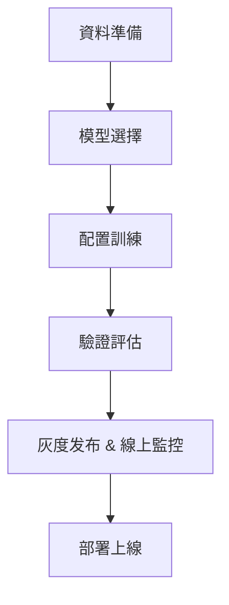

# 一文入門垂域模型 SFT 微調

本文以金融領域“企業年報分析助手”為案例。

## 1. 引言：為什麼需要垂域微調？

隨著通用大模型（如 `deepseek`、`Qwen`、`Baichuan`）的发展，語言理解和生成的能力大幅提升。但在金融、醫療、法律等專業場景中，直接使用通用模型往往效果不佳。常見問題包括：

- **理解專業術語不到位**

  - 例如將 `EBITDA` 誤判為“營業收入”或與“淨利潤”混淆。
  - 建議在資料預處理階段做同義詞標準化，以統一術語描述。

- **生成內容存在事實性錯誤**

  - 如誤報企業財務資料或法規條款；
  - 可透過“自動 redact（脫敏）敏感信息”模組，確保不洩露或誤報關鍵資料。

- **無法滿足行業合規性要求**
  - 生成的表述可能不符合金融披露規範，或遺漏必要的風險提示。

究其原因，通用大模型雖然掌握了大量公共知識，但缺乏對特定領域細粒度知識的深入建模。因此，需要透過**監督微調（SFT, Supervised Fine-Tuning）**，在小規模、專業化的資料上進一步最佳化模型，使其在特定任務和領域表現更好。

> **SFT 相比從零訓練大模型，成本更低（通常僅需 10%–20% 預訓練全量算力）、周期更短。**  
> 例如對一個 `7B` 模型在 `8 × A100`（`80 GB`）上做 `SFT`，通常僅需 `4–12` 小時即可完成。  
> 同時，對金融場景，實務中常從 **1 萬–5 萬** 條高品質標註樣本開始，便可看到顯著效能提升。

## 2. 大模型訓練體系簡述：SFT 在哪里？

從整體訓練流程看，大模型的發展經歷了五個關鍵階段：

| **階段**                               | **目標**                           | **資料規模**         | **典型耗時** | **典型硬件**                 |
| -------------------------------------- | ---------------------------------- | -------------------- | ------------ | ---------------------------- |
| **預訓練（Pre-training）**             | 獲取通用語言知識                   | `TB` 級無標註文字    | 幾周至數月   | 多機千卡級（如 `64 × A100`） |
| **監督微調（SFT/Instruction Tuning）** | 適配具體任務和指令理解             | `10⁴–10⁵` 條標註樣本 | 數小時至數天 | 單機 `4–8 × A100/H100`       |
| **強化學習（RLHF）**                   | 最佳化人類偏好對齊（安全性、友好性） | 千級人類反饋排序資料 | 數天至數週   | 單機多卡+獎勵模型            |
| **安全審計（Safety Check）**           | 檢測偏差與違規輸出                 | 多源監控與規則庫     | 持續線上     | `Kubernetes` + `MLOps` 工具  |
| **部署與監控（Online Monitoring）**    | 灰度发布、實時偏差/延遲監控        | 日誌與指標流水線     | 持續線上     | `Prometheus`、`Grafana`      |

### 2.1 SFT 的定位

- **承上啟下**：銜接“通用語言能力”與“人類偏好對齊”前的最後一步人工標註對齊
- **核心作用**：讓模型學會解析任務指令，並在垂直領域輸出專業、準確的響應

### 2.2 SFT 與預訓練、RLHF 的區別

| **維度**       | **預訓練**         | **SFT**                       | **RLHF**                    |
| -------------- | ------------------ | ----------------------------- | --------------------------- |
| **目標**       | 學習語言統計規律   | 適配特定任務指令              | 對齊人類偏好                |
| **資料需求**   | 海量無標註文字     | 少量高品質 Prompt–Response 對 | 人類偏好排序/對比資料       |
| **訓練複雜度** | 極高（千卡級叢集） | 中等（單機多卡）              | 高（需獎勵模型 + 人類評審） |

## 3. SFT 原理與工作機制

本質上，SFT 屬於典型的監督學習：

- **輸入（Prompt）**：使用者的指令或問題（如“請分析華為 2023 年營收增長率”）
- **輸出（Response）**：期望模型生成的規範答案（如“華為 2023 年營收為 6423 億元，同比增長 9%”）
- **最佳化目標**：最小化模型輸出與標準答案的交叉熵損失（Cross-Entropy Loss）

$$
\mathcal{L} = -\sum_{t=1}^{T} \log P(y_t \mid x, y_{<t})
$$

- **$\;x$**：輸入 Prompt 的 token 序列
- **$\;y$**：目標輸出的 token 序列
- **$\;T$**：輸出序列長度

### 3.1 關鍵技術點

1. **Teacher Forcing**
   - 訓練時將前一步的真實 `token` 作為輸入，促使模型快速收斂。
2. **Label Smoothing**
   - 在標籤上加小噪聲，防止模型過度自信，從而提升泛化能力。
3. **批量梯度 vs. 線上學習**
   - 對大規模資料可採用小批次（`batch`）訓練；對新鮮反饋可透過線上微調快速落地。

## 4. 工程實踐：SFT 微調流程總覽



### 4.1 關鍵環節說明

| **環節**                | **輸入**                | **輸出**                                        | **常見工具**                                     |
| ----------------------- | ----------------------- | ----------------------------------------------- | ------------------------------------------------ |
| **資料準備**            | 年報 PDF、原始領域文件  | 清洗並格式化的 SFT 資料集                       | Apache Tika / PDFPlumber、OCR 清洗、Label Studio |
| **模型選擇**            | 場景需求 & 資源預算     | 基礎模型（如 Qwen-7B、Baichuan-13B、LLaMA2-7B） | Hugging Face Model Hub                           |
| **配置訓練**            | 資料集 + 基礎模型       | 微調後的領域適配模型                            | PyTorch、DeepSpeed、PEFT                         |
| **驗證評估**            | 測試集 + 自動化評測用例 | 模型效能報告                                    | OpenAI Evals、EleutherAI Evals、MLflow           |
| **灰度发布 & 線上監控** | 服務請求日誌、監控指標  | 實時偏差與延遲報警                              | Prometheus、Grafana、Sentry                      |
| **部署上線**            | 訓練好的模型            | API 服務或應用                                  | vLLM、Triton Inference                           |

## 5. 金融案例實踐：打造“企業年報分析助手”

### 5.1 任務設定

- **示例 1：數值計算**

  - **使用者提問**：華為 2023 年的研发投入占比是多少？
  - **理想回答**：根據華為 2023 年年報（財年基準，非日历年），研发支出 1 647 億元，總收入 6 423 億元，研发投入占比 = (1 647 ÷ 6 423) × 100% ≈ 25.65%。（保留兩位小數，注意財年/日曆年差異）

- **示例 2：表格生成**

  - **使用者提問**：對比騰訊和阿里過去三年的淨利潤增長率
  - **理想回答**：
    示例表格模板（資料來源：各公司年報原文，第 4 頁）

    | 年份 | 騰訊 YoY | 阿里 YoY |
    | :--- | :------- | :------- |
    | 2021 | … %      | … %      |
    | 2022 | … %      | … %      |
    | 2023 | … %      | … %      |

- **性能要求**
  - **準確率 > 95%**：關鍵數字必須零誤差（Exact Match）。
  - **合規性**：避免主觀臆斷，全程引用年報原文。

### 5.2 資料準備


- **OCR 清洗**：糾正識別錯誤，去除頁首/頁尾冗餘
- **自動生成 + 人工校對**：先用 `LLM` 生成 `Prompt–Response` 對，再嚴格人工稽核

### 5.3 資料增強技巧

- **同義改寫**：自動工具＋人工擴寫，保證問法多樣性
- **負樣本注入**：插入 `5%–10%` 的錯誤答案，幫助模型學會甄別
- **推理鏈引導（CoT）**：示例 Prompt：
  > “請先列出計算公式，再計算華為研發投入佔比，並說明每一步的依據。”
- **上下文擴展**：對涉及多段資訊的問題，提供完整上下文片段

### 5.4 模型與框架選擇

| **方法**       | **顯存佔用** | **訓練速度** | **適用場景**     |
| -------------- | ------------ | ------------ | ---------------- |
| 全參數微調     | 高           | 慢           | 資料量充足時     |
| LoRA           | 中           | 快           | 常規資源受限場景 |
| QLoRA          | 低           | 中等         | 超大模型微調     |
| Prefix-Tuning  | 低           | 快           | 輕量化、快速實驗 |
| Adapter-Tuning | 中           | 快           | 外掛式微調       |

```python
# LoRA 典型參數（7B 模型）
from peft import LoraConfig

lora_config = LoraConfig(
    r=8,
    lora_alpha=32,
    target_modules=["q_proj", "v_proj"],
    lora_dropout=0.05,
    task_type="CAUSAL_LM"
)
```

### 5.5 訓練實操（程式碼最佳化建議）

- **混合精度訓練**
  - 常用 `fp16（AMP）`；若使用 `bfloat16`，則需 NVIDIA Ampere 或更新架構的 GPU（如 A100、H100）支持。
- **梯度檢查點**
  - `gradient_checkpointing=True`，顯存節省 `30%–40%`。
- **學習率策略**
  - 基礎 `lr 1e-4 → 1e-5`，余弦退火（`cosine`），`warmup 3%–5%`。

### 5.6 驗證與評估

- **自動化評測框架**：`OpenAI Evals`、`EleutherAI Evals` 示例用例
- **常見指標**：

  | **指標**                       | **含義**                               | **適用場景**         |
  | ------------------------------ | -------------------------------------- | -------------------- |
  | **準確率（Exact Match）**      | 生成內容與標準答案的精確匹配率         | 數值、短文本回答     |
  | **推理步驟一致率（CoT 品質）** | 連鎖推理中，過程邏輯與標準步驟的匹配度 | 多步推理、解釋型任務 |
  | **召回率 / 漏答率**            | 模型是否遺漏所有隱含子問題或關鍵點     | 綜合型複雜問題       |
  | **困惑度（Perplexity）**       | 語言模型對資料集的預測難度             | 模型整體生成品質評估 |
  | **延遲（Latency）**            | 端到端響應時延                         | 線上服務場景         |
  | **Token 利用率**               | 截斷或填充導致的有效資訊比率           | 長文字生成或複雜查詢 |

```python
def evaluate_accuracy(test_set, model):
    correct = 0
    for sample in test_set:
        pred = generate(sample["instruction"], model)
        if exact_match(pred, sample["output"]):
            correct += 1
    return correct / len(test_set)
```

> **示例 Evals 用例**：對“華為研發投入佔比”任務，采用 `evals.record_playground_eval` 自動化驗證指令碼。

---

## 6. 常見問題與最佳實踐

### Q：如何緩解災難性遺忘？

- 混合訓練：保留 `10%–20%` 通用指令資料
- 分層學習率：底層參數更小 `lr`
- **EWC（彈性權重鞏固）**、`L2` 正則化

### Q：資料標註成本高怎麼辦？

- 主動學習：優先標註置信度低樣本
- 自訓練（`Self-training`）＋半監督學習
- 知識蒸餾：大模型生成初步標註，再人工校正

---

## 7. 結束語

在垂直領域應用中，`SFT` 是快速將大模型專業化、工程化落地的重要手段。透過合理設計資料、最佳化訓練過程、強化安全與監控，哪怕資源有限，也能打造出高品質的領域智慧助手。希望本文能為你搭建清晰可行的 `SFT` 實踐路線。
