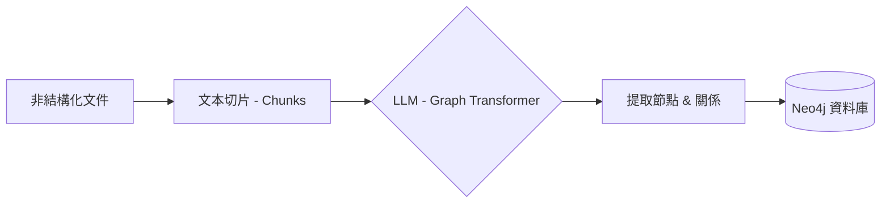

# Knowledge Graphs for RAG（GraphRAG）

本教案基於 DeepLearning.AI 與 Neo4j 合作的 "Knowledge Graphs for RAG" 課程設計，旨在為學習者提供從理論到實踐的完整路徑 [1]。課程圍繞構建一個基於 SEC 10-K 年度報告的問答系統展開，透過實戰掌握 GraphRAG 的核心技術。本教案涉及檢索增強生成（Retrieval-Augmented Generation, RAG）、知識圖譜（Knowledge Graph, KG）與大語言模型（Large Language Model, LLM）等概念。

---

## 課程資訊

- **課程名稱**: Knowledge Graphs for RAG (GraphRAG)
- **適用人群**: AI 工程師、資料科學家、希望提升 RAG 系統效能的開發者
- **先決條件**:
  - 熟悉 Python 程式設計
  - 了解基本的 LLM 和 LangChain 概念
  - 擁有 OpenAI API Key（或其他可用 LLM 服務的 API Key）
  - 已安裝 Docker（用於執行 Neo4j）
- **學習目標**:
  1. 理解知識圖譜（KG）如何解決傳統 RAG 的上下文缺失問題。
  2. 掌握 Neo4j 圖資料庫的基本操作與 Cypher 查詢語言。
  3. 學會使用 LangChain 將非結構化文字轉化為結構化圖譜（Text2Graph）。
  4. 構建一個結合向量檢索與圖檢索的混合檢索（Hybrid Retrieval） QA 系統。

---

## 課程大綱

| **模組**     | **主題**                   | **核心內容**                              | **建議時長** |
| :----------- | :------------------------- | :---------------------------------------- | :----------- |
| **Module 1** | **基礎理論與環境搭建**     | KG 概念、GraphRAG 優勢、Neo4j Docker 部署 | 1 小時       |
| **Module 2** | **Cypher 查詢語言入門**    | 節點、關係、屬性、MATCH/RETURN 語句       | 1.5 小時     |
| **Module 3** | **非結構化文字的圖譜構建** | Text2Graph 流程、Schema 定義、LLM 提取    | 2 小時       |
| **Module 4** | **混合檢索與問答系統**     | 向量索引、圖譜檢索、LangChain 集成        | 2 小時       |
| **Module 5** | **實戰專案：SEC 財報分析** | 處理真實 10-K 資料、多文件關聯、複雜推理  | 2.5 小時     |

以上時長為教學設計的建議值，可根據學員基礎與實踐深度進行調整。

---

## 詳細教學內容

### Module 1: 基礎理論與環境搭建

#### 1.1 理論：為什麼需要 GraphRAG？

- **傳統 RAG 的局限性**:
  - **切片（Chunking）導致語義斷裂**: 簡單的文字切分可能將實體與其屬性或關係分開。
  - **缺乏全域性視角**: 無法回答跨文件或跨段落的綜合性問題（例如："A 公司的供應商 B 的高管 C 之前在哪工作？"）。
- **知識圖譜的優勢**:
  - **顯式關係**: 直接儲存實體間的連線。
  - **結構化上下文**: 提供更精准的上下文窗口，減少幻覺。

#### 1.2 環境搭建 (Hands-on)

**任務**: 啟動 Neo4j 資料庫並配置 Python 環境。

1. **啟動 Neo4j (Docker)**:

   ```bash
   # 啟動 Neo4j 並啟用 APOC 插件（示例配置）
   docker run \
       --name neo4j-graphrag \
       -p 7474:7474 -p 7687:7687 \
       -e NEO4J_AUTH=neo4j/password \
       -e NEO4J_PLUGINS='["apoc"]' \
       neo4j:5.18.0
   ```

   - 訪問 `http://localhost:7474` 驗證啟動成功。

2. **安裝 Python 依賴**:

   ```bash
   # 安裝本教案示例所需的核心依賴
   pip install langchain langchain-community langchain-openai langchain-experimental neo4j tiktoken
   ```

---

### Module 2: Cypher 查詢語言入門

#### 2.1 核心概念

- **Node (節點)**: 實體，如 `(p:Person {name: "Elon Musk"})`
- **Relationship (關係)**: 連線，如 `[:FOUNDED {year: 2002}]`
- **Label (標籤)**: 類別，如 `:Person`, `:Company`

#### 2.2 基礎查詢練習

**場景**: 電影資料庫。

- **建立資料**:

  ```cypher
  CREATE (m:Movie {title: "The Matrix", released: 1999})
  CREATE (p:Person {name: "Keanu Reeves", born: 1964})
  CREATE (p)-[:ACTED_IN {roles: ["Neo"]}]->(m)
  ```

- **查詢資料**:

  ```cypher
  // 查找 Keanu Reeves 演過的電影
  MATCH (p:Person {name: "Keanu Reeves"})-[:ACTED_IN]->(m:Movie)
  RETURN m.title, m.released
  ```

#### 課後練習

- 編寫 Cypher 語句，建立一個包含 "User" 和 "Product" 的簡單購買關係圖。

---

### Module 3: 非結構化文字的圖譜構建 (Text2Graph)

這是本課程的核心。我們將使用 LLM 自動從文字中提取實體和關係。

#### 3.1 流程圖解



#### 3.2 實戰程式碼：從文字到圖譜

**步驟**:

1. **定義 Schema**: 告訴 LLM 我們關心哪些類型的節點和關係。
2. **執行提取**: 使用 LangChain 的 `LLMGraphTransformer`。

在執行示例程式碼前，先在終端設定必要的環境變數：

```bash
export OPENAI_API_KEY="your_api_key"  # LLM 服務的 API Key
export NEO4J_URI="bolt://localhost:7687"  # Neo4j Bolt 連線地址
export NEO4J_USERNAME="neo4j"  # Neo4j 使用者名稱
export NEO4J_PASSWORD="password"  # Neo4j 密碼
```

```python
import os
from langchain_community.graphs import Neo4jGraph
from langchain_openai import ChatOpenAI
from langchain_experimental.graph_transformers import LLMGraphTransformer
from langchain_core.documents import Document

required_env = ["OPENAI_API_KEY", "NEO4J_URI", "NEO4J_USERNAME", "NEO4J_PASSWORD"]
missing_env = [k for k in required_env if not os.getenv(k)]
if missing_env:
    raise RuntimeError(f"Missing env vars: {', '.join(missing_env)}")

graph = Neo4jGraph()

# 示例文本
text = """
Apple Inc. is an American multinational technology company headquartered in Cupertino, California.
Tim Cook is the CEO of Apple.
"""
documents = [Document(page_content=text)]

# 初始化轉換器 (GPT-4 效果最佳)
llm = ChatOpenAI(temperature=0, model="gpt-4")
llm_transformer = LLMGraphTransformer(
    llm=llm,
    allowed_nodes=["Company", "Person", "City"],
    allowed_relationships=["HEADQUARTERED_IN", "CEO_OF", "LOCATED_IN"]
)

# 轉換並儲存
graph_documents = llm_transformer.convert_to_graph_documents(documents)
graph.add_graph_documents(graph_documents)
first_graph_document = next(iter(graph_documents))
print(f"提取了 {len(first_graph_document.nodes)} 個節點和 {len(first_graph_document.relationships)} 條關係。")
```

---

### Module 4: 混合檢索與問答系統

#### 4.1 混合檢索架構

單純的圖檢索可能漏掉非結構化的細節，單純的向量檢索缺乏結構。混合檢索結合兩者。

- **向量檢索 (Vector Search)**: 尋找語義相似的文件塊。
- **圖檢索 (Graph Traversal)**: 尋找實體及其鄰居。

#### 4.2 實現 QA Chain

注意：`GraphCypherQAChain` 具備從自然語言生成 Cypher 的能力，若允許執行不受控的寫操作或危險查詢，可能帶來資料破壞風險。示例中預設關閉危險請求；生產環境建議結合只讀賬號、查詢白名單與審計策略。
可參考 Neo4j GenAI 相關工具棧與 LangChain 的 Neo4j 整合文件 [3,4]。

```python
from langchain.chains import GraphCypherQAChain

# 自動將自然語言轉為 Cypher
chain = GraphCypherQAChain.from_llm(
    graph=graph,
    llm=llm,
    verbose=True,
    allow_dangerous_requests=False
)

# 提問
response = chain.invoke({"query": "Who is the CEO of the company located in Cupertino?"})
print(response['result'])
```

---

### Module 5: 實戰專案：SEC 財報分析

**背景**: 投資者需要分析大量的 SEC 10-K 表格（年度報告），瞭解公司的風險、高管和投資關係。

#### 5.1 資料準備

- 下載示例 SEC 10-K JSON 資料（如 NetApp Inc. 的財報）。
- 提取其中的 `Item 1` (Business) 和 `Item 1A` (Risk Factors) 部分。
- **資源**: 完整的資料處理指令碼、Notebooks 及示例資料可在 GitHub 倉庫中找到 [2]。

#### 5.2 構建策略

1. **Chunking**: 將長文字切分為塊（例如 500-1000 tokens，需根據模型上下文視窗與任務調整）。
2. **向量化**: 為每個 Chunk 建立向量索引，存入 Neo4j。
3. **圖譜化**: 提取關鍵實體（如 `Manager`, `Company`, `Product`）。
4. **連線**: 將 Chunk 節點連結到提取出的實體節點（`MENTIONS` 關係）。

#### 5.3 複雜查詢示例

**問題**: "NetApp 提到了哪些關於供應鏈的風險？"

- **檢索路徑**:
  1. 向量檢索: 搜索 "supply chain risk" 相關的 Chunk 節點。
  2. 圖擴展: 查詢這些 Chunk 關聯的 `Risk` 實體。
  3. 生成: LLM 綜合這些資訊生成回答。

---

## 常見問題 (FAQ)

1. **Q: 必須使用 GPT-4 嗎？**
   - A: 推薦使用 GPT-4 進行圖譜提取（Text2Graph），因為它對指令的遵循能力更強，能生成更規範的 Schema。問答階段可以使用 GPT-3.5 或其他模型。

2. **Q: 如何處理實體消歧（Entity Resolution）？**
   - A: 比如 "Apple" 和 "Apple Inc."。可以在提取後使用簡單的規則合併，或者在提取前給 LLM 提供明確的命名規範。

3. **Q: 資料量很大怎麼辦？**
   - A: 對於大規模資料，建議並行處理 Text2Graph 步驟，並使用 Neo4j 的批次匯入工具。

---

## 拓展思考

### RAG 與 GraphRAG：區別與聯絡

傳統 RAG（Retrieval-Augmented Generation）的核心思想是：將語料切分為 Chunks，為每個 Chunk 構建向量索引；在使用者提問時，透過相似度檢索召回 Top-K 文本片段，將其拼接到 Prompt 中交給 LLM 生成答案。其優勢是工程落地快、可擴展性強，但在以下場景中容易遇到瓶頸：

- **跨 Chunk 依賴**：實體、屬性與關係分散在多個片段中，Top-K 召回未必能同時覆蓋關鍵上下文。
- **多跳推理**：問題需要沿實體關係做 2 跳及以上推理時，純向量相似度檢索往往難以穩定召回完整鏈路。
- **全局一致性**：當語料規模變大，Chunk 粒度與召回策略的權衡（召回率 vs. 噪聲）會更顯著影響回答品質。

GraphRAG 可以視為 RAG 的一種“結構增強”范式：它在保留向量檢索優勢的同時，引入圖結構來顯式表達實體關係與層次結構，並在檢索階段加入圖擴展、路徑/子圖檢索等圖感知機制，從而提升多跳推理與上下文保持能力 [5,6]。從構建方式上，GraphRAG 常見兩類工作流：

- **Knowledge-based GraphRAG**：從語料中抽取實體與關係，構建“事實型”知識圖譜，並用子圖作為檢索與生成依據。
- **Index-based GraphRAG**：將語料摘要為主題節點形成“索引圖”，並將主題與原始文字片段建立對映，實現結構化導航與事實回鏈。


圖 1. RAG 與 GraphRAG 的典型工作流對比（來源：Awesome-GraphRAG）[5,7]

> 圖中示例問題："How does the El Niño phenomenon potentially impact marine biodiversity?"（該問題為圖示示例，與本文 SEC 10-K 案例無直接對應關係）

### GraphRAG vs. Synergized LLMs + KGs

在實際的企業級應用（如銀行反欺詐）中，我們常聽到 "Synergized LLMs + KGs"（大模型與知識圖譜協同）這一概念。雖然它與 GraphRAG 都涉及 KG 和 LLM 的結合，但在**設計理念**和**KG 的角色**上有顯著區別。

| **維度**       | **GraphRAG (本課程模式)**                                                            | **Synergized LLMs + KGs (如銀行反欺詐)**                                                                    |
| :------------- | :----------------------------------------------------------------------------------- | :---------------------------------------------------------------------------------------------------------- |
| **核心目標**   | **文件問答與檢索增強**。解決 LLM 在長文字、跨文件資訊上的遺忘和幻覺問題。            | **複雜推理與決策支援**。解決高風險場景下的精確性、可解釋性和實時性問題。                                    |
| **KG 的來源**  | 主要來自**非結構化文字** (Text2Graph)。KG 是為了更好地索引文字而臨時或半自動構建的。 | 主要來自**結構化業務資料** (Core Banking System)。KG 是核心資產，包含高品質、經校驗的賬戶、交易、裝置資訊。 |
| **KG 的品質**  | **概率性**。依賴 LLM 提取，可能存在噪聲、錯誤或不完整的關係。                        | **確定性 (High Quality)**。作為 "Ground Truth" (事實基準)，資料的準確性至關重要。                           |
| **LLM 的角色** | **構建者 & 接口**。LLM 既用於構建圖譜，也用於生成最終的自然語言回答。                | **推理者 & 解釋者**。LLM 利用高品質 KG 進行邏輯推理 (Reasoning) 和結果解釋，而非構建基礎事實。              |
| **典型場景**   | 研報分析、法律文件審查、百科問答。                                                   | 資金鍊路追蹤、團伙挖掘、反洗錢 (AML)。                                                                      |

**總結**:

- 本課程教授的 **GraphRAG** 更多關注如何"從無到有"利用 LLM 將文字轉化為圖譜，以提升檢索效果。
- **Synergized LLMs + KGs** 則更多關注如何"強強聯合"，利用已有的高品質圖譜為 LLM 提供可靠的推理邊界和事實依據。

---

## 參考文獻與資源

[1] DeepLearning.AI. "Knowledge Graphs for RAG." DeepLearning.AI. 訪問日期：2025-12-25. [Online]. Available: https://learn.deeplearning.ai/courses/knowledge-graphs-rag/

[2] Kaushik Acharya. "Knowledge_Graphs_for_RAG." GitHub. 訪問日期：2025-12-25. [Online]. Available: https://github.com/kaushikacharya/Knowledge_Graphs_for_RAG

[3] Neo4j. "neo4j/neo4j-genai-python." GitHub. 訪問日期：2025-12-25. [Online]. Available: https://github.com/neo4j/neo4j-genai-python

[4] LangChain. "Neo4j Cypher (Graphs Integration)." LangChain Documentation. 訪問日期：2025-12-25. [Online]. Available: https://python.langchain.com/docs/integrations/graphs/neo4j_cypher/

[5] DEEP-PolyU. "Awesome-GraphRAG." GitHub. 訪問日期：2025-12-25. [Online]. Available: https://github.com/DEEP-PolyU/Awesome-GraphRAG

[6] Zhang, Q., Chen, S., Bei, Y., Yuan, Z., Zhou, H., Hong, Z., Dong, J., Chen, H., Chang, Y., & Huang, X. "A Survey of Graph Retrieval-Augmented Generation for Customized Large Language Models." _arXiv preprint_ arXiv:2501.13958, 2025. [Online]. Available: https://arxiv.org/abs/2501.13958

[7] DEEP-PolyU. "rag_vs_graphrag.png." Awesome-GraphRAG. 訪問日期：2025-12-25. [Online]. Available: https://raw.githubusercontent.com/DEEP-PolyU/Awesome-GraphRAG/main/figs/rag_vs_graphrag.png
