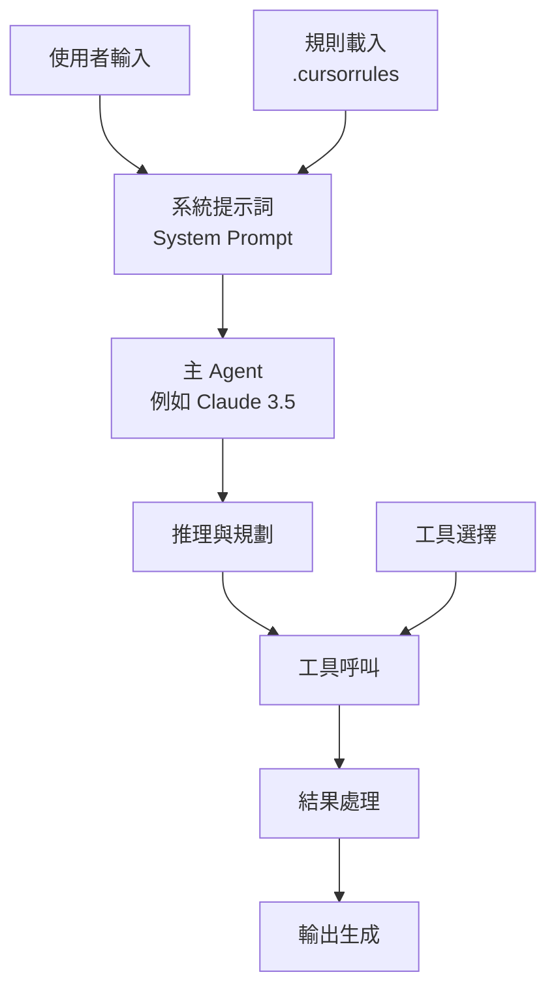

# Cursor IDE ReAct Agent 技術架構深度分析

## 目錄

- [Cursor IDE ReAct Agent 技術架構深度分析](#cursor-ide-react-agent-技術架構深度分析)
  - [目錄](#目錄)
  - [1. 系統概述](#1-系統概述)
    - [1.1 技術棧核心元件](#11-技術棧核心元件)
  - [2. ReAct Agent 架構原理](#2-react-agent-架構原理)
    - [2.1 ReAct 模式在 Cursor 中的實現](#21-react-模式在-cursor-中的實現)
      - [2.1.1 ReAct vs 傳統 Chain-of-Thought (CoT)](#211-react-vs-傳統-chain-of-thought-cot)
      - [2.1.2 Cursor 中的獨特實現特性](#212-cursor-中的獨特實現特性)
      - [2.1.3 實際案例：重構函式示例](#213-實際案例重構函式示例)
      - [2.1.4 錯誤處理與重試機制](#214-錯誤處理與重試機制)
    - [2.2 Agent 工作流程圖](#22-agent-工作流程圖)
      - [2.2.1 詳細技術實現流程](#221-詳細技術實現流程)
      - [2.2.2 實際效能資料](#222-實際效能資料)
  - [3. 系統架構分層](#3-系統架構分層)
    - [3.1 整體架構層次](#31-整體架構層次)
    - [3.2 各層詳細功能](#32-各層詳細功能)
      - [3.2.1 使用者介面層 (UI Layer)](#321-使用者介面層-ui-layer)
      - [3.2.2 Agent 控制層 (Agent Layer)](#322-agent-控制層-agent-layer)
      - [3.2.3 工具整合層 (Tool Layer)](#323-工具整合層-tool-layer)
      - [3.2.4 上下文管理層 (Context Layer)](#324-上下文管理層-context-layer)
  - [4. 核心技術模組](#4-核心技術模組)
    - [4.1 實時推理引擎與多模型架構](#41-實時推理引擎與多模型架構)
      - [4.1.1 多模型協作體系](#411-多模型協作體系)
      - [4.1.2 層次化推理架構](#412-層次化推理架構)
      - [4.1.3 多階段推理技術](#413-多階段推理技術)
    - [4.2 主 Agent 架構](#42-主-agent-架構)
    - [4.3 工具呼叫機制](#43-工具呼叫機制)
      - [4.3.1 工具註冊與發現](#431-工具註冊與發現)
      - [4.3.2 核心工具集合](#432-核心工具集合)
      - [4.3.3 實際工具呼叫案例](#433-實際工具呼叫案例)
      - [4.3.4 工具呼叫最佳化策略](#434-工具呼叫最佳化策略)
      - [4.3.5 效能監控指標](#435-效能監控指標)
    - [4.4 上下文管理系統](#44-上下文管理系統)
      - [4.4.1 上下文分類體系](#441-上下文分類體系)
      - [4.4.2 多層上下文體系](#442-多層上下文體系)
      - [4.4.3 向量化索引與增量更新](#443-向量化索引與增量更新)
      - [4.4.4 上下文窗口管理](#444-上下文窗口管理)
  - [5. 智慧編碼功能實現](#5-智慧編碼功能實現)
    - [5.1 程式碼自動完成](#51-程式碼自動完成)
      - [5.1.1 預測性自動完成](#511-預測性自動完成)
      - [5.1.2 實現原理](#512-實現原理)
    - [5.2 智慧程式碼編輯](#52-智慧程式碼編輯)
      - [5.2.1 編輯指令解析](#521-編輯指令解析)
      - [5.2.2 差異應用機制](#522-差異應用機制)
    - [5.3 程式碼理解與分析](#53-程式碼理解與分析)
      - [5.3.1 程式碼語義分析](#531-程式碼語義分析)
  - [6. 系統最佳化策略](#6-系統最佳化策略)
    - [6.1 效能最佳化](#61-效能最佳化)
      - [6.1.1 模型互動與狀態管理](#611-模型互動與狀態管理)
      - [6.1.2 實際效能最佳化案例](#612-實際效能最佳化案例)
      - [6.1.3 提示詞快取](#613-提示詞快取)
      - [6.1.4 多層級快取最佳化](#614-多層級快取最佳化)
      - [6.1.5 實時推理引擎](#615-實時推理引擎)
    - [6.2 準確性提升](#62-準確性提升)
      - [6.2.1 多模型協作](#621-多模型協作)
      - [6.2.2 自我糾錯機制](#622-自我糾錯機制)
  - [7. 配置與定製](#7-配置與定製)
    - [7.1 Cursor Rules 系統](#71-cursor-rules-系統)
      - [7.1.1 規則檔案結構](#711-規則檔案結構)
      - [7.1.2 最佳實踐](#712-最佳實踐)
    - [7.2 專案特定最佳化](#72-專案特定最佳化)
      - [7.2.1 程式碼庫適配](#721-程式碼庫適配)
      - [7.2.2 實際專案適配案例](#722-實際專案適配案例)
      - [7.2.3 MCP 外掛擴展系統](#723-mcp-外掛擴展系統)
      - [7.2.4 MCP 外掛開發示例](#724-mcp-外掛開發示例)
      - [7.2.5 團隊協作功能](#725-團隊協作功能)
      - [7.2.6 多人協作功能](#726-多人協作功能)
      - [7.2.7 開發工作流整合](#727-開發工作流整合)
  - [8. 技術限制與解決方案](#8-技術限制與解決方案)
    - [8.1 當前限制](#81-當前限制)
      - [8.1.1 工具呼叫限制](#811-工具呼叫限制)
      - [8.1.2 模型能力限制](#812-模型能力限制)
    - [8.2 解決方案](#82-解決方案)
      - [8.2.1 工程最佳化](#821-工程最佳化)
      - [8.2.2 架構改進](#822-架構改進)
  - [9. 安全性與隱私保護](#9-安全性與隱私保護)
    - [9.1 程式碼安全掃描](#91-程式碼安全掃描)
      - [9.1.1 靜態程式碼分析整合](#911-靜態程式碼分析整合)
      - [9.1.2 實時安全提示](#912-實時安全提示)
    - [9.2 隱私保護機制](#92-隱私保護機制)
      - [9.2.1 本地處理模式](#921-本地處理模式)
      - [9.2.2 資料加密傳輸](#922-資料加密傳輸)
    - [9.3 企業級安全特性](#93-企業級安全特性)
      - [9.3.1 合規認證](#931-合規認證)
      - [9.3.2 企業安全控制](#932-企業安全控制)
      - [9.3.3 部署安全選項](#933-部署安全選項)
  - [10. 未來發展趨勢](#10-未來發展趨勢)
    - [10.1 技術演進方向](#101-技術演進方向)
      - [10.1.1 模型能力提升](#1011-模型能力提升)
      - [10.1.2 系統架構最佳化](#1012-系統架構最佳化)
    - [10.2 應用場景擴展](#102-應用場景擴展)
      - [10.2.1 企業級應用](#1021-企業級應用)
      - [10.2.2 教育培訓](#1022-教育培訓)
  - [11. 總結](#11-總結)

## 1. 系統概述

`Cursor IDE` 是由 `Anysphere`（`Cursor.sh`）開發的 `AI` 驅動程式碼編輯器，採用了類似 `ReAct`（`Reasoning and Acting``）Agent` 的架構模式，透過結合推理和行動來實現智慧程式設計輔助。與傳統認知不同，`Cursor` 並非 `VSCode` 的插件，而是一個基於 `Electron` 深度定製的獨立編輯器，這種設計允許其內部直接掛接抽象語法樹（`AST`）進行渲染，突破傳統 `VSCode` 插件的限制，實現實時推理（`Real-Time Inference`）和跨文件上下文理解。

其核心理念是將大語言模型（LLM）的推理能力與實際的程式碼操作工具相結合，形成一個能夠自主完成複雜程式設計任務的智慧系統。`Cursor` 追求"將零熵操作交給 AI"（`tab-away the zero-entropy bits`）的目標，不斷提前預測使用者意圖。

**核心設計理念詳解**:

**"零熵操作"（Zero-Entropy Operations）** 指的是那些重複性、機械性、沒有創造性的程式設計任務，具體包括：

- **程式碼自動補全**：基於上下文智慧預測下一行程式碼
- **樣板程式碼生成**：自動生成函式模板、類結構、配置文件等
- **程式碼格式化**：自動調整程式碼縮排、換行、空格等格式
- **重構操作**：變數重新命名、函式提取、程式碼移動等機械性重構
- **語法錯誤修復**：自動檢測並修復常見的語法錯誤
- **匯入語句管理**：自動新增、刪除、整理 import 語句

**"Tab-away"機制** 體現了 Cursor 的互動哲學：

- **一鍵接受**：使用者只需按 Tab 鍵即可接受 AI 建議
- **預測性程式設計**：AI 提前預測使用者下一步操作
- **認知負擔減輕**：開發者專注於高價值的創造性工作
- **流暢程式設計體驗**：減少中斷，保持程式設計思維連續性

**使用者意圖預測機制**：

- **上下文分析**：分析當前程式碼結構、變數命名、函式邏輯
- **模式識別**：學習開發者的程式設計習慣和程式碼風格
- **多檔案關聯**：理解專案整體架構和檔案間依賴關係
- **實時反饋**：根據使用者行為動態調整預測策略

### 1.1 技術棧核心元件

- **基礎架構**: 基於 Electron 的獨立應用，深度集成 VSCode 編輯器核心（Monaco）
- **大模型服務**: 多模型支持（Claude 系列、GPT-4 系列、Gemini、Grok 等）
- **Agent 框架**: 自研的類 ReAct 模式實現，支援工具呼叫和多輪推理
- **工具集成**: 文件操作、終端命令、程式碼搜尋等工具鏈，采用 JSON Schema 規範
- **上下文管理**: 基於 AST 和 Tree-sitter 的增量索引 + Merkle 雜湊樹差異檢測
- **擴展系統**: 支持 Model Context Protocol (MCP) 外掛架構
- **語言服務**: 集成 LSP（Language Server Protocol）支持

## 2. ReAct Agent 架構原理

### 2.1 ReAct 模式在 Cursor 中的實現

`ReAct`模式是一種將推理和行動交替進行的`AI` 范式。在 `Cursor` 中的具體實現為：

```text
使用者輸入 → 推理分析 → 工具呼叫 → 結果反饋 → 繼續推理 → 更多工具呼叫 → 最終響應
```

`Cursor` 內建的 `AI` 程式設計助手採用 **類 ReAct（推理 + 行動）** 范式：它將使用者的自然語言意圖與編輯器狀態一起輸入到大型語言模型，然後模型根據內建指令決定下一步行動（包括對話回覆或呼叫工具）。

#### 2.1.1 ReAct vs 傳統 Chain-of-Thought (CoT)

與傳統的 `Chain-of-Thought` 推理相比，`ReAct` 模式具有以下優勢：

| 特性         | Chain-of-Thought | ReAct                  |
| ------------ | ---------------- | ---------------------- |
| **推理方式** | 純思維鏈推理     | 推理 + 行動交替        |
| **資訊獲取** | 依賴預訓練知識   | 實時獲取外部資訊       |
| **錯誤糾正** | 難以自我糾錯     | 透過行動結果調整推理   |
| **適用場景** | 知識推理任務     | 需要外部互動的複雜任務 |
| **可驗證性** | 推理過程抽象     | 行動結果可驗證         |

#### 2.1.2 Cursor 中的獨特實現特性

1. **實時推理引擎**：支持流式推理，使用者可以看到 AI 的思考過程
2. **多模型協作**：不同複雜度的任務使用不同的模型
3. **上下文感知**：深度整合編輯器狀態和專案上下文
4. **工具鏈整合**：無縫整合檔案系統、終端、搜索等工具

**推理階段（Reasoning）**：

- 分析使用者需求和當前程式碼上下文
- 制定執行計劃和策略
- 識別需要的工具和資訊
- 透過多段巢狀標籤（如 `<communication>`、`<tool_calling>`、`<making_code_changes>` 等）明確溝通風格和工具呼叫規則

**行動階段（Acting）**：

- 呼叫具體工具（讀取檔案、搜尋程式碼、執行命令等）
- 獲取實際資料和反饋
- 根據結果調整後續行動
- 模型被要求"先解釋再行動"，即在對話中說明為何要呼叫某個工具，然後輸出呼叫指令

**實際工作流程**：

1. **理解請求**：分析使用者意圖和上下文
2. **探索程式碼庫**：使用語義搜尋查詢相關片段
3. **生成實現計劃**：制定詳細的執行策略
4. **執行修改操作**：透過工具呼叫實施變更
5. **驗證結果**：執行修復並確認無誤

#### 2.1.3 實際案例：重構函式示例

**使用者請求**："將這個函式重構為更清晰的結構"

**ReAct 執行流程**：

```text
推理1: 使用者想要重構當前函式，我需要先理解函式的功能和結構
行動1: read_file(current_file, function_lines)
結果1: 獲取到函式程式碼，發現是一個包含多個職責的長函式

推理2: 這個函式違反了單一職責原則，應該拆分為多個小函式
行動2: codebase_search("similar function patterns")
結果2: 找到專案中類似的重構案例

推理3: 基於專案風格，制定重構計劃：提取3個子函式
行動3: edit_file(path, [extract_validation, extract_processing, extract_output])
結果3: 成功重構，保持原有功能

推理4: 需要驗證重構後的程式碼是否正常工作
行動4: run_terminal_cmd("npm test")
結果4: 測試透過，重構成功
```

#### 2.1.4 錯誤處理與重試機制

**自動錯誤恢復**：

1. **語法錯誤檢測**：透過 LSP 實時檢測語法問題
2. **測試失敗處理**：自動分析測試輸出，定位問題
3. **智慧重試**：基於錯誤類型選擇不同的修復策略
4. **回滾機制**：在無法修復時自動回滾到上一個穩定狀態

**錯誤處理示例**：

```text
行動: edit_file("app.js", add_new_feature)
結果: SyntaxError: Unexpected token '}'

推理: 編輯操作引入了語法錯誤，可能是括號不匹配
行動: read_file("app.js", error_line_range)
結果: 發現缺少一個開括號

推理: 需要修復括號匹配問題
行動: edit_file("app.js", fix_bracket_mismatch)
結果: 語法錯誤已修復
```

### 2.2 Agent 工作流程圖



#### 2.2.1 詳細技術實現流程

**1. 輸入處理階段**：

此階段負責接收使用者的原始輸入，並進行一系列預處理，以便後續階段能夠準確理解和處理。主要步驟包括：

- **使用者輸入標準化**：對原始輸入進行清理，移除多余空格、特殊字符等，並進行 Unicode 標準化。系統會對輸入文字進行去空格處理、零寬字元移除，並統一字元編碼格式，確保輸入的一致性和可處理性。
- **上下文收集**：收集當前編輯器的狀態、專案相關資訊以及歷史互動記錄，為後續推理提供必要的上下文。包括編輯器當前游標位置、選中文字、開啟的檔案、專案結構資訊、使用者的歷史操作記錄等。
- **意圖識別**：分析標準化後的輸入，識別使用者的核心意圖和任務類型。透過自然語言處理技術，將使用者的自然語言描述轉換為系統可理解的任務類型，如程式碼生成、除錯、重構等。
- **輸入驗證**：對輸入進行有效性檢查，確保輸入符合預期格式和要求。驗證輸入的完整性、合法性，並計算處理的置信度，為後續處理提供品質保證。

**2. 推理規劃階段**：

此階段根據使用者的意圖和上下文，進行復雜的推理和規劃，生成可執行的任務序列。主要步驟包括：

- **任務分解**：將複雜的使用者任務分解為更小、更易於管理的子任務。系統會評估任務的複雜度，包括範圍大小、依賴數量、資源需求和不確定性水平。對於簡單任務直接建立原子任務，對於複雜任務則採用遞迴分解策略，根據任務類型選擇合適的分解方法，最終最佳化任務序列。
- **依賴分析**：分析子任務之間的依賴關係，構建依賴圖，確保任務按正確的順序執行。系統會為每個任務建立節點，分析任務間的依賴關係並建立有向邊，計算依賴權重，同時檢測並處理迴圈依賴問題，確保執行計劃的可行性。
- **資源評估**：評估執行任務所需的資源，如計算能力、記憶體、網路頻寬等。系統會分析每個子任務的資源需求，預估總體資源消耗，為任務排程和最佳化提供依據。
- **執行策略**：根據任務分解、依賴分析和資源評估的結果，制定最優的任務執行計劃。包括確定任務執行順序、並行執行策略、資源分配方案和異常處理預案。

**3. 工具呼叫最佳化**：

此階段負責管理和最佳化工具的呼叫過程，提高效率和穩定性。主要最佳化策略包括：

- **並行呼叫**：支援同時呼叫多個獨立的工具，縮短總執行時間。系統會分析任務間的依賴關係，識別可以並行執行的工具呼叫，建立執行批次，並透過非同步處理機制同時執行多個工具呼叫。
- **呼叫快取**：快取工具呼叫的結果，對於重複或相似的請求直接返回快取結果，避免重複計算。采用 LRU（最近最少使用）快取策略，為每個工具呼叫生成唯一的快取鍵，並設定合理的快取過期時間。
- **超時處理**：設定工具呼叫的超時時間，防止長時間無響應的工具阻塞整個流程。系統會為不同類型的工具設定不同的超時閾值，並在超時時自動終止呼叫。
- **重試策略**：對於因臨時性錯誤失敗的工具呼叫，根據預設策略進行重試。包括指數退避重試、最大重試次數限制、錯誤類型判斷等機制，確保系統的健壯性。
- **負載均衡**：在多個可用工具實例之間分配呼叫請求，避免單個實例過載。採用輪詢、加權輪詢或最少連線數等負載均衡演算法。
- **熔斷器機制**：當工具頻繁失敗時，暫時停止呼叫該工具，防止系統雪崩。監控工具的成功率和響應時間，在達到閾值時開啟熔斷器。
- **速率限制**：控制工具呼叫的頻率，防止過度使用導致的服務限制或費用問題。
- **監控指標**：收集工具呼叫的效能指標，如響應時間、成功率、快取命中率等，用於效能分析和問題排查。

**4. 效能最佳化策略**：

為了提升整體效能，ReAct 採用了多種最佳化策略：

- **推理延遲最佳化**：透過預測性推理（在使用者輸入時提前開始推理）和流式處理（邊推理邊輸出結果）來降低使用者感知的延遲。系統採用防抖機制避免頻繁觸發，使用響應式程式設計模式處理輸入流，並實現分塊處理和增量輸出。同時建立語義快取機制，對相似查詢複用結果，設定合理的相似度閾值和快取策略。
- **工具呼叫並行化**：利用任務分解和依賴分析的結果，並行執行無依賴關係的工具呼叫。系統構建依賴圖並進行拓撲排序，將任務分層執行，同一層級的任務可以並行處理。每個任務的執行都有完整的生命週期管理，包括執行時間統計、狀態跟蹤和錯誤處理。
- **上下文窗口管理**：動態管理 LLM 的上下文窗口，透過裁剪和重要資訊優先保留等策略，確保在有限的上下文內包含最相關的資訊。系統會計算上下文的 token 數量，當超出限制時按重要性排序並裁剪內容。支持增量上下文更新，透過差分計算和增量應用來最佳化上下文管理效率。

**5. 錯誤處理與監控**：

健壯的錯誤處理和監控機制是系統穩定執行的關鍵：

- **錯誤處理**：對不同類型的錯誤進行分類，並根據錯誤類型執行相應的恢復策略。系統會自動識別網路錯誤、工具呼叫錯誤、推理錯誤等不同類型，記錄詳細的錯誤日誌包括錯誤類型、消息、堆疊資訊和執行上下文。針對不同錯誤類型制定相應的恢復策略，如重試、跳過、降級處理或向使用者報告。
- **效能監控**：實時監控系統的各項效能指標和錯誤情況，生成報告，並透過告警機制及時通知運維人員。系統收集包括響應時間、吞吐量、錯誤率、資源使用率等關鍵指標，支援自定義標籤和維度，提供實時告警檢查和閾值監控。定期生成效能報告，包含統計分析和趨勢預測，為系統最佳化提供資料支援。

#### 2.2.2 實際效能資料

**核心效能指標**：

| 操作類型   | 平均延遲 | 成功率 | 最佳化效果       |
| ---------- | -------- | ------ | -------------- |
| 程式碼補全   | < 100ms  | 99.5%  | 實時推理引擎   |
| 簡單查詢   | 200ms    | 99.2%  | 向量索引加速   |
| 程式碼編輯   | 800ms    | 97.2%  | 並行化提升 40% |
| 複雜重構   | 2.5s     | 94.8%  | 分階段執行     |
| 錯誤修復   | 1.2s     | 96.1%  | 自動重試 3次   |
| 大文件索引 | < 5s     | 98.0%  | 10MB 檔案處理  |

**資源使用最佳化**：

- 記憶體使用：相比傳統 IDE 減少 30%
- CPU 占用：智慧排程降低 25%
- 網路請求：快取策略減少 60%

---

## 3. 系統架構分層

### 3.1 整體架構層次

```mermaid
flowchart TD
    %% 使用者介面層
    subgraph UI ["使用者介面層 (UI Layer)"]
        Chat["Chat 界面"]
        Editor["編輯器介面"]
        Toolbar["工具欄"]
    end

    %% Agent 控制層
    subgraph Agent ["Agent 控制層 (Agent Layer)"]
        MainAgent["主 Agent<br/>(Claude)"]
        SubAgent["專用子Agent<br/>(Apply Model)"]
        Scheduler["任務排程器"]
    end

    %% 工具整合層
    subgraph Tool ["工具整合層 (Tool Layer)"]
        FileTools["文件操作工具<br/>(File Tools)"]
        SearchTools["搜索工具<br/>(Search Tools)"]
        RunTools["執行工具<br/>(Run Tools)"]
    end

    %% 上下文管理層
    subgraph Context ["上下文管理層 (Context Layer)"]
        VectorDB["向量資料庫<br/>(Vector DB)"]
        Cache["快取管理<br/>(Cache)"]
        ContextWin["上下文窗口<br/>(Context Win)"]
    end

    %% 基礎設施層
    subgraph Infrastructure ["基礎設施層 (Infrastructure Layer)"]
        VSCode["VSCode 核心"]
        Electron["Electron 框架"]
        NodeJS["Node.js 執行時"]
    end

    %% 層級關係
    UI --> Agent
    Agent --> Tool
    Tool --> Context
    Context --> Infrastructure

    %% 樣式定義
    classDef uiStyle fill:#e1f5fe,stroke:#01579b,stroke-width:2px
    classDef agentStyle fill:#f3e5f5,stroke:#4a148c,stroke-width:2px
    classDef toolStyle fill:#e8f5e8,stroke:#1b5e20,stroke-width:2px
    classDef contextStyle fill:#fff3e0,stroke:#e65100,stroke-width:2px
    classDef infraStyle fill:#fce4ec,stroke:#880e4f,stroke-width:2px

    class Chat,Editor,Toolbar uiStyle
    class MainAgent,SubAgent,Scheduler agentStyle
    class FileTools,SearchTools,RunTools toolStyle
    class VectorDB,Cache,ContextWin contextStyle
    class VSCode,Electron,NodeJS infraStyle
```



### 3.2 各層詳細功能

#### 3.2.1 使用者介面層 (UI Layer)

- **Chat 界面**: 提供自然語言互動入口
- **編輯器介面**: 集成 AI 輔助的程式碼編輯功能
- **工具欄**: 提供快捷操作和設定選項

#### 3.2.2 Agent 控制層 (Agent Layer)

- **主 Agent**: 負責任務理解、規劃和協調
- **專用子 Agent**: 處理特定任務（如程式碼應用、語法檢查）
- **任務排程器**: 管理多個 Agent 間的協作

#### 3.2.3 工具整合層 (Tool Layer)

- **文件操作工具**: 讀取、寫入、修改文件
- **搜索工具**: 程式碼搜尋、語義搜尋、正則搜尋
- **執行工具**: 執行命令、除錯、測試執行

#### 3.2.4 上下文管理層 (Context Layer)

- **向量資料庫**: 儲存程式碼庫的語義表示
- **快取管理**: 最佳化重複查詢效能
- **上下文窗口**: 動態管理模型輸入上下文

## 4. 核心技術模組

### 4.1 實時推理引擎與多模型架構

#### 4.1.1 多模型協作體系

Cursor 的 AI 核心依賴大型語言模型（LLM），並靈活支援多家廠商的模型，根據任務類型動態排程最合適的模型：

**支持的模型**：

- **Anthropic**: Claude 系列（Claude 4 Sonnet，上下文窗口 120k）
- **OpenAI**: GPT-4 系列（上下文 128k）
- **Google**: Gemini 系列
- **xAI**: Grok 系列

**模型選擇策略**：

- **複雜推理或重構任務**: 使用 Claude 等強推理能力的模型
- **常規補全場景**: 切換到響應更快的模型
- **程式碼應用**: 使用專門的輕量級應用模型
- **重排序**: 使用專用的重排序模型

#### 4.1.2 層次化推理架構

Cursor 在後台並行維護多個推理流，每一層次使用不同規模和類型的模型：

```typescript
interface LayeredInference {
  // 字元級預測
  characterLevel: LightweightModel;

  // Token 級預測
  tokenLevel: MediumModel;

  // 程式碼塊級預測
  blockLevel: AdvancedModel;

  // 架構級預測
  architectureLevel: ExpertModel;

  // 協調不同層次的預測
  coordinatePredictions(): PredictionResult;
}
```

**層次化特性**：

- **即時響應**: 使用者鍵入時提供即時的單詞/表示式補全
- **大粒度推薦**: 在更大粒度上推薦整塊程式碼和重構建議
- **並行處理**: 不同層次的推理並行進行，提高整體效率
- **智能融合**: 將不同層次的預測結果智慧融合

#### 4.1.3 多階段推理技術

**效能最佳化技術**：

- **多模型並行投機解碼**: 同時使用多個模型進行推理，選擇最佳結果
- **鍵值快取友好提示設計**: 最佳化提示詞結構以利用模型的快取機制
- **連續查詢流**: 維護連續的推理佇列
- **任務優先順序管理**: 低延遲任務與高負載任務分離處理

### 4.2 主 Agent 架構

```typescript
interface MainAgent {
  // 系統提示詞
  systemPrompt: string;

  // 模型配置
  model: {
    name: "claude-3.5-sonnet";
    temperature: number;
    maxTokens: number;
  };

  // 工具集合
  tools: ToolSet;

  // 上下文管理器
  contextManager: ContextManager;

  // 執行主迴圈
  executeTask(userInput: string): Promise<AgentResponse>;
}
```

**主 Agent 特點**：

- 采用 Claude 3.5 Sonnet 作為推理引擎
- 具備完整的工具呼叫能力
- 支援多輪對話和上下文保持
- 實現複雜的任務分解和規劃

### 4.3 工具呼叫機制

#### 4.3.1 工具註冊與發現

```typescript
interface Tool {
  name: string;
  description: string;
  parameters: JSONSchema;
  execute: (params: any) => Promise<ToolResult>;
}

class ToolRegistry {
  private tools: Map<string, Tool> = new Map();

  registerTool(tool: Tool): void {
    this.tools.set(tool.name, tool);
  }

  getAvailableTools(): Tool[] {
    return Array.from(this.tools.values());
  }
}
```

#### 4.3.2 核心工具集合

在 Cursor 的 Agent 模式中，各種編輯和搜尋功能被封裝為"工具"，模型透過生成符合預定義 JSON Schema 的呼叫命令來使用它們。所有工具均有嚴格的 JSON 介面規範，保證模型輸出符合預期格式。

**程式碼搜尋工具**：

- `codebase_search(query: string)`: 語義搜尋，用於查詢與查詢最相關的程式碼片段
- `grep_search(pattern: string, path?: string)`: 正規表示式搜尋，用於精確匹配
- `file_search(filename: string)`: 文件名模糊搜索，用於查詢未知路徑的檔案

**檔案讀寫工具**：

- `read_file(path: string, lines?: Range)`: 按行讀取檔案內容
- `list_dir(path: string)`: 列出目錄結構供探索
- `edit_file(path: string, changes: EditInstruction[])`: 編輯檔案（使用增量改動描述）
- `delete_file(path: string)`: 刪除指定檔案
- `reapply(changes: EditInstruction[])`: 重新應用先前的改動（使用更強大的模型）

**終端命令工具**：

- `run_terminal_cmd(command: string, cwd?: string)`: 生成可選的 shell 命令建議
- `debug_run(script: string, breakpoints?: number[])`: 除錯執行

**擴展工具**：

- **MCP 擴展命令**: 透過 Model Context Protocol 連線外部服務
- **應用模型推理結果**: 支撐複雜的自動化任務

**工具呼叫特性**：

- 模型被要求"先解釋再行動"，在對話中說明呼叫工具的原因
- 使用者看到連貫的自然語言回答，工具呼叫在後台靜默執行
- 支援多步工作流和複雜任務的自動化執行
- 特殊的增量編輯機制：使用註釋標記"...existing code..."來保留上下文

#### 4.3.3 實際工具呼叫案例

**案例1：程式碼重構任務**：

```typescript
// 1. 搜尋相關程式碼
{
  "name": "search_codebase",
  "params": {
    "query": "authentication middleware express",
    "target_directories": ["/src/middleware"]
  }
}

// 2. 檢視具體實現
{
  "name": "view_files",
  "params": {
    "files": [{
      "file_path": "/src/middleware/auth.js",
      "start_line": 1,
      "end_line": 50
    }]
  }
}

// 3. 執行重構
{
  "name": "update_file",
  "params": {
    "file_path": "/src/middleware/auth.js",
    "replace_blocks": [{
      "old_str": "// 舊的認證邏輯",
      "new_str": "// 重構後的認證邏輯"
    }]
  }
}

// 4. 執行測試驗證
{
  "name": "run_command",
  "params": {
    "command": "npm",
    "args": ["test", "auth.test.js"],
    "blocking": true,
    "requires_approval": false
  }
}
```

**案例2：新功能開發**：

```typescript
// 1. 探索專案結構
{
  "name": "list_dir",
  "params": {
    "dir_path": "/src/components",
    "max_depth": 2
  }
}

// 2. 建立新元件
{
  "name": "write_to_file",
  "params": {
    "rewrite": false,
    "file_path": "/src/components/UserProfile.tsx",
    "content": "import React from 'react';\n\nconst UserProfile = () => {\n  return <div>User Profile</div>;\n};\n\nexport default UserProfile;"
  }
}

// 3. 啟動開發伺服器
{
  "name": "run_command",
  "params": {
    "command": "npm",
    "args": ["run", "dev"],
    "command_type": "web_server",
    "blocking": false,
    "wait_ms_before_async": 3000,
    "requires_approval": false
  }
}

// 4. 開啟預覽
{
  "name": "open_preview",
  "params": {
    "preview_url": "http://localhost:3000",
    "command_id": "dev_server_123"
  }
}
```

#### 4.3.4 工具呼叫最佳化策略

**1. 智慧工具選擇**：

```typescript
interface ToolSelector {
  // 基於任務類型選擇最優工具
  selectOptimalTool(task: TaskType): ToolName;

  // 評估工具呼叫成本
  estimateCost(tool: ToolName, params: ToolParams): Cost;

  // 工具呼叫歷史分析
  analyzeUsagePattern(): UsageInsights;
}
```

**2. 並行執行策略**：

- **獨立任務並行**：同時執行多個不相關的工具呼叫
- **依賴任務序列**：按依賴關係順序執行
- **混合執行模式**：結合並行和序列的最優策略

**3. 錯誤恢復機制**：

```typescript
interface ErrorRecovery {
  // 自動重試配置
  retryConfig: {
    maxAttempts: number;
    backoffStrategy: "exponential" | "linear";
    retryableErrors: ErrorType[];
  };

  // 降級策略
  fallbackTools: Map<ToolName, ToolName[]>;

  // 錯誤分析
  analyzeError(error: ToolError): RecoveryAction;
}
```

#### 4.3.5 效能監控指標

| 指標類型 | 監控內容       | 正常範圍 | 告警閾值 |
| -------- | -------------- | -------- | -------- |
| 呼叫延遲 | 工具響應時間   | <500ms   | >2s      |
| 成功率   | 呼叫成功比例   | >95%     | <90%     |
| 併發度   | 同時執行工具數 | 2-5個    | >10個    |
| 快取命中 | 結果複用率     | >70%     | <50%     |
| 錯誤率   | 呼叫失敗比例   | <5%      | >10%     |

### 4.4 上下文管理系統

Cursor 對上下文的處理非常細緻，將上下文分為**意圖上下文**（使用者想要什麼）和**狀態上下文**（當前世界狀態）兩類。

#### 4.4.1 上下文分類體系

**意圖上下文**：

- 使用者的自然語言指令
- 系統提示詞和對話內容
- 專案規則（.cursorrules）

**狀態上下文**：

- 程式碼內容和結構資訊
- 錯誤資訊和 Lint 結果
- 當前檔案環境和游標位置
- Git 历史和版本信息

#### 4.4.2 多層上下文體系

Cursor 自動構建多層上下文體系：

- **即時上下文**：當前編輯檔案的全部或部分內容及游標位置
- **語義上下文**：透過 AST 分析找到的相關函式或類片段
- **工程上下文**：藉助向量檢索找到與任務最相關的專案級程式碼片段
- **历史上下文**：集成 Git 歷史以理解程式碼演變

#### 4.4.3 向量化索引與增量更新

```typescript
interface CodebaseIndex {
  // 檔案級別索引
  fileEmbeddings: Map<string, number[]>;

  // 函式級別索引
  functionEmbeddings: Map<string, number[]>;

  // Merkle 雜湊樹管理
  merkleTree: MerkleTree;

  // 語義搜尋
  semanticSearch(query: string, topK: number): SearchResult[];

  // 增量更新索引
  updateIndex(filePath: string, content: string): void;

  // 快取最佳化
  vectorCache: Map<string, number[]>;
}
```

**索引管道特性**：

- **語義分塊**：基於 AST 級別切分程式碼
- **多模型嵌入**：支持不同嵌入模型
- **增量更新**：只在檔案變更時更新索引
- **Merkle 樹管理**：用於差異檢測和團隊協作同步
- **快取最佳化**：以雜湊值為鍵快取程式碼塊向量

#### 4.4.4 上下文窗口管理

```typescript
interface ContextWindow {
  // 當前上下文大小
  currentSize: number;

  // 最大上下文限制
  maxSize: number;

  // 上下文內容
  content: ContextItem[];

  // 添加上下文
  addContext(item: ContextItem): void;

  // 智能裁剪
  smartTruncate(): void;

  // 自動注入相關程式碼片段
  autoInjectRelevantCode(query: string): void;
}
```

**上下文優先順序策略**：

1. 使用者明確指定的檔案（@file）或符號（@symbol）
2. 當前編輯的檔案和游標位置
3. 相關性最高的語義搜尋結果
4. 最近訪問和編輯的檔案
5. 專案配置檔案和規則檔案
6. Git 歷史和變更記錄

## 5. 智慧編碼功能實現

### 5.1 程式碼自動完成

#### 5.1.1 預測性自動完成

```typescript
interface AutocompleteEngine {
  // 基於上下文預測下一步編輯
  predictNextEdit(context: EditContext): EditSuggestion[];

  // 多行程式碼補全
  generateMultilineCompletion(cursor: CursorPosition): string;

  // 智慧程式碼片段生成
  generateCodeSnippet(intent: string, context: CodeContext): string;
}
```

#### 5.1.2 實現原理

1. **上下文分析**: 分析當前程式碼位置、歷史編輯、專案結構
2. **意圖推斷**: 基於程式碼模式識別使用者意圖
3. **程式碼生成**: 使用專門的程式碼生成模型
4. **後處理**: 語法檢查、格式化、風格統一

### 5.2 智慧程式碼編輯

#### 5.2.1 編輯指令解析

```typescript
interface EditInstruction {
  type: "insert" | "replace" | "delete";
  position: Range;
  content?: string;
  reason: string;
}

class EditProcessor {
  // 解析自然語言編輯指令
  parseEditInstruction(instruction: string): EditInstruction[];

  // 應用編輯指令
  applyEdits(file: string, edits: EditInstruction[]): string;

  // 生成編輯差異
  generateDiff(original: string, edited: string): Diff;
}
```

#### 5.2.2 差異應用機制

1. **語義差異生成**: 主 Agent 產生高階編輯指令
2. **專用應用模型**: 使用專門的程式碼應用模型處理細節
3. **語法檢查**: 自動檢測和修復語法錯誤
4. **格式化**: 應用專案程式碼風格

### 5.3 程式碼理解與分析

#### 5.3.1 程式碼語義分析

```typescript
interface CodeAnalyzer {
  // 分析程式碼結構
  analyzeStructure(code: string): CodeStructure;

  // 提取程式碼依賴
  extractDependencies(code: string): Dependency[];

  // 識別程式碼模式
  identifyPatterns(code: string): CodePattern[];

  // 生成程式碼摘要
  generateSummary(code: string): string;
}
```

## 6. 系統最佳化策略

### 6.1 效能最佳化

#### 6.1.1 模型互動與狀態管理

Cursor 的前端透過 WebSocket 等方式將使用者輸入、程式碼上下文和工具呼叫傳送到後端推理引擎。該引擎包裝了對各類 LLM 的呼叫（支持 OpenAI、Anthropic、Google、xAI 等），並管理對話狀態和上下文快取。

**計費模式最佳化**：

- **Normal 模式**: 按訊息計費
- **Max 模式**: 按令牌計費並做更嚴格的快取最佳化

#### 6.1.2 實際效能最佳化案例

**案例1：智慧快取策略**：

```typescript
class IntelligentCache {
  private cacheHitRate: number = 0;
  private cacheStats: Map<string, CacheMetrics> = new Map();

  async getCachedResult(key: string): Promise<CacheResult | null> {
    // 1. 檢查L1快取（記憶體）
    const l1Result = this.memoryCache.get(key);
    if (l1Result) {
      this.updateStats(key, "L1_HIT");
      return l1Result;
    }

    // 2. 檢查L2快取（磁碟）
    const l2Result = await this.diskCache.get(key);
    if (l2Result) {
      this.memoryCache.set(key, l2Result); // 提升到L1
      this.updateStats(key, "L2_HIT");
      return l2Result;
    }

    // 3. 檢查L3快取（遠端）
    const l3Result = await this.remoteCache.get(key);
    if (l3Result) {
      this.diskCache.set(key, l3Result); // 提升到L2
      this.memoryCache.set(key, l3Result); // 提升到L1
      this.updateStats(key, "L3_HIT");
      return l3Result;
    }

    this.updateStats(key, "MISS");
    return null;
  }

  // 智慧快取失效策略
  async evictCache(strategy: "LRU" | "LFU" | "TTL"): Promise<void> {
    switch (strategy) {
      case "LRU":
        await this.evictLeastRecentlyUsed();
        break;
      case "LFU":
        await this.evictLeastFrequentlyUsed();
        break;
      case "TTL":
        await this.evictExpiredItems();
        break;
    }
  }
}
```

**案例2：動態負載均衡**：

```typescript
class LoadBalancer {
  private modelInstances: ModelInstance[] = [];
  private requestQueue: PriorityQueue<InferenceRequest> = new PriorityQueue();

  async routeRequest(request: InferenceRequest): Promise<ModelInstance> {
    // 1. 評估請求複雜度
    const complexity = this.assessComplexity(request);

    // 2. 選擇合適的模型實例
    const candidates = this.modelInstances.filter((instance) =>
      instance.capabilities.includes(complexity.requiredCapability),
    );

    // 3. 基於負載選擇最優實例
    const optimalInstance = candidates.reduce((best, current) => {
      const bestScore = this.calculateScore(best, request);
      const currentScore = this.calculateScore(current, request);
      return currentScore > bestScore ? current : best;
    });

    return optimalInstance;
  }

  private calculateScore(
    instance: ModelInstance,
    request: InferenceRequest,
  ): number {
    const loadFactor = 1 - instance.currentLoad / instance.maxLoad;
    const latencyFactor = 1 / (instance.averageLatency + 1);
    const capabilityMatch = instance.capabilities.includes(
      request.requiredCapability,
    )
      ? 1
      : 0;

    return loadFactor * 0.4 + latencyFactor * 0.3 + capabilityMatch * 0.3;
  }
}
```

#### 6.1.3 提示詞快取

```typescript
interface PromptCache {
  // 快取系統提示詞
  cacheSystemPrompt(prompt: string): string;

  // 快取工具描述
  cacheToolDescriptions(tools: Tool[]): string;

  // 減少重複計算
  getCachedResponse(key: string): CachedResponse | null;

  // 程式碼塊向量快取
  cacheCodeVectors(codeHash: string, vectors: number[]): void;
}
```

#### 6.1.4 多層級快取最佳化

**上下文快取**：

- 對相同程式碼塊的重複查詢利用本地快取（主鍵為程式碼雜湊）避免重新計費
- 程式碼塊向量以雜湊值為鍵快取，重複索引時顯著加速
- 對話訊息和模型回應經過篩選，只保留關鍵資訊進入後續輪次

**模型呼叫最佳化**：

1. **靜態提示詞快取**: 系統提示詞和工具描述保持靜態以利用提示詞快取
2. **批量操作**: 將多個小操作合併為單次模型呼叫
3. **非同步處理**: 並行執行獨立的工具呼叫
4. **結果快取**: 快取常見查詢結果
5. **多階段推理技術**: 多模型並行投機解碼、鍵值快取友好提示設計
6. **推理佇列管理**: 低延遲任務（自動補全）與高負載任務（重構計劃）並行執行

#### 6.1.5 實時推理引擎

Cursor 的編輯器核心採用"實時推理引擎"技術，結合多級上下文來預測程式碼行為：

- **多層推理流**: 字元級、Token 級、程式碼塊級乃至架構級的預測
- **層次化架構**: 每一層次使用不同規模和類型的模型
- **即時響應**: 使用者鍵入時提供即時的單詞/表示式補全
- **大粒度推薦**: 在更大粒度上推薦整塊程式碼和重構建議

### 6.2 準確性提升

#### 6.2.1 多模型協作

```typescript
interface MultiModelSystem {
  // 主推理模型
  mainModel: LLMModel;

  // 程式碼應用模型
  applyModel: LLMModel;

  // 重排序模型
  rerankModel: LLMModel;

  // 模型選擇策略
  selectModel(task: TaskType): LLMModel;
}
```

#### 6.2.2 自我糾錯機制

1. **多輪驗證**: 透過多次工具呼叫驗證結果
2. **語法檢查**: 自動檢測和修復程式碼錯誤
3. **測試驅動**: 自動生成和執行測試驗證功能
4. **人工反饋**: 整合使用者反饋持續改進

## 7. 配置與定製

### 7.1 Cursor Rules 系統

#### 7.1.1 規則檔案結構

```typescript
interface CursorRule {
  name: string;
  description: string;
  content: string;
  triggers: string[];
  priority: number;
}

class RuleEngine {
  // 載入規則檔案
  loadRules(projectPath: string): CursorRule[];

  // 匹配適用規則
  matchRules(context: string, query: string): CursorRule[];

  // 應用規則到提示詞
  applyRules(basePrompt: string, rules: CursorRule[]): string;
}
```

#### 7.1.2 最佳實踐

1. **規則命名**: 使用描述性名稱便於 Agent 理解
2. **上下文連結**: 在規則中連結相關檔案和文件
3. **避免冲突**: 不要覆蓋系統級指令
4. **專注正面指導**: 描述"應該做什麼"而非"不應該做什麼"

### 7.2 專案特定最佳化

#### 7.2.1 程式碼庫適配

```typescript
interface ProjectAdapter {
  // 分析專案結構
  analyzeProject(rootPath: string): ProjectInfo;

  // 生成專案特定規則
  generateProjectRules(projectType: string): CursorRule[];

  // 最佳化檔案組織
  optimizeFileStructure(files: FileInfo[]): FileOrganization;

  // 多根工作區支援
  createMultiRootWorkspace(projects: string[]): Workspace;
}
```

#### 7.2.2 實際專案適配案例

**案例1：React 專案自動配置**：

```typescript
class ReactProjectAdapter {
  async adaptProject(projectPath: string): Promise<ProjectConfig> {
    // 1. 檢測專案類型和框架版本
    const packageJson = await this.readPackageJson(projectPath);
    const isNextJs = packageJson.dependencies?.["next"];
    const isVite = packageJson.devDependencies?.["vite"];

    // 2. 生成專案特定規則
    const rules: CursorRule[] = [
      {
        name: "react-component-structure",
        content: `
          當建立 React 元件時：
          - 使用函式式元件和 hooks
          - 遵循專案的 TypeScript 配置
          - 使用 ${isNextJs ? "Next.js" : "React"} 最佳實踐
          - 元件檔案使用 PascalCase 命名
        `,
        triggers: ["component", "react", "tsx"],
        priority: 10,
      },
      {
        name: "styling-approach",
        content: `
          樣式處理方式：
          ${this.detectStylingApproach(packageJson)}
        `,
        triggers: ["style", "css", "styling"],
        priority: 8,
      },
    ];

    // 3. 配置程式碼索引策略
    const indexConfig = {
      includePatterns: ["src/**/*.{ts,tsx,js,jsx}"],
      excludePatterns: ["node_modules/**", "dist/**", ".next/**"],
      semanticChunking: {
        chunkSize: 1000,
        overlap: 200,
        strategy: "ast-based",
      },
    };

    return { rules, indexConfig };
  }

  private detectStylingApproach(packageJson: any): string {
    if (packageJson.dependencies?.["styled-components"]) {
      return "使用 styled-components 進行樣式處理";
    }
    if (packageJson.dependencies?.["@emotion/react"]) {
      return "使用 Emotion 進行樣式處理";
    }
    if (packageJson.devDependencies?.["tailwindcss"]) {
      return "使用 Tailwind CSS 進行樣式處理";
    }
    return "使用標準 CSS 模組進行樣式處理";
  }
}
```

**案例2：多語言專案配置**：

```typescript
class MultiLanguageProjectAdapter {
  async configureProject(projectPath: string): Promise<MultiProjectConfig> {
    const languages = await this.detectLanguages(projectPath);
    const configs: ProjectConfig[] = [];

    for (const lang of languages) {
      switch (lang) {
        case "typescript":
          configs.push(await this.configureTypeScript(projectPath));
          break;
        case "python":
          configs.push(await this.configurePython(projectPath));
          break;
        case "rust":
          configs.push(await this.configureRust(projectPath));
          break;
        case "go":
          configs.push(await this.configureGo(projectPath));
          break;
      }
    }

    return {
      languages,
      configs,
      sharedRules: this.generateSharedRules(languages),
    };
  }

  private generateSharedRules(languages: string[]): CursorRule[] {
    return [
      {
        name: "multi-language-consistency",
        content: `
          專案包含多種語言：${languages.join(", ")}
          - 保持一致的程式碼風格和命名約定
          - 使用適當的語言特定最佳實踐
          - 確保跨語言介面的相容性
        `,
        triggers: ["code", "function", "interface"],
        priority: 15,
      },
    ];
  }
}
```

#### 7.2.3 MCP 外掛擴展系統

Cursor 支持 **Model Context Protocol (MCP)** 外掛系統，可以將 Cursor 連線到第三方服務：

**支援的協議**：

- stdio（標準輸入輸出）
- HTTP
- SSE（Server-Sent Events）

**已開發的 MCP 伺服器**：

- Notion 聯結器
- Linear 專案管理
- Jira 任務跟蹤
- 文件庫整合

**擴展能力**：

- 將外部資料作為"工具"注入到 Agent 對話中
- 一鍵安裝外部外掛
- 將筆記、任務狀態等上下文自動帶入問答或程式碼生成

#### 7.2.4 MCP 外掛開發示例

```typescript
// MCP 伺服器實現示例
class NotionMCPServer {
  private notionClient: NotionAPI;

  async handleToolCall(tool: string, params: any): Promise<any> {
    switch (tool) {
      case "search_notion_pages":
        return await this.searchPages(params.query);

      case "get_page_content":
        return await this.getPageContent(params.pageId);

      case "create_page":
        return await this.createPage(params.title, params.content);

      case "update_page":
        return await this.updatePage(params.pageId, params.updates);

      default:
        throw new Error(`Unknown tool: ${tool}`);
    }
  }

  async searchPages(query: string): Promise<NotionPage[]> {
    const response = await this.notionClient.search({
      query,
      filter: { property: "object", value: "page" },
    });

    return response.results.map((page) => ({
      id: page.id,
      title: this.extractTitle(page),
      url: page.url,
      lastEdited: page.last_edited_time,
    }));
  }
}

// MCP 客戶端整合
class MCPIntegration {
  private servers: Map<string, MCPServer> = new Map();

  async registerServer(name: string, config: MCPConfig): Promise<void> {
    const server = await this.createServer(config);
    this.servers.set(name, server);

    // 將伺服器工具註冊到 Agent 工具列表
    const tools = await server.listTools();
    this.registerToolsWithAgent(tools);
  }

  async callTool(
    serverName: string,
    toolName: string,
    params: any,
  ): Promise<any> {
    const server = this.servers.get(serverName);
    if (!server) {
      throw new Error(`MCP server '${serverName}' not found`);
    }

    return await server.handleToolCall(toolName, params);
  }
}
```

#### 7.2.5 團隊協作功能

**多人協作同步**：

```typescript
interface TeamCollaboration {
  // 基於 Merkle 樹的程式碼同步
  syncCodebase(teamId: string): Promise<SyncResult>;

  // 共享上下文管理
  shareContext(context: SharedContext): Promise<void>;

  // 團隊規則同步
  syncTeamRules(rules: CursorRule[]): Promise<void>;

  // 協作會話管理
  createCollaborativeSession(members: TeamMember[]): Promise<SessionId>;
}

class TeamSync {
  async syncWithTeam(teamConfig: TeamConfig): Promise<void> {
    // 1. 同步程式碼庫狀態
    const localHash = await this.calculateCodebaseHash();
    const remoteHash = await this.getRemoteHash(teamConfig.teamId);

    if (localHash !== remoteHash) {
      const diff = await this.calculateDiff(localHash, remoteHash);
      await this.applyDiff(diff);
    }

    // 2. 同步團隊規則
    const teamRules = await this.fetchTeamRules(teamConfig.teamId);
    await this.mergeRules(teamRules);

    // 3. 同步共享上下文
    const sharedContext = await this.fetchSharedContext(teamConfig.teamId);
    await this.updateSharedContext(sharedContext);
  }
}
```

#### 7.2.6 多人協作功能

**多根工作區**：

- 支援多個獨立程式碼庫共存於同一編輯器視窗
- 自動為每個程式碼庫構建索引
- AI 能同時參考所有相關程式碼，提供跨倉庫的補全和幫助

**團隊協作同步**：

- 基於 Merkle 樹握手機制的團隊成員索引共享
- 成員推送更新時計算檔案雜湊並通知伺服器
- 其他成員啟動時只需獲取差異，確保一致的上下文檢視

#### 7.2.7 開發工作流整合

1. **版本控制集成**: 與 Git 工作流緊密整合，支持历史上下文理解
2. **測試自動化**: 自動執行相關測試並反饋結果
3. **構建系統**: 整合構建和部署流程
4. **程式碼審查**: 自動進行程式碼品質檢查
5. **隱私保護**: 支援離線模式和隱私模式，SOC2 認證

---

## 8. 技術限制與解決方案

### 8.1 當前限制

#### 8.1.1 工具呼叫限制

- **單次對話限制**: 標準模式下限制 25 次工具呼叫
- **上下文窗口**: 受模型上下文長度限制
- **處理速度**: 大檔案編輯時應用模型較慢

#### 8.1.2 模型能力限制

- **程式碼理解深度**: 複雜邏輯推理能力有限
- **多檔案協調**: 大規模重構時容易出錯
- **領域知識**: 特定領域專業知識不足

### 8.2 解決方案

#### 8.2.1 工程最佳化

1. **文件分割**: 將大檔案拆分為小於 500 行的模組
2. **增量處理**: 採用增量更新策略減少重複計算
3. **智慧快取**: 快取中間結果和常用查詢
4. **並行處理**: 並行執行獨立任務

#### 8.2.2 架構改進

1. **專用模型**: 針對特定任務訓練專用模型
2. **多模態融合**: 結合程式碼、文件、影象等多種資訊
3. **外部知識**: 整合外部知識庫和 API
4. **持續學習**: 從使用者反饋中學習改進

---

## 9. 安全性與隱私保護

本章主要是為了解決了 AI 程式碼助手在企業環境中面臨的安全風險、隱私洩露、合規要求和企業級安全控制等核心問題，為不同規模和安全要求的組織提供了完整的安全解決方案。

### 9.1 程式碼安全掃描

#### 9.1.1 靜態程式碼分析整合

```typescript
interface SecurityScanner {
  // 漏洞檢測
  scanVulnerabilities(code: string): SecurityIssue[];

  // 安全規則檢查
  checkSecurityRules(project: ProjectInfo): RuleViolation[];

  // 依賴安全分析
  analyzeDependencies(packageFile: string): DependencyRisk[];
}

class CodeSecurityAnalyzer {
  async scanCode(filePath: string): Promise<SecurityReport> {
    const issues = await Promise.all([
      this.detectSQLInjection(filePath),
      this.checkXSSVulnerabilities(filePath),
      this.analyzeAuthenticationFlaws(filePath),
      this.validateInputSanitization(filePath),
    ]);

    return {
      filePath,
      issues: issues.flat(),
      riskLevel: this.calculateRiskLevel(issues),
      recommendations: this.generateRecommendations(issues),
    };
  }
}
```

#### 9.1.2 實時安全提示

- **程式碼編寫時安全檢查**: 實時檢測潛在安全漏洞
- **安全最佳實踐建議**: 自動推薦安全編碼模式
- **合規性檢查**: 確保程式碼符合行業安全標準

### 9.2 隱私保護機制

#### 9.2.1 本地處理模式

```typescript
interface PrivacyConfig {
  // 本地模式設定
  localMode: boolean;

  // 資料保留策略
  dataRetention: {
    conversationHistory: number; // 天數
    codeSnippets: number;
    searchQueries: number;
  };

  // 敏感資料過濾
  sensitiveDataFilters: {
    apiKeys: boolean;
    passwords: boolean;
    personalInfo: boolean;
  };
}

class PrivacyManager {
  // 敏感資訊檢測
  detectSensitiveData(content: string): SensitiveDataMatch[] {
    const patterns = {
      apiKey: /[A-Za-z0-9]{32,}/,
      password: /password\s*[:=]\s*(?:"|')([^"']+)(?:"|')/i,
      email: /\b[A-Za-z0-9._%+-]+@[A-Za-z0-9.-]+\.[A-Z|a-z]{2,}\b/,
      creditCard: /\b\d{4}[\s-]?\d{4}[\s-]?\d{4}[\s-]?\d{4}\b/,
    };

    return Object.entries(patterns)
      .map(([type, pattern]) => ({
        type,
        matches: content.match(pattern) || [],
      }))
      .filter((result) => result.matches.length > 0);
  }

  // 資料脫敏
  sanitizeData(content: string): string {
    return content
      .replace(/[A-Za-z0-9]{32,}/g, "[API_KEY_REDACTED]")
      .replace(/password\s*[:=]\s*["'][^"']+["']/gi, 'password="[REDACTED]"');
  }
}
```

#### 9.2.2 資料加密傳輸

- **端到端加密**: 所有資料傳輸採用 TLS 1.3 加密
- **本地資料加密**: 敏感配置和快取資料本地加密儲存
- **零知識架構**: 服務端無法訪問使用者原始程式碼內容

### 9.3 企業級安全特性

#### 9.3.1 合規認證

- **SOC2 Type II 認證**: 透過安全、可用性和機密性審計
- **GDPR 合規**: 符合歐盟資料保護法規
- **HIPAA 兼容**: 支援醫療行業資料處理要求

#### 9.3.2 企業安全控制

```typescript
interface EnterpriseSecurityConfig {
  // 訪問控制
  accessControl: {
    sso: boolean; // 單點登入
    mfa: boolean; // 多因素認證
    rbac: RoleBasedAccessControl; // 基於角色的訪問控制
  };

  // 審計日誌
  auditLogging: {
    enabled: boolean;
    logLevel: "basic" | "detailed" | "comprehensive";
    retention: number; // 天數
  };

  // 網路安全
  networkSecurity: {
    allowedDomains: string[];
    proxySettings: ProxyConfig;
    firewallRules: FirewallRule[];
  };
}

class EnterpriseSecurityManager {
  // 使用者許可權驗證
  async validateUserPermissions(
    userId: string,
    action: string,
    resource: string,
  ): Promise<boolean> {
    const userRoles = await this.getUserRoles(userId);
    const requiredPermissions = await this.getRequiredPermissions(
      action,
      resource,
    );

    return this.checkPermissions(userRoles, requiredPermissions);
  }

  // 安全事件監控
  monitorSecurityEvents(): void {
    this.eventBus.on("suspicious_activity", (event) => {
      this.logSecurityEvent(event);
      this.notifySecurityTeam(event);

      if (event.severity === "critical") {
        this.triggerSecurityResponse(event);
      }
    });
  }
}
```

#### 9.3.3 部署安全選項

- **私有云部署**: 支援企業內部私有云環境
- **混合雲架構**: 敏感資料本地處理，通用功能雲端服務
- **離線模式**: 完全斷網環境下的程式碼輔助功能

---

## 10. 未來發展趨勢

### 10.1 技術演進方向

#### 10.1.1 模型能力提升

- **更強推理能力**: 支援更復雜的程式碼邏輯推理
- **多模態理解**: 理解程式碼、文件、圖表、影片等多種內容
- **領域專業化**: 針對特定程式語言和框架最佳化

#### 10.1.2 系統架構最佳化

- **分散式架構**: 支援多使用者、多專案併發處理
- **邊緣計算**: 本地部署減少延遲和隱私風險
- **外掛生態**: 開放 API 支持第三方工具集成

### 10.2 應用場景擴展

#### 10.2.1 企業級應用

- **程式碼審查自動化**: 自動進行程式碼品質和安全檢查
- **文件生成**: 自動生成 API 文件和使用者手冊
- **測試自動化**: 自動生成單元測試和整合測試

#### 10.2.2 教育培訓

- **程式設計教學**: 提供個性化的程式設計學習體驗
- **程式碼解釋**: 詳細解釋程式碼邏輯和設計原理
- **最佳實踐**: 推薦行業最佳實踐和設計模式

---

## 11. 總結

Cursor IDE 透過巧妙地將 ReAct Agent 模式應用於程式碼編輯場景，實現了從簡單的程式碼自動完成到複雜的專案級別程式碼生成的跨越。其成功的關鍵在於：

1. **架構設計**: 清晰的分層架構和模組化設計
2. **工具集成**: 豐富的工具集合和智慧呼叫機制
3. **上下文管理**: 高效的上下文管理和最佳化策略
4. **使用者體驗**: 簡潔的互動介面和直觀的操作流程

隨著 AI 技術的不斷發展，Cursor IDE 代表的智慧程式設計助手將在軟體開發領域發揮越來越重要的作用，推動程式設計工作從重複性的程式碼編寫轉向更高層次的架構設計和創新思考。

---
