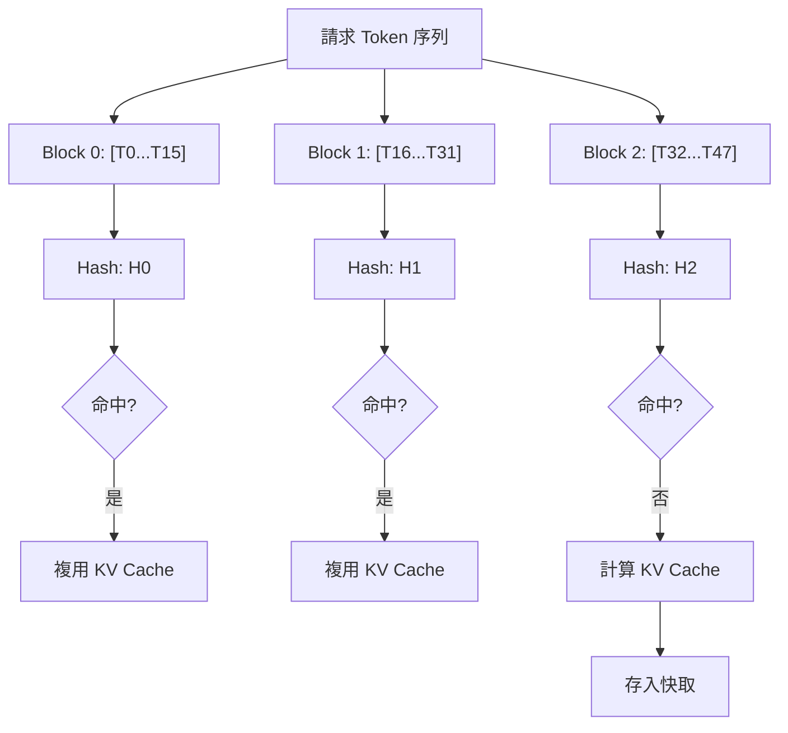
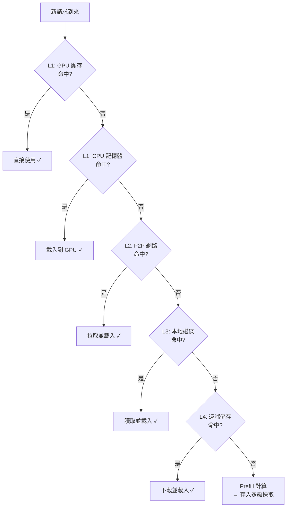

# Prefix Caching 技術詳解：從原理到 vLLM/LMCache 實踐

## 1. 引言：為什麼需要 Prefix Caching？

**Prefix Caching（字首快取）** 是一種透過快取共享字首的 KV Cache 來避免重複計算的推理最佳化技術。在大語言模型（LLM）的實際應用中，許多請求往往共享相同的**字首（Prefix）**，例如：

- **System Prompt**：同一應用的所有請求使用相同的系統指令
- **Few-shot Examples**：相同的示例在多個請求中複用
- **RAG 場景**：檢索到的文件片段被多個查詢複用
- **多輪對話**：歷史對話上下文在後續輪次中反覆出現

如果每次請求都從零開始計算這些重複字首的 KV Cache，將造成巨大的**計算浪費**。以一個 8K token 的 System Prompt 為例：

- 按照 [KV Cache 原理簡介](../01_basic/01_kv_cache_basics.md) 中的分析，Prefill 階段 Attention 部分的計算複雜度為 $O(N^2)$
- 如果每秒有 100 個請求，每個請求都重複計算這 8K token 的 KV Cache，將消耗大量 GPU 算力
- 這些重複計算本質上是**完全冗余的**——相同的輸入總是產生相同的 KV 輸出

**Prefix Caching** 正是為解決這一問題而設計的最佳化技術。其核心思想非常直觀：

> **相同的 token 序列總是產生相同的 KV Cache，因此只需計算一次，後續請求直接複用即可。**

透過 Prefix Caching，我們可以跳過字首部分的 QKV 投影和自注意力計算，將 Prefill 計算量大幅降低。例如對於一個 8K 字首 + 256 token 使用者輸入的典型場景，理論加速比可達約 $16.5\times$（詳見第 5.1 節分析），從而顯著降低 **TTFT (Time-To-First-Token)** 並提升系統吞吐量。

---

## 2. Prefix Caching 核心原理

本章將介紹 Prefix Caching 的核心原理，包括基本概念、字首匹配的約束條件以及雜湊 Key 的設計方案。

### 2.1 基本概念

Prefix Caching 的核心機制可以分為三個步驟：

1. **切分（Chunking）**：將 token 序列按固定大小切分為多個 **Chunk**（在通用概念中稱為 Chunk，在 vLLM 的 PagedAttention 實現中特指 Block）
2. **哈希（Hashing）**：為每個 Chunk 計算唯一的雜湊值作為快取 Key
3. **查詢與複用（Lookup & Reuse）**：新請求到來時，逐 Chunk 查詢快取，命中則複用，未命中則計算並儲存

```text
輸入 Token 序列: [T0,  T1,  T2,  T3,  T4,  T5,  T6,  T7,  T8,  T9,  T10,  T11]
                |----- Chunk 0 -----|---- Chunk 1 -----|----- Chunk 2 -----|
                    Hash: H0              Hash: H1            Hash: H2

快取查詢:
  - H0 命中 → 複用 Chunk 0 的 KV Cache
  - H1 命中 → 複用 Chunk 1 的 KV Cache
  - H2 未命中 → 計算 Chunk 2 的 KV Cache 並儲存
```

### 2.2 字首匹配的約束

由於 Transformer 的因果注意力（Causal Attention）機制，**後續 token 的 KV Cache 依賴於之前所有 token 的信息**。這意味著：

- Prefix Caching 必須從**序列開頭**開始逐 Chunk 匹配
- 一旦某個 Chunk 未命中，**後續所有 Chunk 都必須重新計算**
- 即使後續 Chunk 的 token 內容與快取中某條記錄相同，由於上下文不同，其 KV Cache 也不相同

```text
請求 A: [System Prompt] + [Query A]  → 快取 System Prompt 的 KV
請求 B: [System Prompt] + [Query B]  → 複用 System Prompt 的 KV ✓
請求 C: [Query C] + [System Prompt]  → 無法複用（字首不匹配）✗
```

> **注**：對於打破字首約束的非字首複用場景（如 RAG 中的亂序文件），可以使用 `CacheBlend` 等高階技術透過選擇性重算實現近似複用。

### 2.3 哈希 Key 的設計

Prefix Caching 的哈希 Key 設計直接影響快取的命中率和正確性。常見的設計有兩種：

#### 2.3.1 增量哈希

增量哈希（Incremental Hash）方案中，每個 Chunk 的哈希值**依賴於之前所有 Chunk 的內容**，形成一條雜湊鏈：

$$
H_0 = \text{Hash}(\text{Chunk}_0)
$$

$$
H_i = \text{Hash}(H_{i-1}, \text{Chunk}_i), \quad i > 0
$$

**優點**：

- 天然編碼了字首依賴關係
- 相同的 token 內容 + 相同的字首 → 相同的哈希值
- 不同的字首 + 相同的 token 內容 → 不同的哈希值

**缺點**：

- 需要按序計算，無法並行

#### 2.3.2 內容雜湊 + 位置編碼

直接對 Chunk 內容及其位置資訊計算雜湊：

$$
H_i = \text{Hash}(\text{Chunk}_i, \text{Position}_i)
$$

**優點**：

- 可以平行計算所有 Chunk 的哈希
- 適合預計算場景

**缺點**：

- 需要額外機制確保字首一致性

vLLM 和 LMCache 均采用**增量哈希**方案，以確保快取複用的正確性。

---

## 3. vLLM 的 Automatic Prefix Caching (APC)

vLLM 從 v0.4.0 開始引入了 **Automatic Prefix Caching (APC)** 功能 [1]，實現了 GPU 顯存內的高效字首快取。

> **背景知識**：vLLM 的 APC 設計深受 **SGLang** 提出的 **RadixAttention** [3] 啟發。不同之處在於，SGLang 使用 Radix Tree（基數樹）來維護 token 序列與 KV Cache 的對映關係，而 vLLM 選擇了更易於與其 Block Manager 集成的 **Hash Table（哈希表）** 方案。儘管資料結構不同，兩者在快取淘汰策略（如 LRU + 引用計數）上是高度一致的。Hash Table 方案的優勢在於查詢時間複雜度為 $O(1)$ 且易於與現有的 PagedAttention 塊管理整合，但在處理大量極短字首時可能會面臨一定的記憶體碎片化挑戰。

### 3.1 啟用方式

vLLM 支援透過命令列參數和 Python API 兩種方式啟用 APC。

```bash
# 啟動 vLLM 服務時開啟 APC
vllm serve meta-llama/Llama-2-7b-hf --enable-prefix-caching
```

```python
# 使用 Python API 時開啟 APC
from vllm import LLM
llm = LLM(model="meta-llama/Llama-2-7b-hf", enable_prefix_caching=True)
```

### 3.2 核心實現：Block Hash

vLLM 的 APC 基於 **PagedAttention**（一種將 KV Cache 分塊管理的記憶體最佳化技術）的 Block 粒度實現快取。核心資料結構是 `BlockHashToBlockMap`：

```python
# vLLM Block Hash 計算邏輯（簡化）
def hash_block_tokens(
    parent_block_hash: Optional[int],  # 父 Block 的哈希值
    curr_block_token_ids: Tuple[int, ...],  # 當前 Block 的 Token IDs
) -> int:
    """計算 Block 的哈希值，形成雜湊鏈"""
    return hash((parent_block_hash, curr_block_token_ids))
```

關鍵設計點：

1. **Block 粒度**：以 Block（通常 16-32 個 token）為快取單位，而非單個 token
2. **雜湊鏈**：每個 Block 的雜湊值依賴於父 Block，確保字首一致性
3. **引用計數**：使用引用計數管理 Block 生命周期，支援多請求共享

### 3.3 快取查詢與分配流程

當新請求到來時，vLLM 的 Block Manager 執行以下流程：

```text
1. 將請求的 Token 序列切分為 Block 大小的 Chunk
2. 從第一個 Block 開始，逐個計算雜湊並查詢快取：
   - 命中：複用已有 Block，增加引用計數
   - 未命中：分配新 Block，計算 KV Cache，存入快取
3. 標記第一個未命中的位置為 Prefill 起點
4. 僅對未命中部分執行 Prefill 計算
```



### 3.4 Prefix Caching 與混合注意力模型

對於採用混合注意力機制的模型（如 Gemma-3 的 Sliding Window + Full Attention），vLLM 的 `Hybrid KV Cache Manager` 提供了分層的 Prefix Caching 支持：

- **Full Attention 層**：標準的從左到右字首匹配
- **Sliding Window 層**：從右到左匹配，只關心最近 `sliding_window_size` 個 token
- **混合模型**：取 Full Attention 和 Sliding Window 匹配長度中的較小值作為有效匹配長度

### 3.5 局限性

vLLM 原生 APC 的主要侷限在於：

1. **僅限 GPU 顯存**：快取儲存在 GPU 顯存中，受容量限制。此外，當大量短字首快取佔據顯存時，可能導致 Block Table 碎片化，影響大 batch 的分配效率。
2. **單實例隔離**：不同 vLLM 實例之間無法共享快取
3. **重啟丟失**：行程重啟後快取完全丟失

這些侷限正是 LMCache 等外部 KV Cache 管理系統要解決的問題。下一章將介紹 LMCache 如何透過多級儲存架構突破這些限制。

---

## 4. LMCache 的多級 Prefix Caching

`LMCache` 在 vLLM APC 的基礎上，提供了**跨介質、跨實例**的 Prefix Caching 能力。

### 4.1 架構概覽

LMCache 在 vLLM 的 GPU 顯存快取（由 APC 管理）之外，提供了額外的多級儲存擴展：

| 層級 | 儲存介質                        | 典型延遲 | 應用場景     |
| ---- | ------------------------------- | -------- | ------------ |
| L1   | CPU 記憶體 (LocalCPUBackend)      | ~100 μs  | 本地擴展快取 |
| L2   | P2P 網路 (P2PBackend)           | ~1 ms    | 跨實例共享   |
| L3   | 本地磁碟 (LocalDiskBackend/GDS) | ~10 ms   | 持久化快取   |
| L4   | 遠端儲存 (Redis/S3/Mooncake)    | ~100 ms  | 叢集級共享   |

> **注**：GPU 顯存中的 KV Cache 由 vLLM 的 PagedAttention 和 APC 機制管理，LMCache 負責 GPU 顯存之外的儲存層級。此表層級編號為 LMCache 擴展儲存的編號，與經典快取層級中的 L1/L2 含義略有不同。

### 4.2 Token Hash 機制

LMCache 使用 **Token Content Hash** 作為快取 Key，與 vLLM 的 Block Hash 設計類似但更加靈活：

```python
# LMCache Token Hash 計算（簡化）
# 注意：實際實現通常使用 XXHash 等高效能確定性雜湊演算法，
# 以確保跨行程/跨實例的一致性。此處使用 hash() 僅為簡化示意。
class TokenDatabase:
    def get_cache_key(
        self,
        token_ids: List[int],
        chunk_size: int,
    ) -> List[CacheKey]:
        """將 Token 序列切分並計算增量雜湊"""
        keys = []
        parent_hash = None
        for i in range(0, len(token_ids), chunk_size):
            chunk = tuple(token_ids[i:i + chunk_size])
            chunk_hash = hash((parent_hash, chunk))
            keys.append(CacheKey(hash=chunk_hash, start=i, end=i+chunk_size))
            parent_hash = chunk_hash
        return keys
```

關鍵設計：

1. **增量確定性雜湊**：每個 Chunk 的雜湊值由當前 Chunk 的 token 內容與父 Chunk 的雜湊值共同決定，相同的字首序列始終產生相同的 Key 鏈
2. **跨實例一致性**：基於確定性雜湊演算法，同一模型的不同實例對相同 token 序列產生相同的 Key，天然支援跨實例快取共享
3. **可序列化**：Key 可以在網路中傳輸，支持分布式查找

### 4.3 多級快取查詢

LMCache 的 `StorageManager` 實現了 **Waterfall（瀑布式）** 檢索策略：



### 4.4 跨實例共享場景

LMCache 支援兩種跨實例共享模式：

#### 4.4.1 集中式共享

所有實例透過一箇中心化的快取服務（如 Redis 或 S3）進行 KV Cache 的讀寫，即 Hub-and-Spoke 模式，適合部署簡單、實例數量適中的場景。

```text
         ┌──────────────┐
         │LMCache Server│
         │ (Redis/S3)   │
         └──────┬───────┘
                │
       ┌────────┴────────┐
       │                 │
┌──────┴──────┐    ┌─────┴───────┐
│ vLLM 實例 A  │    │ vLLM 實例 B │
│ + LMCache   │    │ + LMCache   │
└─────────────┘    └─────────────┘

流程：
1. 實例 A 計算 System Prompt 的 KV Cache
2. 實例 A 將 KV Cache 寫入 LMCache Server
3. 實例 B 收到包含相同 System Prompt 的請求
4. 實例 B 從 LMCache Server 讀取 KV Cache，跳過 Prefill
```

#### 4.4.2 點對點共享

實例之間透過 P2P 網路直接傳輸 KV Cache 資料，即 Mesh 模式，由一個輕量的 Cache Controller 管理後設資料，適合對延遲敏感、實例間網路頻寬充足的場景。

```text
┌─────────────┐      P2P 傳輸      ┌─────────────┐
│ vLLM 實例 A │◄──────────────────►│ vLLM 實例 B │
│ + LMCache   │                   │ + LMCache   │
└──────┬──────┘                   └──────┬──────┘
       │                                 │
       └─────────────┬───────────────────┘
                     │
            ┌────────┴─────────┐
            │ Cache Controller │
            │  (後設資料管理)      │
            └──────────────────┘

流程：
1. 實例 A 計算 KV Cache，向 Controller 註冊後設資料
2. 實例 B 需要相同字首，查詢 Controller 獲取位置
3. 實例 B 直接從實例 A 拉取資料（支持 RDMA/TCP）
```

> **注**：在底層傳輸協議選擇上，RDMA 的典型延遲約為 1-2 μs，而傳統 TCP 約為 10-50 μs。借助 RDMA 極低的通訊開銷，可以最大化 P2P 模式在延遲敏感場景下的核心價值。

### 4.5 配置示例

以下示例展示瞭如何透過配置檔案和命令列啟動帶有多級 Prefix Caching 的 vLLM 服務。

```yaml
# LMCache 配置示例：啟用多級 Prefix Caching
chunk_size: 256 # 每個 Chunk 的 Token 數量
local_cpu: true # 啟用 CPU 記憶體快取
local_disk: /mnt/nvme/lmcache # 啟用本地磁碟快取
remote_url: redis://cache-server:6379 # 啟用遠端快取
p2p_enabled: true # 啟用 P2P 共享
```

```bash
# 啟動帶 LMCache 的 vLLM
# --enable-prefix-caching: 啟用 vLLM 內建的 Prefix Caching (顯存內)
# --kv-transfer-config: 啟用 LMCache 聯結器以支援多級快取和跨實例共享
LMCACHE_CONFIG_FILE=lmcache_config.yaml vllm serve meta-llama/Llama-2-7b-hf \
    --enable-prefix-caching \
    --kv-transfer-config '{"kv_connector":"LMCacheConnectorV1","kv_role":"kv_both"}'
```

---

## 5. 性能收益分析

本章從理論和實測兩個維度分析 Prefix Caching 帶來的效能收益，並給出最佳實踐建議。

### 5.1 理論分析

為了量化 Prefix Caching 的加速效果，建立如下簡化模型。

**假設**：

- System Prompt 長度： $P$ tokens
- 使用者 Query 長度： $Q$ tokens
- Prefill 計算複雜度： $O(N^2)$（其中 $N = P + Q$）

**無 Prefix Caching**：

每個請求都需要對完整序列執行 Prefill。由於因果注意力機制（Causal Attention）的掩碼特性，Attention 矩陣中約有一半的元素需要計算：

$$
\text{Cost}_{\text{total}} \approx \frac{1}{2}(P + Q)^2 \approx \frac{1}{2}P^2 \quad (\text{當 } P \gg Q)
$$

**有 Prefix Caching（命中）**：

字首部分的 KV Cache 直接從快取載入，跳過其 QKV 投影和自注意力計算。但字尾 $Q$ 個 token 在 Attention 時仍需訪問字首的全部 KV 資料（即每個 query token 都要 attend 到 $P$ 個字首 token 和之前的 query token）：

$$
\text{Cost}_{\text{cached}} \approx Q \cdot P + \frac{1}{2}Q^2 \approx Q(P + 0.5Q) \quad (\text{當 } P \gg Q \text{ 時，}Q^2 \text{ 項可忽略})
$$

此外還需加上快取讀取的 I/O 開銷（Cache Load）。

**加速比**（假設 $P = 8192$， $Q = 256$）：

精確的浮點運算比為：

$$
\frac{\frac{1}{2}(P+Q)^2}{Q \cdot P + \frac{1}{2}Q^2}
$$

當 $P \gg Q$ 時，分母可近似為 $Q(P+Q)$，得到一個簡潔且保守的加速比估計：

$$
\text{Speedup} \approx \frac{\frac{1}{2}(P + Q)^2}{Q(P + Q)} = \frac{P + Q}{2Q} = \frac{8448}{512} = 16.5\times
$$

> **直觀理解**：加速比 ≈ 總長度 / (2 × 使用者輸入長度)。也就是說，8K 字首 + 256 使用者輸入 → 理論加速約 16.5 倍。

可以看出，加速比近似等於字首與字尾長度比的一半 $\frac{P}{2Q}$，隨字首長度**線性增長**。這意味著字首越長、使用者 Query 越短，Prefix Caching 的收益越顯著。

### 5.2 實測資料

LMCache 官方文件提供的基準測試（as-of 2026-11 查證，模型 Qwen3-8B，long-doc-qa 基準組）：vLLM 單獨部署時平均 TTFT 為 757 ms，掛載 LMCache 后降至 185 ms（約 **-75%**）；整場基準總時長從 23.47 s 降至 13.79 s（約 **-41%**）[2]。收益隨字首長度與命中率的組合變化，實際部署前建議以自身負載複測。

### 5.3 最佳實踐

以下是在生產環境中使用 Prefix Caching 時的關鍵最佳化建議。

1. **Chunk Size 選擇**：
   - 太小：雜湊計算開銷大，快取管理複雜
   - 太大：命中粒度粗，記憶體利用率低
   - 推薦：256-512 tokens（為 vLLM Block Size 的整數倍，便於快取對齊）。實驗表明，256 tokens 的 chunk 能夠很好地平衡雜湊計算開銷（約佔總計算量的 0.1% 以下）與記憶體對齊效率。

2. **System Prompt 設計**：
   - 將穩定的指令放在前面
   - 動態內容（如使用者名稱、時間戳）放在后面
   - 避免在中間插入變化內容（會破壞後續字首）

3. **快取預熱**：
   - 服務啟動時預先計算常用字首的 KV Cache
   - 使用 LMCache Server 持久化，避免冷啟動

### 5.4 快取失效與一致性

在實際生產環境中，除了考慮快取命中，還需要妥善處理**快取失效（Invalidation）**問題。當模型權重更新（如 LoRA 熱切換或模型整體升級）時，舊版本的 KV Cache 將不再有效。為保證一致性，系統通常採用以下機制：

- **Model Version Tag**：在快取 Key 中引入模型版本或雜湊標識，隔離不同版本模型的快取空間。
- **TTL（Time-To-Live）淘汰**：為長期未訪問的快取設定過期時間，結合 LRU 策略自動清理失效資料，防止髒資料汙染。

---

## 6. 進階話題

本章討論 Prefix Caching 與其他推理最佳化技術的協同使用方式，以及在特殊場景下的擴展應用。

### 6.1 與 Chunked Prefill 的協同

[Chunked Prefill](https://docs.vllm.ai/en/latest/features/chunked_prefill.html) 將長 Prefill 拆分為多個小批次執行，與 Decode 請求交替排程。Prefix Caching 可以與 Chunked Prefill 協同工作：

- 快取命中的 Chunk 完全跳過
- 僅對未命中的 Chunk 執行 Chunked Prefill
- 進一步降低長字首場景的排程延遲

### 6.2 與 PD 分離架構的結合

在 `Prefill-Decode 分離架構` 中，Prefix Caching 可以顯著最佳化 Prefill 節點的負載：

- Prefill 節點維護熱門字首的快取
- 相同字首的請求路由到同一 Prefill 節點
- 透過 PDBackend 將 KV Cache 推送到 Decode 節點

---

## 7. 非字首複用與 CacheBlend

Prefix Caching 主要解決的是嚴格字首匹配的問題。對於 RAG 場景中檢索文件順序不固定的情況，傳統的字首快取會因為順序打亂而失效。`CacheBlend` 提供了一種創新的解決方案：

- 允許複用非字首位置的 KV Cache
- 透過選擇性重算修正 Attention 偏差
- 在複用率和計算開銷之間動態平衡

---

## 8. 總結

Prefix Caching 是 LLM 推理最佳化中的關鍵技術，透過快取和複用重複字首的 KV Cache，可以顯著降低 Prefill 計算開銷（LMCache 官方基准中 TTFT 降低約 75%，見 §5.2；實際收益取決於字首長度和命中率）。

**核心要點回顧**：

1. **原理**：相同 token 序列 → 相同 KV Cache，利用雜湊索引實現高效查詢
2. **vLLM APC**：GPU 顯存內的自動字首快取，以 Block 為粒度，使用雜湊鏈確保正確性
3. **LMCache**：多級儲存 + 跨實例共享，將 Prefix Caching 擴展到 CPU/磁碟/遠端儲存
4. **應用場景**：多輪對話、RAG、長文件處理、共享 System Prompt

**技術選型建議**：

| 場景             | 推薦方案                              |
| ---------------- | ------------------------------------- |
| 單實例、顯存充足 | vLLM APC（內建）                      |
| 單實例、顯存不足 | vLLM + LMCache（CPU/磁碟擴展）        |
| 多實例、需要共享 | vLLM + LMCache（P2P 或 Server 模式）  |
| 生產級高可用     | vLLM + LMCache（Redis/Mooncake 后端） |

---

## 9. 參考資料

### 9.1 延伸閱讀

- [KV Cache 原理簡介](../01_basic/01_kv_cache_basics.md) - KV Cache 基礎概念
- `LMCache 架構概覽` - LMCache 系統設計
- `LMCacheConnector 原始碼分析` - vLLM 整合實現
- `CacheBlend 技術詳解` - RAG 場景的非字首複用
- `Hybrid KV Cache Manager` - 混合注意力模型的 Prefix Caching

### 9.2 專案文件

- [1] vLLM Team, "Automatic Prefix Caching," _vLLM Documentation_, 2026. [Online]. Available: https://docs.vllm.ai/en/latest/features/automatic_prefix_caching.html
- [2] LMCache Team, "LMCache Documentation," _LMCache_, 2026. [Online]. Available: https://docs.lmcache.ai

### 9.3 學術論文

Prefix Caching 的核心思想與實現機制在多篇學術論文中均有探討，其中最具代表性的是 SGLang 提出的 RadixAttention 和 Prompt Cache：

- [3] L. Zheng et al., "SGLang: Efficient Execution of Structured Language Model Programs," _arXiv preprint arXiv:2312.07104_, 2023.
  - **貢獻**：提出了 **RadixAttention** 技術，透過維護 Radix Tree（基數樹）來自動管理和複用 KV Cache。vLLM 的 APC 借鑑了其 LRU 淘汰策略，但采用了 Hash Table（哈希表）作為底層資料結構。

- [4] In Gim et al., "Prompt Cache: Modular Attention Reuse for Low-Latency Inference," _arXiv preprint arXiv:2311.04934_, 2023.
  - **貢獻**：系統闡述了透過複用 Attention 狀態來加速 LLM 推理的模組化方法，驗證了其在長文字場景下的顯著收益。
