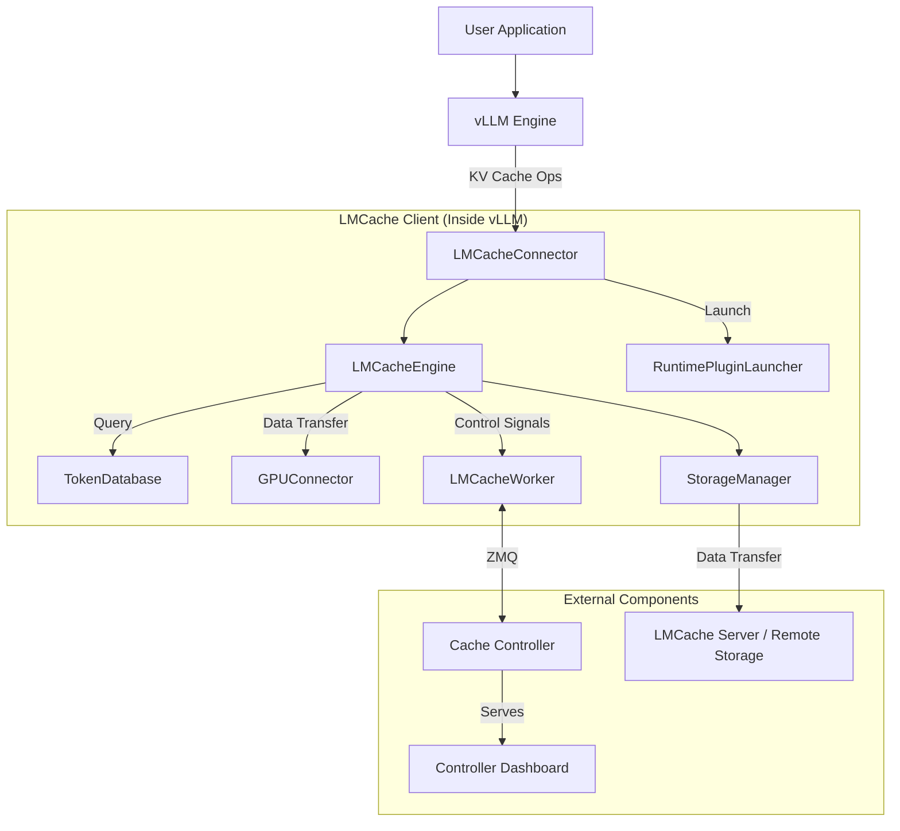

# LMCache 架構概覽

> 核對基線：LMCache v0.5.1（commit 979719d7，2026-07-02）；本文核對日期 2026-11-05

**LMCache** 是一個專為大語言模型服務引擎設計的 KV Cache 管理系統，旨在透過高效的快取機制降低 **Time-To-First-Token(TTFT)** 並提高系統吞吐量，特別是在**長上下文 (Long-Context)** 場景下表現優異。

它透過將 KV Cache 儲存在**多種介質**（GPU 顯存、CPU 記憶體、本地磁碟、遠端儲存）中，實現了跨推理實例的 KV Cache 重用。LMCache 不僅支援**字首快取(Prefix Caching)** ，還支援任意文字片段的複用，從而顯著節省 GPU 計算資源並降低使用者響應延遲。在**多輪對話**和**檢索增強生成**等場景中，LMCache 能夠帶來 `3-10` 倍的性能提升。

## 1. 概述

LMCache 透過擴展 LLM 推理引擎（如 vLLM），構建了一個跨越 GPU 顯存、CPU 記憶體以及磁碟/遠端後端的**多層級 KV Cache 儲存系統 (Multi-Tier Storage Architecture)**。

### 1.1 多層級儲存

LMCache 將儲存介質劃分為四個層級 (L1-L4)，實現了從本地記憶體到遠端服務的全方位覆蓋：

- **L1: 極速記憶體層 (Memory Tier)**:
  - **GPU Memory**: 儲存當前正在使用的活躍 KV Cache 工作集。
  - **LocalCPUBackend**: (預設) 基於本地 CPU 記憶體。**在當前架構中，它是系統強制的全域記憶體分配器 (Global Allocator)**，負責 Host Memory 的申請與回收，是所有資料流轉的必經之地。
  - **PDBackend**: (可選) 專為 **Prefill-Decode 分離**場景設計。在此模式下，它**替代** LocalCPUBackend 成為全域記憶體分配器，支援跨節點的記憶體直傳。
- **L2: 彈性互聯層 (P2P Tier)**:
  - **P2PBackend**: (可選) 基於點對點通訊，優先從其他節點的記憶體中拉取資料，速度通常快於本地磁碟。
- **L3: 本地持久層 (Disk Tier)**:
  - **NixlStorageBackend**: (可選) 高效能網路/儲存後端。它擁有**獨立的記憶體分配器**用於管理內部緩衝區 (Buffer)，但不承擔全域性分配任務。
  - **GdsBackend**: (可選) 基於 **NVIDIA GPUDirect Storage (GDS)** 的高性能持久化后端。它擁有**獨立的記憶體分配器** (CuFileMemoryAllocator) 用於管理 GDS 專用的 I/O 緩衝區 (GPU/Registered Memory)，但**不取代** LocalCPUBackend 的全局分配器地位。詳見 [GdsBackend 原始碼分析](./10_gds_backend.md)。
  - **LocalDiskBackend**: (可選) 基於本地磁碟 (NVMe SSD)，利用 `O_DIRECT` 和非同步 I/O 作為後備快取。**注意：其索引僅在記憶體維護，重啟後資料不可恢復。**詳見 [LocalDiskBackend 原始碼分析](./09_local_disk_backend.md)。
- **L4: 遠端共享層 (Remote/Shared Tier)**:
  - **RemoteBackend**: (可選) 基於中心化儲存服務 ([LMCache Server](./13_lmcache_server.md), Redis, Mooncake, S3)，用於跨實例持久化共享。

### 1.2 核心能力范式

LMCache 支援三種核心能力正規化，覆蓋了從單機加速到大規模分散式叢集的多樣化需求：

1. **本地複用 (Local Reuse)**:

   - **核心價值**: **擴展顯存，以空間換時間**。利用本地 CPU 記憶體和磁碟作為二級快取，突破 GPU 顯存容量限制。
   - **關鍵機制**: 非同步解除安裝 (Offload) 與 預取 (Prefetch)。
     - **GdsBackend / NixlStorageBackend**: 利用 GPU 直通儲存 (GDS) 技術實現零複製的極速本地 I/O。
     - **LocalDiskBackend**: 利用 O_DIRECT 和非同步執行緒池提供標準的本地磁碟快取。
   - **典型場景**: 單實例長文件推理、本地多輪對話歷史複用。

2. **叢集共享 (Cluster Sharing)**:

   - **核心價值**: **一次計算，全局可用**。在多個推理實例間共享 KV Cache，避免重複計算，提升叢集整體吞吐量。
   - **關鍵機制**:
     - **集中式**: 基於共享儲存 (**LMCache Server / Redis / Mooncake / S3**) 的 Hub-and-Spoke 模式。**NixlStorageBackend** 支援直接對接 S3 物件儲存。
     - **去中心化**: 基於 P2P (**P2PBackend**) 的 Mesh 互聯模式。
   - **典型場景**: 跨實例負載均衡、上下文遷移 (Context Migration)、多實例共享 System Prompt。

3. **流水線傳輸 (Pipeline Transmission)**:
   - **核心價值**: **計算解耦，極致延遲**。專為 Prefill-Decode 分離架構設計，實現 KV Cache 的定向、低延遲流轉。
   - **關鍵機制**: Push-based 的記憶體直傳 (PD Backend)。
   - **典型場景**: 高性能 PD 分離推理、異構叢集部署。

---

## 2. 元件架構圖

下圖展示了 LMCache 的總體架構設計，描繪了嵌入在推理引擎內部的客戶端元件 (Client) 如何與外部的控制平面 (Controller) 和資料平面 (Storage Server) 進行互動。

---

## 3. 主要元件說明

本節詳細介紹了 LMCache 的核心架構元件，涵蓋了執行於推理引擎行程內的攔截、儲存與管理模組（如 LMCacheConnector, StorageManager），以及負責全域性協調與服務的獨立行程元件（如 Cache Controller, LMCache Server）。

### 3.1 推理引擎行程內元件

這些元件直接執行在推理引擎（如 vLLM）的行程空間內，與推理引擎共享記憶體和資源。

#### 3.1.1 LMCacheConnector (LMCacheConnectorV1Impl)

`LMCacheConnector` (具體實現類為 `LMCacheConnectorV1Impl`) 是 LMCache 與推理引擎（如 vLLM）之間的橋樑。它作為 vLLM 的一個外掛執行，攔截 KV Cache 的相關操作。

**角色**：聯結器 / 介面卡
**程式碼位置**：[`lmcache/integration/vllm/vllm_v1_adapter.py`](https://github.com/LMCache/LMCache/blob/main/lmcache/integration/vllm/vllm_v1_adapter.py)
**功能**：

- **攔截**：攔截 vLLM 的 KV Cache 生成和讀取請求。
- **轉換**：將 vLLM 的內部 KV Cache 格式（如 PagedMemory）轉換為 LMCache 的通用格式。
- **轉發**：將請求轉發給核心的 `LMCacheEngine` 處理。

> 深入分析可參考：[LMCacheConnector 原始碼分析](./02_lmcache_connector.md)

#### 3.1.2 LMCacheEngine

`LMCacheEngine` 是 LMCache 的中央控制器，負責協調生命週期管理、I/O 操作和快取策略執行。

**角色**：核心引擎
**程式碼位置**：[`lmcache/v1/cache_engine.py`](https://github.com/LMCache/LMCache/blob/main/lmcache/v1/cache_engine.py)
**功能**：

- **生命周期管理**：管理 KV Cache 的儲存、檢索和預取。
- **GPU 交互**：透過 `GPUConnector` 高效地在 GPU 和 CPU 之間傳輸資料。
- **事件管理**：處理非同步 I/O 事件。

> 深入分析可參考：[LMCacheEngine 原始碼分析](./03_lmcache_engine.md)

#### 3.1.3 TokenDatabase

`TokenDatabase` 維護了 Token 序列與 KV Cache Key 之間的對映關係，是實現快取查詢的關鍵元件。

**角色**：後設資料索引
**程式碼位置**：[`lmcache/v1/token_database.py`](https://github.com/LMCache/LMCache/blob/main/lmcache/v1/token_database.py)
**功能**：

- **索引**：根據輸入的 Token 序列（Prompt）計算並查詢對應的 Cache Key。
- **樹狀儲存**：通常采用 Radix Tree 等資料結構高效儲存 Token 字首。

#### 3.1.4 GPUConnector

`GPUConnector` 負責處理不同推理引擎（如 vLLM）特有的顯存格式（如 PagedAttention）與 LMCache 通用記憶體格式之間的轉換與傳輸。

**角色**：顯存介面卡
**程式碼位置**：[`lmcache/v1/gpu_connector.py`](https://github.com/LMCache/LMCache/blob/main/lmcache/v1/gpu_connector.py)
**功能**：

- **格式轉換**：將非連續的 Paged Memory 轉換為連續的記憶體塊（或反之）。
- **資料傳輸**：執行 GPU <-> CPU 之間的高效記憶體複製（D2H / H2D）。

#### 3.1.5 StorageManager

`StorageManager` 實現了分層儲存架構，統一管理從記憶體到遠端儲存的多級後端，並執行資料讀寫策略。

**角色**：儲存管理
**程式碼位置**：[`lmcache/v1/storage_backend/storage_manager.py`](https://github.com/LMCache/LMCache/blob/main/lmcache/v1/storage_backend/storage_manager.py)
**功能**：

- **分層管理**: 統一管理 L1 (Memory), L2 (P2P), L3 (Disk), L4 (Remote) 多級後端。
- **策略執行**: 實現了 **Write-All (全寫模式)** 確保資料多級持久化，以及 **Waterfall (瀑布式檢索)** 確保優先訪問最快層級。同時支援 **LRU/LFU** 等快取逐出策略。
- **記憶體分配**: 負責協調記憶體緩衝區的分配和回收。LMCache 目前支援四種記憶體分配策略：
  - **LocalCPUBackend**: 標準模式下的預設分配器 (Host Memory)。
  - **PDBackend**: PD 分離模式下的專用分配器 (Pinned/Shared Memory)。
  - **GdsBackend**: GDS 模式下的專用分配器 (Registered Device Memory)，確保 I/O Buffer 滿足 `libcufile` 的對齊要求。
  - **NixlStorageBackend**: 高效能場景下的獨立分配器 (Registered Host/Device Memory)，用於支援零複製傳輸。
- **后端抽象**: 透過統一的介面與不同的儲存後端互動。

> 深入分析可參考：[LMCache 分層儲存架構與排程機制詳解](./05_lmcache_storage_overview.md)

#### 3.1.6 LMCacheWorker

`LMCacheWorker` 執行在推理引擎行程內部（作為 `LMCacheEngine` 的一部分），是 `Cache Controller` 在本地的代理。

**角色**：控制代理
**程式碼位置**：[`lmcache/v1/cache_controller/worker.py`](https://github.com/LMCache/LMCache/blob/main/lmcache/v1/cache_controller/worker.py)
**功能**：

- **通信**：透過 ZMQ 與遠端的 `Cache Controller` 保持長連線。
- **執行**：接收並執行來自 Controller 的指令（例如，將某段 KV Cache 從本地傳送到另一個實例）。
- **上報**：向 Controller 上報本地的快取狀態和心跳。

#### 3.1.7 RuntimePluginLauncher

`RuntimePluginLauncher` 負責在 LMCache 生命週期中載入和管理外部外掛，允許使用者透過自定義指令碼擴展系統功能。

**角色**：外掛啟動器
**程式碼位置**：[`lmcache/v1/plugin/runtime_plugin_launcher.py`](https://github.com/LMCache/LMCache/blob/main/lmcache/v1/plugin/runtime_plugin_launcher.py)
**功能**：

- **外掛載入**：根據配置掃描並啟動指定目錄下的 Python 或 Shell 外掛指令碼。
- **生命周期管理**：確保外掛行程隨主行程啟動和退出。
- **環境注入**：向外掛注入當前 Worker ID、Role 等上下文信息。

### 3.2 獨立服務行程

這些元件作為獨立的作業系統行程執行，通常部署在單獨的容器或節點上，為多個推理實例提供服務。

#### 3.2.1 Cache Controller (lmcache_controller)

`Cache Controller` 是一個獨立的行程，負責管理整個 LMCache 叢集的後設資料和控制流。

**角色**：控制平面（Control Plane）
**程式碼位置**：``lmcache/v1/cache_controller/``
**功能**：

- **全域性檢視**：維護叢集中所有 KV Cache 的位置信息。
- **指令下发**：向各推理實例的 `LMCacheWorker` 发送指令（如 `lookup`, `pin`, `move`, `clear`）。
- **負載均衡**：在多實例部署中排程 KV Cache 的遷移和複用（目前主要提供 move/pin/clear 等底層介面，自動化排程策略需外部實現）。
- **接口暴露**：提供 RESTful API 或 gRPC 介面供外部系統呼叫。

#### 3.2.2 LMCache Server (lmcache_server)

`LMCache Server` 是 LMCache 自帶的一種輕量級遠端儲存服務，用於跨機共享 KV Cache。它在架構上與 Mooncake Store、Redis 等第三方儲存後端處於同一層級。

**角色**：資料平面（Data Plane） - 預設遠端儲存後端
**程式碼位置**：[`lmcache/v1/server/__main__.py`](https://github.com/LMCache/LMCache/blob/main/lmcache/v1/server/__main__.py)
**核心功能與架構**：

- **遠端儲存後端**：為 `StorageManager` 提供標準的遠端儲存介面，負責接收並儲存來自推理實例的 KV Cache 資料，以及響應讀取請求。
- **單點記憶體架構**：目前采用**單行程、全記憶體**的儲存模型（未來計劃支援磁碟持久化）。作為中心化節點，它**不支持**分布式特性（如自動分片 Sharding、多副本 Replication 或共識演算法）。
- **高效通訊協議**：基於 TCP 實現自定義二進位制協議，針對 KV Cache 的傳輸特徵進行了最佳化，提供比通用 HTTP/RPC 更低的延遲。

**適用場景與選型建議**：

- **推薦場景**：
  - **開發與驗證**：無需部署複雜的外部儲存元件，快速搭建環境。
  - **小規模部署**：節點數量較少，吞吐量和高可用要求不苛刻的場景。
  - **低運維成本**：開箱即用，無外部依賴。
- **生產環境對比**：對於追求**高可用 (HA)**、**大規模併發**或**資料持久化**的生產環境，建議使用 `Redis` (支援叢集模式) 或 `Mooncake Store` (高效能分散式儲存) 替代。

#### 3.2.3 Controller Dashboard

`Controller Dashboard` 是一個基於 Web 的視覺化介面，用於監控 LMCache 叢集的實時狀態。

**角色**：視覺化監控看板
**程式碼位置**：``lmcache/v1/cache_controller/frontend/``
**功能**：

- **叢集監控**：展示所有連線的 LMCache 實例及其狀態（CPU/GPU 快取使用率）。
- **Worker 管理**：查看各 Worker 的詳細資訊和連線狀態。
- **實時指標**：提供系統核心指標（如 QPS、命中率等）的圖表展示。
- **訪問方式**：通常透過 Controller 啟動時的監控埠（如 9001）訪問。

---

## 4. 共享模式

LMCache 支援三種主要的 KV Cache 共享模式，使用者可以根據基礎設施條件靈活選擇。

### 4.1 集中式共享

在此模式下，所有推理實例都連線到一個統一的共享儲存後端（Shared Storage Backend），形成 **Hub-and-Spoke**（星型）架構。

- **核心機制**：**資料中心化儲存**。所有的 KV Cache 資料寫入和讀取都必須經過中心儲存節點。
- **後端選項**：
  - `LMCache Server`：LMCache 自帶的輕量級儲存伺服器，支持 TCP/RDMA。
  - `Redis`：通用的記憶體資料庫，適合小規模或測試環境。
  - `Mooncake Store`：高效能分散式儲存，支援大規模叢集。
  - `NixlStorageBackend (S3)`：直接對接 S3 等物件儲存，適合雲原生環境下的低成本、大容量共享。
- **工作流程**：
  1. **寫入**：實例 A 生成 KV Cache 后，將其推送到中心儲存後端。
  2. **儲存**：中心儲存後端持久化或在記憶體中儲存該資料。
  3. **讀取**：實例 B 需要該資料時，從中心儲存後端拉取。
- **優勢**：
  - **架構簡單**：易於部署和理解。
  - **資料持久化**：中心儲存通常具備更好的持久化能力，實例宕機不影響資料可用性。
  - **解耦**：生成者和消費者不需要同時線上。
- **劣勢**：中心儲存節點容易成為**網路頻寬瓶頸**，且存在單點故障風險。
- **適用場景**：
  - **多輪對話上下文共享**：使用者在不同時間發起的請求被路由到不同實例。
  - **跨實例複用公共字首**：如共享 System Prompt 或長文件背景。
  - **非實時共享**：對延遲要求不極端的場景。

### 4.2 點對點共享

在此模式下，推理實例之間直接進行 KV Cache 資料的傳輸，無需經過中心化的儲存後端。

- **核心機制**：采用**控制面與資料面分離**的設計。
  - **控制面**：`Cache Controller` 僅負責維護全域性後設資料（即 KV Cache 的 Key 與儲存位置的對映關係），充當“目錄服務”，**不儲存實際資料**。
  - **資料面**：實際的 KV Cache 資料由 `LMCacheWorker` 在推理實例之間透過網路直接傳輸。
- **關鍵元件**：
  - `P2PBackend`: 負責與 `Cache Controller` 互動並處理資料傳輸。
  - `Cache Controller`：負責後設資料管理和節點發現。
  - `LMCacheWorker`：負責實例間的連線建立和資料傳輸。
- **工作流程 (Multi-Tier Lookup)**：
  1. **註冊 (Register)**：實例 A 生成 KV Cache 后，透過 `P2PBackend` 非同步向 `Cache Controller` 发送 `ADMIT` 消息，註冊 KV Cache 的位置信息。
  2. **Tier 1: 本地查找 (Local Lookup)**: (開發中) 實例 B 嘗試在本地維護的後設資料快取中查詢，如果命中則直接發起連線。
  3. **Tier 2: 控制面查找 (Controller Lookup)**: 實例 B 向 `Cache Controller` 傳送批次查詢請求 (`BatchedP2PLookupMsg`)。Controller 返回持有資料的 Peer 節點地址 (如 Instance A)。
  4. **Tier 3: 確認與傳輸 (Transfer)**:
     - 實例 B 透過 **NIXL 傳輸通道** (支持 RDMA/TCP) 與實例 A 建立連線。
     - 在建立連線並請求資料時，隱式地確認資料是否存在。
     - 利用零複製技術，將資料從 Instance A 的記憶體直接傳輸到 Instance B。
- **注意 (P2P 局限性)**: 當前 P2P 實現僅支援共享**記憶體 (LocalCPUBackend)** 中的資料。若 Instance A 的資料已被逐出至磁碟，Instance B 無法透過 P2P 拉取 (將視為 Cache Miss)。
- **優勢**：消除了中心化儲存的頻寬瓶頸，充分利用叢集內部的高速網路（如 RDMA），適合大規模分散式推理場景。
- **注意**：此模式無需部署 `LMCache Server`，但必須部署 `Cache Controller`。
- **適用場景**：
  - **跨實例上下文遷移 (Context Migration)**：在負載均衡或故障恢復時，將活躍的 KV Cache 從一個實例“流轉”到另一個實例。
  - **大規模叢集內資料路由**：避免單一中心節點成為瓶頸。

### 4.3 預填充-解碼分離 (PD 分離) 模式

在此模式下，系統被明確劃分為 **Prefill (預填充)** 實例和 **Decode (解碼)** 實例。KV Cache 從 Prefill 實例單向流轉到 Decode 實例。

- **核心機制**: **Push-based 流水線**。Prefill 實例作為生產者，主動將生成的 KV Cache 推送給 Decode 實例（消費者）。
- **關鍵元件**:
  - `PDBackend`: 專用的後端，替代 `LocalCPUBackend` 作為記憶體分配器。它負責協調 KV Cache 的发送和接收。詳見 [PDBackend 原始碼分析](./08_pd_backend.md)。
  - `Global Proxy`: 全局代理，負責排程和協調 Prefill 和 Decode 實例。
- **工作流程**:
  1. **Prefill**: Prefill 實例計算完成後，`PDBackend` 並不將資料存入常規的 LRU 快取，而是直接透過底層傳輸通道 (如 TCP/RDMA) 推送到指定的 Decode 實例。
  2. **Wait**: Decode 實例在需要特定 KV Cache 時，會進入阻塞等待狀態，直到資料從 Prefill 實例到達。
  3. **Decode**: 資料到達後，Decode 實例直接使用該資料進行後續的 Token 生成。
- **區別於 P2P**:
  - **主動性**: PD 模式通常是 Push (推) 或特定的 Pipeline 排程，而 P2P 是 Pull (拉) 且基於查詢。
  - **角色**: PD 模式中節點角色固定 (Prefill vs Decode)，P2P 模式中節點是對等的。
  - **延遲**: PD 模式針對首字延遲 (TTFT) 進行了極致最佳化，通常配合全域性排程器使用。
- **適用場景**:
  - **高效能推理服務**: 追求極致的 TTFT 和吞吐量。
  - **異構叢集**: Prefill 節點使用高算力 GPU (如 H100)，Decode 節點使用低顯存頻寬 GPU (如 A10/L40)。

---

## 5. 典型工作流

本節以資料的**寫入 (Offload)** 和**讀取 (Reuse)** 為主線，串聯各元件，展示 KV Cache 在系統中的完整流轉過程。

### 5.1 Offload (寫入流程)

當推理實例（如 vLLM）完成 Prefill 階段或進行 KV Cache 驅逐時，LMCache 執行以下流程將資料持久化並共享：

1. **捕獲 (Capture)**

   - **核心邏輯**: `LMCacheConnector` 作為 vLLM 的插件，在 `save_kv_layer` 等階段攔截 KV Cache 儲存請求。
   - **程式碼位置**: [`lmcache/integration/vllm/vllm_v1_adapter.py`](https://github.com/LMCache/LMCache/blob/main/lmcache/integration/vllm/vllm_v1_adapter.py)
   - **細節**: 聯結器根據已儲存的 token 數量 (`skip_leading_tokens`) 計算本次增量儲存的 Token 範圍，生成 `store_mask`，並呼叫核心引擎介面 `store(...)`。

2. **傳輸 (Transfer)**

   - **核心邏輯**: `LMCacheEngine` 協調資源，將資料從 GPU 顯存高效傳輸到 CPU 記憶體。
   - **程式碼位置**: [`lmcache/v1/cache_engine.py`](https://github.com/LMCache/LMCache/blob/main/lmcache/v1/cache_engine.py)
   - **細節**:
     - 首先呼叫 `TokenDatabase` 根據 Token 序列計算 Chunk Hash Key。
     - 呼叫 `StorageManager` 申請 CPU 記憶體 (`MemoryObj`)。
     - 利用 `GPUConnector` 執行 D2H (Device-to-Host) 複製。注意：此步驟通常會同步等待資料完全複製到 CPU 記憶體（除非使用特殊最佳化的非同步流且目標也是 GPU），以確保後續儲存操作能讀取到有效資料。

3. **儲存 (Storage)**

   - **核心邏輯**: `StorageManager` 將資料分發到配置的儲存後端（分層儲存）。
   - **程式碼位置**: [`lmcache/v1/storage_backend/storage_manager.py`](https://github.com/LMCache/LMCache/blob/main/lmcache/v1/storage_backend/storage_manager.py)
   - **細節**: `StorageManager` 按照初始化的優先順序順序，遍歷所有激活的儲存後端並提交任務。
     - **記憶體分配器說明**:
       - **Global Allocator**: 預設使用 **LocalCPUBackend** (或 PD 模式下的 PDBackend)。所有 KV Cache 必須先寫入它分配的 Host Memory。
       - **Internal Allocator**: **GdsBackend** 和 **NixlStorageBackend** 使用自己的 Allocator 分配傳輸緩衝區。`StorageManager` 會將資料從 Host Memory 複製到這些緩衝區中，然後再執行底層寫入。這意味著在當前架構下，**無法完全繞過 CPU 記憶體**。
   - **後端優先順序** (初始化與呼叫順序):
     1. **PDBackend**: (僅在 PD 模式啟用) 優先順序最高，作為 Allocator。
     2. **LocalCPUBackend**: (預設) 核心記憶體後端。若啟用 PD 模式且未顯式配置 `local_cpu=True`，則會被跳過。
     3. **P2PBackend**: (僅在 P2P 模式啟用) 優先順序高於磁碟/遠端。**注意**: P2P 模式依賴 LocalCPUBackend 存在。
     4. **NixlStorageBackend**: (可選) 專為高效能網路/DPU 最佳化的儲存後端。
     5. **LocalDiskBackend**: 若配置了本地磁碟路徑。
     6. **GdsBackend**: 若啟用 GPUDirect Storage。
     7. **RemoteBackend**: 遠端後端 (Redis/Mooncake/LMCache Server)。
     8. **Storage Plugins**: 自定義外掛後端。沒有統一的 `PluginBackend` 類，經 `config.storage_plugins` 宣告名字、由 `extra_config` 提供 `module_path`/`class_name` 動態載入（`lmcache/v1/storage_backend/__init__.py` 的 `storage_plugin_launcher`）。
     9. **AuditBackend**: (可選) 審計包裝器，用於記錄 I/O 操作日志。
   - **併發寫入**: `batched_put` 會向所有激活的後端併發提交任務。例如，資料會同時被寫入本地記憶體（同步更新索引）、提交給磁碟寫入執行緒（非同步）以及傳送給遠端伺服器（非同步）。

4. **发布 (Publish)** (僅 P2P 模式)
   - **核心邏輯**: 本地儲存完成後，非同步通知 Cache Controller 更新後設資料。
   - **程式碼位置**: [`lmcache/v1/storage_backend/local_cpu_backend.py`](https://github.com/LMCache/LMCache/blob/main/lmcache/v1/storage_backend/local_cpu_backend.py)
   - **細節**: 當資料成功存入 `LocalCPUBackend` 后，其內部會透過 `BatchedMessageSender` 構造 `ADMIT` 消息，並經由長連線非同步傳送給 `Cache Controller`。Controller 收到后更新全局路由表，使其他實例能感知到該資料的存在。

### 5.2 Reuse (讀取流程)

當新請求到達推理實例時：

1. **哈希 (Hashing)**: `LMCacheConnector` 根據 Prompt 的 **Token IDs** 計算 KV Cache 的 Key (Hash)（注意：LMCache 接收的是分詞後的 Token 序列，而非原始文本）。
2. **查找 (Lookup)**: `LMCacheEngine` 向 `StorageManager` 查詢資料位置：
   - **本地查找**: 檢查本地記憶體或磁碟。
   - **遠端/P2P 查找**: 若本地未命中，透過 `P2PBackend` 查詢 `Cache Controller` (獲取持有該資料的對端地址) 或查詢 `RemoteBackend`。
3. **拉取 (Retrieval)**:
   - **命中本地**: 直接從記憶體/磁碟讀取。
   - **命中遠端**: 從 `LMCache Server` (或 Redis/Mooncake) 下載。
   - **命中 P2P**: `P2PBackend` 透過底層傳輸通道 (如 TCP/RDMA) 與持有資料的對端實例建立連線，直接拉取資料。
4. **載入 (Load) & 提升 (Promotion)**:
   - **資料載入**: 資料從後端被讀取到記憶體（標準模式為 CPU 記憶體；GDS/Nixl 模式直達 GPU 顯存）。
   - **自動提升**: 資料物件的引用 (Reference) 會被註冊到 `LocalCPUBackend`，避免重複 I/O。
   - **最終傳輸**: 若資料在 CPU，則由 `LMCacheEngine` 傳輸至 GPU；若已在 GPU 則直接複用。
5. **解碼 (Decode)**: vLLM 引擎複用 KV Cache，跳過 Prefill 計算，直接開始 Decode 階段。

---

## 6. 儲存後端選型指南

LMCache 提供了豐富的儲存後端以應對不同的硬體環境和業務需求。

> 詳細的場景分析、後端組合方案及優劣勢對比，請參閱 **[儲存架構概覽 - 典型部署場景與選型指南](./05_lmcache_storage_overview.md#4-典型部署场景与后端组合)**。

> 在 Kubernetes 側基於 LMCache 做 KV 分層的編排方案，參見 [云原生高性能分布式 LLM 推理框架 llm-d 介紹](../../../../04_cloud_native_ai_platform/k8s/05_llm_d_intro.md)。

---
